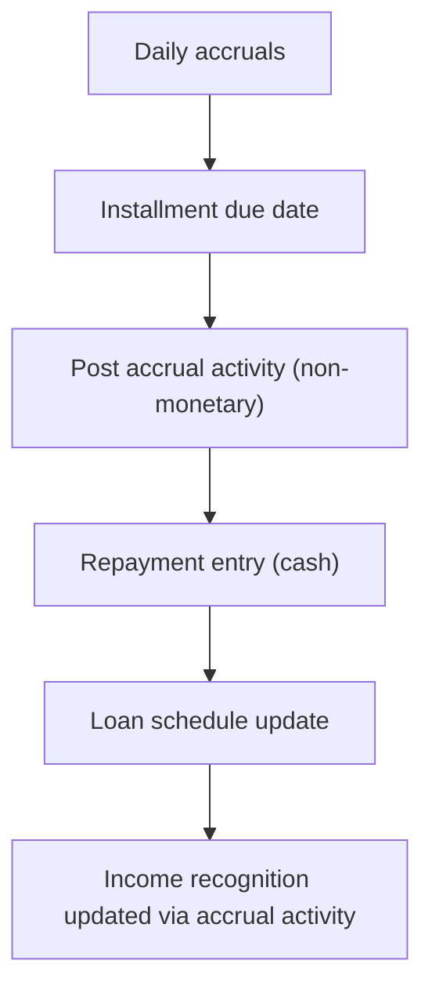

# Accrual Activity Posting on Installment date

This page documents the behavior and calculations associated with the introduction of a new non-monetary transaction type named accrual activity transaction. The accrual activity transaction is posted on the Installment due_date and applies to the Installment’s INCOME portion. It records accrual-related income without moving cash, and it interacts with the existing daily accrual and repayment processing to shape the repayment schedule and income recognition.

### Conceptual overview

- New transaction type: accrual activity. It is non-monetary and is used to reflect accruals in the context of an installment without cash movement.
- Posting date: the Installment due_date. On this date, the accrual activity transaction is created to represent income accrual for the installment.
- Scope of effect: accrual activity contributes to the recognition of income in the installment’s schedule, and it may influence the composition of the repayment entry that settles that installment. Cash remains unchanged by the accrual activity transaction itself; cash movements occur when repayments are made against the loan and are recorded as usual in the cash-based ledger.

### Processing implications and relationships

The accrual activity transaction sits in the accrual processing flow between daily accrual accruals and the actual repayment entries. On the installment due date, an accrual activity record is posted with a defined amount that affects the INCOME portion of the installment. A subsequent repayment entry may occur on the same date or later, allocating cash to principal and interest; the repayment will reflect the cash flow while the accrual activity records the non-cash income recognition.

The reference scenarios illustrate how accrual activity interacts with the repayment schedule and the EMI (installment) line items. In all scenarios, the EMI remains the scheduled amount for the installment, while accrual activity contributes to the income side and is settled through the repayment entry.

### Calculation references and observed scenarios

The following scenarios provide concrete examples of accrual activity posting on installment dates and how they interact with repayment entries. Each scenario uses the same baseline disbursement and daily accrual context and highlights how accrual activity amounts map to the income component and to the subsequent cash repayment.

#### Scenario 1 – On-time payment with accrual activity of 20
- Context: The installment due_date has an accrual activity posting with an amount of 20.
- Key figures:
 - Accrual activity date: 2/1/22
 - Accrual activity amount: 20
 - Accrual activity principal: 0
 - Accrual activity interest: 20
 - Installment Date: 2/1/22
 - EMI (scheduled repayment): 220
 - Repayment on 2/1/22: principal 200, interest 20
- Interpretation: On the installment due date, 20 of income is accrued (non-cash) and is represented as part of the income component for the installment. A cash repayment of 220 on the same date reduces the loan principal by 200 and clears 20 of interest, matching the EMI of 220.

| Item | Value |
|---|---|
| Accrual activity date | 2/1/22 |
| Accrual amount | 20 |
| Accrual principal | 0 |
| Accrual interest | 20 |
| Installment Date | 2/1/22 |
| EMI (scheduled) | 220 |
| Repayment (date) | 2/1/22 |
| Principal paid | 200 |
| Interest paid | 20 |

#### Scenario 2 – Early payment with accrual activity of 10
- Context: The installment due_date has an accrual activity posting with an amount of 10.
- Key figures:
 - Accrual activity date: 2/1/22
 - Accrual activity amount: 10
 - Accrual activity principal: 0
 - Accrual activity interest: 10
 - Installment Date: 2/1/22
 - EMI (scheduled repayment): 220
 - Repayment on 2/1/22: principal 210, interest 10
- Interpretation: The accrual activity adds 10 of income on the installment due date without cash movement. The cash repayment on the same date allocates 210 to principal and 10 to interest, maintaining the EMI at 220.

| Item | Value |
|---|---|
| Accrual activity date | 2/1/22 |
| Accrual amount | 10 |
| Accrual principal | 0 |
| Accrual interest | 10 |
| Installment Date | 2/1/22 |
| EMI (scheduled) | 220 |
| Repayment (date) | 2/1/22 |
| Principal paid | 210 |
| Interest paid | 10 |

#### Scenario 3 – Early part payment reversal (with accrual activity and reversal)
- Context: This scenario demonstrates reversal of an earlier part payment accrual and its effect on the repayment schedule.
- Timeline and key figures (highlights):
 - Daily accrual entries accumulate prior to the reversal period.
 - On 1/16/22, a repayment occurs with total 220, allocating 210 to principal and 10 to interest (before reversal effects).
 - A reversal of an earlier accrual (daily accrual-reversed) is recorded on 1/16/22, followed by an accrual re-application (daily accrual - replayed) with adjusted values (0.6) in the same or near-term window.
 - After reversal events, the repayment schedule shows the consolidated outcome consistent with the scenario’s intended effect on the installment’s income component and the cash repayment.
- Representative figures (summarized):
 - Repayment on 1/16/22: total 220, principal 210, interest 10
 - Accrual reversal and replayed accrual entries occur around 1/16/22 with matching adjustments to the accruals before and after reversal.

| Event | Date | Total | Principal | Interest |
|---|---|---|---|---|
| Repayment (before reversal) | 1/16/22 | 220 | 210 | 10 |
| Daily accrual-reversed | 1/16/22 | 0.67 | 0 | 0.67 |
| Daily accrual - replayed | 1/16/22 | 0.6 | 0 | 0.6 |
| Repayment (after reversal) | 1/16/22 | 220 | 210 | 10 |

- Interpretation: The reversal sequence removes the previously recorded accrual and re-applies accrual thoughtfully, resulting in the repayment still aligning with the installment’s EMI while verifying the income and accrual balances reflect the reversal and replay of accruals.

### Diagram: accrual activity flow on installment dates

Below is a compact visualization of the end-to-end flow from prior daily accruals through accrual activity posting on the installment date, to the repayment event and the resulting impact on schedules and income recognition.

### Data and traceability considerations

- The accrual activity transaction is explicitly non-monetary; it records an accrual to the Income component on the installment date, without cash movement.
- The replication in the repayment entry preserves the EMI amount while distributing cash against principal and interest as usual.
- When reversals or replays of accrual occur (as in Scenario 3), the system reconciles the accrual ledger with the repayment schedule to maintain consistent balances and income recognition.

### Architectural and behavioral notes

- Scope: The enhancement introduces a dedicated accrual activity transaction type within the accrual processing pathway. It operates on the installment’s income recognition without altering cash balances.
- Interactions: Accrual activity complements daily accruals and repayment processing. It does not replace or alter the fundamental cash-flow mechanics for repayments; instead, it provides an additional, non-cash artifact for income accrual that follows the installment’s schedule.
- Data consistency: Throughout the scenarios, the repayment allocations (principal vs. interest) remain consistent with the EMI, while accrual activity contributes to the income side on the installment date. Reversals and replays must preserve the integrity of the repayment schedule and the accrued income balance.

### What changed for downstream consumers

- No cash movement is introduced by accrual activity itself; the effect is on income recognition and the interpretation of the installment’s schedule in reporting and accounting views.
- The three scenarios illustrate how accrual activity interacts with on-time, early, and reversal scenarios, verifying predictable outcomes for the repayment schedule and income reporting.

### Summary of verified behavior

- A new non-monetary accrual activity transaction is posted on the Installment due_date for the Installment’s INCOME portion.
- The EMI remains the same as the scheduled installment (e.g., 220 in the scenarios shown).
- Accrual activity amounts (e.g., 20 or 10) are recorded as income components on the installment date and are settled through the cash repayment subsequently observed in the repayment entry.
- Reversals and replays of accruals are supported to preserve consistency of the repayment schedule and income balances.

This documentation reflects the verified behavior and numerical patterns demonstrated in the reference scenarios, and it presents the resulting effects on repayment schedules and income recognition without introducing unverified assumptions.