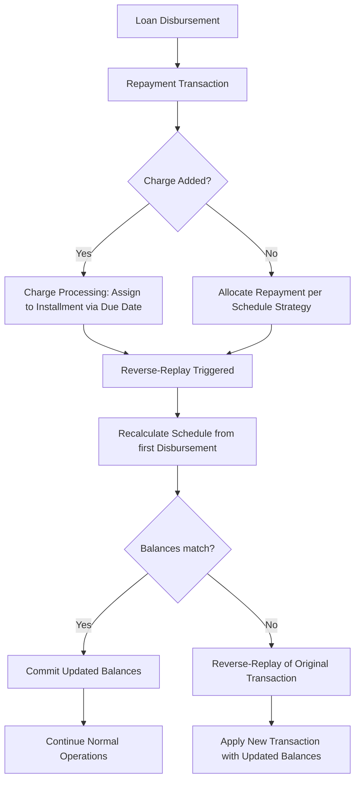

# Payment strategy by timely order

This page documents the time-respective repayment strategy implemented for the repayment and allocation subsystem. The feature governs how repayments and charges are allocated across loan installments, with explicit rules for how transaction dates and charge due dates drive allocation decisions, how allocations are recomputed when new transactions or charges occur, and how the system maintains consistent balances and income accounting through reverse-replay processes.

Technical scope and design guarantees
- Role and boundaries: The component sits in the loan repayment and allocation domain and enforces a time-respective allocation policy. It determines how a repayment amount is distributed across an installment's components (charges, principal, penalties, fees, interest) and how charges are accounted against installments in relation to their due dates. The design distinguishes between transactions (consisting of a repayment) and charges (fees/penalties that may be due) and uses the transaction date for repayments and the due date for charges when distributing amounts.
- Allocation guarantees: When a repayment transaction is executed or a charge is added, the system allocates the payment according to the current repayment strategy. If an installment has unpaid balances, the repayment amount is distributed following the strategy's priority order.
- Recalculation and integrity: The system supports a reverse-replay mechanism. When a repayment transaction is executed or a charge is added, the entire repayment schedule is recalculated starting from the first disbursement, resetting installment balances and re-applying the current strategy to distribute repayments anew. If the resulting balances differ from the originally recorded balances, the original transaction is reverse-replayed and the new transaction inherits the same properties but with updated balances. Charges are considered in advance of transactions during the reprocessing window and may trigger a replay to verify that charges are addressed in the correct order.
- Domain concepts evidenced by the reference data: The allocation strategy uses a defined order for allocating amounts to installment components and distinguishes between due charges and in-advance principal as part of the repayment flow. The referenced material also documents scenarios in which repayments are made before or after charge due dates and how those actions affect the balance and the allocation across principal and charges.

Key concepts and data points
- Transaction vs. charge: Repayments use the transaction date for allocation; charges use the due date for allocation decisions. This distinction is fundamental to how the schedule evolves when new repayments or new charges are introduced.
- Installment components and priorities: Installments consist of several components that may be due or outstanding. The specific components mentioned in the reference include due charges, in-advance principal, penalties, fees, interest, and principal. The strategy defines the allocation order among these components.
- Reverse-replay flow: When a transaction is executed or a charge is added, a reprocessing pass reconstructs the repayment schedule from the earliest disbursement onward, re-distributing repayments under the current strategy. If the reprocessing yields different balances than those stored previously, the system performs a reverse-replay of the original transaction and applies the new transaction with updated balances.

Allocation rules and sequencing
- Current behavior (verified): On a repayment transaction, the system distributes the transaction amount according to the target repayment installment and the existing strategy. The distribution is conditioned by the installment having unpaid balances. The source indicates the inclusion of a prioritised distribution across penalty, fee, interest, and principal components, with the date used for allocation determined by whether the item being allocated is a transaction (transaction date) or a charge (due date).
- New prioritised order (verified design): The repayment strategy introduces a fixed ordering for how allocations occur when paying an installment. The order is:
 1) Due charges
 2) In advance principal
 3) Penalty
 4) Fee
 5) Interest
 6) Principal
 This order governs how a repayment amount is consumed across the components of the targeted installment, paying attention to any unpaid but due charges before applying funds to principal or other components.

Reference scenarios illustrating the new order
- New Behaviour #1
 | Transaction ID | Transaction Type | Business date | Transaction date / Due date | Amount | Principal | Charges | Outstanding | Notes |
 | 1 | Disbursement | 01/01/2022 | 01/01/2022 | 1000 | 1000 | 0 | 0 | |
 | 2 | Repayment | 10/01/2022 | 10/01/2022 | 500 | 500 | 0 | 500 | ← NO REVERSE-REPLAY |
 | 3 | Charge | 15/01/2022 | 20/01/2022 | 50 | 0 | 50 | 550 | |
 | 4 | Repayment | 17/01/2022 | 17/01/2022 | 450 | 450 | 0 | 100 | Not paying the charge, it is not due yet |
 | 5 | Repayment | 21/01/2022 | 21/01/2022 | 50 | 0 | 50 | 50 | Paying the charge, it is already due |
 The example shows a repayment that first reduces the principal, and later a repayment that allocates to the outstanding charge, reflecting the priority order and the timing of charge due dates.

- New Behaviour #2
 | Transaction ID | Transaction Type | Business date | Transaction date / Due date | Amount | Principal | Charges | Outstanding | Notes |
 | 1 | Disbursement | 01/01/2022 | 01/01/2022 | 1000 | 0 | 0 | 1000 | |
 | 2 | Repayment | 10/01/2022 | 10/01/2022 | 500 | 500 | 0 | 500 | ← NO REVERSE-REPLAY |
 | 3 | Charge | 15/01/2022 | 20/01/2022 | 50 | 0 | 50 | 550 | |
 | 4 | Repayment | 17/01/2022 | 17/01/2022 | 100 | 100 | 0 | 450 | Not paying the charges, it is not due yet |
 | 5 | Charge | 19/01/2022 | 23/01/2022 | 10 | 0 | 10 | 460 | |
 | 6 | Repayment | 20/01/2022 | 20/01/2022 | 100 | 50 | 50 | 360 | Paying the 1st charge, it is due on the day and the remaining amount goes to the in advance principal; Not paying the 2nd charge, it is not due yet |
 This demonstrates the ability to apply portions of repayments to charges when due and advance principal when standard, while tracking outstanding balances.

- New Behaviour #3
 | Transaction ID | Transaction Type | Business date | Transaction date / Due date | Amount | Principal | Fees | Outstanding | Notes |
 | 1 | Disbursement | 01/01/2022 | 01/01/2022 | 1000 | 0 | 0 | 1000 | |
 | 2 | Repayment | 10/01/2022 | 10/01/2022 | 500 | 500 | 0 | 500 | ← NO REVERSE-REPLAY |
 | 3 | Charge | 15/01/2022 | 20/01/2022 | 50 | 0 | 50 | 550 | Not paying the charge, it is not due yet |
 | 4 | Repayment | 17/01/2022 | 17/01/2022 | 550 | 500 | 50 | 0 | Paying the charge, it is not due yet, but paying in advance |
 This scenario illustrates paying the in-advance principal portion first, then the charge portion when a repayment occurs before the charge due date, leading to a zero balance in the installment.

Note: These behaviour summaries reflect the verified scenarios described in the reference material and show how the new order interacts with charges and repayments across the installment lifecycle.

Calculation references and schedules (-based examples)
- Calculation reference: Fineract Payment Allocation Use Cases (DE, PayIn30) provide structured examples across multiple scenarios with explicit dates, amounts, and balance evolutions. The use cases demonstrate how Disbursement, Snooze, Real Time Repayment, and charges interact to produce changes in Principal, Penalties, Fees, and the overall installment balance. See the UC sections for concrete numbers and balance evolution across scenarios.
- Calculation reference (repeatable): The companion calculation table set documents the same scenarios in two formats, reinforcing the observed allocation behaviour and balance updates under the time-respective strategy.

Representative calculation walkthroughs (illustrative, grounded in the reference data)
- Scenario: New Behaviour #3 (summary): Disbursement: 1000; Repayment: 500; Charge: 50; Repayment: 550. The repayment of 550 pays 500 to principal and 50 to charges, resulting in an installment balance of

0. This demonstrates the priority of tackling the charge amount within a repayment when due or already due, followed by reduction of principal, under the new order.
- Scenario: New Behaviour #1 (summary): Disbursement: 1000; Repayment: 500 (to principal); Charge: 50; Repayment: 450 (to principal); Repayment: 50 (to charges). The sequence shows that the repayment after the charge may be allocated to principal first, then the remaining amount can be allocated to charges, depending on whether the charge is due and the timing of the repayment.

Allocation methodology (formula-like description)

 
Calculation

 
<strong>Context:</strong> Allocation of a repayment amount to an installment's components follows the fixed priority order: Due charges, In advance principal, Penalty, Fee, Interest, Principal.

 
<strong>Formula:</strong> For a repayment amount T applied to an installment with component balances [DueCharges, InAdvancePrincipal, Penalties, Fees, Interest, Principal], repeatedly do:
 - allocate = min(T, currentComponentBalance) to the current component in order
 - T = T - allocate
 - move to next component if T > 0
 - stop when T == 0 or all components are fully funded

 
<strong>Substitution (example):</strong> If T = 550, and the installment has DueCharges = 50, InAdvancePrincipal = 100, Penalties = 0, Fees = 0, Interest = 0, Principal = 400, then allocations proceed as:
 - To DueCharges: min(550, 50) = 50; T -> 500
 - To InAdvancePrincipal: min(500, 100) = 100; T -> 400
 - To Principal: min(400, 400) = 400; T -> 0
 Result: Charges paid, part of advance principal paid, remaining principal settled.

 
<strong>Result:</strong> The remaining balances reflect the allocations in the defined order, respecting the traceable sequence and the payment amount.

Note: The exact numeric paths depend on the balances present in the targeted installment at the time of the repayment and any charges due or in advance. The above demonstrates how the method corresponds to the observed scenarios in the reference data.

Mermaid diagram: reverse-replay and allocation flow

Operational notes and edge cases
- Reverse-replay scope: The replay process starts from the first disbursement and rebuilds installment balances. It re-applies the current repayment strategy to distribute repayments, so that the charge-related allocations can be honored even when a transaction or charge is added after the fact.
- Charge timing and allocation: Charges are associated with their due dates (or other specified due dates for specific charge types). If a repayment arrives after the due date and the strategy prioritises due charges, the system will allocate to those charges before addressing principal, provided the remaining repayment amount permits.
- Oldest-first considerations: In some scenarios (for penalties, where evidenced), the allocation decision may emphasise oldest outstanding penalties. The explicit examples in the reference material demonstrate how the system can structure the allocation to reflect such ordering when required by the data, though the primary staged order remains: Due charges → In advance principal → Penalty → Fee → Interest → Principal.
- Journal and accounting implications: The descriptions emphasize that allocations affect income recognition through how fees, penalties, and other charges are paid over time. When a sequence of repayments and charges results in changes to the allocation to income-bearing components, the system re-evaluates the distribution to preserve consistent accounting results. Where balances are updated, the calculations and allocations reflect the verified sequence described above.
- End-to-end integrity: The integrity checks require that each period’s opening balance equals the previous closing balance and that allocations reconcile against the transaction amounts. The documented behavior includes precise balance transitions in the reference scenarios to illustrate the expected consistency.

High-level design and design notes
- Time-respective repayment strategy: The design specifies that repayments are allocated by the repayment transaction date, while charges use the charge due date for allocation. The strategy’s ordering determines how funds are applied when multiple components are outstanding.
- New priority ordering: The updated priority order to support timely payment behavior is explicitly documented as: Due charges, In advance principal, Penalty, Fee, Interest, Principal. This order is intended to verify that charges and related income are recognized in a temporally consistent manner, particularly where charges accrue or are added after the initial repayment, and where reverse-replay may adjust allocations after the fact.
- Reverse-replay mechanism: Reprocessing is triggered by a new transaction or a new charge. The mechanism reconstitutes the installment balances and re-applies the current strategy, potentially reversing previously recorded repayments in order to reallocate correctly under the updated conditions. If the reprocessed balances do not match the previously stored values, the system marks the original transaction for reversal and applies the new transaction with updated balances.

Reference calculations and schedules (-based examples)
- Fineract Payment Allocation Use Cases (DE region, PayIn30 product): The reference calculations describe the interaction of repayments, charges, and various components (principal, penalties, fees) across multiple scenarios (UC1 through UC12). The sheets present the same data in two formats to illustrate how charge due dates and transaction dates influence allocation decisions and how repayments distribute across components.
- Calculation reference summary: The documented use cases consistently show that charges are treated per their due date, repayments per their transaction date, and that the allocation order and reverse-replay behavior determine the evolution of the installment balances and the overall loan schedule.

References to the specification
- Time respective repayment strategy: The core goals and behavior are described in the reference specification. It documents the ordering of components for repayment allocation, the reverse-replay mechanism, and the handling of charges and advance principal within the repayment lifecycle. The specification emphasizes that fee income can be affected by backdated transactions or reversed/replayed distributions, which motivates the design of the time-respective strategy and the reverse-replay logic.

Additional notes for implementation context
- The described behaviors are verified by the reference scenarios, including explicit balance evolutions and notes about reverse-replay outcomes. The design verifies that allocations are traceable, auditable, and consistent across schedule recalculations, with the primary guarantee that the allocation sequence and resulting balances reflect the current strategy and the timing semantics of repayments and charges.

Glossary of terms used in this page
- Due charges: Charges that are currently due (or overdue) and eligible to be paid from a repayment amount according to the strategy.
- In advance principal: Principal that is paid in advance of the scheduled principal due date, as permitted by the strategy.
- Penalty: Penalties assessed for late or other breaches of terms, payable from repayments when allocated.
- Fee: Fees associated with the loan that can be allocated from repayments.
- Interest: Interest due as part of the installment, subject to allocation by the strategy.
- Principal: The remaining loan principal component of an installment.
- Reverse-replay: The process of recalculating the repayment schedule after a new transaction or charge to preserve consistency of balances and income allocations.

End of documentation