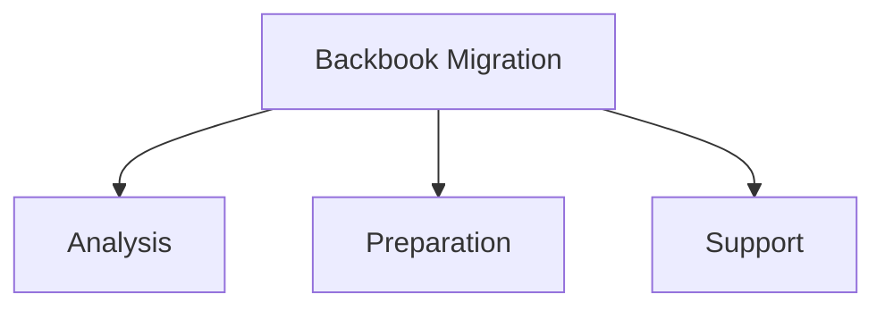

# Backbook Migration - Analysis, Preparation & Support

This publication documents the Backbook Migration work item within the Pepper-Soup project. It is classified as a work_item and located under Migration > Backbook migration > Backbook Migration - Analysis, Preparation & Support. The work item is organized into three facets: analysis, preparation, and support. The reference indicates there are 43 children within this work item, spanning these areas.

### Scope and Decomposition

The work item is decomposed into three primary sub-areas, which collectively guide the analysis, preparation, and ongoing support activities for the Backbook migration effort. within the reference data confirms the decomposition into analysis, preparation, and support components.

- Analysis
- Preparation
- Support

### 

The reference data provides the following evidences:
- Content type: page
- Feature ID: backbook-migration-analysis-preparation-support
- Navigation path: Migration > Backbook migration > Backbook Migration - Analysis, Preparation & Support
- Classification: work_item
- Children: analysis, preparation, support

### Observations

The available does not specify concrete implementation details, class mappings, configuration properties, acceptance criteria, or architectural decisions beyond the three sub-areas. The reference establishes the high-level decomposition into analysis, preparation, and support.

### Audience

Audience: contributors. This page is intended for backend Java engineers, integrators, and Fineract contributors.