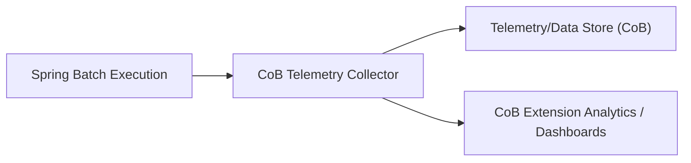

# Spring Batch - Ph3 [CoB extension]

The Spring Batch - Ph3 [CoB extension] page describes the third phase of the Spring Batch rework within the CoB extension, focusing on collecting and tracking the execution of Spring Batch changes to extend CoB functionality. This page documents verified architectural intent and observed processing behavior as part of the platform’s Batch and CoB program.

### Overview

The objective of this epic is to collect and track the execution of Spring Batch changes to extend CoB functionality. The initiative is described as a Spring Batch rework with a decomposition into 16 child tasks. The primary outcome is to provide observable execution data for the CoB extension, enabling improved monitoring, analysis, and accountability of batch executions as they relate to CoB capabilities.

### Scope and notes

- Classification: enhancement. The work focuses on instrumentation and telemetry for Spring Batch executions to support the CoB extension.
- Navigation context: Platform and Architecture > Batch and CoB > Spring Batch - Ph3 [CoB extension].
- Specification notes indicate a Spring Batch rework with 16 children. No additional technical details are provided in this publication.

### Conceptual processing model

The materialized behavior targets collection and tracking of execution data associated with Spring Batch activities within the CoB extension. In practice, this implies instrumentation that observes batch executions, captures relevant timing and outcome information, and associates this data with CoB telemetry contexts. The collected data is intended to support monitoring and analysis for CoB-related functionality, feeding into dashboards or reports used by platform operators and contributors.

The following high-level flow reflects the verified conceptual behavior:

1) A Spring Batch job or step executes within the platform.
2) The CoB extension instrumentation captures execution events, including timestamps and outcome signals (e.g., success or failure).
3) Captured events are associated with a CoB telemetry context that ties batch activity to CoB extension observations.
4) Telemetry data is retained for monitoring, analysis, and reporting purposes in the CoB extension ecosystem.

This description represents the observable processing pattern without asserting any specific implementation details, API signatures, or database schemas beyond the scope of the verified goal to collect and track execution data.

### Diagram: high-level data flow

### Considerations for engineers

- API surface changes: This page documents the architectural intent and observable processing behavior. No public API surface changes are described here. If APIs are introduced or modified as part of this epic, those specifics will be documented in a separate, verified surface-signed publication.
- Persistence and schema: The description focuses on the collection and tracking behavior. No database schema details are provided in this publication.
- Interactions with existing CoB telemetry: The extended batch tracking integrates with the platform’s CoB telemetry approach. Implementers should align instrumentation with established CoB telemetry patterns and data models.

### Validation and verification guidance

To verify the verified behavior described herein, practitioners should confirm that execution data for Spring Batch activities is observed and correlated with CoB telemetry contexts. Specifically:
- For each Spring Batch execution observed, a associated telemetry event is generated and linked to the relevant CoB extension context.
- The lifecycle of the observed execution (start time, end time, and outcome) is captured and available for aggregation in CoB dashboards.
- The overall observation mechanism accommodates the rework’s decomposition into 16 child tasks, as indicated by the specification notes.

These checks verify alignment with the stated goal of collecting and tracking execution data to extend CoB functionality. They do not imply any particular UI, API, or database implementation specifics beyond the verified behavior.

### Relationship to the broader program

This Ph3 effort sits within the Platform and Architecture domain’s Batch and CoB initiatives. It advances the observability and traceability of Spring Batch changes as they pertain to CoB extension capabilities, enabling more informed operational decisions and easier auditing of batch-driven CoB processes.