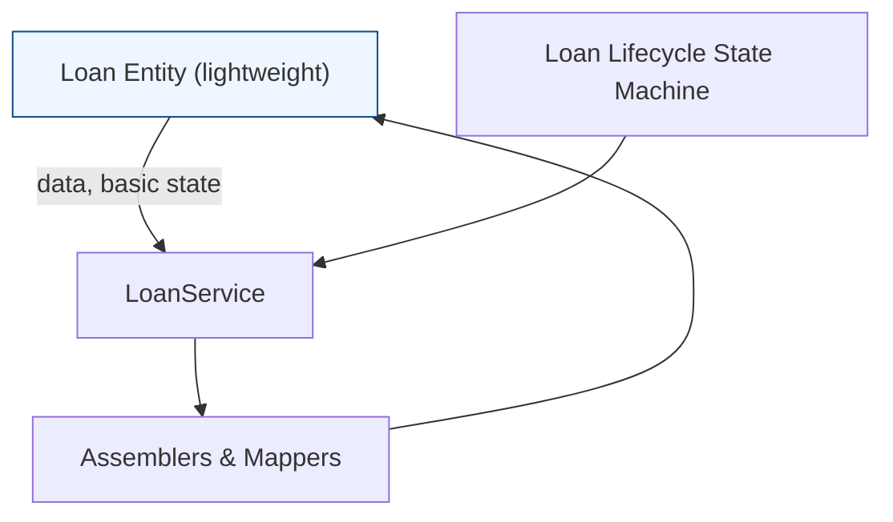

# Interest bearing Progressive Loan performance improvements

### Precise technical summary
The refactor targets the architectural erosion caused by a monolithic Loan entity that currently comprises 7200+ lines of logic. The primary objective is to extract business logic from the Loan entity into distinct, well-scoped components—namely services, assemblers, and mappers—so the entity retains only its fields, accessors, and lightweight state manipulation methods. This separation is intended to reduce deserialization overhead, lessen the number of cross-entity fetches, and demystify the processing pipeline by decoupling responsibilities. The work spans the broader platform boundaries of the progressive loan module and its interaction with the core loan subsystem, while preserving existing behavior and external contracts. No new behavior is introduced as part of this refactor; the intent is isolation and reuse rather than feature augmentation.

Among the guiding module boundaries, the effort contemplates clearly delineating responsibilities across the following conceptual areas:
- fineract-loan: the core loan domain kept lean at the entity level.
- fineract-progressive-loan: the progressive loan-specific logic and orchestrations that will be implemented through services, assemblers, and mappers rather than embedded in the Loan entity.

The refactor follows an ongoing design principle: move business logic out of the persistence/rich-domain object into stateless services that encapsulate validation, state transitions, actions on loans, and financial calculations where standard, with mapping layers translating between domain and API data transfer objects.

### Execution lifecycle and state machine
 describes a dedicated component, the loan lifecycle state machine, responsible for governing transitions in the loan lifecycle. While the reference does not enumerate concrete states or triggers, the intended outcome of the refactor is to keep the Loan entity free of lifecycle logic and to centralize lifecycle transitions within the state machine and related services.

If and when state names and triggers are enumerated in the future, they will be documented separately with their exact transitions and preconditions. In the current reference, the stateful behavior remains centralized in the lifecycle state machine, with the Loan entity kept lightweight and focused on state storage.

### Architecture and responsibilities after refactor
The proposed target architecture splits concerns to improve readability, maintainability, and reuse. The Loan entity should contain only its fields, getters, setters, and lightweight state-manipulation methods. All substantive business logic moves to specialized components, including but not limited to:
- Validators: enforce invariants and preconditions for loan creation, modification, and actions.
- Creation and modification: encapsulate the rules that govern loan instantiation and updates.
- State changes: manage transitions validated by the lifecycle/state machine layer.
- Actions on loan: encapsulate operations such as disbursement, repayment, recovery, waive actions, and related side effects.
- Disbursement related actions: sequence and validation specific to fund release.
- Utility actions: generic helpers used by multiple workflows.
- Loan Transaction related actions: handling of postings, reversals, and auditing hooks.
- Loan repayment schedule related actions: generation, adjustments, and recalculations of the repayment timetable.
- Loan balance related actions: balance maintenance and reconciliation hooks.
- Loan offices related actions: geographic or organizational associations that may impact processing rules.
- Loan accounting related actions: interfacing with accounting entries, postings, and GL integration when available.
- Loan charge related actions: management of interest, fees, and other charges.
- Interest recalculation related actions: recalculation logic isolated from the core entity.
- Loan mapping related actions: transformations between domain and API representations.
- Guarantor related actions: handling guarantor data and related validations.
- Loan reschedule related actions: actions and validations for rescheduling loans.
- Delinquency related actions: delinquency tracking and related triggers.
- Loan mapping actions: dedicated mapping logic for converting loan domain data to external representations.

This decomposition is intended to produce small, reusable, well-defined components that can be exercised independently and tested in isolation, reducing the cognitive load of the Loan entity and enabling easier maintenance and testing.

### Acceptance criteria (verification-oriented)
The refactor is considered complete when the following conditions are met:
- The Loan entity contains only its fields, getters, setters, and basic state-manipulation methods.
- No helper classes remain embedded within the Loan entity; helpers and complex logic are moved to dedicated services, assemblers, or mappers.
- The business logic formerly embedded in the Loan entity is extracted into services, assemblers, and mappers.
- Complex methods and business logic are split into smaller, well-defined pieces that can be reused across workflows.
- The resulting architecture provides clear separation of concerns, enabling easier testing, reuse, and future extensions without changing external behavior.

### Traceable decomposition plan (high-level)
The refactor contemplates a progressive decomposition into the following cross-cutting areas, each with its own focused responsibilities:
- Validators
- Creation and modification
- State changes
- Actions on loan
- Disbursement related actions
- Utility actions
- Loan Transaction related actions
- Loan repayment schedule related actions
- Loan balance related actions
- Loan offices related actions
- Loan accounting related actions
- Loan charge related actions
- Interest recalculation related actions
- Loan mapping related actions
- Guarantor related actions
- Loan reschedule related actions
- Delinquency related actions
- Loan mapping actions

This organization aims to establish a reusable set of building blocks that can be composed to implement loan workflows without entangling domain entity state with business logic.

### Diagram: high-level architecture of the refactor

### Why this matters for performance and maintainability
The current consolidation of extensive logic within the Loan entity increases deserialization cost and leads to repeated, intertwined evaluation paths that can trigger across many code paths. By isolating business logic into dedicated services and mapping layers, the platform reduces the amount of logic executed directly within the entity during serialization/deserialization and reduces the need to fetch and recombine data from the entity for every operation. The reorganization enhances readability and testability, enabling more focused unit and integration tests for each component and facilitating easier future optimizations.

### Notes on behavior, validation, and accounting
- No new behavior is introduced by this refactor; the effort concentrates on structural changes that preserve existing externally observable behavior.
- The loan lifecycle continues to be governed by the dedicated state machine component, which orchestrates transitions based on explicit triggers and validations (states and triggers are not enumerated ).
- Validation guards, invariant checks, and error handling are expected to be centralized within Validator components and related services as part of the decomposition, rather than embedded in the Loan entity.
- Where accounting interactions exist, dedicated Loan accounting related actions are introduced to mediate journal postings and GL integration in a structured manner, separate from entity state management.

### How to approach verification in a real implementation (alignment with )
- Confirm that the Loan entity exposes only its data fields, getters, and setters after refactor.
- Validate that all previously observable behavior remains unchanged from the caller’s perspective by running existing integration and end-to-end tests.
- Verify that the new components (validators, actions, schedule logic, etc.) can be exercised independently and can be swapped or extended without touching the Loan entity.
- verify that the loan lifecycle transitions remain driven by the loan lifecycle state machine, with services consuming state changes via well-defined interfaces.

This page codifies the reference-material-driven plan for achieving performance and maintainability improvements through a disciplined, service- and mapper-first refactor of the Interest bearing Progressive Loan domain. It documents the intended architectural boundaries, the target decomposition, and the acceptance criteria that signal completion, while preserving established behavior and external contracts.