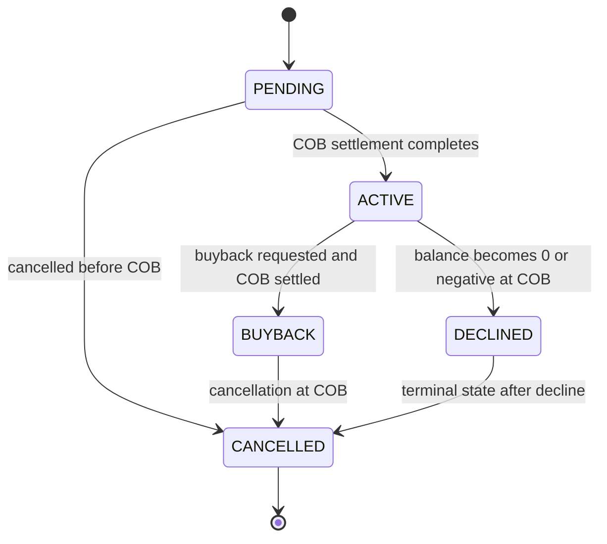

# Cross cutting changes for Pay in 3/4

This page documents the cross-cutting changes introduced for the Pay in 3/4 enhancement, with a focus on Asset Externalization for PayPal and investor-owned loans. The material herein reflects verified product behavior and the implemented design described in the Asset Externalization specifications and related reference data. It covers the scope of persistence, APIs, eventing, processing rules, and accounting implications that span multiple modules and services. The goal is to allows backend engineers, integrators, and Fineract contributors to understand how asset ownership transfers are initiated, executed, and reconciled with COB processing, and how related data and journal entries are captured and reported.

---

## Conceptual overview and scope

The Pay in 3/4 cross-cutting changes introduce a formal mechanism to transfer loan ownership between PayPal (the current owner) and an external asset owner (investor), as well as a buyback pathway from an external investor back to PayPal. The ownership transfer is represented by an external ownership transfer. The transfer has a lifecycle and state machine with at least the following states: PENDING, ACTIVE, BUYBACK, DECLINED, CANCELLED. The transfer becomes active at COB on (a settlement) date, provided the loan balance is positive. When a transfer is active, journal entries and GL postings reflect the investor’s ownership. The transfer may be cancelled or bought back, subject to the COB rules and decision tracker outcomes.

Key architectural elements affected by this change include:
- Data persistence for asset ownership and transfers
- Public API surface for initiating, querying, and managing asset transfers
- Event publishing for ownership changes and related activities
- COB-driven processing that applies ownership changes at end-of-day and verifies data consistency
- Accounting entries that reflect investor-owned loans

This page presents the implemented behavior, data model, API surface, and associated workflows, grounded in the verifiable reference data.

---

## Data persistence: new entities and mappings

To support asset externalization, a set of new tables were introduced to model asset owners, transfers, and their associations to loans and journal entries. The following tables and their primary purposes are defined in the low-level design:

- m_external_asset_owner
 - Stores information about an external asset owner (external_id as a unique identifier, creation metadata).
 - Columns of note: id (PK), external_id (UNIQUE), created_by, created_on_utc, last_modified_by, last_modified_on_utc.

- m_external_asset_owner_transfer
 - Represents a transfer request from one owner to another, including the external identifiers, status, and associated loan.
 - Key fields include: id (PK), owner_id (FK to m_external_asset_owner), external_id (transfer external id), status, purchase_price_ratio, settlement_date, effective_date_from, effective_date_to, loan_id, loan_external_id, is_system_created, related_to_id, created_by, created_on_utc, last_modified_by, last_modified_on_utc.

- m_external_asset_owner_active_transfer_loan_mapping
 - Maps a loan to its active asset ownership transfer, modeling the active transfer relationship for reporting and processing clarity.
 - Columns include: id (PK), loan_id (FK), owner_transfer_id (FK), created_by, created_on_utc, last_modified_by, last_modified_on_utc.

- m_external_asset_owner_journal_entry_mapping
 - Links journal entries to the external asset owner for traceability and auditing of investor-related postings.
 - Columns include: id (PK), journal_entry_id (FK), owner_id (FK), created_by, created_on_utc, last_modified_by, last_modified_on_utc.

- m_external_asset_transfer_journal_entry_mapping
 - Links journal entries to a specific asset transfer (sale or buyback), enabling reporting by transfer and owner.
 - Columns include: id (PK), journal_entry_id (FK), transfer_id (FK), created_by, created_on_utc, last_modified_by, last_modified_on_utc.

- m_external_asset_owner_transfer_details
 - Aggregates totals and subtotals associated with an asset transfer, including outstanding amounts, fees, penalties, and overpaid amounts.
 - Columns include: id (PK), asset_transfer_id (FK), total_outstanding_amount, total_outstanding_principal, total_outstanding_interest, total_outstanding_fee, total_outstanding_penalty, total_overpaid_amount, created_by, created_on_utc, last_modified_by, last_modified_on_utc.

These tables encode the externalization model for asset ownership transfers, their lifecycle, and the audit trail needed for regulatory and reporting purposes. The schema is designed to maintain a clear mapping between loan records, external owners, transfers, and journal entries, while enabling real-time (or COB) processing of ownership changes.

---

## API surface: creation, queries, and lifecycle management

The cross-cutting enhancements introduce a public API surface to manage asset ownership transfers, including sales to external investors, buybacks, and cancellations. The API surface is designed to support: initiating a sale (transfer to an external owner), initiating a buyback, cancelling a pending transfer, and retrieving transfer data or related journal entries. The design emphasizes strict enforcement of state transitions and COB-based effects.

Public endpoints (as specified by the reference data) include:

- Root endpoint
 - /external-asset-owners
 - Support for resources and sub-resources that represent ownership and transfer operations.

- Asset transfer (sale) request
 - POST /external-asset-owners/transfers?loanId={loanId}&command=sale
 - Request body fields (verified):
 - settlement_date: date; settlement date for the transfer (must not be in the past)
 - owner_external_id: string up to 100 chars; external identifier for the asset owner; required for SALE
 - transfer_external_id: string up to 100 chars; external transfer id; optional if generated by the system
 - purchase_price_ratio: numeric; represents the fraction of investor ownership; required for SALE
 - dateformat: string; date format (e.g., yyyy-MM-dd)
 - locale: string; locale code (e.g., en)
 - Response body includes: resourceId (internal transfer id), resourceExternalId (external transfer id), subResourceId (loan id), subResourceExternalId (loan external id), changes (settlementDate, ownerExternalId, transferExternalId, purchasePriceRatio), dateformat, locale.

- Asset buyback request
 - POST /external-asset-owners/transfers?loanExternalId={loanExternalId}&command=buyback
 - Request body fields mirror the sale request where settlement_date, owner_external_id, transfer_external_id, purchase_price_ratio, dateformat, locale are provided. The loanExternalId can be used as the loan identifier in the request path or body depending on the endpoint usage.
 - Response mirrors the sale response with internal resource id, external transfer id, loan identifiers, and the changes payload.

- Asset transfer cancellation
 - POST /external-asset-owners/transfers?loanExternalId={loanExternalId}&command=cancel
 - Request body can include transfer_external_id; Response includes resource identifiers and a changes payload reflecting the status and subStatus (e.g., USER_REQUESTED, CANCELLED).

- Fetch transfer request
 - GET endpoints to retrieve transfers by transferExternalId, loanId, or loanExternalId. The response includes totalFilteredRecords and pageItems with fields such as transferId, owner.externalId, loan.id, loan.externalId, transferExternalId, purchasePriceRatio, settlementDate, status, effectiveFrom, effectiveTo, and localization fields dateformat and locale.

- Fetch transfer journal entries
 - GET /external-asset-owners/transfers/external-id/{ownerExternalId}/journal-entries
 - Response includes transferData (transferId, owner.externalId, loan details, transferExternalId, purchasePriceRatio, settlementDate, status, effectiveFrom, effectiveTo) and journalEntryData (journal entries linked to the transfer with typical journal line details).

- Fetch owner journal entries
 - GET /external-asset-owners/owners/external-id/{ownerExternalId}/journal-entries

These APIs provide the required surface for clients to trigger asset ownership transfers, monitor their status, and audit associated journal postings. They are designed to follows the lifecycle defined in the Asset Externalization Solution Design and related reference data, including the need to publish events upon ownership changes and to surface journal entries associated with the transfer and owner.

To illustrate, here are representative payload shapes (conceived from the reference data):

```
POST /external-asset-owners/transfers?loanId=1&command=sale
{
 "settlement_date": "2023-05-21",
 "owner_external_id": "1234567890987654321",
 "transfer_external_id": "36efeb06-d835-48a1-99eb-09bd1d348c1e",
 "purchase_price_ratio": 1,
 "dateformat": "yyyy-MM-dd",
 "locale": "en"
}
```

```
Response:
{
 "resourceId": 86,
 "resourceExternalId": "36efeb06-d835-48a1-99eb-09bd1d348c1e",
 "subResourceId": 1,
 "subResourceExternalId": "35462342345234523764",
 "changes": {
 "settlementDate": "2023-05-21",
 "ownerExternalId": "1234567890987654321",
 "transferExternalId": "36efeb06-d835-48a1-99eb-09bd1d348c1e",
 "purchasePriceRatio": 1
 },
 "dateformat": "yyyy-MM-dd",
 "locale": "en"
}
```

---

## Eventing and integration: ownership events and journal mapping

The Asset Externalization feature relies on event publishing to notify downstream systems of ownership changes and related activities. Existing events are extended to include owner information, enabling clients to determine which entity currently holds ownership. In addition, a new event type is introduced to reflect ownership changes (sale, buyback) and associated journal postings.

- Ownership change events
 - These events carry: date/time of the transfer, loan account ID, Sale Transaction ID, credit asset owner ID, and the balance transaction amount. They are emitted as part of the COB processing that finalizes the ownership transfer.
 - Earlier design decisions specify that asset ownership changes are performed at COB, and events are emitted to reflect the resulting ownership state.

- Journal entry association
 - The data model includes mappings between journal entries and asset owners, and between journal entries and transfers. This allows querying journal activity by asset owner and by transfer, which is essential for investor accounting and audit trails.

- Scheduling and COB behavior
 - Settlement/COB behavior governs when ownership transfers take effect and when journal entries are posted. The decision tracker documents rules about same-day sale and buyback handling and whether GL postings are created in that scenario.

---

## Business rules, state transitions, and COB behavior

The cross-cutting changes implement a lifecycle with strict state transitions and COB-based effects. The important rules and transitions are evidenced in the reference data and decision trackers:

- Settlement date constraints
 - The settlement date must not be in the past. If the settlement date is in the past, the transfer request is rejected as per the decision tracker.

- State transitions
 - TRANSFER states include PENDING, ACTIVE, BUYBACK, DECLINED, CANCELLED. An ACTIVE transfer means the ownership is in effect and investor-related postings apply to the loan. A BUYBACK denotes the external owner having their investment reclaimed. DECLINED occurs when, for example, the settlement date arrives but the balance condition prevents transfer. CANCELLED occurs if a transfer is aborted prior to COB.

- Same-day sale and buyback behavior
 - If a sale and a buyback are requested for the same COB day, the engineering decisions evolved during review determine how the two transfers are handled. Initial guidance suggested that GL entries would be created with sale first and buyback last; later guidance indicates that if both occur on the same day, GL entries will not be created and two CANCELLED events will be emitted, one for each transfer. The rules also specify that a pending transfer on the same loan can be cancelled (per the decision tracker).

- COB processing and balance checks
 - Asset ownership transfer execution is performed at COB using the loan balance at COB. If the balance is zero or negative at COB, transfers are declined per the decision items. The transfer’s effectiveFrom and effectiveTo dates denote the active period for the ownership transfer.

- Pending transfers and cancellation
 - If there is an existing pending transfer, new transfer requests are refused in accordance with the decision tracker rules.

- Loss/gain of ownership and accounting implications
 - The cross-cutting changes include extensive guidance on accounting postings when a loan is investor-owned, including the need to map journal entries to the external owner, and to reflect the sale/buyback and related adjustments in investor-led GL accounts. The precise mapping between journal entries and external owners is captured in the m_external_asset_owner_journal_entry_mapping and related tables.

---

## Calculation references and representative schedules

Reference data contains complete calculation references and repayment schedules used in testing and verification of the Pay in 3/4 scenarios. The documents include:
- Calculation Reference: downpayment scenarios updated
 - Includes several repayment schedules showing combinations of Disbursement, Down Payment (DP), principal allocations, balances, and installment postings across multiple periods.
- Calculation Reference: TransactionSummaryReport Mar01 2023
 - Demonstrates how transaction types, charges, refunds, and repayments are represented in the summary report for a given product (GPL_DE_PI30).
- Calculation Reference: TrialBalanceSummaryReport Mar01 2023
 - Illustrates how beginning balances, debits, credits, and ending balances are reported per product and GL accounts for investor-related activity.

These references provide end-to-end visibility into how the new flow affects repayment schedules, DP handling, charges, and journal postings. They illustrate the types of data that flow through the system during sale and buyback events and how balances evolve across installment periods.

> Note: The references contain extensive tabular data representing many scenarios (Single D, Double D, with charges, with different day setups, various settlement interactions, and overpayments). They are intended for verification and testing of the implemented behavior and are not prescriptive UI content.

---

## Use cases and end-to-end flows

The asset externalization feature is described through a set of use cases that capture initiation, execution, and loan-closure scenarios, including failure modes and edge cases:

- UC1: Initiate asset transfer
 - OK path for sale or buyback initiation
 - NOK paths include: an existing pending transfer, or a loan balance that is closed/overpaid

- UC2: Execute asset transfer
 - OK paths for sale and buyback execution
 - DEPRECATED path: Sale declined due to a closed loan
 - Special path: Pending → Buyback on the same day triggers cancellation logic per latest decisions

- UC3: Loan got closed
 - Buyback execution when the loan closes is OK
 - Sale on closed loan is NOK
 - Buyback and sale cancellation on close is NOK

- UC4: Edge and error cases
 - Invalid loan IDs, missing transfer IDs, and conflicting transfers are rejected with clear responses and event emissions per the event framework.

These use cases map to the API surface and to the COB-driven behavior described above, providing a consistent set of expectations for integration partners and internal services.

---

## State machine diagram (ownership status)

Mermaid state diagram of asset ownership status transitions (restricted to the verified set in the reference data):



This diagram captures the verified lifecycle states and the primary transitions that are observed in the cross-cutting changes. It also embodies the COB-driven semantics where state transitions are finalized at COB and are accompanied by the standard events and journal postings.

---

## Relationships, responsibilities, and sequencing

- Actor responsibilities
 - User or client initiates an asset transfer request via the sale or buyback API endpoints.
 - The system validates the request against business rules (settlement date not in the past, asset/account status eligibility, and absence of conflicting pending transfers).
 - The COB process applies the ownership change, posts the associated journal entries (to the investor accounts, Shareholder/Asset Owner accounts, and related GL accounts), and publishes ownership events.
 - Auditors and integrators can retrieve transfer details and related journal entries via the fetch endpoints, enabling investor-level reconciliation.

- Data integrity and reconciliation
 - The data model enforces relationships between loans, asset owners, transfers, and journal entries. The active transfer mapping verifies that an active transfer is clearly associated with a loan.
 - The COB processing verifies that an opening balance at the start of a period matches the previous closing balance, and that all pay-downs and charges are reconciled with the correct owner accounting entries.

- Accounting surface
 - The Asset Externalization requirements define the accounting treatment for investor-owned loans, including journal entry codes and the flow of amounts between Loan/Fee Rec- Investor and Cash Clearing-Investor accounts. The exact configuration of journal entries is aligned with the new ownership mapping, and with the existing GL posting rules.

---

## Data dictionary (summary)

- Externalization persistence and mapping
 - m_external_asset_owner: external owner entity, with unique external_id and timestamps
 - m_external_asset_owner_transfer: external transfer, with status and settlement/effective dates, and association to loan
 - m_external_asset_owner_active_transfer_loan_mapping: mapping between loan and active transfer
 - m_external_asset_owner_journal_entry_mapping: association between a journal entry and an asset owner
 - m_external_asset_transfer_journal_entry_mapping: association between journal entry and a transfer
 - m_external_asset_owner_transfer_details: aggregate totals for a transfer (outstanding, overpaid, etc.)

These structures support a reliable audit trail and allows investor-facing reporting in alignment with Pay in 3/4 requirements.

---

## Architecture and implementation guidance (takeaways)

- The cross-cutting changes are implemented as a cohesive extension across persistence, API, and COB processing layers. The new data model underpins multi-owner scenarios and provides a stable path for future enhancements (e.g., later phases of delayed settlement or additional ownership types).
- The API design emphasizes precise state management and event-driven visibility for external clients and internal services. Callers can initiate sales or buybacks, monitor status, and retrieve journal postings for reconciliation.
- The COB workflow is central to correctness, so that ownership changes occur at end of business day with proper balance checks and that events reflect the final state.
- The accounting surface is extended to accommodate investor-owned loan postings while preserving existing GL semantics for PayPal-owned loans. The mapping between journal entries and external owners provides an auditable linkage for investor reporting.

---

The reference data includes detailed calculation references and schedules for downpayment scenarios, single and double disbursement flows, and day-specific installment regimes. These references illustrate how down payments interact with principal allocations and loan balances over multiple installments and are used to validate the end-to-end behavior of investor-facing transfers. They demonstrate typical patterns for DP handling, charges, adjustments, and repayments across various timelines.

- Calculation Reference: downpayment scenarios updated
- Calculation Reference: TransactionSummaryReport Mar01 2023
- Calculation Reference: TrialBalanceSummaryReport Mar012023

These calculation references are intended for verification and testing, so that the implementation preserves financial integrity across the new ownership flow.

---

## Change impact and non-go-live considerations

- Externalization events and ownership data are designed to be consumable by downstream systems (e.g., Credit ETL) to reflect real-time ownership across the investment lifecycle.
- The existing GL posting rules are extended to support investor-owned postings, with care taken to preserve accounting consistency for PayPal-owned loans as well.
- The transfer URIs, request shapes, and response contracts are designed to be backward compatible with integration partners while enabling new workflows for asset ownership.

---

If you need deeper walkthroughs of particular sections (for example, a step-by-step walkthrough of UC1 and UC2, or a mapping diagram between m_external_asset_... tables and journal_entry records), I can expand those sections with more targeted diagrams and sample narratives based on the verified reference data.