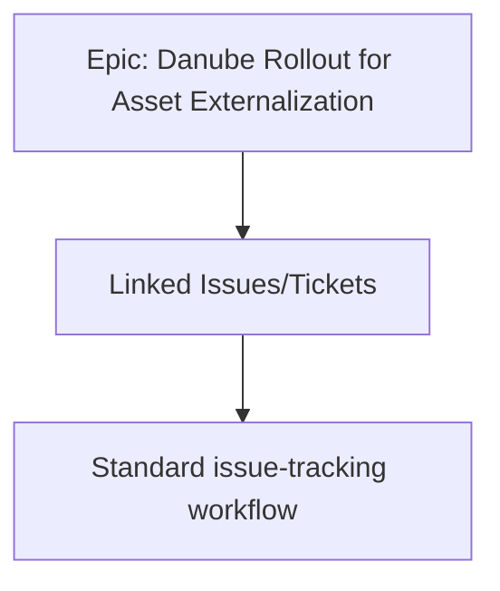

# Epic to track issues and tickets related to Project Danube Rollout for Asset Externalization

This document describes the Epic dedicated to tracking issues and tickets arising from Project Danube Rollout for Asset Externalization within the Pepper-Soup domain. The Epic serves as a centralized container to aggregate, reference, and monitor work items related to the Danube rollout, supporting governance and oversight for asset externalization initiatives. The specification notes indicate that this Epic has no child items and is used for rollout tracking within the Asset Externalization and Investors context.

### Navigation context

- Navigation path: Asset Externalization and Investors > Danube rollout > Epic to track issues and tickets related to Project Danube Rollout for Asset Externalization.

### Scope and boundaries

- In scope: The Epic is scoped to issues and tickets that pertain specifically to the Danube rollout for Asset Externalization. It is intended to provide a single reference point for tracking related work items and their progress.
- Out of scope: Topics unrelated to the Danube rollout or Asset Externalization, and any work items not directly connected to thisEpic’s purpose of rollout tracking.

### Objectives and deliverables

- Provide a centralized Epic to collect and reference issues and tickets associated with the Danube rollout for Asset Externalization.
- Establish a clear navigation and contextual placement within the Asset Externalization and Investors domain to support discovery and governance.
- Adhere to the Specification Notes indicating that this Epic has no children and is focused on rollout tracking.
- allows stakeholders to view, discuss, and coordinate responses to rollout-related issues without introducing nested Epic structures.

### Structural model and relationships

The Epic functions as a governance container for Danube rollout-related issues and tickets. It does not imply nested Epic hierarchies (no children). Related work items exist as independent tickets or tasks linked to the Danube rollout context, allowing cross-referencing and traceability without expanding the Epic’s structural footprint.

### Behavioral context and considerations

- The Epic serves as a coordination surface for rollout-related issues and tickets. Creation, assignment, and resolution of individual tickets occur within the standard issue-tracking workflow, while the Epic itself remains the unifying reference point for Danube rollout concerns.
- Because the Specification Notes explicitly state that there are no child items, the Epic does not house sub-Epics. Related work items are linked as discrete tickets to preserve a flat Epic structure focused on rollout tracking.

### Diagram: relationships within the Epic context

### Notes on governance and reporting

This Epic supports governance and oversight by providing a labeled container that aggregates tickets and issues related to Project Danube Rollout for Asset Externalization. While detailed acceptance criteria, implementation mappings, or automated reporting specifics are not described in the current scope, the Epic’s existence and placement within the Asset Externalization and Investors navigation path allows consistent reference for status summaries, progress reviews, and audit considerations related to the Danube rollout.

### Summary

The Epic to track issues and tickets related to Project Danube Rollout for Asset Externalization establishes a focused, governance-oriented container for Danube rollout-related work items. It emphasizes rollout tracking, maintains a flat Epic structure with no children, and anchors itself within the Asset Externalization and Investors domain to support coordinated, auditable progress reporting.