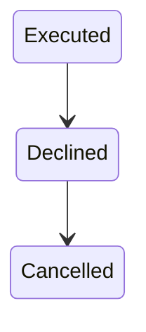

# Asset Externalization

## Asset Externalization

### Scope and exclusions

Asset externalization covers loan assets only. The investor module for savings accounts, fixed deposits, recurring deposits, and shares accounts is out of scope, as are customisable asset owner data fields. The system stores asset owner, transfer ID, settlement date, purchase price ratio, status, and created timestamp for each asset. When a request contains an unrecognised owner external ID, the system creates an entry in the owner table automatically. Stored ownership data cannot be updated.

### Transfer statuses

Transfer statuses describe where a loan stands in an externalization sale or buyback and when ownership changes take effect.

Each status has the following meaning:

- Active means the loan is sold to an investor with a settlement date on or after the current date.
- Pending means the loan is selected for transfer with a settlement date on or after the current date.
- Buyback means a buyback has been initiated, similar to pending, but ownership reverts.
- Declined means validation failed because of the balance.

The system refuses to initiate a sale or buyback when:

- the loan balance is zero or negative (overpaid),
- a transfer is already initiated (Pending) or active (Active),
- the settlement date is earlier than the business date.

A buyback is accepted when:

- the loan has an Active transfer status,
- the loan has a Pending transfer status with the same effective date.

Adding or changing the asset owner of a loan account:

- does not change loan account portfolio behaviour,
- posts no accounting entries,
- does not change actual ownership; ownership changes through COB.

The COB jobstep posts journal entries on the settlement date for:

- asset owner change (Pending to Active),
- buyback (Buyback to null).

If the loan account balance becomes zero or negative on the settlement date before COB:

- the asset transaction is marked as declined,
- no journal entries are posted.

### Monetary transaction asset owner column

Monetary transaction journal entries include an “asset Owner” column that stores the current asset owner ID of the loan account.

The asset owner column is populated as follows:

- Any monetary transaction with a business date on or before the settlement date carries the old investor ID.
- Any monetary transaction with a business date after the settlement date carries the new investor ID.
- The column is null when the loan account has no active investor.
- The column is always null for loan accounts of products where the investor module is disabled.
- The value is derived from the current active asset owner as of that business date, irrespective of transaction type, backdated transactions, reversals, charge additions, or accruals.

You can map a new GL account for asset transfer in a loan product when the investor module configuration is enabled, or use the asset transfer option from the financial activity mappings section.

### Transaction summary report

The transaction summary report includes asset owner detail, asset transfer and asset buyback transaction details, and groups and totals sums based on the report. It applies only to the investor side of a transaction, so there is no Asset Transfer or Asset Buyback summary line when Asset Owner ID is null (PayPal).

Balances reported equal the journal entry where principal is the investor side of the 112601 entry and fees are the investor side of the 112603 entry.

- Balances reported equal the journal entry where principal is the investor side of the 112601 entry and fees are the investor side of the 112603 entry.
- The Trial Balance report includes asset owner detail in transaction summary reports.
- The Trial Balance report groups and totals sums based on the transaction summary report.

### Event category and emission

The system uses the INVESTOR event category for owner transfer and account snapshot events. These events are emitted at transfer time during CoB execution, whether the transfer status is EXECUTED or DECLINED / CANCELLED.

The number of events depends on the transfer status:

- For EXECUTED or DECLINED status, the system triggers one event.
- For CANCELLED status when a sale and buyback occur on the same day, the system triggers two events, one for each transfer.

### COB transfer processing

Account ownership transfer can only happen after or at the end of Close of Business. The asset ownership executor jobstep validates all pending transfers where the settlement date equals the closed business date. Pending transfers become ACTIVE transfers only if balance is greater than or equal to 0.

### Sale and buyback status transitions

A sale transitions from PENDING to ACTIVE when the account balance is greater than zero, and to DECLINED when the balance is less than or equal to zero. A buyback transitions from ACTIVE to BUYBACK when the balance is greater than zero, and to [none] when the balance is less than or equal to zero. When sale and buyback occur on the same settlement date, both are CANCELLED with no status changes and no journal entries, and there is no owner transfer. A sale followed by a buyback results in both transactions being CANCELLED.

### Events at ownership change

The system emits an account change event when ownership change takes place, which happens when CoB runs or when a buyback completes. Events are emitted as before but extended with relevant data. Investor related fields appear in events only when the module is turned on.

### Cancel action and API behavior

You can cancel a PENDING sale or an incomplete BUYBACK before the transfer settles. The cancel API returns OK for a PENDING or BUYBACK loan transfer that CoB has not processed, and improper parameters produce an error response. Cancelling a PENDING sale with a BUYBACK returns an error that points to the existing BUYBACK.

Cancellation behaves as follows:

- The system sends a transfer event when a transfer is cancelled.
- Cancellation references the cancelled record through the transfer external id.
- An asset transfer request on a closed or overpaid loan fails with a proper error message instead of an internal server error.

The owner_id in m_external_asset_owner_transfer is set as follows:

- For a first transfer request (SALE) with a new owner, owner_id is set to the proper owner_id.
- For a BUYBACK transfer request, owner_id is set to the proper owner_id.

Aggregated balance items are stored with external owner details as follows:

- When a transfer takes place, aggregated balance items are stored along with the external owner they relate to.
- At the time of buyback, the same values are stored along with the previous external asset owner id.

### Transfer API errors and edge cases

The Asset Owner Transfer POST API returns an Internal Server Error when no loan exists for the supplied external ID.

Buyback and pending transfers share unified date handling, where the effective from date and settlement date have the same meaning.

When a sales request contains a non-existent date, the response includes no error message and the system selects the nearest valid date.

### Transfer external ID handling

The transfer external ID identifies a transfer in responses and retrieval calls. It is not unique and can be generated by you.

Retrieval and buyback settlement behave as follows:

- GET v1/external-asset-owners/transfers?transferExternalId={transferExternalId} returns a list with all transfers that share the same transfer external ID, regardless of owner or other data.
- For a BUYBACK transaction, the effectiveTo date equals the buyback settlementDate.

Sales transactions are declined when initiated on these loan account stages:

- closed
- overpaid
- submitted
- approved

### Loan state changes affecting pending transfers

When a loan closes or is overpaid while a transfer is pending, business listeners decline pending sales and accept pending buybacks. A closed loan can still be selected for sale or buyback, but COB does not catch up closed loans, so a pending asset externalisation does not advance when the loan is paid.

COB only processes transfers whose effective date equals the business date and whose valid_to is 9999-12-31.

- COB picks only transfers with Effective date equal to the business date and valid_to equal to 9999-12-31.
- At cancellation, the valid_to of the cancelled record is set to NOW.
- Transfer and snapshot events are sent only at actual transfer; no events are sent for cancel.
- The LoanAccountSnapshotBusinessEvent event is sent only when an actual ownership change happens (Pending → Active; Buyback → null).

When a loan is paid fully before settlement, pending transfers are resolved as follows:

- If there is a pending sale and a pending buyback with different settlement dates, the pending sale transfer is declined and the pending buyback is cancelled.
- A pending sale transfer is declined if the loan is closed before the settlement date.
- A pending buyback is cancelled with a new substatus.

Sales requests made before approval or disbursement behave as follows:

- A SALES request can be made when the loan is not approved or disbursed.
- If the settlement date is before approval or disbursement, COB does not pick up the loan, so SALES does not become ACTIVE.

> **Note:** Inline COB returns an internal server error when asset externalisation sales and buyback settlement dates are the same.

### Event owner parameters

A sales or buyback event must include From Owner and To Owner parameters. From Owner identifies the current owner, while To Owner identifies the party receiving the transfer.

Externalization events carry owner information as follows:

- The LoanOwnershipTransferBusinessEvent extends LoanBusinessEvent and informs external systems about asset ownership changes for a given loan.
- The event is triggered on any asset ownership state transition and contains transaction type, transaction date/time, loan account ID, buyback transaction ID, new AssetOwnerID, and balance transaction amount.
- An AccountChangedEvent is required with a business date matching the settlement date for accounting.
- An accountSnapshot event with loan account data V1_schema is required.
- Assert externalization events include owner information so downstream systems can use it for reporting and analytics.
- On the LoanTransactionAdjustmentDataV1 event, owner_id is required in both the adjusted transaction and the new transaction.

Configuration and GL setup for externalization include:

- A global config enables or disables the investor module.
- A global config enables automatic owner creation and defaults to true.
- GL code 146000 is set up as the receivable/clearing account with type Asset Account.

Additional externalization behaviour includes:

- Sale and buyback happening the same day still create GL entries, with sale always first and buyback last.
- A pending transaction can be cancelled; it is not needed for Pin30 asset transfers and will be an optional story.
- In the External_Asset_Owner_Transfer_Details table, 0 values are stored instead of null if the value is not present in the model.
- The Trial Balance Summary Report for product GPL_DE_PI30 is sorted by Date, by Product, by GL Account, and by Investory (Asset Owner).

### Database constraints and indexes

Database constraints and indexes support asset externalization by enforcing uniqueness and improving lookup performance on transfer-related tables.

The following constraints and indexes apply:

- A composite unique constraint on Status and externalTransferId is defined in external_transafer_status_external_transfer_id_constraints.xml with context=mysql and may also be needed for postgres.
- The m_external_asset_owner_transfer table has an index on the loan_id column.
- The BATCH_JOB_EXECUTION_PARAMS table has an index on the JOB_EXECUTION_ID column.

### Event verification

The system verifies event emission and data completeness when a loan ownership transfer completes. It checks that the required business events are emitted at transfer time and that each event carries all required data. Verified scenarios include transfers with a zero balance, a negative balance, and a same-day transfer. Executed, Declined, and Cancelled statuses are verified in each case.

### Aggregated balance items verification

The system stores aggregated balance items during sales events and during buyback events. Balances are correctly stored when interest, a fee charge, or a penalty charge is present. The initiate transfer API stores ownership data.

### Transfer retrieval APIs

You can retrieve ownership history and details of related transfers using a loan ID, a loan external ID, or an asset transfer ID.

A transfer can be cancelled before execution by copying the original transfer with substatus USER_REQUESTED.

- POST /transfers/{id}?command=cancel cancels a transfer by ID.
- POST /transfers/external-id/{transferExternalId}?command=cancel cancels a transfer by transfer external ID.

### API response issues

The API response issues cover missing fields, incorrect validation errors, and fields that should be removed or added across transfer, sale, and buyback endpoints. These issues affect fetch transfer requests, buyback settlement calls, and sale/buyback response details.

The following response issues exist:

- The fetch transfer request API response does not include totalfilteredRecords and pageItems.
- A buyback transaction API call with settlementDate=null returns a 500 error instead of a 400 validation error.
- The subStatus field is missing from swagger and the id field is missing from the details response.
- The changes field should be removed from the sale/buyback API response.
- A resource id should be added to the API response.

### Search API

The search API is available at /external-asset-owners/search.

Search supports the following criteria:

- A text field searches external id fields such as owner or transaction ID.
- Date ranges search using the submitted date, settlement date, or effective date.

### Worked examples

A loan is sold from no current investor (asset owner null) to Investor A, identified by external id 123456789. The transfer amount is 1,010, made up of 1,000 principal and 10 fees, and the settlement date is 25-05-2023. The figures are illustrative. The system posts the null side of the transfer and the investor side separately, and the trial balance groups each GL account by asset owner. This example shows how the asset owner column splits the same GL account between null and an active investor.

| GL Account | Asset Owner | Debit | Credit | Ending Balance |
| --- | --- | --- | --- | --- |
| 112601 Loans Receivable | (blank) | 0.00 | 1000.00 | -1000.00 |
| 112601 Loans Receivable | 123456789 | 1000.00 | 0.00 | 1000.00 |
| 112603 Interest/Fee Receivable | (blank) | 0.00 | 10.00 | -10.00 |
| 112603 Interest/Fee Receivable | 123456789 | 10.00 | 0.00 | 10.00 |
| 146000 Receivable/Clearing | (blank) | 1010.00 | 1010.00 | 0.00 |

A loan with an active investor, Investor A (123456789), is bought back for 1,010, comprising 1,000 principal and 10 fees, with settlement date 01-06-2023. Ownership reverts to null. The system posts the buyback journal entries using the closing balance of the loan account, moving the receivable and fee amounts from the investor back to the null owner. This example shows the buyback accounting entries and how the asset owner column changes from investor to null.

| GL Account | Asset Owner | Debit | Credit |
| --- | --- | --- | --- |
| 112601 Loans Receivable | 123456789 | 0.00 | 1000.00 |
| 112603 Interest/Fee Receivable | 123456789 | 0.00 | 10.00 |
| 146000 Receivable/Clearing | 123456789 | 1010.00 | 0.00 |
| 146000 Receivable/Clearing | (blank) | 0.00 | 1010.00 |
| 112601 Loans Receivable | (blank) | 1000.00 | 0.00 |
| 112603 Interest/Fee Receivable | (blank) | 10.00 | 0.00 |

A sale is requested with settlement date 21-05-2023. Close of Business on 22-05-2023 activates the sale. A buyback is then requested on business date 25-05-2023 with settlement date 30-05-2023, and Close of Business on 31-05-2023 processes it. Each transfer record carries effective from and effective to dates that bound the period the status applies. If the buyback is requested on 10-05-2023 instead, its effective from and effective to dates are both 10-05-2023.

| Transfer | Status | Effective From | Effective To | Settlement Date |
| --- | --- | --- | --- | --- |
| Sale | PENDING | 01-05-2023 | 21-05-2023 | 21-05-2023 |
| Sale | ACTIVE | 22-05-2023 | 30-05-2023 | 21-05-2023 |
| Buyback | BUYBACK | 25-05-2023 | 25-05-2023 | 30-05-2023 |

Investor A1 becomes active on settlement date 04-05-2023. A repayment is posted on business date 02-04-2023, before the settlement date, and is reversed on business date 05-05-2023, after the settlement date. The asset owner column on monetary transactions follows the settlement date plus one rule: any transaction on or before the settlement date keeps the old owner, and any transaction after it carries the new owner. This example shows how a backdated reversal is tagged with the owner active as of its business date.

| Entry | Business Date | Settlement Date | Asset Owner Column |
| --- | --- | --- | --- |
| Repayment | 02-04-2023 | 04-05-2023 | null |
| Reversal | 05-05-2023 | 04-05-2023 | A1 |

See also: [BNPL: Pay in 3 and 4](../loan-engine/bnpl.md#pay-in-3-and-4).
