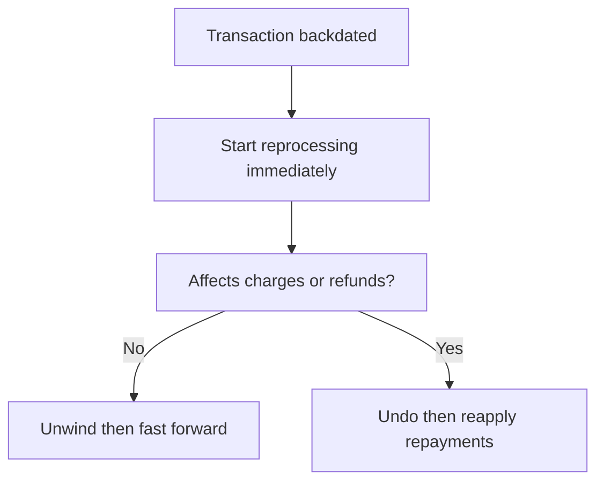
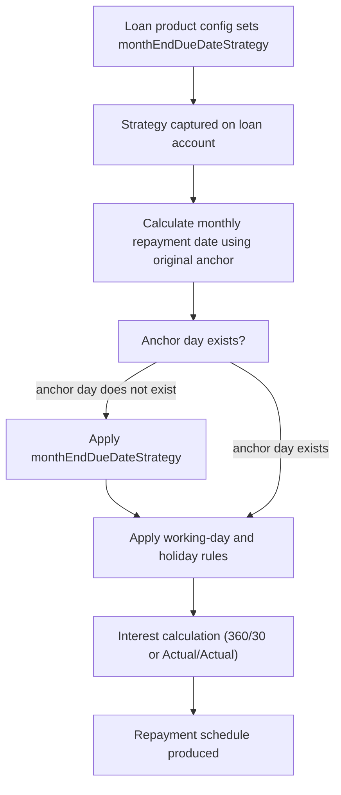
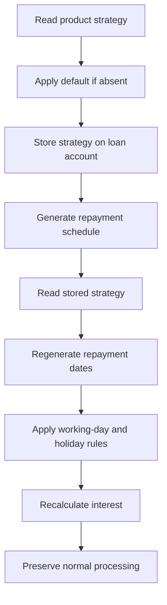

# Disbursement and Schedule

## Down Payments

### Down payment configuration

You can configure down payments at the loan product level to collect the down-payment amount at disbursement, either as a percentage of the disbursement amount or manually by the user. A user can enable or disable the down-payment option and specify the percentage when it is enabled.

The following configuration options apply to down payments:

- Enable Auto Repayment for Down Payment subtracts the down payment from the disbursed amount or from a created payment transaction.
- There is a product-level checkbox to not extend the loan schedule for multi-disbursal, appearing in the Down payment section of the configuration.
- When down-payment is enabled, a user can enable or disable auto repayment for the down-payments.

### Scope and lifecycle of down payment configuration

Down payment applies to every loan account of a loan product once it is enabled, and to every disbursement of those accounts. The down-payment percentage defined at the product level applies to all disbursements of those accounts. Changes to down-payment configuration at the product level affect only new loan accounts; existing accounts keep their existing configuration.

### Schedule handling with down payments

When down-payment configuration is enabled, the repayment schedule includes down-payment installments and appears in the loan created and approved states. A down payment is always due on the disbursement day, and its amount is based on the percentage set in the product configuration. The system distinguishes down-payment installments from regular installments.

The following rules apply to down-payment installments:

- If a down-payment installment falls on an existing regular installment due date, the repayment schedule shows two installments on the same date.
- If two down payments occur on the same day, the schedule creates two down-payment installments.

### Down payment as an installment

A down payment is treated like an installment for amount allocations, repayment fulfillment, event handling, overdue calculation, arrears, delinquency, and delinquency calculation. Repayment on down payments follows the payment allocation rules when those are introduced.

The system sends the following events for a down payment installment:

- A payment due event is sent when the down payment installment is due.

### Repayment priority and allocation

When a regular instalment and a downpayment instalment fall due on the same date, the regular instalment takes priority. The downpayment instalment is paid only after the regular instalment is fully paid. This priority rule applies to all existing payment allocation rules.

### Charges and interest on down payments

Charges, chargebacks, and interest are never added to a downpayment instalment. They are allocated to the next regular instalment instead.

The following rules apply to charges and interest on down payments:

- Specified due-date charges are allocated to the next down-payment or installment, whichever is next.
- A chargeback applied on one of the repayments is added to the next down-payment or installment, whichever is next.
- No charges or chargebacks, including instalment fee, specified due day charges, and NSF penalty, can be added to a downpayment instalment.
- Any charge added is allocated to the next regular instalment.
- A chargeback is allocated to the next regular instalment.
- No interest can be added to a downpayment instalment.
- When interest is calculated, it is added to the regular instalment, never to the downpayment instalment.
- Any interest added is allocated to the regular instalment.

### Disbursement reversal with down payments

You can reverse a disbursement when a down payment exists. The down payment is reversed along with the disbursement, and its accounting entries are reverted.

The down payment instalment is handled as follows:

- When a disbursement is reverted, the down payment instalment belongs to that disbursement and is deleted.
- With multiple disbursements, reverting one disbursement deletes only the related down payment instalment.
- With auto-down-payment, the down payment transaction is reverted as well.
- Without auto-down-payment, if no payment happened, the instalment is deleted; if a payment happened, reversal is not allowed.

> **Note:** Down-payment instalments do not move during reschedule of the schedule.

### Auto down payment

Auto down payment applies to all new loan accounts and all disbursements for a loan product when auto repayment for down payments is enabled. At disbursement, the system posts a down payment transaction for the down payment amount. This transaction type behaves like a repayment transaction and uses the same accounting as repayment.

### Repayment start date options

You select the repayment start date from either the loan submitted date or the loan disbursed date on the loan product. The schedule is generated from the selected date. The loan disbursed date is the default option.

### Backdated disbursement and rescheduling

A backdated disbursement cannot occur before the loan submission date. When it occurs, the system regenerates the loan schedule and reprocesses the transactions. If the schedule is based on the loan submission date, no reschedule happens. If the schedule is based on the first disbursement date and a disbursement has already occurred, the loan is rescheduled according to the new disbursement date. Rescheduling with down payment enabled does not produce an error.

### Multi-disbursement schedule behavior

A multi-disbursement loan uses an initial repayment schedule based on the default amount and default date while the loan is in the created and approved states. The loan inherits the do not extend loan schedule configuration. Repayment can be made using the DownPayment payment type.

The do not extend loan schedule for multi disbursal checkbox controls how the schedule behaves at disbursement:

- When the checkbox is enabled, the loan schedule is not extended and Fineract distributes the disbursement amount amongst the existing instalments.
- When the checkbox is disabled, the loan schedule follows the default behavior of Fineract and extends to the exact number of repayments configured.

Loan term frequency and number of repayments logic ignore down payment periods.

### Special allocation and edge cases

Repayment undo for the first repayment on a loan with PIN4_DOWNPAYMENT_AUTO_ADVANCED_PAYMENT_ALLOCATION completes without error after full repayment and advancing the business date. The system creates one down-payment installment for each disbursement even when multiple disbursements fall on the same date. For Pay in 3 installment with down payment, the last installment receives the extra amount instead of the second installment. A charge is added into the next installment.

### Worked examples

Down payment is enabled on the loan product at 25% of the disbursement amount, and auto repayment for down payments is switched on. The figures are illustrative. A disbursement of 1,000.00 on 1 January creates a down-payment installment of 250.00 that is due and paid on the same day. The remaining 750.00 is scheduled as three regular monthly installments of 250.00 each on 1 February, 1 March, and 1 April. If auto repayment is disabled, the same 250.00 down-payment installment is created but remains due until a user posts a repayment against it.

| Date | Event | Principal | Down payment | EMI | Due | Paid | Balance |
| --- | --- | --- | --- | --- | --- | --- | --- |
| 1/1/22 | Disbursement | 1,000.00 | – | – | – | – | 1,000.00 |
| 1/1/22 | Down payment (auto) | – | 250.00 | 250.00 | 250.00 | 250.00 | 750.00 |
| 2/1/22 | Regular installment due | 250.00 | – | 250.00 | 250.00 | – | 750.00 |
| 2/1/22 | Repayment | 250.00 | – | 250.00 | – | 250.00 | 500.00 |
| 3/1/22 | Regular installment due | 250.00 | – | 250.00 | 250.00 | – | 500.00 |
| 4/1/22 | Regular installment due | 250.00 | – | 250.00 | 250.00 | – | 500.00 |

A charge is never posted to a down-payment installment; it is allocated to the next regular installment. With down payment at 25% and auto repayment enabled, a disbursement of 1,000.00 on 1 January creates a down payment of 250.00 due and paid the same day. A fee of 50.00 posted on 1 January moves to the regular installment due 1 February, raising its EMI to 300.00 while the principal portion stays at 250.00. If no charge is posted, the regular installment on 1 February keeps an EMI of 250.00 instead of 300.00.

| Date | Event | Principal | Down payment | Fees | EMI | Due | Paid | Balance |
| --- | --- | --- | --- | --- | --- | --- | --- | --- |
| 1/1/22 | Disbursement | 1,000.00 | – | – | – | – | – | 1,000.00 |
| 1/1/22 | Down payment (auto) | – | 250.00 | – | 250.00 | 250.00 | 250.00 | 750.00 |
| 1/1/22 | Charge posted | – | – | 50.00 | – | – | – | 750.00 |
| 2/1/22 | Regular installment due | 250.00 | – | 50.00 | 300.00 | 300.00 | – | 750.00 |
| 2/1/22 | Repayment | 250.00 | – | 50.00 | 300.00 | – | 300.00 | 500.00 |
| 3/1/22 | Regular installment due | 250.00 | – | – | 250.00 | 250.00 | – | 500.00 |

Each disbursement carries its own down-payment installment, and down-payment installments are not merged. When two disbursements of 1,000.00 occur on 1 January with a 25% down-payment rate and auto repayment enabled, the system creates two down-payment installments of 250.00 each, both due and paid on 1 January. The remaining principal is then scheduled as regular installments. If the second disbursement occurs on a later date, its down-payment installment is due on that later date instead of 1 January.

| Date | Event | Disbursement | Down payment | EMI | Due | Paid | Balance |
| --- | --- | --- | --- | --- | --- | --- | --- |
| 1/1/22 | First disbursement | 1,000.00 | – | – | – | – | 1,000.00 |
| 1/1/22 | First down payment | – | 250.00 | 250.00 | 250.00 | 250.00 | 750.00 |
| 1/1/22 | Second disbursement | 1,000.00 | – | – | – | – | 1,750.00 |
| 1/1/22 | Second down payment | – | 250.00 | 250.00 | 250.00 | 250.00 | 1,500.00 |
| 2/1/22 | Regular installment due | – | – | 500.00 | 500.00 | – | 1,500.00 |
| 3/1/22 | Regular installment due | – | – | 500.00 | 500.00 | – | 1,500.00 |

The down-payment installment always starts and is due on the disbursement date, and the regular schedule follows that date when the repayment start date is set to the disbursement date. A disbursement of 1,000.00 on 5 January with a 25% down payment creates a down-payment installment of 250.00 due and paid on 5 January, followed by three regular monthly installments of 250.00 each. If the repayment start date is set to the loan submitted date instead, the first regular installment is scheduled from the submitted date while the down payment still falls on the disbursement date.

| Date | Event | Principal | Down payment | EMI | Due | Paid | Balance |
| --- | --- | --- | --- | --- | --- | --- | --- |
| 1/5/22 | Disbursement | 1,000.00 | – | – | – | – | 1,000.00 |
| 1/5/22 | Down payment | – | 250.00 | 250.00 | 250.00 | 250.00 | 750.00 |
| 2/5/22 | Regular installment due | 250.00 | – | 250.00 | 250.00 | – | 750.00 |
| 3/5/22 | Regular installment due | 250.00 | – | 250.00 | 250.00 | – | 500.00 |
| 4/5/22 | Regular installment due | 250.00 | – | 250.00 | 250.00 | – | 500.00 |

## Same-Day Disbursement and Instalments

### Same-day disbursement on overpaid loans

You can disburse on an overpaid loan account when the loan is ACTIVE, CLOSED (OBLIGATIONS MET), or OVERPAID. This applies to multi tranche loan accounts with either a progressive loan schedule or a cumulative loan schedule.

The following rules apply to disbursements on overpaid loans:

- The transaction date can be defined for the disbursement.
- Loan balances are updated accordingly.
- The outstanding principal of the actual installment increases by the full amount of the disbursement transaction.
- The overpayment amount is allocated as repayment for principal ultimately.
- The initial overpaid amount is adjusted or marked paid as advance payments to future installments as per account configuration.

During same day operation, a disbursement transaction can happen before the credit balance refund transaction, resulting in disbursement on an overpaid loan account and credit balance refund on an active loan account.

### Charge operations on overpaid loans

You can add charges and perform chargebacks on overpaid loans. Amount allocation remains the same as for disbursements, and the system updates loan balances and the repayment schedule accordingly.

### Credit Balance Refund rules

A Credit Balance Refund (CBR) transaction is a credit type transaction that initiates a refund to a customer when a loan is overpaid. You can initiate a CBR transaction only on a loan in OVERPAID status, and you can define its transaction date. Backdated transactions are allowed after CBR, and they can lead to situations where the original CBR amount is higher or lower than the overpayment amount on the loan.

The following rules govern the CBR amount:

- The CBR amount cannot be higher than the overpayment amount on the loan.
- The CBR amount can be lower than the overpayment amount, though doing so does not make sense.
- If backdated transactions after reprocessing make the CBR amount higher than the overpayment amount on the loan, the outstanding principal of the actual installment increases by the full CBR transaction amount and the overpayment amount is allocated as repayment for principal.
- On the repayment schedule, the full amount of CBR appears as Credit Principal.

### Chargeback rules

A chargeback transaction initiates a chargeback on a previous repayment or refund and effectively undoes it without reverting it. It applies when you need to reverse a prior transaction while keeping the original record intact.

Chargeback transactions follow these rules:

- The chargeback amount must be equal to or lower than the target transaction amount.
- You can create multiple chargeback transactions for the same target transaction when each chargeback amount is lower than the target transaction amount.
- The cumulative amount of all chargeback transactions for the same target transaction cannot exceed the target transaction amount.
- The chargeback transaction date is always the actual business date and cannot be defined.
- Backdated transactions are allowed after a chargeback.

### Chargeback on overpaid loans

Chargeback on an overpaid loan is allowed, and the chargeback amount is recognised as outstanding principal. On the repayment schedule the full chargeback amount appears as Credit Principal.

The effect of the chargeback depends on how it compares with the overpayment:

- When the overpayment amount is higher than the chargeback amount, the chargeback transaction has no effect on the repayment schedule; only the overpayment amount on the loan is decreased and proper accounting entries are created.
- When the chargeback transaction amount is higher than the overpayment on the loan, the outstanding principal of the actual installment is increased by the full chargeback transaction amount and the remaining overpayment amount is allocated as repayment for principal.

### Chargeback timing and schedule impact

Chargeback is allowed before or after the maturity date, with slightly different behaviour. Before maturity, the actual installment is increased by the full Chargeback transaction amount and delinquency calculation is immediately triggered from that date until fully paid. After maturity, a new installment (N+1) is created if it did not exist before, with the full Chargeback transaction amount.

### Chargeback allocation

A chargeback transaction can charge principal, fee, or penalty. Based on the target transaction that was charged back, the chargeback amount is allocated between principal, fee, and penalty buckets according to an allocation priority order. This priority order matters only when the chargeback is partial. Chargeback credit allocation can be configured when Repayment strategy is Advanced payment allocation.

When the target transaction was repaying fee and/or penalty alongside principal, the same type of fee and/or penalty is created during Chargeback.

### Worked examples

A repayment that exceeds the outstanding principal moves the loan to OVERPAID status and creates an overpayment balance. The figures are illustrative: principal 900, three monthly installments of 300, no interest, 30-day months. After two installments are paid, a repayment of 600 settles the remaining 300 and leaves 300 overpaid. A Credit Balance Refund (CBR) can then be made for part of the overpayment or for all of it. With a full CBR the loan closes and the overpayment is cleared; with a partial CBR the loan stays overpaid and the remaining overpayment persists.

| Step | Event | Amount | Loan status | Outstanding principal | Overpaid amount | Overpayment GL effect |
| --- | --- | --- | --- | --- | --- | --- |
| 1 | Disbursement | 900.00 | Active | 900.00 | 0.00 | — |
| 2 | Two installments paid | 600.00 | Active | 300.00 | 0.00 | — |
| 3 | Repayment | 600.00 | Overpaid | 0.00 | 300.00 | Credit 300.00 |
| 4 | CBR partial | 100.00 | Overpaid | 0.00 | 200.00 | Debit 100.00 |
| 4 | CBR full (alternative) | 300.00 | Closed (obligations met) | 0.00 | 0.00 | Debit 300.00 |

A chargeback reverses a prior repayment or refund without deleting it. Using the same illustrative loan—principal 900, three monthly installments of 300, no interest—a repayment of 600 after two installments are paid leaves the loan overpaid by 300. A chargeback can then be made for part of that repayment or for all of it. A partial chargeback reduces the overpayment without changing the repayment schedule; a full chargeback closes the loan.

| Step | Event | Amount | Loan status | Outstanding principal | Overpaid amount | Overpayment GL effect |
| --- | --- | --- | --- | --- | --- | --- |
| 1 | Disbursement | 900.00 | Active | 900.00 | 0.00 | — |
| 2 | Two installments paid | 600.00 | Active | 300.00 | 0.00 | — |
| 3 | Repayment | 600.00 | Overpaid | 0.00 | 300.00 | Credit 300.00 |
| 4 | Chargeback partial | 100.00 | Overpaid | 0.00 | 200.00 | Debit 100.00 |
| 4 | Chargeback full (alternative) | 300.00 | Closed (obligations met) | 0.00 | 0.00 | Debit 300.00 |

A disbursement on an overpaid loan first consumes the overpayment and then, if the amount exceeds it, creates new outstanding principal. The figures are illustrative: the loan is overpaid by 300 with no outstanding principal. The disbursement is applied against the overpayment first; any excess becomes new outstanding principal on the current installment.

| Step | Event | Amount | Loan status | Outstanding principal | Overpaid amount | Overpayment GL effect |
| --- | --- | --- | --- | --- | --- | --- |
| 1 | Repayment creates overpayment | 600.00 | Overpaid | 0.00 | 300.00 | Credit 300.00 |
| 2 | Disbursement lower than overpayment | 100.00 | Overpaid | 0.00 | 200.00 | Debit 100.00 |
| 2 | Disbursement equal to overpayment (alternative) | 300.00 | Closed (obligations met) | 0.00 | 0.00 | Debit 300.00 |
| 2 | Disbursement higher than overpayment (alternative) | 400.00 | Active | 100.00 | 0.00 | Debit 300.00 |

On the same business day, a disbursement can post to an overpaid loan before a Credit Balance Refund, and the loan balance and status reflect each transaction in order. The figures are illustrative: principal 1,000, an initial disbursement of 500, a down payment of 100, and four monthly installments of 100. Same-day ordering lets a disbursement reduce an overpaid balance before the refund clears it, leaving the loan active with a fresh installment schedule.

| Day | Event | Amount | Balance | Loan status | Installments due |
| --- | --- | --- | --- | --- | --- |
| 1 | Disbursement | 500.00 | 500.00 | Active | 4 × 100.00 |
| 1 | Down payment | 100.00 | 400.00 | Active | 4 × 100.00 |
| 2 | Refund | 500.00 | -100.00 | Overpaid | — |
| 3 | Credit Balance Refund | 100.00 | 0.00 | Overpaid | — |
| 3 | Disbursement | 500.00 | 500.00 | Active | 4 × 100.00 |
| 3 | Down payment | 100.00 | 400.00 | Active | 4 × 100.00 |

## Payment Holidays

A payment holiday moves future installments forward according to the holiday period and reschedules the loan maturity date accordingly. It applies on an installment due date and cannot be set on a backdated date or after the maturity date.

The following rules govern how payment holidays behave:

- Installments already due are not extended; only future installments are extended.
- The down-payment installment is not affected by a payment holiday.
- The N+1 installment is treated as a regular installment while the holiday is applied and is also rescheduled according to the holiday set.
- Future fee and penalty due dates move forward to the next payment due date.
- Delinquency and pause calculations are independent and handled automatically.
- Applying a payment holiday triggers account changed events.

Special cases apply as follows:

- For multi-disbursement loans where the first down payment is past due and the second down payment is received, apply the payment holiday on the date of the second down payment.
- If the payment holiday date has passed at the point of application, return an error.
- The field disableScheduleExtensionForDownPayment is removed and is not supported.

| Loan example | Down payment | Installment frequency |
| --- | --- | --- |
| Four-installment loan | 25% | Monthly |

The figures in this example are illustrative. A loan account is disbursed for 1,000 on 1-Aug. A 25% down payment reduces the principal balance to 750 and sets the first installment to 0. The remaining three installments of 250 each fall due on 1-Sep, 1-Oct, and 1-Nov, with maturity on 1-Nov. On 5-Aug, a one-month payment holiday is approved. The holiday moves every future installment one month forward: the installment due 1-Sep moves to 1-Oct, the installment due 1-Oct moves to 1-Nov, and the installment due 1-Nov moves to 1-Dec. Maturity moves from 1-Nov to 1-Dec. With a two-month holiday instead, each future due date moves two months forward and maturity moves to 1-Jan. This shows that only future installments shift; the down-payment installment stays fixed, and maturity moves with the last installment.

| Installment | Due before | Due after | Amount due | Balance after |
| --- | --- | --- | --- | --- |
| Installment 1 | 1-Aug | 1-Aug | 0.00 | 750.00 |
| Installment 2 | 1-Sep | 1-Oct | 250.00 | 500.00 |
| Installment 3 | 1-Oct | 1-Nov | 250.00 | 250.00 |
| Installment 4 | 1-Nov | 1-Dec | 250.00 | 0.00 |
| Maturity | 1-Nov | 1-Dec |  |  |

A loan account is disbursed for 1,000 on 1-Aug. The down payment fails, so the principal balance remains 1,000 and all four installments of 250 remain due on 1-Aug, 1-Sep, 1-Oct, and 1-Nov, with maturity on 1-Nov. On 5-Aug, a two-month payment holiday is approved. Because the first installment is already due, it is not extended and stays due on 1-Aug. The remaining future installments move two months forward: 1-Sep to 1-Nov, 1-Oct to 1-Dec, and 1-Nov to 1-Jan. Maturity moves from 1-Nov to 1-Jan. This shows that an installment already due at the time of the holiday is not extended, while all later installments shift by the full holiday period.

| Installment | Due before | Due after | Amount due | Balance after |
| --- | --- | --- | --- | --- |
| Installment 1 | 1-Aug | 1-Aug | 250.00 | 750.00 |
| Installment 2 | 1-Sep | 1-Nov | 250.00 | 500.00 |
| Installment 3 | 1-Oct | 1-Dec | 250.00 | 250.00 |
| Installment 4 | 1-Nov | 1-Jan | 250.00 | 0.00 |
| Maturity | 1-Nov | 1-Jan |  |  |

A loan account is disbursed for 1,000 on 1-Aug. The down payment is reversed, returning the principal balance to 1,000, and an NSF fee of 15 creates a penalty balance of 15; the second installment due 1-Sep rises to 265. A real-time payment of 250 on 3-Aug reduces the principal balance to 750 while the penalty balance stays 15, and the first installment due 1-Aug is settled to 0. On 5-Aug, a one-month payment holiday is approved. Future installments and the fee due date move one month forward: the second installment moves from 1-Sep to 1-Oct and remains 265, the third installment moves from 1-Oct to 1-Nov at 250, and the fourth installment moves from 1-Nov to 1-Dec at 250. Maturity moves from 1-Nov to 1-Dec. This shows that a future fee moves with the next payment due date and that a payment covering principal and penalty clears the penalty balance.

| Installment | Due before | Due after | Amount due | Balance after | Penalty after |
| --- | --- | --- | --- | --- | --- |
| Installment 1 | 1-Aug | 1-Aug | 0.00 | 750.00 | 15.00 |
| Installment 2 | 1-Sep | 1-Oct | 265.00 | 500.00 | 0.00 |
| Installment 3 | 1-Oct | 1-Nov | 250.00 | 250.00 | 0.00 |
| Installment 4 | 1-Nov | 1-Dec | 250.00 | 0.00 | 0.00 |
| Maturity | 1-Nov | 1-Dec |  |  |  |

A loan account has four monthly installments due on 1-Jan, 1-Feb, 1-Mar, and 1-Apr. A one-month payment holiday is applied to the 1-Feb installment. The installment on 1-Jan stays in place because it precedes the holiday, while the installment on 1-Feb and all later installments move one month forward to 1-Mar, 1-Apr, and 1-May respectively. Maturity moves from 1-Apr to 1-May. This shows the pure date shift: every installment on or after the holiday date moves forward by the holiday period, while earlier installments remain unchanged.

| Installment | Due before | Due after |
| --- | --- | --- |
| Installment 1 | 1-Jan | 1-Jan |
| Installment 2 | 1-Feb | 1-Mar |
| Installment 3 | 1-Mar | 1-Apr |
| Installment 4 | 1-Apr | 1-May |
| Maturity | 1-Apr | 1-May |

## Loan Lifecycle Dates

A custom module listens to loan lifecycle events and stores extra details whenever a tracked status change occurs, such as when a loan gets overpaid or matures. The module is configurable so you can decide which status changes to track. You configure the statuses using the key custom.module.loan.lifecycle.allowed.status.codes.

The configuration key accepts a list of statuses with the following behaviour:

- ALL tracks every status change and is the default.
- OVERPAID,CLOSED_OBLIGATIONS_MET tracks when the loan gets closed hence fully paid or when the loan gets overpaid.

An extra listener for the LoanStatusChangedBusinessEvent runs in the customer module, fetches the actual business date, and stores it in the database.

> **Note:** When an overpayment arrives as backdated, the system creates a CBR but distributes no information to other systems because CoB does not consider backdated events.

The system sets overpaid on date to submittedOnDate instead of transactionDate.

A loan of 1,000.00 carries a 12% annual interest rate, three monthly installments, and 30-day months. It is disbursed on 1 January 2025. On 15 February 2025 the borrower overpays by 100.00, but the payment is backdated to a transaction date of 1 February 2025. The custom module captures the overpaid lifecycle event and writes a record to custom_loan_lifecycle_change_history. The figures are illustrative.

| Event | Submitted On | Transaction Date | Stored Business Date | Status Code |
| --- | --- | --- | --- | --- |
| Disbursed | 2025-01-01 | 2025-01-01 | 2025-01-01 | DISBURSED |
| Overpaid | 2025-02-15 | 2025-02-01 | 2025-02-15 | OVERPAID |
| Matured | 2025-03-30 | 2025-03-30 | 2025-03-30 | MATURED |

The example shows that a backdated overpayment is stored with the submittedOnDate as the status_change_business_date, not the earlier transaction date.

The table custom_loan_lifecycle_change_history enforces a primary key on id and a foreign key on loan_id. It also carries regular indexes on status_change_business_date and status_code so queries by date or status avoid a full scan.

| Constraint or Index | Column | Type |
| --- | --- | --- |
| Primary key | id | PK |
| Foreign key | loan_id | FK |
| Index | status_change_business_date | Regular |
| Index | status_code | Regular |

These definitions keep each lifecycle change unique and linked to a loan while allowing fast retrieval by business date or status code.

## Fixed-Length Loans

Fixed-length loans let you define a fixed tenure for a loan account under the term section of the loan product configuration. The fixed length and fixed length frequency values stored at the product level are inherited by the loan account, and you can change the fixed length value at loan account creation. Fixed length configuration is supported only for zero interest bearing loan accounts and only with the advance payment allocation strategy. Validation prevents approval when the fixed length cannot derive the number of repayments entered.

The following rules govern how installments behave under fixed length configuration:

- All installments honor the repayment frequency set, and the fixed length tenure days are adjusted to the last installment only.
- Frequency remains the same for loan term, repay every, and fixed length.
- The rest of the installments can vary in length, so the last installment might be much shorter than the rest.
- There is no rule of division when the period cannot be split into even days; remaining days are added to the last installment.
- The last installment must be at least 1 day or an error is returned.
- The initial plan or repayment schedule must stay within the maximum loan length period.
- Trailing activities post-maturity that could post to the loan beyond the maximum loan length period are permitted.
- Post maturity scenarios, N+1, chargeback, and CBR functionalities work as designed and are not affected by fixed length config.

The following rules describe how changes to the loan affect fixed length:

- Changing the repayment date, introducing a midterm grace period, or adjusting the interest rate for the remainder of the loan does not impact the duration of the last installment adjusted due to fixed length config.
- The extend repayment period reschedule option can impact and change the fixed length adjusted as per the loan config.
- Payment holiday, skip payment, or reschedule keeps the length in days of the last installment the same as before and honors the fixed length defined.
- Extend schedule changing the repayment schedule is fine.

The following rules describe how maximum length affects schedule generation:

- Max length can be defined in days, weeks, or months, and is only applicable for loans with terms defined in days, weeks, or months respectively.
- When the maximum length field is provided, repayment schedule generation adjusts the last installment to fit the configured maximum length.

| Field | Description |
| --- | --- |
| Fixed length | Defines the fixed tenure for the loan account. |
| Fixed length frequency | Frequency value kept in sync with the frequency field set at the product level or loan account level. |
| Maximum length | Optional field defining the maximum length in days of the loan. |

A fixed-length loan of 900.00 is repaid in 3 installments every 15 days over a 45-day term. The fixed length is set to 40 days, so the first two installments keep the 15-day frequency and the last installment absorbs the remaining 10 days. The figures are illustrative. If the fixed length is instead 50 days, only the last installment changes: it becomes 20 days long.

| Installment | Due after (days) | Length (days) | Principal | Balance after |
| --- | --- | --- | --- | --- |
| 1 | 15 | 15 | 300.00 | 600.00 |
| 2 | 30 | 15 | 300.00 | 300.00 |
| 3 | 40 | 10 | 300.00 | 0.00 |

A loan of 1,200.00 is set up for 6 monthly installments over a 6-month term, with repayments every 1 month. The fixed length is entered as 5 months. The minimum fixed length is (6 - 1) * 1 + 1 = 6 months, so 5 months is invalid and the account cannot be approved.

| Parameter | Value |
| --- | --- |
| Number of repayments | 6 |
| Repay every | 1 month |
| Minimum fixed length | 6 months |
| Entered fixed length | 5 months |
| Result | Rejected |

A 750.00 loan has 3 installments every 15 days over a 45-day term with a fixed length of 40 days. The original schedule has installments on days 15, 30, and 40 with lengths 15, 15, and 10 days. After rescheduling, the second installment moves from day 30 to day 35 and the third from day 40 to day 45, but the interval lengths remain 15 and 10 days, so the fixed length of the last installment is unchanged.

| Installment | Original due day | Rescheduled due day | Length (days) | Principal | Balance after |
| --- | --- | --- | --- | --- | --- |
| 1 | 15 | 15 | 15 | 250.00 | 500.00 |
| 2 | 30 | 35 | 15 | 250.00 | 250.00 |
| 3 | 40 | 45 | 10 | 250.00 | 0.00 |

## Backdated Loans

### Backdated loan creation and supported activities

Backdated loan creation is allowed when the business date is later than the loan creation date, such as business date 01-11-2024 with loan creation date 01-01-2022. Backdating is permitted only as the latest transaction in the loan life cycle.

Supported backdated monetary activities include:

- Disbursement reversals.
- Refund reversals.
- Repayment reversals.
- Fee-penalty-charge adjustment reversals.
- Goodwill credit.
- Interest accrual-accrual activity.
- Interest refund-reversal.
- Interest payment waiver.

The interest rate can be modified backdated on the loan account.

### Backdated transaction types

Backdating applies to disbursements, repayments, fee and charge adjustments, credit balance refunds, goodwill credits, charge-offs, interest waivers, interest accruals, interest refunds, merchant refunds, and PayPal payout reversals.

The following transaction types support backdating:

- DISBURSEMENT backdate is allowed.
- REFUND - MERCHANT_ISSUED backdate is allowed.
- REFUND - PAYPAL_PAYOUT backdate is allowed.
- REFUND_REVERSAL - PAYPAL_PAYOUT_REVERSAL backdate is allowed.
- REPAYMENT backdate is allowed.
- REPAYMENT_REVERSAL backdate is allowed.
- FEE Addition backdate is allowed.
- Charge Adjustment backdate is allowed.
- Charge Adjustment Reversal backdate is allowed.
- CREDIT_BALANCE_REFUND backdate is allowed.
- GOODWILL_CREDIT backdate is allowed.
- GOODWILL_CREDIT_REVERSAL backdate is allowed.
- CHARGEOFF backdate is allowed.
- INTEREST_WAIVER – interest Payment Waiver backdate is allowed.
- INTEREST – accrual activity backdate is allowed.
- INTEREST_REFUND backdate is allowed.
- INTEREST_REFUND_REVERSAL backdate is allowed.

### Backdated API support

The API supports backdating schedule adjustments and charge-offs for loans. Backdating interest rate changes and pausing or resuming interest is not supported through the API.

### Backdated processing behavior

When you backdate a transaction, reprocessing starts immediately and calculates the effects of the new transaction together with the existing loan state. If reprocessing does not affect charges or credit balance refunds, the system unwinds transaction effects on balances and allocations, then fast forwards to the present day with the backdated loan accounted for. Repayments are processed in reverse order as undo transactions and then applied again, considering only transactions on or after the backdated date. You do not perform any manual action; the reprocessor handles the recalculation automatically.

### Charge-off backdating

Charge-off backdating uses the charge-off API endpoint, which is allowed via Batch API call.

Charge-off backdating follows these rules:

- ChargeAdjustment is handled differently in Temenos and will be a challenge for backdated transactions.
- No chargeback changes are required because no back book loan requires chargeback to be applied.

### Backdated merchant refund writer issue

Creating a merchant issued refund on a backdated loan causes the writer node to hang or enter an infinite loop, spiking CPU to 100% and exhausting the connection pool. The refund is not created.

The merchant issued refund should be created.

Goodwill credit is not reversed and replayed after repayment reversal, and its external id is null.

Goodwill credit has to be reversed and replayed with the same external id.

### Accrual activity reversal and replay

Accrual activity reverses and replays after a backdated repayment, and it should reverse-replay exactly once in every scenario. When reverse-replaying, the system copies the reverted transaction's external id to the replayed transaction and sets the external id on the reverted transaction to null. Updating the transaction date to the date when the period got early repaid prevents LoanAccrualsProcessingServiceImpl#processIncomeAndAccrualTransactionOnLoanClosure from reversing the accrual again and creating a new Accrual Activity. AbstractLoanRepaymentScheduleTransactionProcessor#calculateAccrualActivity does not check whether the period got early fully repaid; it only updates portions on the transaction without updating the transaction date to the date when the period got early repaid. A revert business event and a reverse-replay business event must not both exist for the same transaction.

Scenario #1 shows the correct behaviour for reverse-replay of Accrual Activity transaction.

Backdated loan behaviour includes the following rules:

- When a large charge of 123456789012.12 is created on a loan disbursed for 800 on 12/20/2024 with no interest, total due for the period and total outstanding for the period show 1.23456789812E11 instead of 1.2345678981212E11.
- When m_loan_charge_paid_by is not present after reversal for some credit transactions, the transaction summary report does not include the fees portion for those credit transactions.
- During reschedule of a period due date, the EMI must not change; only the due date moves and interest is recalculated.
- Loan product configuration DELT uses interest rate 9.99%, days in month ACTUAL, days in year ACTUAL, and number of repayments 6.

### Days in month calculation issue

The days-in-month calculation issue affects backdated loans when days in year is ACTUAL or days in month is ACTUAL. It originates in ProgressiveEMICalculator#calculateRateFactorPerPeriod, where the number of days in the month is calculated from the interest period from date. For ACTUAL / ACTUAL, the number of days in the period should be taken directly instead of calculating days in the month and multiplying with the repay every month multiplier. Loan product configuration with days in year 360 and days in month 30 is not affected. During backbook migration there will be no down-payment, no chargeback, there will be N+1 situations, and mostly adding fee after maturity date.

### Temenos vs Fineract interest calculation differences

Temenos and Fineract calculate EMI and interest differently depending on the loan scenario, and results do not always match between the two systems.

The following differences apply between Temenos and Fineract:

- Temenos treats the disbursement date as the first day of interest, while Fineract treats the disbursement date plus one as the first day of interest.
- Fineract excludes the from date and includes the end date, so the number of days in a month and year can differ from Temenos; for example, a period from 13 December 2023 to 13 January 2024 gives 18 days in 2023 and 13 days in 2024 in Fineract, versus 19 days in 2023 and 12 days in 2024 in Temenos.
- Temenos does not recalculate interest of the current period in case of early repayment, causing the second payment interest to not match.
- Temenos calculates interest differently when the whole loan is backdated and the current date is after the maturity date.
- Adjust to last has differences between Fineract and Temenos.

The following results match between Temenos and Fineract:

- EMI and period interest match when the loan cycle is within one year period.
- For S5 schedule at the time of disbursement, EMI and period interest match when the loan cycle is within one year period.
- For S5 schedule after all 4 repayments, EMI, period interest, and transaction interests match when the loan cycle is within one year period.
- For S6 schedule after repayments, payment interest and preclosure calculation match.
- The first and second repayment period interest amounts match when the first period is past due and the second period is due.
- EMI matches between Fineract and Temenos.

The following results do not match between Temenos and Fineract:

- When the loan starts with month end dates, Fineract calculation is not correct.
- Future installments interest amounts do not match.
- Interests from second periods do not match.
- Interests from third periods do not match.
- EMI after 2nd disbursement does not match.
- Schedule and payment calculation match only till current date.

Schedule-specific differences include:

- For S7 after 1st disbursement, there is a difference in interest after 10-11-2024 regarding how Temenos calculates interest for a future date.
- For S7 after 2nd disbursement, there is an interest difference of 1 cent, last EMI differences, and interest difference after the current date.
- For S7 schedule after preclosure, there is an interest difference of 1 cent, last EMI differences, and a preclosure calculation difference possibly because of calculation after current date.

Other observed differences include:

- In a multi-disbursement scenario, the total billed amount in Temenos is less than the disbursed amount with 3 cents missing.
- Early payment interests are not matching, probably because they were not recalculated on the Temenos side, causing the second payment interest to also not match.
- A scenario could not be reviewed because it was not possible to replicate the exact use case in Temenos.
- For S7 screenshot of values after 2nd disbursement, no Temenos sample exists to compare.

Temenos calculates and reflects the repayment schedule as if the current period due got paid, while Fineract calculates and reflects the repayment schedule as if all past due periods got paid.

Interest calculation start date differs between Temenos and Fineract: in Temenos the first day of interest is the disbursement date, while in Fineract the first day of interest is the disbursement date plus one.

When the loan falls in the same year, EMIs are matching, period interests are matching, early/late payments are matching, and preclosure calculation is matching.

### Loan product configuration for progressive interest bearing loans

A progressive interest-bearing loan product can enable interest recalculation and Accrual Activity through its Accounting tab configuration.

The affected loan product configuration includes the following settings:

- The loan product is progressive and interest bearing.
- Interest recalculation is set to true.
- Default payment allocation is LAST_INSTALLMENT.
- Accrual Activity is enabled through the Accounting tab checkbox.
- The product creates an Automatic Interest Refund transaction when a Merchant Issued Refund is created.

### Outstanding amount projection

The projected total outstanding amount is calculated on the fly from the total disbursed amount plus total fees, penalties and interest. Each period deducts the total due from the total outstanding amount to project the total outstanding after that period. The second disbursement shows the same outstanding amount on each installment except the last installment, which carries an adjusted amount.

The system determines whether a transaction is backdated as follows:

- It queries only if a later non-reversed transaction exists on the loan.
- It does not use findAll for this determination.

### Rate factor formula

The rate factor formula for a rescheduled period is `interest rate / days in year * days in month * actual days in period / calculated days in period`.

Interest for a period uses the following rules:

- Interest for a period equals `outstanding total principal * nominal interest rate / number of days in year * number of days in period`.
- The correct rate factor approach calculates full months between the from date and the due date, then adds the ratio of the partial period as `number of days / actual days in the month of the partial period from date`.

### Worked examples

A backdated loan is created when the business date is later than the loan creation date and the backdated transaction is the latest transaction in the loan life cycle. The figures below are illustrative: a principal of 1,000, an annual interest rate of 12%, 3 monthly installments, and 30-day months. The system generates the repayment schedule from the loan creation date even though the business date is later.

| Period | Due date | Opening balance | EMI | Interest | Principal | Closing balance |
| --- | --- | --- | --- | --- | --- | --- |
| 1 | 01-01-2022 | 1000.00 | 340.02 | 10.00 | 330.02 | 669.98 |
| 2 | 02-01-2022 | 669.98 | 340.02 | 6.70 | 333.32 | 336.66 |
| 3 | 03-01-2022 | 336.66 | 340.03 | 3.37 | 336.66 | 0.00 |
| Total |  |  | 1020.07 | 20.07 | 1000.00 |  |

The example shows that a backdated loan produces a standard amortization schedule from the original loan creation date, with the final installment absorbing rounding differences. Changing the day-count convention to 360 days in a year and 30 days in a month does not change the EMI structure but simplifies the interest calculation to fixed 30-day periods.

When a repayment is reversed after a goodwill credit has been posted, the goodwill credit is reversed and then replayed with the same external id. The reverted transaction keeps a null external id, while the replayed transaction copies the external id from the reversed transaction. A loan of 1,000 receives a repayment of 900 and a goodwill credit of 150 on the same day; the repayment is then reversed.

| Step | Transaction | Amount | External id | Status |
| --- | --- | --- | --- | --- |
| 1 | Goodwill credit | 150.00 | GW-100 | Posted |
| 2 | Repayment reversal | 900.00 |  | Posted |
| 3 | Goodwill credit reversal | -150.00 |  | Reverted; external id null |
| 4 | Goodwill credit replay | 150.00 | GW-100 | Posted |

The example shows that reverse-replay happens once and preserves the external id on the new transaction while clearing it on the reverted transaction.

A backdated repayment that fully repays a period early causes the system to reverse the accrual activity for that period and replay it exactly once, moving the transaction date to the date the period was fully repaid. This prevents a second reversal by LoanAccrualsProcessingServiceImpl. A loan of 1,000 is disbursed on 01-01, an accrual run occurs on 02-02, and a repayment of 1,100 is posted backdated on 01-31. If the repayment is made after the installment date instead of before it, the result changes only in that the transaction date remains the installment date rather than the early repayment date.

| Step | Event | Accrual activity | External id | Transaction date | Reversals |
| --- | --- | --- | --- | --- | --- |
| 1 | COB run creates accrual | Posted | ACC-1 | 02-02 | 0 |
| 2 | Backdated repayment on 01-31 | Reversed | ACC-1 | 01-31 | 1 |
| 3 | Accrual replayed | Posted | ACC-1 | 01-31 | 1 |
| 4 | No further reversal | - | - | - | 0 |

The example shows that accrual activity reverse and replay is consistent: it occurs once, the external id is preserved, and the date moves to the early repayment date.

When the due date of a period is rescheduled, the EMI for each period must not change; only the due date moves and interest is recalculated for the longer or shorter period. The final installment absorbs any difference. A loan of 120 with an annual interest rate of 12%, 3 monthly installments, and 30-day months has an EMI of 40.80.

| Period | Due date | Opening balance | EMI | Interest | Principal | Closing balance |
| --- | --- | --- | --- | --- | --- | --- |
| 1 | 01-01 | 120.00 | 40.80 | 1.20 | 39.60 | 80.40 |
| 2 | 03-01 | 80.40 | 40.80 | 1.61 | 39.19 | 41.21 |
| 3 | 04-01 | 41.21 | 41.62 | 0.41 | 41.21 | 0.00 |
| Total |  |  | 123.22 | 3.22 | 120.00 |  |

The example shows that moving the second due date from 02-01 to 03-01 leaves the first two EMIs unchanged, recalculates interest for the extended period, and adjusts only the final installment.

See also: [Interest and Accruals: Early and Late Repayment Interest](interest.md#early-and-late-repayment-interest), [Interest and Accruals: EMI Calculation](interest.md#emi-calculation).

## Delayed Captures and Full-Term Tranches

### Full term tranche feature overview

The full term tranche feature lets each tranche disbursement keep the actual term length of the loan instead of adjusting to the remaining future installments. Fineract currently does not support the full term length for each tranche disbursement. It applies when enabled at the loan product or account level and only for the progressive repayment strategy.

Configuration and behaviour rules:

- The full term tranche option is disabled by default.
- Configuration must allow full term length for each tranche.
- The option is available when tranche disbursement is enabled at the loan product.
- Users can configure full term tranche at loan product and account level.
- When enabled, the system follows full term schedule calculation for each tranche disbursement.
- When disabled, the system works normally.

### Schedule generation and installment aggregation

When full term length for each tranche is enabled, the system generates a schedule and calculation for the full term for each disbursement of the loan account. Installment dates always follow the first disbursement date pattern, and overlapped installments from multiple disbursements aggregate into one single installment. Features applied to the schedule affect the whole schedule rather than each disbursement-level schedule. The updated_term field contains the value of the new extended term caused by multiple tranche disbursements.

When a new installment overlaps an existing N+1 installment during disbursement, the outcome depends on the due dates:

- If the N+1 installment due date is equal to or before the new installment due date, the installments merge into one.
- If the N+1 installment due date is after the new installment due date, a new installment is created and the N+1 installment becomes shorter.

### Disbursement constraints and undo

Delayed capture beyond one billing period is not supported. Further disbursements are not allowed on a charged-off or written-off loan account. Disbursement after the maturity date is not defined. When full term tranche is enabled, you can undo the last disbursement, after which the schedule is reprocessed chronologically based on the remaining disbursements and transactions.

### Compatible loan features

The following loan features work normally on tranche loans with full term tranche enabled.

Compatible features:

- Downpayment works normally.
- Interest pause works normally.
- Capitalised Income works normally.
- BuyDown fees work normally.
- Charge-back works normally.
- Write-off works normally.
- Re-age works normally on all three options.
- Re-amortization works normally on all three options.
- Payment Holiday/Reschedule works normally.
- Contract termination works normally.
- Repayment and charges work as normal, matching loans without full term tranches.
- Charge off works normally on all three options.

### Charges, penalties, and transaction allocation

Charges and penalties work normally on the schedule according to the configured charge calculation type and charge time type. Transaction allocation happens normally on the repayment schedule and affects the current schedule. Backdated monetary operations and reversal of existing monetary operations require no differences compared to normal operations.

### Backdated operations, reversal, and reprocessing

Backdated monetary operations and reversals trigger reprocessing of the repayment schedule and transactions. The system also creates an additional installment when a charge or chargeback is added after the maturity date.

### API fields and term tracking

The get loan API exposes updated_term, which reports the extended term resulting from multiple tranche disbursements, reage, or reschedule. The actual_no_term field is an integer that holds the actual number of terms and is calculated on the fly for all repayment periods except disbursement, downpayment, and N+1. This field is also added to loan related events.

### Rate factor and interest calculation examples

The rate factor converts an annual interest rate into a per-period multiplier used to calculate interest across the schedule. It applies when the loan uses monthly repayment frequency and a principal balance of 100.

The rate factor values are:

- The annual interest rate is 9.4822% and the daily rate factor is 0.00026339444440.
- The monthly rate factor is 1.007901833 and the monthly rate factor minus 1 is 0.007901833.

The cumulative product accumulates as follows:

- The cumulative product fn starts at 1 for the first period.
- Each subsequent period multiplies the prior fn by the monthly rate factor.
- The cumulative product reaches 1.048357511.

Iteration flags and values appear in the schedule as:

- The iteration flag should iterate is FALSE and iterate with value is 0.00.
- The iteration flag is FALSE and final iterate value is 17.13.
- The iteration flag is TRUE and iterate with value is 0.00.
- The iteration flag is TRUE and final iterate value is 0.02 with result 17.15.

Re-amortization and schedule timing are:

- Business date is 4/1/24 and re-amortization occurs on 4/1/24.
- Re-age from date is 5/1/24 and re-age installments count is 6.
- Actual gap days are used alongside fixed 30 days in the schedule columns.

Other schedule values are:

- Principal balance for disb 2 is 100.00.
- Payment holiday runs from 5/1/24 to 5/15/24.
- Interest pause period runs from 4/2/24 to 5/1/24.

Re-amortization iteration settings are:

- The re-amortization iteration flag is TRUE and the iterate-with value starts at 0.00.

Interest rate configuration is:

- Interest rate is 9.4822% per year with a daily rate factor of 0.00026339444440.

Re-amortization timing is:

- Re-amortization occurs on 4/1/24.

### Worked examples

Full-term tranche, single disbursement. A loan product has the full-term tranche option enabled and uses the progressive repayment strategy. A principal of 1,000 is disbursed at the start of month 1 with a 12% annual interest rate (1% per month), a term of 3 monthly installments, and 30-day months. The figures are illustrative. The system generates one installment per month for the full term, and each installment date follows the disbursement date pattern. This is the baseline full-term schedule before any additional disbursement.

| Month | Payment | Interest | Principal | Balance |
| --- | --- | --- | --- | --- |
| 1 | 340.02 | 10.00 | 330.02 | 669.98 |
| 2 | 340.02 | 6.70 | 333.32 | 336.66 |
| 3 | 340.03 | 3.37 | 336.66 | 0.00 |
| Total | 1,020.07 | 20.07 | 1,000.00 | - |

Second disbursement with overlapping installments. The same loan product has full-term tranche enabled. A second disbursement of 1,000 arrives midway through month 2, while the first tranche still has an installment due on the first of month 2. Because installment dates follow the first disbursement pattern, the two installments overlap and are merged into a single installment. The updated term reflects the extension caused by the second tranche. With the option disabled, the second disbursement would fit into the remaining installments instead of extending the term. The overlapping installments are aggregated into one payment, and the term is extended to cover the second tranche.

| Month | Event | Payment | Interest | Principal | Balance |
| --- | --- | --- | --- | --- | --- |
| 1 | Disbursement 1,000 | - | - | - | 1,000.00 |
| 2 | Payment and second disbursement 1,000 | 340.02 | 10.00 | 330.02 | 1,669.98 |
| 3 | Merged installment | 360.00 | 16.70 | 343.30 | 1,326.68 |
| 4 | Merged installment | 360.00 | 13.27 | 346.73 | 979.95 |
| 5 | Merged installment | 360.00 | 9.80 | 350.20 | 629.75 |
| 6 | Final merged installment | 636.05 | 6.30 | 629.75 | 0.00 |

Undo last disbursement. With full-term tranche enabled, a user can undo the most recent disbursement. After the second disbursement brings the balance to 1,669.98, the undo reverses that disbursement, returning the balance to 669.98 and restoring the original three-month term. Undoing the last disbursement removes the second tranche and recalculates the schedule on the remaining balance.

| Month | Event | Payment | Interest | Principal | Balance |
| --- | --- | --- | --- | --- | --- |
| 2 | Undo second disbursement | - | - | - | 669.98 |
| 2 | Regular installment | 340.02 | 6.70 | 333.32 | 336.66 |
| 3 | Final installment | 340.03 | 3.37 | 336.66 | 0.00 |

Re-amortization on a full-term tranche schedule. Re-amortization works normally when full-term tranche is enabled. Suppose the outstanding balance is 600 with three monthly installments remaining at 1% monthly interest. The system recalculates a level EMI over the remaining term. The recalculated schedule pays off the remaining balance over the remaining term with a level installment.

| Month | Payment | Interest | Principal | Balance |
| --- | --- | --- | --- | --- |
| 1 | 204.01 | 6.00 | 198.01 | 401.99 |
| 2 | 204.01 | 4.02 | 199.99 | 202.00 |
| 3 | 204.02 | 2.02 | 202.00 | 0.00 |

## Repayment Due Date Strategy

### Strategy overview and scope

Apache Fineract adjusts monthly repayment due dates when the original repayment day does not exist in the target month. Financial institutions can choose how this adjustment is handled at the loan product level, and the setting applies only to monthly repayment frequencies. Daily, weekly, and yearly frequencies keep their existing behavior.

The rollover behavior supports two outcomes when the repayment day is missing from the target month:

- The due date rolls to the last day of the month.
- The due date rolls forward to the first day of the following month.

The following rules apply to the repayment due date strategy:

- Both cumulative and progressive loan schedules are supported.
- The original repayment anchor day is preserved for subsequent installments.
- Interest calculations remain consistent with the configured day-count convention.
- Changing a repayment due date can affect interest calculations depending on the loan product configuration.
- Existing loan products without the new attribute generate identical repayment schedules and interest calculations as before.
- Backward compatibility with existing loan products and loan accounts is maintained.

The configuration scope is limited to:

- Monthly repayment frequencies only.
- Loan product level configuration through `monthEndDueDateStrategy`.
- Loan account level configuration through `monthEndDueDateStrategy`.

The following are out of scope:

- Non-monthly repayment frequencies.
- Changes to existing interest day-count conventions.
- Retroactive regeneration of existing loans solely because of a product configuration change.
- Changes to meeting calendar recurrence rules.
- Changes to existing holiday and working-day adjustment policies.

### Enum values and defaults

The enum MonthEndDueDateStrategyType defines how the system sets a repayment due date when a monthly repayment day does not exist in the target month. The default value is LAST_DAY_OF_MONTH, and null values are interpreted as LAST_DAY_OF_MONTH.

| Enum value | Meaning |
| --- | --- |
| LAST_DAY_OF_MONTH | Default value when monthEndDueDateStrategy is not provided; null values are interpreted as this value. |
| FIRST_DAY_OF_NEXT_MONTH | Strategy value used when the target month does not contain the original repayment day. |

The month-end strategy applies only under these conditions:

- Repayment frequency is monthly.
- The original repayment anchor is the 29th, 30th, or 31st.
- The target month does not contain the original repayment day.
- The strategy is FIRST_DAY_OF_NEXT_MONTH when the target month is shorter than the original anchor day.

The strategy is stored on loan products and loans as follows:

- A nullable column month_end_due_date_strategy VARCHAR(100) exists on m_product_loan and m_loan.
- Existing records with null values continue to use LAST_DAY_OF_MONTH.

Repayment due date calculation remains separate from interest day-count convention, outstanding principal balance, EMI and principal-interest allocation, and working-day and holiday adjustments.

### Processing order and date generation

The repayment due date strategy determines the calendar due date before any holiday, working-day, or other schedule adjustments are applied. Rolling a repayment due date does not change the original repayment anchor, and subsequent repayment dates are always calculated using that original anchor rather than the previously adjusted due date.

Schedule generation follows this processing order:

- Calculate the monthly repayment date using the original repayment anchor.
- Apply `monthEndDueDateStrategy` when the anchor day does not exist, using either the last day of the month or the first day of the next month.
- Apply existing working-day and holiday adjustment rules.
- Calculate interest under 360/30 or Actual/Actual and produce the repayment schedule.

The implementation must use the original repayment anchor, not the previously adjusted installment date, and must avoid relying on `LocalDate.plusMonths` alone for roll-forward behavior because that operation clamps invalid days to the last valid day.

| Component | Role |
| --- | --- |
| Due Date Strategy | Produces Scheduled From/Due Dates |
| Configured Day-Count Convention | Branches to 360/30 Monthly 30/360 Treatment or Actual/Actual Actual Days/Actual Year |
| Interest Calculation and Principal/Interest Allocation | Consumes the convention output |

### Shared date calculation components

Both cumulative and progressive schedule generation use the shared date calculation functionality, and the repayment due date strategy must be passed into the applicable date calculation methods so that both generators produce consistent results.

The shared date generation path and its alignment requirements are:

- DefaultScheduledDateGenerator.generateNextRepaymentDate(...), getRepaymentPeriodDate(...), and adjustDate(...) form the shared date generation path.
- The month-end clamp exists in CalendarUtils.adjustDate(...) and both implementations must remain aligned.
- Holiday application and other loan date calculation paths may invoke CalendarUtils instead of the scheduled date generator's private adjustment logic.
- Changing only one implementation can produce a correct initial schedule but incorrect dates during subsequent holiday processing.

The strategy is captured and applied at two points in the loan lifecycle:

- At loan submission: read the strategy configured on the loan product, apply the default if the product value is absent, store the strategy on the loan account, and generate the repayment schedule using the captured strategy.
- At schedule regeneration: read the stored strategy from the loan account, regenerate the repayment dates using the same strategy, apply existing working-day and holiday rules, recalculate interest according to the configured day-count convention, and preserve normal schedule and transaction processing behavior.

### Interest calculation integration

The repayment due date strategy controls when repayments fall due, while interest calculation remains the responsibility of the existing loan schedule and interest calculation components. The strategy does not replace the interest calculation formula, change the loan product's day-count configuration, or directly add or subtract interest days. Existing components evaluate the adjusted schedule according to the configured convention.

Interest depends on the configured day-count convention as follows:

- Under 360/30 monthly interest convention, rolling a repayment date from 28 February to 1 March does not change the interest calculated for each regular monthly period.
- Under Actual/Actual, interest is calculated using the actual number of calendar days between repayment dates, so rolling a repayment date forward changes the number of days in the affected periods and may change the interest charged.
- Under 360/30 with monthly frequency and FIRST_DAY_OF_NEXT_MONTH, interest per regular monthly period remains unchanged when a due date is rolled forward.
- Under Actual/Actual with monthly frequency and FIRST_DAY_OF_NEXT_MONTH, interest is calculated using the actual number of calendar days between consecutive repayment dates.
- For periods crossing calendar-year boundaries, the existing Actual/Actual year-length handling remains applicable.

The implementation must preserve the following behaviour:

- Both strategies must produce the same monthly interest fractions under 360/30.
- Changing the due date strategy must not introduce additional interest under the specified 360/30 monthly convention.
- The implementation must preserve existing interest calculation conventions, rounding behavior, and financial precision.
- The generated repayment periods must be processed according to the loan product's configured day-count convention.
- The calculation implementation must explicitly verify that the existing Fineract convention yields the required 30/360 monthly fractions for the specified business scenario.
- The interest amount must reflect the outstanding principal applicable to each period.

> **Note:** Rolling a repayment date can shift one day of interest between periods on different principal balances, so total interest may change even when individual period days shift in opposite directions.

### Schedule generation consistency

The month-end due date strategy applies to both cumulative and progressive loan products and governs every repayment due date, including the final installment. It is used consistently across initial schedule generation, schedule regeneration, progressive EMI calculation, cumulative schedule generation, fixed-length maturity calculation, and holiday adjustment processing.

The following consistency rules apply:

- For equivalent repayment terms, cumulative and progressive schedule generation produce the expected repayment dates, with interest amounts, EMI values, and principal allocations following the applicable schedule calculation methodology.
- Holiday processing does not reverse an already rolled repayment date to the last day of the previous month.
- For cumulative loans linked to a repayment meeting calendar, the meeting calendar takes precedence and the strategy does not override dates generated through meeting calendar recurrence.
- For progressive loans configured with fixed length, the schedule generator and loan maturity-date calculation use consistent date calculation behavior, and the final repayment due date is not reverted to the last day of the month by a separate fixed-length calculation path.

### Fixed-length maturity consistency

When fixed length is configured, the maturity date calculation and the scheduled date generator must produce the same final due date, and both paths apply the same month-end strategy. LoanApplicationTerms.calculateMaxDateForFixedLength and ProgressiveEMICalculator require validation when fixed length is configured.

### Product-level configuration and APIs

The repayment due date strategy is configured at loan product level and exposed through the product create, update, read, and template APIs, as well as loan submission and loan read operations. The strategy field is persisted on LoanProductRelatedDetail, parsed and populated by LoanProductAssembler, supported for product updates by LoanProductRelatedDetailUpdateUtil, validated by LoanApplicationValidator, exposed on LoanProductData and LoanAccountData, and propagated to schedule generation through LoanConfigurationDetails and ILoanConfigurationDetails. It is not restricted to progressive schedules.

### Loan-level inheritance and persistence

A loan account inherits the repayment due date strategy from its loan product at submission. The account stores that strategy so that later changes to the product configuration do not affect existing loans. Schedule regeneration, including rescheduling and interest recalculation, reuses the stored strategy.

Persistence rules:

- The system persists the strategy for both the loan product and the loan account.
- The stored strategy remains available after application restart.
- The stored strategy remains available during future schedule regeneration.

The implementation follows existing Fineract enum conventions, including `ApiFacingEnum`, code, and human-readable name where required, and uses simple date operations without meaningful additional overhead during loan schedule generation.

The feature covers product-level configuration, loan-level inheritance and persistence, monthly repayment date generation, cumulative and progressive loan schedules, interest calculation integration and verification, fixed-length maturity consistency, loan product and loan account APIs, regression and integration testing.

### Worked examples

A monthly loan is disbursed on 31 January with the repayment anchor on the 31st and three monthly installments. The figures are illustrative. February has 28 days, so the anchor day does not exist in the target month. The product attribute `monthEndDueDateStrategy` controls the adjustment: `LAST_DAY_OF_MONTH` clamps the due date to the last day of February, while `FIRST_DAY_OF_NEXT_MONTH` rolls it to 1 March. The original anchor is preserved, so March uses 31 March and April uses 30 April under `LAST_DAY_OF_MONTH`, or 1 May under `FIRST_DAY_OF_NEXT_MONTH`.

The example shows that only the missing anchor day in a short target month is adjusted, while the original anchor governs all later installments.

| Installment | Target month | Strategy | Due date |
| --- | --- | --- | --- |
| 1 | February | LAST_DAY_OF_MONTH | 28 February |
| 1 | February | FIRST_DAY_OF_NEXT_MONTH | 1 March |
| 2 | March | LAST_DAY_OF_MONTH | 31 March |
| 2 | March | FIRST_DAY_OF_NEXT_MONTH | 31 March |
| 3 | April | LAST_DAY_OF_MONTH | 30 April |
| 3 | April | FIRST_DAY_OF_NEXT_MONTH | 1 May |

A loan of 1,000 with an annual interest rate of 12% is disbursed on 30 January with monthly repayments on the 30th and three installments. After the first installment, 200 of principal is repaid, leaving 800 outstanding for the second period. Under the 360/30 convention each regular monthly period uses a 30-day interest fraction, so the interest is identical whether the first due date is clamped to 28 February or rolled to 1 March.

The example shows that rolling the due date forward does not add interest under 360/30 because every monthly period keeps the 30/360 fraction.

| Period | Strategy | Due date | Outstanding principal | Interest |
| --- | --- | --- | --- | --- |
| 1 | LAST_DAY_OF_MONTH | 28 February | 1,000.00 | 10.00 |
| 1 | FIRST_DAY_OF_NEXT_MONTH | 1 March | 1,000.00 | 10.00 |
| 2 | LAST_DAY_OF_MONTH | 30 March | 800.00 | 8.00 |
| 2 | FIRST_DAY_OF_NEXT_MONTH | 30 March | 800.00 | 8.00 |
| Total | Both strategies | — | — | 18.00 |

A loan of 1,000 with an annual interest rate of 12% is disbursed on 30 January with monthly repayments on the 30th and three installments. After the first installment, 200 of principal is repaid, leaving 800 outstanding for the second period. Under Actual/Actual the interest uses the actual calendar days between due dates, so rolling the first due date from 28 February to 1 March adds one day to period 1 and removes one day from period 2.

The example shows that under Actual/Actual the extra day in period 1 is charged on the higher balance, so total interest increases when the due date is rolled forward.

| Period | Strategy | Due date | Actual days | Outstanding principal | Interest |
| --- | --- | --- | --- | --- | --- |
| 1 | LAST_DAY_OF_MONTH | 28 February | 29 | 1,000.00 | 9.53 |
| 1 | FIRST_DAY_OF_NEXT_MONTH | 1 March | 30 | 1,000.00 | 9.86 |
| 2 | LAST_DAY_OF_MONTH | 30 March | 30 | 800.00 | 7.89 |
| 2 | FIRST_DAY_OF_NEXT_MONTH | 30 March | 29 | 800.00 | 7.63 |
| Total | LAST_DAY_OF_MONTH | — | 59 | — | 17.42 |
| Total | FIRST_DAY_OF_NEXT_MONTH | — | 59 | — | 17.49 |
