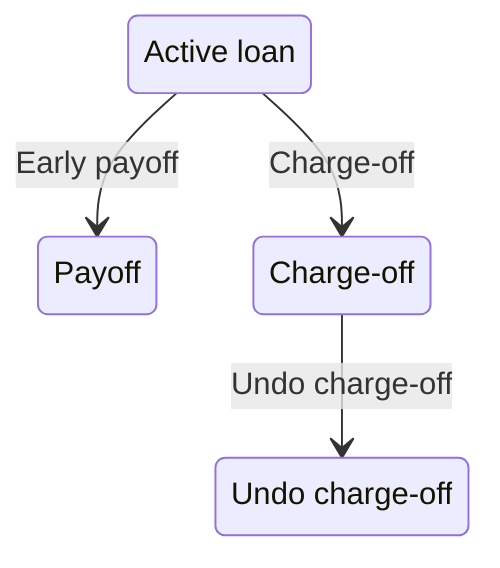
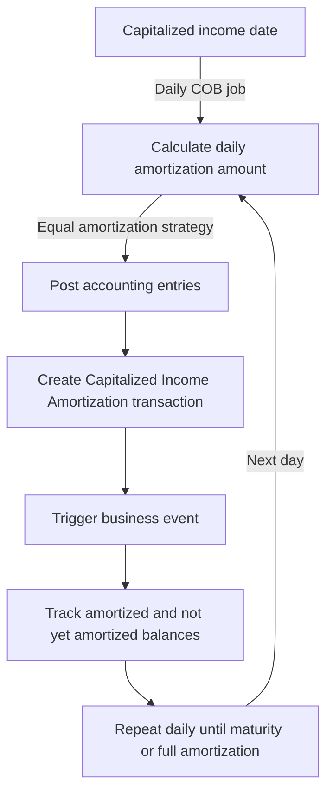
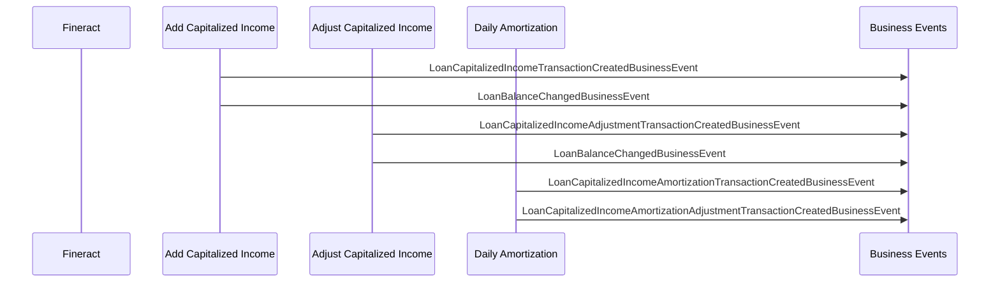
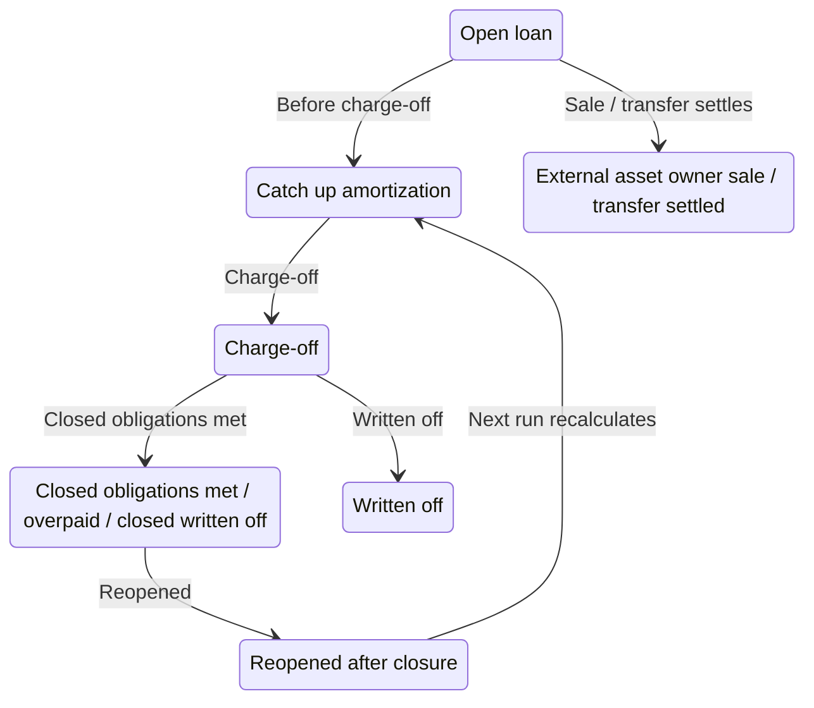
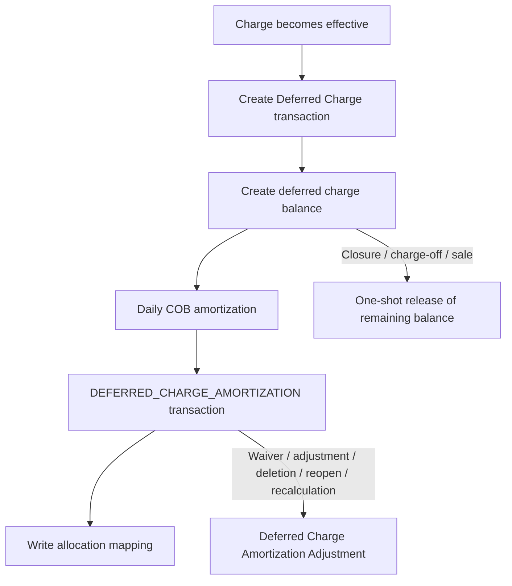
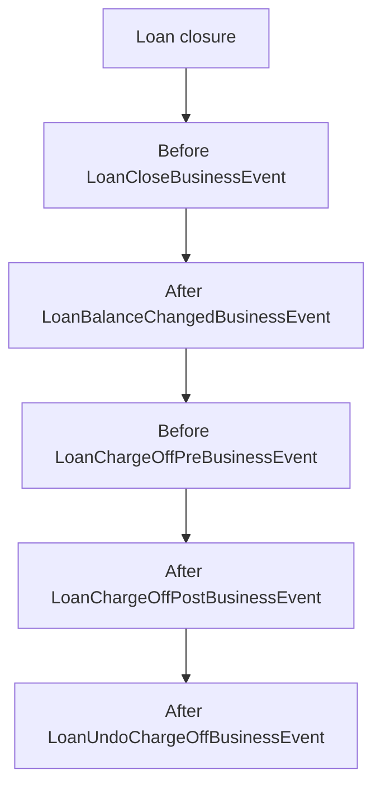

# Fees

## Buy-Down Fees

### Feature overview

Buy-down fees are a unique transaction type used to post merchant fees to a loan account at disbursement and amortize them into interest income over the loan lifecycle. They can be added through the API or from the UI.

Buy-down fees follow these rules:

- Buy-down fees are added at the time of disbursement through the API.
- Buy-down fees can also be added from the UI.
- The buy-down fee amount has no impact on schedule calculation or interest calculation.

### Configuration and product setup

Buy Down fees are configurable at the loan product level and are supported only for progressive loans. The loan must have Buy Down fees enabled, and this setting is inherited from the loan product. Once a loan is created, the Buy Down fees configuration is copied from the loan product.

The following configuration settings apply to Buy Down fees:

- Calculation mode is FLAT, which is the default and only option.
- Amortization strategy is EQUAL_AMORTIZATION, which is the default and only option.
- Income type is FEE or INTEREST, with FEE as the default.
- Daily Buy Down fees recognition is done by equal portions based on the number of days between Buy Down fees date and loan maturity date.

The Buy Down fees balance record stores the following information:

- The loan it links to.
- The Buy Down fees transaction it links to.
- The Buy Down fees amount.
- The Buy Down fees date.
- The not yet recognized income.
- The charged-off Buy Down fees amount.
- The adjustment Buy Down fees amount.

### Adding buy-down fees

You can add buy-down fees to a loan after disbursement once the loan is active. The transaction date can be any date on or after the first disbursement date.

The following rules apply when adding buy-down fees:

- Buy-down fees amount can be either Interest or Fees Income.
- Payment type, note, and external id are supported.
- The system creates a new transaction of type Buy Down fees with the specified amount.
- The specified amount is the transaction amount.
- Buy-down fees do not affect loan schedule calculation, recalculation, or interest calculation.
- Buy-down fees events include adding buy-down fees, daily amortization, and buy-down fees adjustment.

Buy-down fees are treated as an income portion, either Interest or Fees.

### API and template details

You add Buy Down fees using the buyDownFee command. The API returns Buy Down fee information including the Buy down fee amount, Transaction, Amortized amount, Not yet amortized amount, and Adjusted amount.

| Template API | Maximum allowed amount |
| --- | --- |
| Buy Down Fee transaction | Approved amount of the loan minus total disbursed amount minus total buy down fees minus total capitalized income |
| Buy Down Fee Adjustment transaction | Buy Down Fee transaction amount minus total Buy Down Fee adjustment for the original transaction |

### Amortization and daily recognition

Buy-down fees amortize daily like Capitalized Income, using either equal amortization or formula-based amortization as configured. The amortization portion is based on configuration (Fee vs Interest) and the same applies to which GL mapping is used. The system recognizes deferred income as income each day through a daily amortization job and updates the buy-down fee balance to track amortized and not yet amortized amounts. If a loan precloses on the same day, final amortization recognizes all remaining deferred income as income in one shot.

Equal amortization divides the fee by the number of days, while formula-based amortization applies when configured.

- Equal amortization uses fee/days.
- Formula-based amortization applies if configured.
- The amortization formula divides the number of days between the current date and the loan maturity date and not yet amortized capitalized income by that number of days.
- Rounding is done on the calculated amount based on rounding mode configuration.
- If more deferred income is recognized at EOD, a Buy Down fee amortization Adjustment transaction can correct the amount.

### Buy-down fee adjustments

A Buy Down fees Adjustment transaction adjusts or credits the deferred income and reduces the Buy Down fees balance from amortization without affecting the loan balance.

The following rules apply to Buy Down fees Adjustment transactions:

- You can add a Buy Down fee adjustment transaction type to a loan account through API or UI.
- You can invoke an adjustment only on an existing Buy Down fees transaction.
- The adjustment transaction date cannot be earlier than the original transaction date.
- The total adjustment amount cannot exceed the original transaction amount, and total Buy Down fees adjustment cannot exceed the original Buy Down fees transaction.
- Multiple adjustments are allowed on the same original not reverted Buy Down fees transaction.
- The system creates an ADJUSTMENT relation between the original Buy Down fees transaction and the adjustment transaction.
- The related Buy Down Fee Balance is updated by adding the adjustment amount to amountAdjustment.
- Accounting entries mirror Buy Down fees entries.
- There is no allocation strategy for Buy Down Fees Adjustment.
- A RELATED relation is created between the charge-off final amortization transaction and the charge-off transaction.

A Buy Down fees transaction can be reversed only when:

- it has not already been reversed, and
- there is no not yet reversed Buy Down fees Adjustment belonging to that transaction.

### Reversals

You can reverse a Buy Down fees Adjustment transaction that has not already been reversed. The system passes mirror JE entries for the reversal entry. Reversing the transaction updates the related buy down fee balance by subtracting the amount from amountAdjustment. All already amortized amounts are corrected in a Buy Down fees amortization adjustment transaction using mirror JE entries, handled by COB, and the related buy down fee balance is deleted.

### Payoff and charge-off handling

Buy Down fees apply to non-merchant lending, where the EXPENSE parameter is hidden and the system takes the Fund Source parameter mapped GL for accounting. When a loan pays off early, the remaining deferred income balance accelerates and is recognized immediately. Once paid off, no reversal undoes the realized income.

Charge-off handling for buy-down fees works as follows:

- Early payoff scenarios include full prepayment with balance acceleration and partial prepayment handling, validating remaining balance recognition and proper closure.
- Any balance in deferred income is charged off when the loan balance is charged off.
- No daily amortization occurs after the charge-off date.
- Any not yet recognized balance moves to charge-off, and a final amortization with journal entries is created.
- Undoing a charge-off undoes the charge-off final amortization transaction and adjusts accounting entries, but does not undo the amortization transaction because it is a catch-up.
- The amount that should have been already amortized is calculated and differences are corrected with Amortization/Amortization Adjustment journal entries.

Accounting entries for buy-down fees:

| Scenario | Debit | Credit |
| --- | --- | --- |
| Buy Down fees | Parameter Fund Source Type ASSET GL cash at hand | Parameter Deferred Income mapping Type Liability GL Deferred Income |
| Buy Down fees amortization | Buy Down fees Amortization parameter (Income, GL: Interest/fees Income) | Parameter Deferred Income mapping Type Liability GL Deferred Income |
| Buy Down fees amortization in charge-off | Charge-off expense / charge-off expense-bad dept / credit loss-bad dept / credit loss-bad dept-fraud | Parameter Deferred Income mapping Type Liability GL Deferred Income |
| Buy Down fees Adjustment | Parameter Fund Source Type ASSET GL cash at hand | Parameter Deferred Income mapping Type Liability GL Deferred Income |

Accounting entries for payoff, charge-off, write-off, and amortization adjustment:

| Scenario | Debit | Credit |
| --- | --- | --- |
| Pay-off | Buy Down fees Amortization parameter (Income, GL: Interest/fees Income) | Deferred Income mapping (Liability, GL: Deferred Income) |
| Charge-off | Charge-off expense / charge-off expense-bad dept / credit loss-bad dept / credit loss-bad dept-fraud | Deferred Income mapping (Liability, GL: Deferred Income) |
| Write-off | Losses written off parameter (Expense, GL: Written off) | Deferred Income mapping (Liability, GL: Deferred Income) |
| Amortization adjustment | Buy Down fees Amortization parameter (Income, GL: Interest/fees Income) | Deferred Income mapping (Liability, GL: Deferred Income) |

### Accounting entries

Buy-Down fees use journal entries for accounting, and the initial posting debits Expense and credits Deferred Income.

Accounting configuration and coverage:

- Buy-Down fees accounting can be configured between merchant and non-merchant lending (Expense or Asset) at global level loan product configuration.
- For merchant lending, the EXPENSE parameter is shown for mapping at the UI loan product level.
- Special event accounting covers charge-off and adjustments.

### GL mappings and accounts

When Buy Down fees is enabled on a loan product, the system configures a Buy Down Expense account and a Buy Down fees Amortization account for periodical accounting. These accounts are available only for progressive loans.

GL mappings for Buy Down fees behave as follows:

- Buy Down Expense and Buy Down fees Amortization mappings are configurable on a loan product.
- New GL account mappings for Buy Down Expense and Buy Down fees Amortization are added for a loan product.
- Both mappings are mandatory fields when Buy Down fees is enabled.
- Updated mappings are returned as part of loan product details.
- Updates to mappings during loan product update are permitted.

### Balance tracking and visibility

The system maintains a current deferred buy-down fee balance at the loan level and tracks it on both the loan and each buy-down fee transaction across buy-down fee events. The deferred balance tracks correctly through the loan lifecycle. Buy-down fee amortization and daily income recognition have no customer impact or visibility, and buy-down fees do not appear in customer-facing schedules or statements.

### Business events

Fineract triggers external business events for adding Buy Down fees to a loan, adjusting existing Buy Down fees, Buy Down fees amortization, reversal of Buy Down fees or adjustment transactions, and end-of-day Buy Down fees amortization adjustment.

The system emits the following transaction events:

- Adding Buy Down fees to the loan triggers a NEW Buy Down fees transaction event.
- Adjusting existing Buy Down fees triggers a NEW Buy Down fees Adjustment transaction event.
- Buy Down fees amortization triggers a NEW Buy Down fees Amortization transaction event.
- Reversal triggers an EXISTING LoanTransactionAdjustment event.
- End-of-day processing triggers a NEW Buy Down fees Amortization Adjustment transaction event.

New loan transactions of type Buy Down fee Amortization are created for each daily interest recognition of Buy Down fees and trigger a new business event.

Correct handling of payoff and charge-off scenarios is required, and COB processing time remains acceptable.

### Worked examples

A buy-down fee is posted at disbursement and amortized in equal daily amounts over the loan term. The figures are illustrative. A loan of 900.00 is disbursed at 12% annual interest with three monthly installments and 30-day months. A buy-down fee of 90.00 is posted on Day 1, and the loan matures on Day 90. Because the fee does not alter the schedule or interest calculation, the principal is repaid in three installments of 300.00 plus monthly interest on the opening balance. The deferred buy-down balance starts at 90.00 and declines by 1.00 per day, calculated as 90.00 divided by 90 days.

| Step | Date | Deferred balance start | Amortized | Deferred balance end | GL effect |
| --- | --- | --- | --- | --- | --- |
| Fee posted | Day 1 | — | — | 90.00 | Dr BuyDown Expense 90.00 / Cr Deferred Income 90.00 |
| Month 1 amortization | Day 30 | 90.00 | 30.00 | 60.00 | Dr Deferred Income 30.00 / Cr Interest/Fees Income 30.00 |
| Month 2 amortization | Day 60 | 60.00 | 30.00 | 30.00 | Dr Deferred Income 30.00 / Cr Interest/Fees Income 30.00 |
| Month 3 amortization | Day 90 | 30.00 | 30.00 | 0.00 | Dr Deferred Income 30.00 / Cr Interest/Fees Income 30.00 |
| Total |  |  | 90.00 |  |  |

The deferred balance reaches zero at maturity, and fee amortization never changes the loan principal.

A buy-down fee adjustment reduces the deferred income balance without touching the loan principal. A loan of 900.00 carries a 90.00 buy-down fee posted on Day 1 and matures on Day 90. After 30 days, 30.00 has been amortized and the deferred balance is 60.00. On Day 31 an adjustment of 30.00 is posted: it debits Deferred Income and credits BuyDown Expense, lowering the deferred balance to 30.00. The remaining 30.00 is amortized at 0.50 per day over the final 60 days. Total adjustments stay within the original 90.00 fee, and the loan balance follows its scheduled repayments independently of the fee. Moving the adjustment to a later date would leave more of the original fee amortized before the reduction, but the loan balance would still be unaffected.

| Step | Date | Deferred balance start | Amount | Deferred balance end | Loan balance | GL effect |
| --- | --- | --- | --- | --- | --- | --- |
| Fee posted | Day 1 | — | 90.00 | 90.00 | 900.00 | Dr BuyDown Expense 90.00 / Cr Deferred Income 90.00 |
| Month 1 amortization | Day 30 | 90.00 | 30.00 | 60.00 | 600.00 | Dr Deferred Income 30.00 / Cr Interest/Fees Income 30.00 |
| Adjustment | Day 31 | 60.00 | 30.00 | 30.00 | 600.00 | Dr Deferred Income 30.00 / Cr BuyDown Expense 30.00 |
| Remaining amortization | Day 90 | 30.00 | 30.00 | 0.00 | 0.00 | Dr Deferred Income 30.00 / Cr Interest/Fees Income 30.00 |

The adjustment reduces deferred income and the expense account, leaves the loan balance unchanged, and later amortization applies to the reduced balance.

When a loan is paid off early, any remaining deferred buy-down balance is accelerated and recognized immediately. A loan of 900.00 carries a 90.00 buy-down fee posted on Day 1 and matures on Day 90. By Day 45, 45.00 has been amortized at 1.00 per day, leaving a deferred balance of 45.00. The borrower repays the outstanding principal of 600.00 plus accrued interest on Day 45. The remaining 45.00 deferred balance is recognized in full at payoff, bringing the deferred balance to zero. No further amortization occurs after payoff.

| Step | Date | Deferred balance start | Recognized | Deferred balance end | Loan balance | GL effect |
| --- | --- | --- | --- | --- | --- | --- |
| Fee posted | Day 1 | — | 90.00 | 90.00 | 900.00 | Dr BuyDown Expense 90.00 / Cr Deferred Income 90.00 |
| Amortization to payoff | Day 45 | 90.00 | 45.00 | 45.00 | 600.00 | Dr Deferred Income 45.00 / Cr Interest/Fees Income 45.00 |
| Payoff acceleration | Day 45 | 45.00 | 45.00 | 0.00 | 0.00 | Dr Deferred Income 45.00 / Cr Interest/Fees Income 45.00 |

The early payoff accelerates the unamortized deferred income, so the full fee is recognized by the payoff date.

On charge-off, the remaining deferred buy-down balance is written off and no further amortization is posted. A loan of 900.00 carries a 90.00 buy-down fee posted on Day 1. After 30 days, 30.00 is amortized and the deferred balance is 60.00 while the loan balance is 600.00. On Day 60 the loan is charged off. The remaining 60.00 deferred balance is written off against the charge-off expense, the deferred balance reaches zero, and daily amortization stops.

| Step | Date | Deferred balance start | Written off | Deferred balance end | Loan balance | GL effect |
| --- | --- | --- | --- | --- | --- | --- |
| Fee posted | Day 1 | — | 90.00 | 90.00 | 900.00 | Dr BuyDown Expense 90.00 / Cr Deferred Income 90.00 |
| Month 1 amortization | Day 30 | 90.00 | 30.00 | 60.00 | 600.00 | Dr Deferred Income 30.00 / Cr Interest/Fees Income 30.00 |
| Charge-off | Day 60 | 60.00 | 60.00 | 0.00 | 0.00 | Dr Charge-off expense 60.00 / Cr Deferred Income 60.00 |

The charge-off writes off the unamortized deferred balance and ends all future buy-down fee amortization.

## Capitalized Income

### Overview and purpose

Capitalized Income is a fee-based or interest-based income item added to the principal of a loan and amortized over time. It is applied at disbursement and treated as part of the loan's principal for repayment and interest calculations. It enables financial institutions to recognize deferred income systematically over the loan term, aligning accounting practices with regulatory requirements and improving income recognition accuracy.

Capitalized Income applies under the following conditions:

- It is supported only for Progressive Loan Schedules.
- It is added via API on or after the first disbursement date.
- Disbursement plus Capitalized Income must be less than or equal to Approved Loan Amount.
- It is treated as a principal portion that recalculates the repayment schedule.

The system introduces these transaction types for Capitalized Income:

- Capitalized Income
- Capitalized Income Amortization
- Capitalized Income Adjustment
- Capitalized Income Amortization Adjustment

Amortization behavior depends on loan events:

- Capitalized income amortization is recognized daily using the configured strategy, moving portions from Deferred Income to Income from Capitalization.
- On preclosure, amortization stops and the remaining balance is recognized in full on the preclosure date.
- On charge-off, amortization stops and the remaining balance is charged off.
- If the original Capitalized Income transaction is reversed, all associated amortization transactions are reversed via Capitalized Income Amortization Adjustment transactions.

If a Capitalized Income Adjustment exceeds the unrecognized balance, the accounting entry debits Deferred Income plus Income and credits Loan Portfolio (Asset).

### Configuration at loan product level

Capitalized income is configurable at the loan product level and includes status, calculation mode, strategy, and income type. You can enable it, choose the calculation mode, amortization strategy, income type, and GL mappings. The feature is disabled by default.

The following configuration options apply to capitalized income at the loan product level:

- Enable Capitalized Income is a boolean toggle and defaults to disabled.
- Calculation Mode supports only FLAT, which is also the default.
- Amortization Strategy supports only EQUAL_AMORTIZATION, which is also the default, and recognizes daily capitalized income in equal portions over the life of the loan.
- Income Type supports FEE as the default and INTEREST as an option.
- GL Mapping includes Deferred Income as a Liability mapping to GL Deferred Income and Income from Capitalization as an Income mapping to GL Interest/fees Income.

Capitalized income configuration is stored on the loan product in m_product_loan using these columns:

- enable_income_capitalization
- capitalized_income_calculation_type
- capitalized_income_strategy
- capitalized_income_type

| Configuration | Value |
| --- | --- |
| Enable Capitalized Income | Boolean toggle, default disabled |
| Calculation Mode | FLAT only (default) |
| Amortization Strategy | EQUAL_AMORTIZATION only (default) |
| Income Type | FEE (default) or INTEREST |
| GL Mapping | Deferred Income (Liability) to GL Deferred Income; Income from Capitalization (Income) to GL Interest/fees Income |

Capitalized income can be FLAT (default) or % of Disbursement amount. Amortization strategy default is Equal amortization. Income type defines allocation rules with FEE as default and INTEREST as option. Daily capitalized income recognition is done by equal portions based on the number of days between capitalized income date and loan maturity date. The capitalized income transaction accounting uses a new transaction type with Deferred Income mapping of type Liability to GL Deferred Income.

### Loan-level configuration and balances

Capitalized Income configuration is stored on the loan record in m_loan using enable_income_capitalization, capitalized_income_calculation_type, capitalized_income_strategy, and capitalized_income_type. Once a loan is created, this configuration is copied from the loan product. Loan-level balances include capitalized_income_derived and capitalized_income_adjustment_derived.

Each capitalized income transaction has its own balance row in m_loan_capitalized_income_balance.

The m_loan_capitalized_income_balance table stores one row per capitalized income transaction.

| Column | Description |
| --- | --- |
| id | Primary key |
| version | Record version |
| loan_id | Reference to the loan |
| loan_transaction_id | Reference to the capitalized income transaction |
| amount | Capitalized income transaction amount |
| date | Capitalized income transaction date |
| unrecognized_amount | Amortization amount not yet recognized |
| charged_off_amount | Charged-off balance |
| amount_adjustment | Total adjustment amount |
| created_by | User who created the row |
| created_on_utc | Creation timestamp |
| last_modified_by | User who last modified the row |
| last_modified_on_utc | Last modification timestamp |

### Adding capitalized income

You can add capitalized income to a loan account through the API. The transaction amount is whatever amount you provide, and payment type, note, and external id are supported. Capitalized income can be added once the loan is active and is only supported for progressive loans. The transaction date can be any date on or after the first disbursement date.

Adding capitalized income is subject to these validations:

- The loan must be a progressive loan.
- Income capitalization must be enabled on the loan.
- Disbursement amount plus capitalized income must be less than or equal to the approved amount.

### Disbursement validation

When capitalized income is added to a loan, disbursement validation compares the disbursement amount plus capitalized income against the applied amount and, where applicable, the approved amount. For loans with an over-applied percentage configuration, the available disbursement amount uses the calculated maximum disbursable amount instead of the approved amount.

### Principal treatment and schedule impact

Capitalized income is treated as principal for schedule calculation and follows daily amortization. It applies after disbursement for Progressive Loans.

Capitalized income affects principal and interest calculations as follows:

- The capitalized income amount is considered a principal portion.
- Schedule calculation and interest calculation are based on the disbursement amount plus capitalized income.
- Capitalized income creates a distinct loan transaction with its own type, not merged with disbursements or repayments.
- The loan schedule includes the added amount in outstanding principal.
- Accounting entries debit Loan Portfolio (Asset) and credit Deferred Income (Liability).
- Daily amortization runs through Capitalized Income Amortization transactions.
- Validation enforcement includes amount limits and date restrictions.

### Amortization mechanics

Capitalized income amortization runs daily at close of business for origination fees. It recognizes a portion of deferred income as income each day based on the configured income type and amortization strategy. Equal amortization is the default and only strategy option.

The amortization mechanics work as follows:

- The system calculates the daily amount by dividing the not yet amortized capitalized income by the number of days between the current date and the loan maturity date.
- The calculated amount is rounded based on the configured rounding mode.
- A new journal entry is created for each daily amortization transaction entry.
- A new loan transaction of type Capitalized Income Amortization is created for each daily interest recognition and triggers a new business event.
- The accounting entry debits Deferred Income (Liability) and credits Income from Capitalization (Income).

Amortization posts automatically each day from the capitalized income date until maturity or full amortization through a background close-of-business job. Fineract tracks both amortized and not yet amortized capitalized income balances on a loan and capitalized income transaction basis, with one entry per transaction per loan.

The system maintains the fees balance during amortization as:

- balance minus capitalized income minus fee credits/adjustments minus fee income recognized.

If the loan is preclosed on the same day, final amortization is done for the balance amount, recognizing all remaining not yet recognized amount as income in one shot.

### Charge-off behavior

Charge-off charges off the capitalized income and stops daily amortization after the charge-off date; any not yet recognized balance moves to charge-off. Undoing charge-off reverses this behavior and adjusts the accounting entries.

If the loan is rescheduled and the maturity date changes, the amortization schedule changes with the new maturity date.

### Capitalized income adjustment

A Capitalized Income Adjustment is a new loan transaction type that works as a credit transaction reducing the origination fees balance from amortization. It reduces the Capitalized Income balance on an existing Capitalized Income transaction. It applies only to progressive loans, and its transaction date cannot be in the future or earlier than the original transaction date.

The following rules govern Capitalized Income Adjustments:

- An adjustment can be invoked only on existing, not reverted Capitalized Income transactions, and multiple adjustments are allowed on the same original transaction.
- The total adjustment amount cannot exceed the original transaction amount, and total capitalized income adjustment cannot be more than the original capitalized income transaction.
- The adjustment amount cannot exceed the remaining not yet recognized amount of LoanCapitalizedIncomeBalance (m_loan_capitalized_income_balance); if the balance would go negative, it is set to 0.
- An adjustment transaction can have a value equal to the original Capitalized Income transaction.
- The adjustment transaction lists relations of type ADJUSTMENT between the original Capitalized Income transaction and the adjustment transaction.
- The adjustment can have its own Allocation Strategy set and reduces loan balances as per that allocation.
- Accounting entries work like a mirror of Capitalized Income entries.
- The adjustment can be backdated, similarly as Charge or interest adjustment.
- The adjustment cannot be reversed; if incorrect, it must be re-applied.
- Adjustment logic includes proper balance reduction and accounting splits.

The following rules apply to closed or overpaid loans:

- Accounting entries for Capitalized Income remain CR GL Loan Receivable (Parameter: Loan Portfolio) and CR GL Deferred Income GL (Parameter: Defered income mapping).
- The adjustment transaction follows the payment allocation strategy set, and the overpaid amount credits the overpaid portion.
- No changes are made to the repayment schedule side for the overpaid portion.

### Reversal handling

Reversal handling covers transaction dependencies and mirror entries. Reversal must be handled manually via dedicated transactions; no automatic reversal is supported.

A transaction can be reversed only when it has not yet been reversed and its dependency condition is met:

- A Capitalized Income transaction is allowed to be reversed if there is no not yet reversed Capitalized Income Adjustment belonging to it.
- A Capitalized Income Adjustment transaction that has not yet been reversed is allowed to be reversed.

Reversing a Capitalized Income transaction generates the following:

- A Capitalized Income Amortization Adjustment is automatically generated.
- The adjustment reverses all already recognized portions (amortized income) linked to the original Capitalized Income transaction.
- The adjustment debits Income from Capitalization (Income) and credits Deferred Income (Liability).
- The adjustment links to the original Capitalized Income transaction to maintain traceability.
- The adjustment is system-generated only and cannot be created manually by API or UI.

Reversing a Capitalized Income Adjustment transaction uses the following:

- Mirror JE entries are used as the basis for the reversal entry.
- Reverse-replay reuses the same logic as Repayment transaction handling.

Reversal triggers these business events:

- Capitalized Income Amortization Adjustment.
- LoanAdjustTransactionBusinessEvent.
- Loan Balance changed.
- Loan Status changed if applicable.

Special conditions apply during reverse-replay:

- If a loan is in overpaid state or goes into overpaid, Principal maps to Overpayment amount during Capitalized Income reverse-replay.
- When Capitalized Income is applied on closed or overpaid loans, future installments from the Capitalized Income posting date are recalculated accordingly.
- Capitalized income transactions support backdating.
- Adjustment transactions must not predate the original capitalized income.

| Transaction type | Debit | Credit |
| --- | --- | --- |
| Capitalized Income | Loan Portfolio (Asset) | Deferred Income (Liability) |
| Capitalized Income Amortization | Deferred Income (Liability) | Income from Capitalization (Income) |
| Capitalized Income Adjustment | Deferred Income (Liability) / Income from Capitalization (Income) | Loan Portfolio (Asset) |

The new GL mapping is returned as part of loan product details and can be updated during loan product update.

> **Note:** Once a loan is paid off, there is no reversal or anything that undoes the realized income.

When a Capitalized Income transaction is reversed, all already amortized amounts are corrected in a Capitalized income amortization adjustment transaction with mirror JE entries.

### GL mapping and accounting

Capitalized income requires GL mapping for Deferred Income and Income from Capitalization on the loan product. Deferred Income is a liability account and is available only for progressive loans when income capitalization is enabled. All accounting entries must balance with proper GL mapping.

| GL account | Type | Use |
| --- | --- | --- |
| Deferred Income | Liability | Periodical accounting for capitalized income |
| Income from Capitalization | Income | Income type mapping for capitalized income |

An origination fee adjustment posts as a debit to Deferred Income and a credit to Loan Receivable.

### Business events

Fineract triggers external business events when capitalized income is added, adjusted, amortized, or reversed. The events depend on the action taken and whether loan balance or loan status changes apply.

Adding capitalized income triggers the following events:

- Capitalized Income transaction event.
- Loan Balance changed business event.
- Loan Status changed business event if applicable.

Adjusting existing capitalized income triggers the following events:

- Capitalized Income Adjustment transaction event.
- Loan Balance changed business event.
- Loan Status changed business event if applicable.

Capitalized income amortization triggers the following events:

- Capitalized Income Amortization transaction event.
- Capitalized Income Amortization Adjustment transaction event.

Reversal of capitalized income or an adjustment transaction triggers the following events:

- Capitalized Income transaction event.
- Capitalized Income Adjustment transaction event.

| Action | Business events |
| --- | --- |
| Create Capitalized Income transaction | LoanCapitalizedIncomeTransactionCreatedBusinessEvent, LoanBalanceChangedBusinessEvent |
| Daily amortization | LoanCapitalizedIncomeAmortizationTransactionCreatedBusinessEvent, LoanCapitalizedIncomeAmortizationAdjustmentTransactionCreatedBusinessEvent |
| Create Capitalized Income Adjustment transaction | LoanCapitalizedIncomeAdjustmentTransactionCreatedBusinessEvent, LoanBalanceChangedBusinessEvent |

Capitalized income amortization also triggers:

- Capitalized Income Amortization transaction event.

### API endpoints and commands

You add capitalized income to a loan using the capitalizedIncome command, and you retrieve capitalized income details for a loan through its loan ID. Configuration happens at loan product level.

The following endpoints and commands support capitalized income:

- POST /loanproducts configures capitalized income on a loan product with mandatory fields enableIncomeCapitalization, capitalizedIncomeCalculationType, capitalizedIncomeStrategy, and capitalizedIncomeType.
- POST /loans/{loanId}?command=capitalizedIncome adds capitalized income with mandatory fields transactionDate, dateFormat, locale, and transactionAmount, and optional fields paymentTypeId, note, and externalId.
- GET /loans/{loanId}/deferredincome fetches capitalized income details including capitalized income amount, amortized amount, not yet amortized amount, and adjusted amount.
- GET /loans/{loanId}/capitalizedincome retrieves capitalized income amortization information.
- POST /loans/{loanId}/transactions/{capitalizedIncomeTransactionId}?command=capitalizedIncomeAdjustment adds a capitalized income adjustment with mandatory fields transactionDate, dateFormat, locale, and transactionAmount, and optional fields paymentTypeId, note, and externalId.
- GET /loans/{loanId}/transactions/template?command=capitalizedIncome retrieves capitalized income limits, returning paymentTypeOptions, currency, date, and amount.
- GET /loans/{loanId}/transactions/template?command=capitalizedIncomeAdjustment retrieves capitalized income adjustment limits, returning paymentTypeOptions, currency, date, and amount.

The API responses return the following identifiers:

- The Add Capitalized Income response body returns resourceId and resourceExternalId.
- The Add Capitalized Income Adjustment response body returns resourceId and resourceExternalId.

> **Note:** The ability to get capitalized income details via external Id should be added.

### Limits and calculations

Schedule calculation and interest calculation both use the disbursement amount plus capitalized income as their basis. The maximum capitalized income transaction amount equals the approved loan amount minus the total disbursed amount minus total capitalized income. The maximum capitalized income adjustment amount equals the capitalized income transaction amount minus total capitalized income adjustments for the original transaction.

### Other integration notes

Capitalized Income integrates with charge-off, preclose, and reschedule operations, and the system fires correct business events for all operations. Origination fees can be added to multi disbursements, with each disbursement able to enable or disable them. Fees amortization starts from the disbursement date, same as accruals. UC-1 iteration is disabled and the iterate-with value is 0.00. UC-2 iteration is disabled and the iterate-with value is 0.00.

Capitalized Income Adjustment uses the following allocation strategy:

- past due Principal
- past due Int
- Past due fees
- Past due Penalty
- due Principal
- due Int
- due fees
- due Penalty
- advance Principal
- advance Int
- advance fees
- advance Penalty

Adding capitalized income and daily amortization affect database balances as follows:

- Adding capitalized income creates a new Capitalized income transaction with the capitalized income amount, considered a principal portion on the loan transaction.
- Database balances are maintained over events including adding capitalized income and daily amortization of capitalized income.

> **Note:** When a Capitalized Income Adjustment transaction is created and the loan gets closed or overpaid, Capitalized Income Amortization Adjustment is calculated and created in realtime during COB execution.

### Worked examples

A loan is disbursed with a principal of 1,000.00 and a capitalized income of 200.00, so the repayment schedule is calculated on 1,200.00. The annual interest rate is 12%, the year has 360 days, each month has 30 days, and the loan is repaid in three monthly installments. Capitalized income is added at disbursement, treated as principal for interest and installment calculations, and amortized daily from Deferred Income to Income from Capitalization using the EQUAL_AMORTIZATION strategy. These figures are illustrative. The example shows that capitalized income increases the principal base for interest and installments while its deferred balance is amortized to income day by day.

| Date | Event | Principal balance | Interest | Principal paid | Deferred income | Income recognized |
| --- | --- | --- | --- | --- | --- | --- |
| 1/1/24 | Disbursement and capitalized income | 1,200.00 | — | — | 200.00 | — |
| 2/1/24 | Installment 1 after monthly amortization | 803.98 | 12.00 | 396.02 | 133.33 | 66.67 |
| 3/1/24 | Installment 2 after monthly amortization | 404.00 | 8.04 | 399.98 | 66.66 | 66.67 |
| 4/1/24 | Installment 3 and final amortization | 0.00 | 4.04 | 404.00 | 0.00 | 66.66 |
| Totals | — | — | 24.08 | 1,200.00 | — | 200.00 |

After part of the capitalized income has been recognized, a lender may post a Capitalized Income Adjustment to reduce the deferred balance. Using the same loan of 1,000.00 principal plus 200.00 capitalized income, assume 66.67 has already been recognized, leaving 133.33 not yet recognized. An adjustment of 100.00 is posted on 3/1/24. If the adjustment exceeds the remaining balance, the excess is debited to Income from Capitalization and the deferred balance is floored at zero. The example shows that an adjustment reduces the amortization basis, and when it exceeds the unrecognized balance the excess hits Income from Capitalization.

| Date | Transaction | Deferred income before | Adjustment | Deferred income after | Accounting entry |
| --- | --- | --- | --- | --- | --- |
| 1/1/24 | Capitalized income | — | 200.00 | 200.00 | Dr Loan Portfolio 200.00 / Cr Deferred Income 200.00 |
| 2/1/24 | Amortization | 200.00 | 66.67 | 133.33 | Dr Deferred Income 66.67 / Cr Income from Capitalization 66.67 |
| 3/1/24 | Capitalized income adjustment | 133.33 | 100.00 | 33.33 | Dr Deferred Income 100.00 / Cr Loan Portfolio 100.00 |
| 4/1/24 | Final amortization | 33.33 | 33.33 | 0.00 | Dr Deferred Income 33.33 / Cr Income from Capitalization 33.33 |

A Capitalized Income transaction can be reversed when no unreversed adjustment depends on it. Reversal generates a system-created Capitalized Income Amortization Adjustment that mirrors the already recognized income, and the original entry is mirrored against Loan Portfolio. Using the same 1,000.00 principal and 200.00 capitalized income, assume 66.67 was recognized by 2/1/24 and the transaction is reversed on 2/15/24. The example shows that reversal unwinds both the recognized income and the original principal addition through mirror journal entries.

| Date | Transaction | Deferred income | Income from capitalization | Accounting entry |
| --- | --- | --- | --- | --- |
| 1/1/24 | Capitalized income | 200.00 | 0.00 | Dr Loan Portfolio 200.00 / Cr Deferred Income 200.00 |
| 2/1/24 | Amortization to date | 133.33 | 66.67 | Dr Deferred Income 66.67 / Cr Income from Capitalization 66.67 |
| 2/15/24 | Reversal: amortization adjustment | 200.00 | 0.00 | Dr Income from Capitalization 66.67 / Cr Deferred Income 66.67 |
| 2/15/24 | Reversal: original transaction | 0.00 | 0.00 | Dr Deferred Income 200.00 / Cr Loan Portfolio 200.00 |
| Totals | — | — | — | — |

Capitalized income integrates with charge-off and preclosure. On charge-off, daily amortization stops and any not yet recognized deferred income is moved to charge-off. On preclosure on the same day, final amortization recognizes the full remaining balance in one shot. Using the same 1,000.00 principal and 200.00 capitalized income, assume the loan is charged off on 3/15/24 after two installments, with 404.00 principal outstanding and 66.66 deferred income still unrecognized. The example shows that charge-off freezes amortization and charges off the remaining deferred balance together with the outstanding principal.

| Date | Event | Principal balance | Deferred income remaining | Income recognized to date | Charge-off amount |
| --- | --- | --- | --- | --- | --- |
| 1/1/24 | Disbursement and capitalized income | 1,200.00 | 200.00 | 0.00 | — |
| 2/1/24 | Installment 1 | 803.98 | 133.33 | 66.67 | — |
| 3/1/24 | Installment 2 | 404.00 | 66.66 | 133.34 | — |
| 3/15/24 | Charge-off stops amortization | 0.00 | 0.00 | 133.34 | 470.66 |
| Totals | — | — | — | 133.34 | 470.66 |

## Fee Classification

### Classification overview

You can configure and select a classification for capitalized Income and BuyDown fee transactions. Classification selection is optional for both transaction types.

The loan transaction entity includes a new classification field:

- Database data type: Long
- Java type: CodeValue

Two new codes support the classification field:

- capitalized_income_transaction_classification for Capitalized Income transaction type
- buydown_fee_transaction_classification for Buydown Fee transaction type

### APIs

The Template API returns classification values for Capitalized Income and Buydown Fee transaction types only, with classificationOptions as a list of code values that defaults to none when none are set.

The following APIs list amortization allocation schedule base details:

- /v1/loans/{loandId}/capitalized-incomes/{loanTransactionId}
- /v1/loans/external-id/{loandExternalId}/capitalized-incomes/{loanTransactionId}
- /v1/loans/{loandId}/capitalized-incomes/external-id/{loanTransactionExternalId}
- /v1/loans/external-id/{loandExternalId}/capitalized-incomes/external-id/{loanTransactionExternalId}
- /v1/loans/{loandId}/buydown-fees/{loanTransactionId}
- /v1/loans/external-id/{loandExternalId}/buydown-fees/{loanTransactionId}
- /v1/loans/{loandId}/buydown-fees/external-id/{loanTransactionExternalId}
- /v1/loans/external-id/{loandExternalId}/buydown-fees/external-id/{loanTransactionExternalId}

Each response includes:

- Loan id
- Loan external id
- Base loan transaction
- Base loan transaction date
- Base loan transaction amount
- Unrecognized amount
- Charged-off amount
- Adjustment amount
- Mapping table with amortization loan transaction id, amortization loan transaction external id, date, type (Amortization or Amortization adjustment), and amount

### Transaction behavior

When you create a Capitalized Income or Buydown Fee transaction, you can optionally provide a classification, which Fineract stores at transaction level; if you do not provide one, it remains null. Fineract validates the classification against the related codes. An adjustment transaction created for an existing Capitalized Income or Buydown fee transaction inherits the target transaction classification automatically, and you cannot set a different classification. Amortization transactions do not inherit a classification because they contain only an aggregated amount.

### Amortization schedules

The system calculates and stores Daily Amortization schedules at each Classification level. When an Adjustment transaction happens, the system recalculates. A Daily Amortization transaction can be aggregated to one entry at transaction level, but you can drill down to classification level if required.

### Amortization mapping table

The amortization mapping table stores Capitalized Income and Buydown fee amortization allocation.

| Column | Type | Description |
| --- | --- | --- |
| type | Enum | Capitalized Income or Buydown fee |
| loan_id | FK to Loan | The loan the mapping belongs to |
| base_loan_transaction_id | FK to loan transaction | The original transaction |
| date | DATE | The mapping date |
| amortization_loan_transaction_id | FK to loan transaction | The amortization transaction |
| type | ENUM AM / AM_ADJ | Amortization or amortization adjustment |
| amount | BigDecimal | The allocated amount |
| audit fields | Audit fields | Standard audit fields |

Rows are created when Capitalized income / buy down fee amortization or amortization adjustment transactions are calculated and created. Mapping table rows are not linked to the Loan transaction and must not be fetched via loan transactions.

### Allocation and income GL selection

When a Capitalized Income or Buy-Down fee transaction exists, the system determines the amount considered and the income GL account used for amortization based on how many transactions exist and whether they share a classification.

The system applies the following rules:

- When only one Capitalized Income or Buy-Down fee transaction exists, the full amount is considered.
- When multiple Capitalized Income or Buy-Down fee transactions exist with the same classification, the full amount is considered.
- When multiple Capitalized Income or Buy-Down fee transactions exist with different classifications, the system fetches the allocation mapping from the amortization mapping table.
- If the amortization mapping table does not exist or has no entry, the system calculates today’s amortization for each transaction on the fly, groups them by classification, and uses the appropriate income GL account.

| Fee type | Debit parameter | Debit GL | Credit parameter | Credit GL |
| --- | --- | --- | --- | --- |
| Capitalized Income | Differed Income | Liability GL Differed Income | Income from Amortization | Interest/fees Income |
| Buy-Down fees | Differed Income | Liability GL Differed Income | Buy Down fees Amortization | Interest/fees Income |

### Advanced accounting rules

Advanced accounting rules let you map a different income GL account for daily amortization based on the fee classification selected. You can define one credit income account per classification code value, and mappings can be added, updated, or deleted.

| Classification code value | Maximum GL accounts per value | Mapping actions |
| --- | --- | --- |
| capitalized_income_transaction_classification | 1 | Add, update, delete |
| buydown_fee_transaction_classification | 1 | Add, update, delete |

Classification information is exposed in the following places:

- The Fetch Loan transaction API returns the classification field.
- Business events contain the classification field.

### Worked examples

A loan receives a single Capitalized Income transaction of 1,000.00. No classification is selected, so the transaction classification remains null. The system amortizes 250.00 at the start of each month, debiting Deferred Income and crediting Income from Amortization. The figures in this example are illustrative.

| Date | Event | Amount | Classification | Debit GL | Credit GL | Deferred Income Balance |
| --- | --- | --- | --- | --- | --- | --- |
| 1 Jan | Capitalized Income | 1,000.00 | null | Deferred Income | — | 1,000.00 |
| 1 Feb | Amortization | 250.00 | null | Deferred Income | Income from Amortization | 750.00 |
| 1 Mar | Amortization | 250.00 | null | Deferred Income | Income from Amortization | 500.00 |
| 1 Apr | Amortization | 250.00 | null | Deferred Income | Income from Amortization | 250.00 |
| 1 May | Amortization | 250.00 | null | Deferred Income | Income from Amortization | 0.00 |

With no classification, amortization uses the default liability and income accounts and the classification field stays null.

A loan holds two Capitalized Income transactions: 1,200.00 classified as Usage Fees and 800.00 classified as Late Fees. Because the classifications differ, the system calculates the day’s amortization for each transaction separately and groups the result by classification. On 1 February the total amortization is 200.00, split as 120.00 for Usage Fees and 80.00 for Late Fees.

| Date | Base Transaction | Classification | Amount | Debit GL | Credit GL |
| --- | --- | --- | --- | --- | --- |
| 1 Feb | Capitalized Income 1,200.00 | Usage Fees | 120.00 | Deferred Income | Income from Amortization |
| 1 Feb | Capitalized Income 800.00 | Late Fees | 80.00 | Deferred Income | Income from Amortization |
| Total |  |  | 200.00 |  |  |

If both transactions shared the same classification, the system would treat the full amount as one group instead of splitting by classification.

A loan product defines an advance accounting rule that maps the classification Usage Fees to the credit account Usage Fees Income. A Capitalized Income transaction of 900.00 is created with that classification. The system amortizes 300.00 each month, debiting Deferred Income and crediting Usage Fees Income.

| Date | Event | Amount | Classification | Debit GL | Credit GL | Deferred Income Balance |
| --- | --- | --- | --- | --- | --- | --- |
| 1 Jan | Capitalized Income | 900.00 | Usage Fees | Deferred Income | — | 900.00 |
| 1 Feb | Amortization | 300.00 | Usage Fees | Deferred Income | Usage Fees Income | 600.00 |
| 1 Mar | Amortization | 300.00 | Usage Fees | Deferred Income | Usage Fees Income | 300.00 |
| 1 Apr | Amortization | 300.00 | Usage Fees | Deferred Income | Usage Fees Income | 0.00 |

The advance accounting rule overrides the default credit account, so the classified transaction credits Usage Fees Income rather than Income from Amortization.

See also: [Buy-Down Fees](#buy-down-fees), [Capitalized Income](#capitalized-income).

## Charge Amortization

### Feature overview and scope

Charge amortization spreads eligible loan charge income over the loan term or a fixed number of days instead of recognizing it when the charge is booked or paid. It applies to progressive loans and loan fees with eligible charge time types; charges without an amortization configuration keep today's behaviour by default. Cumulative loans, penalties, installment and overdue fees, savings charges, and effective-rate catch-up for historical periods are out of scope.

When a charge is amortized, the following rules apply:

- The full charge amount goes to a deferred income liability when the charge is applied, and the receivable is booked against it.
- Daily amortization transactions move income from deferred income into income over the full loan term or X days, using a flat or effective rate method.
- Accrual does not recognize income for that charge, so income is never counted twice.
- The remaining deferred balance releases in one shot when the loan is fully paid, overpaid, written off or sold, and immediately when the loan is charged off.

The feature reuses the Capitalized Income and Buy-down Fee rulebook, including a deferred balance per source, daily COB amortization, allocation mappings, one-shot release on closure, and release linked to charge-off. Patterns, naming and lifecycle semantics match those features, and the flat calculation is shared code rather than a copy. Default NONE applies everywhere, so existing charges, products and loans behave the same, no data migration is needed, and API changes only add fields.

### Charge definition configuration

A loan charge definition controls whether its charge amortizes and how. The amortization period type is NONE by default, or FULL_LOAN_TERM or NUMBER_OF_DAYS; NUMBER_OF_DAYS requires a positive integer amortization days value. Only loan fees can be amortized, not penalties, and allowed charge time types are DISBURSEMENT, TRANCHE_DISBURSEMENT and SPECIFIED_DUE_DATE. The configuration is copied onto the loan charge when the loan charge is created, and later changes to the charge definition do not affect existing loan charges.

| Setting | Options |
| --- | --- |
| Amortization period type | NONE (default), FULL_LOAN_TERM, NUMBER_OF_DAYS |
| Amortization calculation type | FLAT (default), EFFECTIVE_RATE |
| Amortization income type | FEE (default), INTEREST |

The following rules restrict which combinations are valid:

- EFFECTIVE_RATE is allowed only with FULL_LOAN_TERM.
- NONE keeps today's behaviour: periodic or upfront accrual accrues, cash based recognizes on payment, and none posts no journal entries.

### Product enablement and validation

Charge amortization applies to a loan product only when its enable charge amortization flag is on; the flag defaults to false. Without it, amortized charges cannot be attached to the product or added to its loans, and the system returns a validation error. Amortization is supported only for progressive loans using the advanced-payment-allocation strategy.

Charge amortization accepts specific accrual methods and requires GL mappings under accrual accounting:

- Charge amortization is allowed with ACCRUAL_PERIODIC, ACCRUAL_UPFRONT and NONE, and rejected for CASH_BASED; with NONE, balances and transactions are tracked but no journal entries are posted.
- With accrual accounting, the product must have GL mappings for fee receivable, deferred income liability, fee income, and interest income if any attached charge uses income type INTEREST.

A product can optionally override the charge-level amortization configuration for each attached charge.

### Accounting entries and transaction types

| Transaction type | Debit | Credit |
| --- | --- | --- |
| DEFERRED_CHARGE | FEES_RECEIVABLE | DEFERRED_INCOME_LIABILITY |
| DEFERRED_CHARGE_AMORTIZATION not charged off | DEFERRED_INCOME_LIABILITY | INCOME_FROM_FEES or the income account mapped to the charge, or INTEREST_ON_LOANS, or LOSSES_WRITTEN_OFF if the loan is written off |
| DEFERRED_CHARGE_AMORTIZATION charged off | DEFERRED_INCOME_LIABILITY | the account mapped to the charge-off reason, otherwise CHARGE_OFF_EXPENSE or CHARGE_OFF_FRAUD_EXPENSE |
| DEFERRED_CHARGE_AMORTIZATION_ADJUSTMENT | fee income or interest income | DEFERRED_INCOME_LIABILITY |
| WAIVE_CHARGES or CHARGE_ADJUSTMENT on an amortized charge | DEFERRED_INCOME_LIABILITY | FEES_RECEIVABLE |
| Repayment fee portion | Fund source | FEES_RECEIVABLE |

Journal entries for charge events follow these debit and credit rules:

- When a charge becomes effective, the journal entry debits Fee receivable and credits Deferred income.
- Daily amortization debits Deferred income and credits Fee income or Interest income.
- Amortization reversal debits Fee income or Interest income and credits Deferred income.
- Repayment of the charge debits Fund source and credits Fee receivable.
- Waiver or charge adjustment of an amortized charge debits Deferred income and credits Fee receivable.
- Closure (paid off or overpaid) debits Deferred income and credits Fee income or Interest income.
- Closure (written off) debits Deferred income and credits Losses written off.
- Charge-off debits Deferred income and credits charge-off expense, fraud expense, or the account mapped to the reason.

### Lifecycle events and releases

Charge amortization reacts to lifecycle events such as waivers, adjustments, deletions, repayments, reschedules, closures, charge-offs, and external asset transfers. Listeners run only when charge amortization is enabled and the loan has open balances. Each event either recalculates amortization, releases remaining deferred amounts, or reverses recognized income. CASH_BASED is rejected by validation; with NONE no journal entries are posted.

Waivers and adjustments change the recognized amount and reverse excess income:

- A waived charge or charge adjustment grows amount_adjustment from that date, recalculates amortization, and reverses income recognized above the new amount with AM_ADJ.
- Undoing a waiver or reversing a charge adjustment restores amount_adjustment and recalculates amortization.

Deletion, inactivation, repayment replay, and term changes affect deferred balances as follows:

- Deleting or inactivating a loan charge reverses the DEFERRED_CHARGE transaction, marks the balance deleted, reverses all recognized income with AM_ADJ, and closes the balance.
- A backdated repayment or reversal replay has no effect for FLAT charges and recalculates EFFECTIVE_RATE only if the cash flows changed.
- A reschedule, re-age, re-amortize, or maturity change lets FULL_LOAN_TERM pick up the new maturity, leaves NUMBER_OF_DAYS unaffected apart from the maturity cap, and recalculates EFFECTIVE_RATE.

Closure, payoff, write-off, and reopening release or restore deferred amounts:

- A paid-off or overpaid loan releases the remaining amount on the closed or overpaid date.
- A written-off loan releases the remaining amount and credits Losses written off.
- Reopening a closed loan causes the next run to recalculate against the real window and reverse any over-recognized income under fullyAmortizedOnSaleOrClosure handling.
- When the loan reaches closed obligations met, overpaid, or closed written off, the remaining deferred balance is recognized in one shot; for a written-off loan the credit goes to Losses written off.

Charge-off and its reversal handle the remaining balance as follows:

- Before charge-off, amortization catches up to the business date.
- On charge-off, amortization catches up to the charge-off date first, then the remaining balance is released immediately in one amortization transaction linked to the charge-off with RELATED; charged_off_amount equals unrecognized_amount, then unrecognized_amount equals 0, and the credit goes to charge-off expense, charge-off fraud expense, or the account mapped to the charge-off reason.
- Undoing a charge-off reverses the linked amortization transaction and restores the unrecognized balance.

External asset transfers settle the remaining balance as follows:

- When an external asset owner sale or transfer settles, the remaining balance is recognized on the settlement date.

### Charge timing and balance creation

When an amortized charge becomes effective, the system creates a Deferred Charge transaction for the charge amount, posting DEBIT Fee receivable / CREDIT Deferred income. The deferred charge service creates DEFERRED_CHARGE transactions and handles charge lifecycle changes, while the amortization processing service calculates amortization to a date, combines charges, writes allocation mappings, and handles closure, charge-off and sale releases. The event listener service reacts to close, balance-changed, charge-off (before and after) and undo charge-off events. The COB step DEFERRED_CHARGE_AMORTIZATION performs daily amortization and creates Deferred Charge transactions for future-dated charges once their due date arrives. A disbursement charge creates its Deferred Charge transaction at disbursement on the disbursement date, while a tranche disbursement charge creates one on the tranche disbursement date with one balance per tranche. A specified due date charge with a due date on or before the business date creates its Deferred Charge transaction on the due date, and a backdated charge is caught up on the next COB run; a specified due date charge with a future due date creates its transaction on the due date via the COB step, since future-dated transactions are not allowed otherwise. Undoing a disbursement reverses or removes all Deferred Charge transactions, amortizations and balances.

Each COB run creates one aggregated Deferred Charge Amortization transaction per loan.

- Each COB run creates one aggregated Deferred Charge Amortization transaction per loan, posting DEBIT Deferred income / CREDIT Fee income, or Interest income when the income type is INTEREST.
- When recognized income has to go down, a Deferred Charge Amortization Adjustment posts the reverse; triggers are a waiver, a charge adjustment, a deletion, a loan reopening or a recalculation.
- Repayment of an amortized charge posts DEBIT Fund source / CREDIT Fee receivable via the standard accrual repayment path.

### Event listeners

Event listeners release amortized charge balances when loans close, charge off, or have a charge-off undone.

The following listeners run in the charge amortization workflow:

- Before LoanCloseBusinessEvent releases the amortized balance on closure without journal entries.
- After LoanBalanceChangedBusinessEvent releases the amortized balance on closure with journal entries.
- Before LoanChargeOffPreBusinessEvent catches up to the business date.
- After LoanChargeOffPostBusinessEvent releases the amortized balance linked to the charge-off.
- After LoanUndoChargeOffBusinessEvent reverses the release and restores the balance.

### Daily amortization processing

Daily amortization processing runs during end-of-day (COB) for loans with open deferred charge balances and creates at most one amortization transaction per loan per business date. Amortized charges are excluded from all accrual processing, including periodic, upfront, accrual adjustment, accrual activity, and accrual on closure or charge-off.

The amortization window and per-loan transaction limits work as follows:

- The amortization window runs from the balance date to either window_end_date or the loan's current maturity date.
- NUMBER_OF_DAYS windows end at min(start + X, maturity).
- A COB run for business date D recognizes income through the end of D, with tillDate + 1 as the exclusive end.
- For each balance, delta equals recognizable(tillDate) minus alreadyAmortized from LoanAmortizationAllocationService.
- A positive delta creates an allocation mapping of type AM; a negative delta creates one of type AM_ADJ.
- The deltas are added up into one transaction per loan.

Traceability and repeat-run behaviour work as follows:

- When a loan has several amortized charges, their amounts are combined into one transaction per day; the amount per charge stays traceable through allocation mappings, the read API, and fee income accounts mapped to individual charges.
- Every amortization amount is traceable to its charge through m_loan_amortization_allocation_mapping; charge-off releases are linked to the charge-off transaction.
- Running COB again for the same business date creates no new transaction; backdated events are corrected by the next run.
- The COB step does nothing for loans without open deferred charge balances; balance lookups use indexes on (loan_id, is_closed).

Payment allocation and validation behave as follows:

- The three new transaction types are left out of payment allocation and replay, like accrual and Capitalized Income amortization.
- Validation errors follow the Capitalized Income validator style in LoanProductDataValidator.

### Calculation methods

Charge amortization uses either the flat or effective-rate method. The flat method spreads income evenly by day over the window, while the effective-rate method uses a level-yield method based on the loan's contractual cash flows and amortizes all effective-rate charges on a loan as one group before splitting income back to each charge.

The flat calculation recognizes income over adjustment segments as follows:

- recognizable(tillDate) = sum over adjustment segments of unrecognized_at_segment_start * days_in_segment / days_from_segment_start_to_window_end.
- Waivers and adjustments reduce the amount still to recognize from their date onward.
- A change in maturity spreads the remaining amount over the days left.

The effective-rate calculation works as follows:

- The starting net carrying amount N0 equals disbursed principal minus the sum of effective-rate charge amounts collected at t0; charges collected later count as cash inflows on their due dates.
- Contractual cash flows CFi are principal plus interest plus any effective-rate charge portion due on each installment date ti, taken from the progressive schedule model.
- The system solves for r such that sum(CFi / (1+r)^(di/365)) = N0, using Newton-Raphson with bisection fallback; the day count follows the product's days-in-year setting.
- For each period k, EIR income k = C k-1 * ((1+r)^(days k/365) - 1); amortization k = EIR income k - contractual interest k; C k = C k-1 + EIR income k - CF k.
- Daily booking spreads income evenly by day inside each period.
- The group amount splits across charges in proportion to their unrecognized amounts, with the last period receiving the remainder so the total equals the deferred amount.

After a reschedule, re-age, re-amortization, variable rate change, prepayment that changes future interest, or a new effective-rate charge, the system recalculates the effective rate going forward using the current carrying amount, the unrecognized balance, and the remaining cash flows.

> **Note:** All posting rules go in AccrualBasedAccountingProcessorForLoan.

### Database schema and indexes

The schema stores amortized charge balances per loan and reuses an existing allocation mapping table.

The following database objects support charge amortization:

- m_loan_charge copies the same four columns from the charge.
- m_product_loan includes the enable_charge_amortization boolean column, which is not null and defaults to false.
- m_product_loan_charge_amortization optionally holds product-level overrides of each charge.
- m_loan_deferred_charge_balance carries an index on loan_id and is_closed.
- m_loan_amortization_allocation_mapping is reused unchanged.

### Enums, events and permissions

Charge amortization introduces three new API-facing enums: ChargeAmortizationPeriodType, ChargeAmortizationCalculationType, and ChargeAmortizationIncomeType. The loan charge holds a copy of the configuration and checks that the charge is allowed when added to a loan.

New business events and Avro schemas exist for deferred charge transactions:

- LoanDeferredChargeTransactionCreatedBusinessEvent
- LoanDeferredChargeAmortizationTransactionCreatedBusinessEvent
- LoanDeferredChargeAmortizationAdjustmentTransactionCreatedBusinessEvent

Event registration and permissions:

- Business events and Avro schemas exist for every new transaction type, registered in the external event configuration and disabled by default.
- The new business events are added to m_external_event_configuration, disabled by default.
- The new read endpoints use the existing READ_LOAN permission; configuration changes use the existing charge and loan product permissions.

### API endpoints

The charge amortization API exposes amortization settings on charges and loan products, deferred-charge balances and schedules, and loan-level amortization totals. The COB step DEFERRED_CHARGE_AMORTIZATION calculates amortization to date, combines charges, creates allocation mappings, and runs idempotently. The accounting processor uses new transaction types, splits by charge income mapping, and routes waivers and adjustments.

The following endpoints support charge amortization:

- POST /charges and PUT /charges accept amortizationPeriodType, amortizationDays, amortizationCalculationType and amortizationIncomeType.
- GET /charges/template returns the amortization template options.
- POST /loanproducts and PUT /loanproducts accept enableChargeAmortization and validate accounting mappings.
- GET /loans/{loanId}/deferred-charges returns the deferred balance per charge, including amount, adjustment, recognized, unrecognized, charged-off, window and configuration.
- GET /loans/{loanId}/deferred-charges/{loanChargeId}/amortization-schedule returns projected and actual amortization rows per installment period for one charge.
- GET /loans/{loanId}/deferred-charges/amortization-schedule returns projected and actual amortization rows combined across charges.
- GET /loans/{loanId} includes charge amortization configuration in charge data and adds totalDeferredChargeIncome, totalDeferredChargeIncomeRecognized and totalDeferredChargeIncomeUnrecognized to the loan summary.

### Worked examples

A progressive loan is disbursed for 1,000.00 and carries a 90.00 origination fee charged at DISBURSEMENT. The charge definition uses amortization period type FULL_LOAN_TERM, calculation type FLAT, and income type FEE. The loan term is 90 days across three 30-day months, the fee is paid at disbursement, and the loan is paid off on day 30. These figures are illustrative. At disbursement the DEFERRED_CHARGE transaction debits Fee receivable and credits Deferred income for the full 90.00; daily COB amortization then debits Deferred income and credits Fee income until closure releases the rest.

| Event | Day | Debit | Credit | Deferred balance | Unrecognized |
| --- | --- | --- | --- | --- | --- |
| Charge applied | 0 | Fee receivable 90.00 | Deferred income 90.00 | 90.00 | 90.00 |
| Fee repaid at disbursement | 0 | Fund source 90.00 | Fee receivable 90.00 | 90.00 | 90.00 |
| Daily COB amortization | 1–30 | Deferred income 30.00 | Fee income 30.00 | 60.00 | 60.00 |
| Loan paid off (closure) | 30 | Deferred income 60.00 | Fee income 60.00 | 0.00 | 0.00 |

This example shows deferred income set up in full at disbursement, recognized daily at 1.00, and the remaining balance released in one shot on early payoff.

The same 1,000.00 loan carries a 120.00 origination fee, but the charge uses amortization period type NUMBER_OF_DAYS with 60 amortization days and calculation type FLAT. The loan matures in 120 days and is paid off on day 30. Because the window ends at day 60 rather than at maturity, the daily amount is 2.00. The DEFERRED_CHARGE transaction still debits Fee receivable and credits Deferred income for the full amount at disbursement.

| Event | Day | Debit | Credit | Deferred balance | Unrecognized |
| --- | --- | --- | --- | --- | --- |
| Charge applied | 0 | Fee receivable 120.00 | Deferred income 120.00 | 120.00 | 120.00 |
| Daily COB amortization | 1–30 | Deferred income 60.00 | Fee income 60.00 | 60.00 | 60.00 |
| Loan paid off (closure) | 30 | Deferred income 60.00 | Fee income 60.00 | 0.00 | 0.00 |

With FULL_LOAN_TERM instead, the 120.00 would spread over 120 days at 1.00 per day and continue until maturity or closure.

A 100.00 origination fee is charged at DISBURSEMENT on a 100-day progressive loan using FULL_LOAN_TERM and FLAT calculation, so 1.00 is recognized daily. On day 50 a charge adjustment waives 30.00 of the fee. The amount_adjustment grows from that date, the deferred balance is reduced, and the remaining unrecognized amount is spread over the days left.

| Event | Day | Debit | Credit | Deferred balance | Unrecognized |
| --- | --- | --- | --- | --- | --- |
| Charge applied | 0 | Fee receivable 100.00 | Deferred income 100.00 | 100.00 | 100.00 |
| Daily COB amortization | 1–50 | Deferred income 50.00 | Fee income 50.00 | 50.00 | 50.00 |
| Fee waiver | 50 | Deferred income 30.00 | Fee receivable 30.00 | 20.00 | 20.00 |
| Daily COB amortization | 51–100 | Deferred income 20.00 | Fee income 20.00 | 0.00 | 0.00 |

Any income already recognized above the new amount would be reversed with a DEFERRED_CHARGE_AMORTIZATION_ADJUSTMENT of type AM_ADJ.

A 90.00 origination fee is charged at DISBURSEMENT on a 90-day progressive loan using FULL_LOAN_TERM and FLAT calculation, so 1.00 is recognized daily. The loan is charged off on day 40. Before charge-off, amortization catches up to the business date; on charge-off the remaining deferred balance is released in one shot and credited to the charge-off expense account.

| Event | Day | Debit | Credit | Deferred balance | Unrecognized |
| --- | --- | --- | --- | --- | --- |
| Charge applied | 0 | Fee receivable 90.00 | Deferred income 90.00 | 90.00 | 90.00 |
| Daily COB amortization | 1–40 | Deferred income 40.00 | Fee income 40.00 | 50.00 | 50.00 |
| Loan charged off | 40 | Deferred income 50.00 | Charge-off expense 50.00 | 0.00 | 0.00 |

On charge-off the remaining deferred balance is released in one shot to the charge-off expense account and daily amortization stops.
