# Working Capital (EIR)

## EIR New Scope

### Product overview and scope

The Working Capital Loan product is a zero-interest financing facility that supports short-term operational liquidity needs for merchants, typically repaid through flexible cash flow–based payments. It uses an Effective Interest Rate (EIR)–based calculation aligned with PayPal’s Working Capital financing offerings, and the loan framework accurately calculates and amortizes these loans using EIR methodology. The product is implemented as a separate, dedicated module without impacting existing loan products, and it represents the product template from which loan accounts are created.

The product has the following characteristics:

- It is a single disbursement product and is not a traditional term loan with a traditional full tenure repayment schedule.
- It does not have regular repayment schedules with defined installments and a maturity date like term loans, and it does not have interest rate and allocations like interest, fees and principal.
- Total days to be amortized are not in sync with the loan repayment schedule and maturity date.
- No accrual or accrual activity type of transactions are required for these loan accounts.
- No monetary transaction occurs once the loan is fully paid.
- Repayments and reversals are possible.
- Specified due date charges are allowed, and in some regions NSF is applied.
- Only full fee adjustments are possible; no partial fee adjustments are supported.
- Full and partial charge adjustment is supported, but the total amount cannot be higher than the original charge.
- The actual repayment transaction calculates and posts the Actual Amortization (Income) on the payment date, along with the repayment transaction.
- Charge waive entry: Dr GL 404007 Fee Income (Income, fees) and Cr GL 112603 Fee Receivable Fees Receivable (Asset, fees).
- WCP supports only single disbursements per loan account.

Configuration and accounting capabilities include:

- Allocation priority order can be defined at the loan product level.
- GL mapping is defined at the loan product level.
- The loan framework configures accounting mappings and reports in Fineract to support reconciliation, GL postings, and portfolio-level monitoring of working capital exposure.
- API and parameters for Goodwill Credit are similar to term loans, and standard accounting entries for Goodwill Credit are mentioned in the Accounting section.
- The source of deferred income for Discount fees Amortization is Discount fees.
- Transactions associated with Discount fees Amortization include Repayment Transaction, Discount fees Adjustment, and Goodwill Credit Transaction.
- The user can configure an allocation rule specific to Payout Refund.

The framework supports the following payment scenarios without impacting financial accuracy:

- Excess payments
- Fewer payments
- No payment calculation scenarios

### Out-of-scope features

The following features are out of scope for the current phase and must not be offered or silently accepted.

Out-of-scope features:

- Flat amortization.
- Prepayment.
- Charge waiver.
- Chargeback.
- Real-time charge accrual.
- EIR for MTR.
- Repayment-% API.
- Payment-amount strategies.
- Disbursement charges on WC product.
- Tax component on WC product.

### Lifecycle invariants and validations

Lifecycle invariants and validations apply throughout the loan lifecycle, including repayment on disbursement day and undo disbursement with discount. They govern balances, schedules, calculated values, journal entries, dates, and principal semantics. No negative balances are allowed, and any negative balance, schedule cell, or calculated value is a bug.

The following invariants hold across all scenarios:

- Balances match before and after every scenario.
- Journal entries match before and after every scenario.
- Journal entries match before and after reversal or backdated transactions.
- Negative amounts are always an issue and considered a bug for balances, schedules, and any calculations.
- Submitted on date for transactions is always the current business date.
- Submitted and created dates are tested with business date ON and OFF.
- Calculated-values-below-expected validation applies to the loan lifecycle.
- Principal versus approved versus net semantics apply to the loan lifecycle.
- There is no leftover or overflow when changing percentage period payment rate.

### LP configuration strategies

A loan product (LP) uses one of three configuration strategies: Revenue based, Fix payment amount, or Fix EIR. The strategy determines which values are provided, calculated, and stored at the loan account level. Repayment-based values are calculated and stored separately.

| Strategy | Provided | Calculated | Stored |
| --- | --- | --- | --- |
| Revenue based | — | Period Payment amount, Total Days, Daily EIR, Calc. Annual EIR | Period Payment amount, Total Days, Daily EIR, Calc. Annual EIR |
| Fix payment amount | Period payment amount | Total days, Daily EIR, Annual EIR | Period payment amount, Total days, Daily EIR, Annual EIR |
| Fix EIR | Annual EIR | Period payment amount, Total days, Daily EIR | Period payment amount, Total days, Daily EIR, Annual EIR |

The values calculated and stored based on repayments are Payment amount, Actual Amortization (Income), and Income Modification.

### Repayment percentage rate

The repayment percentage rate is a configurable rate used to determine repayment amounts based on a defined base such as outstanding or inflows. Modifying the rate recalculates EIR, updates dependent values accurately, recalculates the amortization schedule, and applies changes only prospectively from the current business date onward.

The recalculation is triggered when the rate is updated via UI or API, and the effective date must equal the current business date; backdating is not permitted. No explicit transaction is created for the modification.

The system retains historical amortization entries as-is and recalculates the future schedule only, splitting it into an unchanged historical portion and a recomputed future portion. Past Discount fees Amortization transactions remain unchanged, while future ones are based on the updated EIR and revised amortization schedule.

The updated rate applies to all future repayment calculations and all future amortization calculations, and any modification impacts projected repayment cash flows, EIR calculation, and future amortization values.

The updated repayment percentage rate is applied from the current business date onward and no backdated recalculation is performed.

Money-in transactions follow this allocation order:

- Penalty, then fee, then principal, with DUE / IN_ADVANCE modifiers.
- Charges first, then principal (penalty, fees and principal).

### Delinquency management

Delinquency management applies to the range schedule created from the expected period and amount, and evaluated-period guards control when it runs. Payment allocation follows oldest-past-due first, and excess never goes to future periods.

Delinquency management supports the following behaviours:

- Partial-group inheritance applies to pause, resume, and reschedule.
- Replacement semantics apply to reschedule.
- The restart-period option applies to reset.
- Undo applies to reset.
- Near-breach thresholds are 33.33 and 66.66 with a sticky flag.
- A backdated repayment before the latest reset is ignored for breach.
- Delinquency Pause works similarly to Term Loans.
- Delinquency Buckets work similarly to Term Loans.
- Payment Holidays affect only the range schedules.
- For Re-age, the period payment amount does not change.

Re-age expectation is precalculated, reevaluated during the lifecycle of the loan, and delinquency handling enforces minimal payment.

### Charge-off and write-off

A Working Capital loan supports two charge-off types: Fraud and Charge-off. Writing off a loan with an unrealized discount fee posts a final Discount Fee Amortization for the remaining amount on the write-off date, debiting deferred interest revenue and crediting the configured write-off expense account. Undoing the write-off reverses that amortization and restores realized and unrealized income.

Write-off results and conditions:

- After write-off, realized income equals the net discount fee, unrealized income is 0.00, and GL 240005 for the loan is 0.00.
- Write-off works for NONE accounting (transaction only, no journal entries) and ACC_DEF_REV_AM products.
- On product WCLP_ADVANCED_ACCOUNTING, write-off posts nothing for the unearned part of the discount fee; it stays parked as deferred income and later COB runs skip written-off loans, so the amount is never recognised.
- An e2e scenario covers write-off plus undo with an unrealized discount fee.

On product WCLP_ADVANCED_ACCOUNTING, when a Working Capital loan is already charged off, the discount fee command (?command=discountFee) is still accepted; the new discount fee raises the outstanding balance, is never amortised because charged-off loans are frozen, cannot be adjusted because adjustments on or after the charge-off date are rejected, and blocks the undo of the charge-off because the charge-off is no longer the last user transaction.

A discount fee command on a charged-off loan is rejected with a loan-status message and returns 400; nothing is persisted, the outstanding balance stays unchanged, and the charge-off can still be undone. The same result applies through the external-id endpoint and the Batch API. Undo charge-off and the existing adjustment guard keep working. An e2e negative scenario covers a discount fee after charge-off being rejected.

The discount fee command validates relatedResourceId: the referenced transaction must exist, belong to the loan, be a DISBURSEMENT, and not be reversed; otherwise the call returns 400 with a clear error code. A second discount fee is always rejected with discount.already.set.before.disbursement, regardless of the relatedResourceId passed.

When creating a loan account, Currency, Settings, and Term are copied from the loan product, and the rest of the values are inherited from the loan product for fields not listed as modifiable.

### Discount fee amortization on charge-off and write-off

On charge-off or write-off, the system derives the final discount fee delta from the active amortization transactions rather than from the clipped unrealized balance and posts a positive or negative correction. After charge-off or write-off, realized income equals net discount fee, unrealized income equals 0.00, and GL 240005 balance for the loan equals 0.00. Undoing charge-off or undoing write-off reverses the correction posted during charge-off or write-off.

The system enforces one validation rule for delinquency pause records:

- A delinquency PAUSE cannot start before any existing RESET start date.

### Amortization methodologies

Amortization methodologies generate amortization schedules and support dynamic recalculation based on actual cash flows. The system supports two amortization calculation types: Flat Amortization and Declining Amortization.

Flat Amortization applies the following rules:

- Flat Amortization amortises income in a straight-line manner over the loan tenure.
- Flat Amortization distributes deferred income equally across the loan term.
- Flat Amortization is independent of actual repayment patterns.
- Flat Amortization has simpler calculation logic.
- Flat Amortization has a fixed amortization amount per period.
- Flat Amortization has minimal recalculation unless tenure changes.
- Flat Amortization is considered low priority and may have limited initial support.

Declining Amortization applies the following rules:

- Declining Amortization amortises income using the Effective Interest Rate (EIR) methodology.
- Declining Amortization is based on time value of money.
- Declining Amortization aligns income recognition with actual cash flows.
- Declining Amortization is dynamic and recalculated based on repayments.
- Declining Amortization amortization amount varies over time.
- Declining Amortization has higher accuracy in financial reporting and compliance.
- Declining Amortization strongly depends on repayment amounts and timing of payments.
- Declining Amortization is the primary and preferred approach for implementation.

### Amortization schedule

The system generates an amortization schedule that shows projected amortization amounts, deferred income balance, and the expected timeline of income recognition. The schedule is not fixed; it is continuously recalculated and updated based on actual repayments, payment timing, and changes in the outstanding balance.

Amortization is triggered by specific transaction types and depends on several loan attributes.

- Repayment transactions, goodwill credit transactions, and discount and discount adjustments trigger amortization.
- Amortization logic depends on total deferred income, loan principal or outstanding balance, repayment amounts and frequency, loan tenure or expected duration, and EIR for the declining method.
- Backdated reprocessing ensures consistency with the actual cash flow history.
- Amortization calculation does not directly create accounting entries; any accounting impact is handled through payment transactions.

### Projected amortization schedule record fields

The projected amortization schedule for Working Capital loans is automatically generated and maintained across the full loan lifecycle, representing the current state of the loan and dynamically updating based on approval, disbursement, and repayment activity. Amortization, income recognition, and deferred balance movement are tracked using effective interest rate methodology.

| Field |
| --- |
| Amortization Installment Number |
| Amortization Installment Date |
| Expected Payment Amount |
| Discount Factor |
| NPV Value |
| Balance |
| Net Amortization Amount |
| Actual Payment Amount |
| Actual Amortization Amount |
| Income Modification |
| Deferred Balance |

### Discount fee amortization balance normalization

Discount fee amortization balance normalization prevents part of the discount fee from remaining stranded as unearned when a single large payment clears most of a Working Capital loan balance. Without normalization, the schedule's balance track absorbs the difference, the projected closing period bills less than the borrower actually owes, and the deferred fee never reaches zero.

The balance track and expected schedule results follow these rules:

- The balance track satisfies net − collected + cumulativeAmortization.
- This equals what is owed (net + fee − collected) only when the amortizations sum to the full fee.
- The closing period bills the 4.00 actually outstanding, the deferred discount fee closes at 0.00, and the schedule accounts for the full 10000.

Normalization acceptance criteria:

- Normalize the calculated discount fee amortization balance, which may result in over or under billing due to a loss of precision.
- Use a reliable and consistent strategy so that any remaining loss of precision is carried forward and affects the next normalized amortization.

Fineract's step-validation is hard-wired to a single job family LOAN, and WORKING_CAPITAL_LOAN_CLOSE_OF_BUSINESS is not part of it, so PUT updates to WC COB business step are rejected.

### DF adjustment

Discount fee (DF) adjustment supports partial adjustment and multiple adjustments until the remaining amount reaches zero. The system rejects any adjustment greater than the remaining amount and supports backdated and undo operations. Undoing a DF adjustment on a repaid or closed loan is supported.

DF amortization adjustment applies to the following:

- DF amortization.
- DF amortization on charge-off.
- DF amortization on write-off.

### Transaction framework

The transaction framework captures, processes, displays, and accounts for loan transactions at loan account level. All transaction types follow APIs and parameters consistent with term loan product implementations, and the framework ensures consistency across transaction types, accurate accounting integration, and support for backdated processing and reprocessing.

### Monetary transaction types

Monetary transaction types include Disbursement, Repayment, Discount fees Amortization, Prepayment, Charge Adjustment, Discount Fees, Credit Balance Refund, Goodwill Credit Transaction, Recovery Payment (post write-off), and Payout Refund.

### Non-monetary transaction types

Non-monetary transaction types include Charge Application, Charge Waiver, Write-Off / Charge-Off, and Adjustments / Reversals.

### Transaction fields

Every transaction captures a fixed set of fields that identify it, record its financial components, and track its state and relationships.

| Field | Description |
| --- | --- |
| Transaction ID | System-generated identifier for the transaction. |
| External ID | Identifier used for integrations. |
| Transaction Type | Type of the transaction. |
| Transaction Date | Business date of the transaction. |
| Created Date / System Date | Date the transaction was created in the system. |
| Amount | Transaction amount. |
| Currency | Currency of the transaction. |
| Principal Component | Principal portion of the transaction. |
| Fee Component | Fee portion of the transaction. |
| Penalty Component | Penalty portion of the transaction. |
| Outstanding Balance | Outstanding balance after the transaction. |
| Payment Reference / Mode | Reference or mode of payment. |
| Reversal Flag | Flag indicating whether the transaction is a reversal, if applicable. |
| Linked Transaction ID | Identifier of the linked transaction for reversals. |

### Transaction date and amount rules

A transaction date must not precede the loan disbursement date and must comply with backdating rules. A monetary transaction amount must be greater than zero.

### Transaction states and allocation

The system permits transactions only when the loan is in a valid state: Active, Charged-Off (with restrictions), or Written-Off (restricted to recovery transactions). Transaction allocation distributes amounts into Penalties, Fees, and Principal, and the allocation priority order is configurable at Transaction level.

### Backdated and reversed transactions

Backdated transactions are supported for most transaction types. Transactions can be reversed when there are no dependency conflicts and the loan status is valid. Every transaction triggers Journal Entries based on configuration, and transaction level GL entries are described in the Accounting section.

### Post write-off and post charge-off transactions

After write-off, only recovery transactions are allowed when enabled, and accounting follows write-off-specific rules. After charge-off, transactions are allowed based on configuration, and all accounting follows charge-off-specific rules.

### Disbursement

Disbursement is a monetary transaction executed on an approved loan account. It releases the approved loan funds to the borrower, activates the loan account, initiates repayment obligations, and triggers all related accounting and schedule generation.

The following rules apply to disbursement:

- Charges configured as disbursement-time charges are applied automatically.
- Disbursement date must not precede loan approval date.
- Disbursement date must comply with backdating rules.
- Disbursement amount must be greater than zero.
- For single disbursement, disbursement amount must not exceed approved loan amount.
- Disbursement triggers Journal Entries (JE).

Standard Accounting Entry details are in the accounting section.

### Disbursement reversal

Disbursement reversal is allowed. It creates a linked reversal transaction, reverses all other monetary transactions and principal outstanding, reverses accounting entries, and reverts the loan status to approved state.

### Repayment

A repayment is a monetary transaction executed on an active loan account that represents the borrower's payment toward the loan obligations. It reduces the outstanding balance, updates and adjusts the amortization schedule, calculates the actual amortization amount, allocates the payment across components, posts a Discount Fees Amortization transaction, and triggers the corresponding accounting entries.

### Repayment types and rules

A repayment can be a regular repayment, a partial payment, or an excess or advance payment. Repayment applies to loans that are Active, Closed, or Charged-Off.

Repayment rules:

- The repayment date must not precede the loan disbursement date.
- The repayment amount must be greater than zero.
- The repayment amount follows the allocation strategy set for the Repayment transaction type; if none is set, it follows the default strategy.

### Repayment processing

On repayment, the system adjusts outstanding balances, updates the amortization schedule, recalculates future periods, and triggers Journal Entries (JE). Standard accounting entries are described in the Accounting section.

For backdated repayments, the system reprocesses the schedule and replays all subsequent transactions and accounting entries.

Repayment reversal behaviour:

- Reversal of a Repayment transaction is allowed.
- Repayment reversal creates a linked reversal transaction.

### Accounting setup and reporting

Accounting setup and reporting cover journal entry dates, searchability, closure and reporting behaviour for working capital loans.

Charge handling and transaction behaviour include the following rules:

- Charge waive must not be offered.
- Charge accrual applies to charges.
- Journal entry dates apply on backdated transactions.
- Journal entry search by working capital loan is supported.
- GL closure versus backdated working capital transactions is tested.
- Year-end retained-earnings job with working capital income accounts is tested.
- Trial balance and GL reports are tested.
- Discount fee amortization and journal entry replay apply to backdated transactions.
- UI date display applies to backdated transactions.
- External id auto-generation applies to payment types.
- Overpayment leads to OVERPAID status.
- Reverse-replay occurs when a charge-paying transaction is reversed.

### Repayment reversal

Repayment reversal reverses allocated components such as penalty, fee, and principal, reverses the outstanding balance impact, reverses accounting entries, reprocesses the amortization schedule, and replays subsequent transactions if applicable.

Other repayment behaviours are as follows:

- An overpayment is refunded through a credit balance refund transaction.
- A repayment after charge-off is treated as a regular payment and its accounting follows charge-off rules.
- A repayment after write-off is treated as recovery income.

### Prepayment transaction

The Prepayment transaction lets a borrower fully settle and close an active loan account by paying the exact outstanding amount required as of a specified payoff date. It behaves similarly to a standard Repayment transaction.

The system calculates the payoff amount required to close the loan.

- Users cannot modify any calculated amounts in the Prepayment transaction.
- Users cannot enter repayment allocation amounts.
- Users cannot modify principal, interest, fee, or penalty portions.
- Users cannot override the total payoff amount.
- The system uses the calculated values as-is during transaction processing.

### Prepayment date rules

The system supports backdated prepayment transactions. The Prepayment Date must be less than or equal to the Current Business Date and greater than or equal to the Latest Payment Transaction Date.

The system rejects a prepayment transaction when:

- the Prepayment Date is in the future.
- the Prepayment Date is earlier than the latest repayment, prepayment, or payment transaction date on the loan.

### Prepayment accounting

Prepayment uses the same accounting entries as a standard repayment transaction, so no new accounting mappings are required.

Existing repayment accounting rules apply during prepayment processing:

- Principal settlement uses existing repayment accounting rules.
- Fee settlement uses existing repayment accounting rules.
- Penalty settlement uses existing repayment accounting rules.
- All journal entries generated during prepayment processing are identical to those generated by an equivalent repayment transaction.

### Discount fees overview

A discount fee is a monetary transaction applied to a loan account that represents an upfront income adjustment, typically at or as of disbursement. The system recognises this income over the loan tenure using Effective Interest Rate (EIR) amortisation, creating deferred income and adjusting the effective yield rather than recognising the fee immediately.

Discount fees follow these rules:

- You can add discount fees at loan creation or after disbursement, but they are strictly effective as of the disbursement date.
- The transaction date must equal the disbursement date and cannot be after it.
- The discount fee amount must be greater than zero.
- The total discount amount amortises over the loan tenure and is recognised as fee income progressively based on repayments.

This mechanism supports proper income recognition over the loan tenure, alignment with EIR-based accounting standards, and accurate discount fees amortisation linked to repayments.

### Discount fees amortization

Discount fees are amortised using the Effective Interest Rate (EIR) methodology. Amortization is repayment-driven and matches income with cash flows; the system recognises a portion of deferred income as fee income on each repayment based on the recalculated EIR schedule. Amortization entries are system-driven only, and no direct or manual amortization entries are allowed.

### Discount fees accounting and EIR impact

Discount fees affect the Effective Interest Rate (EIR) and the amortization schedule. The system recalculates EIR and updates the amortization plan dynamically.

Accounting entries are created at two points:

- when the discount fee is applied
- during amortization on repayment

### Discount fee adjustment

A discount fee adjustment reduces the deferred income balance on a Working Capital Loan. It applies only when the loan is active, a non-reversed Discount Fee transaction exists as the parent, and the adjustment amount is greater than zero and does not exceed the remaining adjustable discount.

The following conditions must hold for a discount fee adjustment:

- The loan product type must be Working Capital Loan.
- The loan status must be Active.
- A non-reversed Discount Fee transaction must exist as the parent transaction.
- The adjustment transaction date must be greater than or equal to the parent Discount Fee date.
- The adjustment amount must be greater than zero.
- The adjustment amount must be less than or equal to the remaining adjustable discount.

On prepayment, charge-off, or write-off, the remaining unamortised discount fee is recognised immediately or adjusted as per configuration.

### Credit Balance Refund overview

A Credit Balance Refund (CBR) transaction refunds excess funds to the borrower when a loan account has been overpaid. It applies when total repayments received exceed the total payable amount.

The CBR transaction has the following characteristics:

- It is a monetary transaction executed on a loan account with a credit balance.
- It ensures proper handling of customer overpayments, accurate settlement of credit balances, and correct accounting treatment for refunds.

### Credit balance and CBR outcomes

A credit balance arises when a borrower pays more than the total outstanding dues, and the excess amount is maintained as a credit balance on the loan account. The excess amount can be adjusted against future dues or refunded to the customer through a Credit Balance Refund (CBR).

A Credit Balance Refund has the following effects:

- It reduces or eliminates the credit balance.
- It refunds the excess amount to the customer.
- It triggers accounting entries.

### CBR validations

A Credit Balance Refund (CBR) can be performed only when the loan account has an available credit balance, and the refund amount must equal the full credit balance. The transaction date must comply with business date rules and backdating rules, and CBR is allowed for overpaid loans.

On CBR execution, the system performs the following:

- Reduces the credit balance.
- Updates loan balances accordingly.
- Triggers Journal Entries (JE).

Accounting entries for Credit Balance Refund are described in the accounting section.

Backdated CBR and reversal behaviour:

- Backdated CBR is supported subject to validations.
- The refund date for a backdated CBR cannot be before the smallest repayment transaction date.
- CBR reversal is allowed subject to no dependency conflicts and valid loan or account status.
- CBR reversal reverses the credit balance adjustment and accounting entries.

### CBR balance and status effects

A credit balance refund (CBR) reduces the overpayment amount by the refund amount. It does not recalculate the amortization schedule or trigger the delinquency or breach payment-application flow.

Repayment status changes depend on the overpayment amount:

- If repayment creates an overpayment (overpaymentAmount > 0), the loan status transitions from ACTIVE to OVERPAID.
- After CBR, if overpaymentAmount > 0, the status remains OVERPAID.
- After CBR, if overpaymentAmount == 0 and principalOutstanding == 0, the status transitions from OVERPAID to CLOSED_OBLIGATIONS_MET.

### Goodwill Credit overview

Goodwill Credit is a monetary transaction applied to a loan account that represents a credit adjustment provided to the borrower, typically as a gesture of goodwill to address customer grievances, service issues, or operational corrections. It ensures controlled handling of customer compensation, proper adjustment of outstanding dues, and accurate accounting of goodwill expenses. Functionally, Goodwill Credit is the same as a Repayment Transaction.

### Goodwill Credit execution

Goodwill Credit credits an amount to the borrower without expecting repayment and reduces the outstanding loan balance. It triggers accounting entries and can be applied only when the loan is Active, Charged-Off, or Closed. The credit amount must be greater than zero.

### Goodwill Credit system effects

Goodwill Credit adjusts outstanding balances, updates the amortization schedule, and recalculates future periods.

### Goodwill Credit accounting and reversal

Goodwill Credit creates journal entries. You can reverse a Goodwill Credit transaction, and the reversal creates a linked reversal transaction that reverses allocated components such as penalty, fee, and principal, reverses the outstanding balance impact, and reverses the accounting entries.

A repayment made after charge-off is treated as a regular payment, while a repayment made after write-off is treated as recovery income.

### Discount fees Amortization transaction overview

The Discount fees Amortization transaction recognizes deferred income for tracking purposes and aligns that recognition with payment events.

The transaction provides the following characteristics:

- It makes deferred income movement visible.
- It links payments logically to income recognition.
- It supports EIR-based tracking without affecting accounting entries or loan balances.

### Discount fees Amortization transaction characteristics

Discount fees Amortization is a system-generated, non-monetary transaction that reduces tracked deferred income in the logical view and creates an Amortization record for reporting and audit. It has no impact on loan outstanding or accounting balances.

### Discount fees Amortization transaction contents and triggers

A Discount fees Amortization transaction consists of deferred income value that is amortised. Amortization is driven by payment events and is not independently triggered or scheduled.

### Discount fees Amortization transaction restrictions

Discount fees Amortization is system-generated only and cannot be manually created, modified, or deleted independently. It is generated in the same processing flow as a payment when a valid payment transaction exists and the deferred income balance is greater than zero. On each payment, a portion of deferred income is marked as amortised for tracking purposes, and the transaction maintains traceability for audit and reporting.

### Discount fees Amortization no accounting impact

Discount fees Amortization creates no accounting entries and has no impact on outstanding loan balances or GL accounts. It is purely informational and tracking in nature and does not affect financial balances.

Backdated payment transactions trigger recalculation and reprocessing of Discount fees Amortization.

- For backdated payment transactions, Discount fees Amortization is recalculated.
- For backdated payment transactions, Discount fees Amortization is recreated/reprocessed.

Discount fees Amortization cannot be reversed independently.

- Income amortization cannot be reversed independently.
- Reversal of Discount fees Amortization is only possible via reversal of the parent transaction (repayment or goodwill credit).

### Discount fees Amortization scenarios

Discount fee amortization scenarios determine when the system generates amortization transactions based on available deferred income and the type of payment or account event. The system applies different amortization behavior depending on whether deferred income exists, how many payments occur, and whether the loan is prepaid or foreclosed.

The following rules govern discount fee amortization:

- When no deferred income is available, no amortization transaction is generated.
- Each payment generates a corresponding amortization transaction.
- On prepayment or foreclosure, remaining deferred income is fully amortized at the tracking level.

### Discount fees Amortization immutability

A Discount fee amortization transaction is system-generated and exists only as a dependent transaction. You cannot create, edit, or independently delete one.

### Payout Refund overview

The Payout Refund transaction recovers disbursed loan proceeds from fraudulent Working Capital Product (WCP) loan accounts by reducing the outstanding principal balance and fees according to the allocation order. If the refund amount exceeds the outstanding principal balance, the loan enters an Overpaid status. The system calculates and posts the Amortization transaction at close of business (COB).

### Payout Refund applicability

The Payout Refund transaction applies to WCP Loans with an Active loan status.

### Payout Refund purpose and behavior

The Payout Refund transaction recovers previously disbursed loan funds from fraudulent working capital product (WCP) loans. It applies only to active and closed WCP loans and works similarly to a repayment transaction.

The following rules govern Payout Refund transactions:

- Backdating and reversal of the transaction are allowed, similar to a repayment transaction.
- The system recalculates and posts the amortization transaction as of the current date for backdated Payout Refund transactions.
- The transaction reduces the outstanding principal and fees balance according to the allocation rule.
- If the refund exceeds the outstanding principal balance, the excess amount is recorded as overpayment.
- Loan status changes to Overpaid when excess funds exist for a Payout Refund transaction.
- The Discount fee amortization transaction is calculated and posted at the close of business (COB) for Payout Refund.

Reschedule actions affect minimum payment criteria and frequency as follows:

- Already evaluated periods where minPaymentCriteriaMet is not null are not affected and historical data is preserved.
- If multiple reschedule actions exist, the latest one by ID takes precedence for generating new periods during COB.
- Before reschedule, Expected Amount is based on product-level minimum payment config; after reschedule, it is Percentage of approvedPrincipal or FLAT from reschedule action.
- Before reschedule, Frequency is based on product-level delinquency bucket config; after reschedule, it is new frequency and frequencyType from reschedule action.

### Reschedule period effects

Rescheduling leaves Evaluated Periods unchanged and preserves them as-is. The Current Period keeps its original expected amount before reschedule, then carries the updated expected amount with outstanding recalculated after reschedule. Future Periods follow the original schedule before reschedule, then are deleted and regenerated with new parameters after reschedule.

### Reschedule preconditions

Reschedule applies only to loans with active status, at least one disbursement with an actual disbursement date, and a generated delinquency range schedule.

### Reschedule parameters

Reschedule parameters apply to delinquency reschedule and do not affect the Breach Schedule of Evaluation.

The following rules govern reschedule parameters:

- minimumPayment must be a positive number as a percentage of approved principal.
- frequency must be a positive integer.
- frequencyType must be one of DAYS, WEEKS, MONTHS, YEARS.

### Breach reset timing and effects

A breach reset takes effect only from the current system date, and backdated resets are not permitted. After the reset, breach evaluation restarts from the current evaluation period. All breach records and evaluations before the reset date remain unchanged and are not considered for future breach tracking or calculations.

The system applies the following rules to breach resets:

- A Reset Tag is added to the period where the reset is applied so evaluation happens from that period only.
- Multiple breach resets are permitted for an account over time.
- Only one breach reset per account per day is permitted.

> **Note:** Changes on periods prior to the reset date do not affect current evaluations and calculations.

### Breach reset undo

You can undo or delete a breach reset when you have the required permissions and controls. The breach status reverts to its state before the reset, and breach evaluation is recomputed. All undo or deletion actions are captured in the audit trail.

### Breach reset restart period option

A Breach Reset can restart the breach period from the reset date when you select the Restart Period from Reset Date option. The option is optional during the Breach Reset process.

If you do not select the option, Breach Reset behaves exactly as it does today, with no changes to existing breach period calculations.

### Breach reset restart period behavior

When you select the Restart Period from Reset Date option, the system uses the Breach Reset Date as the new starting point for breach period calculations. Existing breach periods are reset, and a new breach period starts from that date. Subsequent breach periods follow the existing generation logic based on the new start date. Previous breach periods remain available for audit and history but do not influence newly generated breach periods after the reset.

Breach Disable stops breach evaluation under specific business scenarios such as charge-off or write-off.

- Authorized users can disable breach evaluation for a loan account.
- Disable takes effect only as of the current system date; backdated disable is not permitted.
- From the disable date onward, breach evaluation stops for the account.
- Near Breach evaluation stops during the disable period.
- Breach Past Due amount evaluation stops during the disable period.

### Breach Disable blocked features

Breach Disable blocks breach-related actions while it remains active. You can apply Breach Disable only once until it is reversed.

While Breach Disable is active, the following actions are not permitted:

- Breach Reschedule
- Breach Reset
- Breach Pause

Reversing Breach Disable re-triggers breach evaluation and recomputes it as of the undo date.

Breach Past Due Amount is governed by these rules:

- It represents the amount by which an account remains in breach in the current period.
- It is calculated at the end of each Breach Period, as defined in the breach schedule.
- Backdated repayments or adjustments trigger recalculation for the affected periods.
- A Breach Reschedule recomputes it based on the revised breach schedule and applicable terms.

### Breach Pause and Breach Disable effects on Past Due Amount

Breach Pause does not affect how Breach Past Due Amount is calculated. Breach Disable stops the calculation of Breach Past Due Amount from the disable date onward.

Past Due Amount continues to be computed as per defined logic irrespective of pause periods.

- Past Due Amount continues to be computed as per defined logic irrespective of pause periods.

### Breach Past Due Amount constraints

The Breach Past Due Amount tracks overdue amounts for breach evaluation and never falls below zero. It carries forward cumulatively across periods until fully resolved or reset, and recalculations respect reset, disable, and reschedule rules.

Breach past due and payment allocation behave as follows:

- Breach past due is cumulative: any unpaid amount from the previous period carries forward and is added to the current period's past due.
- Breach Past Due Amount equals Previous Period Past Due Amount plus Current Period Past Due Amount.
- Incoming payments are allocated only to the current period and are not applied to past or future periods.
- Periods prior to a reset remain unchanged; a Reset flag is recorded against the reset period, and subsequent breach evaluations and past due calculations consider only periods from the reset point onward.
- Backdated payments or reversals update the affected period's Actual Payment Amount, Past Due Amount, and Breach Status, but they do not trigger recalculation of subsequent periods or alter the current breach evaluation.
- No history is maintained for breach evaluations.

Delinquency past due and payment allocation behave as follows:

- Delinquency past due is calculated independently for each period and does not carry forward from previous periods; Period Past Due Amount equals Total Amount Due for the Period minus Total Amount Paid for the Period.
- Incoming payments are allocated to the oldest unpaid minimum due period; payments are applied to past due periods first, then the current period, and no allocation is made to future periods.
- Delinquency tag history is maintained for audit and tracking purposes.
- When a reset is performed, all periods prior to the reset period are nullified for delinquency evaluation, and the delinquency tag history is updated accordingly.
- Backdated payments or reversals do not affect periods prior to the reset; delinquency calculations continue from the reset period without re-evaluating earlier periods.

### Near Breach overview

Near Breach functionality provides early warning signals when a merchant's performance or repayment behavior approaches predefined breach thresholds without resulting in an actual breach. The system continuously monitors key parameters such as merchant sales and repayment trends against configurable near breach thresholds. When thresholds are reached, the system flags the account as being in a near breach state.

Multiple near breach configurations can be mapped to a loan product, and multiple evaluations can be tagged to the loan product.

- Multiple near breach configurations can be mapped to a loan product.
- Multiple evaluations can be tagged to the loan product.

As the breach period approaches its end, the required proportion of payment increases to avoid being flagged as near breach.

| Days remaining | Required proportion |
| --- | --- |
| Less than 60 days | 33.33% |
| Less than 30 days | 66.66% |

### Near Breach versus Breach

Near Breach is an early warning that a condition is close to being violated, while Breach is an actual violation of a defined rule. Near Breach typically occurs at 70–90% of the breach limit and acts as a preventive step. Breach occurs at 100% or beyond the defined limit and acts as a correction step.

The Datatables infrastructure splits the Loan entity into two independent entities: Term Loan Product and Term Loan Account for regular loan products and accounts, and WCP Loan Product and WCP Loan Account for Working Capital loan products and accounts.

Datatables are scoped to the entity they are registered against.

- Datatables created for the WCP loan entity are visible only to WCP loan products and accounts.
- Datatables created for the Term loan entity are visible only to Term loan products and accounts.
- Datatables registered against m_wc_loan are visible only to WCP loan accounts and do not appear in listings or entry operations for m_loan.
- Datatables registered against m_wc_loan_product are visible only to WCP loan products and do not appear in listings or entry operations for m_product_loan.
- Term loan datatables are not exposed under WCP apptable names.

| Type | Primary key | Foreign key column | Indexing |
| --- | --- | --- | --- |
| Single-row datatable | wc_loan_id or wc_product_loan_id | wc_loan_id or wc_product_loan_id | primary key, unique, and indexed |
| Multi-row datatable | auto-generated id column | wc_loan_id or wc_product_loan_id | non-unique indexed foreign key |

Data scoping and column validation rules apply as follows.

- Data scoping for WC_LOAN restricts record access by the caller's office hierarchy through m_wc_loan → m_client → m_office.
- Data scoping for WC_LOAN_PRODUCT applies no office filter, same as other product-level tables.
- Column name validation rejects id and the FK column (wc_loan_id / wc_product_loan_id) as user-defined column names on create / add / change / drop operations.

### Payment Holidays

Payment holidays let borrowers defer repayments without the account being classified as delinquent. In Working Capital products, where fixed installment schedules do not apply, a payment holiday directly affects delinquency and breach schedules and evaluation. A payment holiday does not affect Effective Interest Rate calculation, amortization, or income recognition.

The system supports the following payment holiday behaviour:

- The system allows backdated payment holiday entries.
- Applying a backdated payment holiday recalculates delinquency and breach evaluations for the affected period.
- An account can have multiple payment holiday periods.
- Overlapping payment holiday periods are not permitted and must be validated by the system.

The Credit Balance Refund transaction represents a refund of excess funds paid by the borrower when the loan has an overpayment balance.

### Working Capital Loan Overview

Working Capital Loans are zero-interest, discount or fee-based products with flexible, sales-based repayments. They use the effective interest rate (EIR) methodology for income recognition, deferral, and net present value calculation.

### Product Configuration

The working capital loan product defines product-level financial defaults, repayment settings, allowable principal and rate ranges, default delinquency bucket classification, and currency and amortization setup.

The product includes the following configuration fields:

- period_payment_rate, min_period_payment_rate, and max_period_payment_rate
- discount
- repayment_every and repayment_frequency_enum
- delinquency_bucket_classification_id

Product relationships are as follows:

- Many products may belong to one fund.
- One product may have one configurable attributes record.
- One product may have many product payment allocation rules.
- One product may be used by many loans.

### Product Table Schema

The table m_wc_loan_product defines working capital loan products and uses id as its primary key.

| Column | Type | Constraints |
| --- | --- | --- |
| id | bigint | primary key, generated by default as identity |
| name | varchar(100) | not null, unique |
| short_name | varchar(4) | not null, unique |
| external_id | varchar(100) | unique |
| fund_id | bigint | references m_fund, on update restrict, on delete restrict |
| start_date | date |  |
| close_date | date |  |
| description | varchar(500) |  |
| currency_code | varchar(3) | not null |
| currency_digits | smallint | not null |
| currency_multiplesof | smallint |  |
| amortization_type | varchar(50) | not null |
| delinquency_bucket_classification_id | bigint | references m_delinquency_bucket, on update restrict, on delete restrict |
| npv_day_count | integer | not null |
| min_principal_amount | numeric(19, 6) | default NULL::numeric |
| principal_amount | numeric(19, 6) | not null |
| max_principal_amount | numeric(19, 6) | default NULL::numeric |
| min_period_payment_rate | numeric(19, 6) | default NULL::numeric |
| period_payment_rate | numeric(19, 6) | not null |
| max_period_payment_rate | numeric(19, 6) | default NULL::numeric |
| discount | numeric(19, 6) | default NULL::numeric |
| repayment_every | integer | not null |
| repayment_frequency_enum | varchar(50) | not null |

### Product Table Indexes and Ownership

| Table | Owner | Index | Column |
| --- | --- | --- | --- |
| m_wc_loan_product | postgres | IND_wc_loan_product_fund_id | fund_id |
| m_wc_loan_product | postgres | IND_wc_loan_product_external_id | external_id |

### Product Validation Rules

Working capital loan products must satisfy validation rules covering identity, amount, rate, dates, currency, and repayment configuration before they can be used. Product configurable attributes determine which defaults may be overridden at loan account level during loan creation or update.

Product validation rules:

- Product name must be unique.
- Product short_name must be unique.
- Product external_id must be unique if provided.
- Product principal_amount must fall within the configured minimum and maximum when both are present.
- Product period_payment_rate must fall within the configured minimum and maximum when both are present.
- Product start_date must be less than or equal to close_date when both are present.
- Product required currency fields must be populated.
- Product required repayment configuration must be populated.

Configurable attribute behaviour:

- The table m_wc_loan_product_configurable_attributes defines which product attributes may be overridden at loan account level.
- Loan product configurable attributes indicate whether selected product defaults can be changed during loan creation or update.

### Configurable Attributes Table Schema

The table m_wc_loan_product_configurable_attributes stores configurable attributes for working capital loan products and has a one-to-one relationship with m_wc_loan_product.

| Column | Type | Constraint |
| --- | --- | --- |
| id | bigint | primary key, generated by default as identity |
| wc_loan_product_id | bigint | not null, unique, references m_wc_loan_product |
| delinquency_bucket_classification_overridable | boolean |  |
| discount_default_overridable | boolean |  |
| period_payment_frequency_overridable | boolean |  |
| period_payment_frequency_type_overridable | boolean |  |

The table owner is postgres, and the index IND_wc_loan_product_configurable_attributes_product_id exists on wc_loan_product_id.

The field wc_loan_product_id is a unique FK in m_wc_loan_product_configurable_attributes.

The field discount_default_overridable exists in m_wc_loan_product_configurable_attributes.

### Payment Allocation Rules Overview

A product payment allocation rule defines the default payment allocation logic at product level by transaction type. It determines how incoming transactions are allocated for loans created from that product and supports per-transaction-type allocation ordering. The table m_wc_loan_product_payment_allocation_rule stores these rules.

### Payment Allocation Rule Table Schema

The table m_wc_loan_product_payment_allocation_rule stores payment allocation rules for working capital loan products.

| Column | Type | Null | References |
| --- | --- | --- | --- |
| id | bigint generated by default as identity | not null | primary key |
| wc_loan_product_id | bigint | not null | m_wc_loan_product |
| transaction_type | varchar(255) | not null | none |
| allocation_types | text | not null | none |
| created_by | bigint | not null | m_appuser |
| last_modified_by | bigint | not null | m_appuser |
| created_on_utc | timestamp with time zone | not null | none |
| last_modified_on_utc | timestamp with time zone | not null | none |

The table has the following additional properties:

- The allocation_types field is stored as text and likely contains JSON.
- Code treats allocation_types as an ordered collection.
- Audit columns exist in the table.
- The table owner is postgres.
- The index IND_wc_loan_product_payment_allocation_rule_product_id exists on wc_loan_product_id.

### Loan Account Overview

The m_wc_loan table represents an individual customer working capital loan account. It holds core loan contract data, captures lifecycle dates and user actions, stores final account-level financial terms, links to client, product, fund, and delinquency bucket, and supports maturity and closure.

### Loan Account Table Schema

The m_wc_loan table stores working capital loan accounts and includes identity and audit fields, identification fields, lifecycle fields, relationship fields, financial terms fields, and counter fields. Each row is identified by a bigint identity primary key named id.

| Field | Type | Constraint |
| --- | --- | --- |
| id | bigint | identity primary key |
| version | integer | not null |
| created_by | bigint | not null foreign key referencing m_appuser with restrict on update and delete |
| last_modified_by | bigint | not null foreign key referencing m_appuser with restrict on update and delete |
| created_on_utc | timestamp with time zone | not null |
| last_modified_on_utc | timestamp with time zone | not null |
| loan_status_id | smallint | default 0, not null |
| last_closed_business_date | date | nullable |
| account_no | varchar(20) | not null, unique |
| external_id | varchar(100) | unique |
| disbursedon_date | date | nullable |
| client_id | bigint | foreign key referencing m_client with restrict on update and delete |
| fund_id | bigint | foreign key referencing m_fund with restrict on update and delete |
| product_id | bigint | not null foreign key referencing m_wc_loan_product with restrict on update and delete |
| submittedon_date | date | nullable |
| rejectedon_date | date | nullable |
| rejectedon_userid | bigint | foreign key referencing m_appuser with restrict on update and delete |
| approvedon_date | date | nullable |
| approvedon_userid | bigint | foreign key referencing m_appuser with restrict on update and delete |
| closedon_date | date | nullable |
| closedon_userid | bigint | foreign key referencing m_appuser with restrict on update and delete |
| expected_maturedon_date | date | nullable |
| maturedon_date | date | nullable |
| principal_amount_proposed | numeric(19, 6) | not null |
| approved_principal | numeric(19, 6) | not null |
| currency_code | varchar(3) | default NULL |
| currency_digits | smallint |  |
| currency_multiplesof | smallint |  |
| principal_amount | numeric(19, 6) | default NULL |
| period_payment_rate | numeric(19, 6) | default NULL |
| repayment_every | integer |  |
| repayment_frequency_enum | varchar(50) | default NULL |
| amortization_type | varchar(50) | default NULL |
| npv_day_count | integer |  |
| discount | numeric(19, 6) | default NULL |
| delinquency_bucket_classification_id | bigint | foreign key referencing m_delinquency_bucket with restrict on update and delete |
| loan_counter | integer |  |
| loan_product_counter | integer |  |

### Loan Account Relationships and Indexes

A working capital loan account links to one client, one product, one fund, one delinquency bucket, and one balance, while a client may hold many loans and many loans may share the same product, fund, or delinquency bucket. A loan may also have many disbursement details.

| Table | Owner | Index | Columns |
| --- | --- | --- | --- |
| m_wc_loan | postgres | IND_m_wc_loan_external_id | external_id |
| m_wc_loan | postgres | IND_m_wc_loan_client_id | client_id |
| m_wc_loan | postgres | IND_m_wc_loan_product_id | product_id |
| m_wc_loan | postgres | IND_m_wc_loan_loan_status_id | loan_status_id |

### Loan Validation Rules

Loan validation rules apply to account numbers, external identifiers, product references, client references, principal amounts, and override values. They govern how a loan account is created and updated.

The following validation rules apply to loans:

- The loan account_no must be unique.
- The loan external_id must be unique if provided.
- The loan product_id must exist.
- The loan client_id should exist when required by the business flow.
- The loan proposed or approved principal must be non-negative.
- The loan approved principal should respect product min and max limits if configured.
- Loan override values must honor configurable-attribute permissions.

### Loan Lifecycle Commands

Loan lifecycle commands move a loan account through its states. Approval, rejection, undo approval, disbursement, undo disbursal, and closure each require a specific starting state and validate dates and amounts before changing state.

Each command has preconditions and state transitions:

- Approval moves a loan from Submitted and pending approval to Approved and requires approvedOnDate and expectedDisbursementDate.
- Rejection moves a loan from Submitted and pending approval to Rejected and requires rejectedOnDate.
- Undo approval moves a loan from Approved back to Submitted and pending approval.
- Disbursement moves a loan from Approved to Active and requires actualDisbursementDate and transactionAmount.
- Undo disbursal moves a loan from Active back to Approved.
- Closure requires business closure criteria.

Date and amount validations apply as follows:

- approvedOnDate must not be future and must not be before the submitted date.
- rejectedOnDate must not be future and must not be before the submitted date.
- actualDisbursementDate must not be future, must not be before the submitted date, and must not be before the approved date.
- approvedLoanAmount must be less than or equal to proposed principal.
- discountAmount must be less than or equal to created discount.
- transactionAmount must be greater than 0 and less than or equal to approved principal.

Additional validations apply as follows:

- The client must be active for disbursement.
- Payment detail fields must meet length and format requirements for disbursement.
- Undo approval is only allowed in the Approved state.
- Undo disbursal is only allowed after disbursement in the Active state.

### Loan Balance Table Overview

The m_wc_loan_balance table stores current aggregate balance data for a loan and maintains its current financial state, including paid principal, outstanding principal, and income metrics.

### Loan Balance Table Schema

The m_wc_loan_balance table stores the working capital loan balance and has a one-to-one relationship with m_wc_loan. Transaction posting and COB processing derive and update it.

| Column | Type | Constraint |
| --- | --- | --- |
| id | bigint | identity primary key |
| wc_loan_id | bigint | not null unique foreign key referencing m_wc_loan |
| principal_outstanding | numeric(19, 6) | not null |
| total_paid_principal | numeric(19, 6) | not null |
| total_payment | numeric(19, 6) | not null |
| realized_income | numeric(19, 6) | not null |
| unrealized_income | numeric(19, 6) | not null |
| created_by | bigint | not null |
| last_modified_by | bigint | not null |

The table owner is postgres and includes audit columns and a version column.

### Overpayment Tracking

Overpayment is tracked explicitly in WorkingCapitalLoanBalance.overpaymentAmount. For a Working Capital Loan, principalOutstanding never goes below zero, and any repayment amount above the outstanding obligation is stored in overpaymentAmount.

### Chargeback Refund (CBR)

A Chargeback Refund (CBR) is a monetary transaction executed on a loan account in OVERPAID status. It reduces the overpayment amount by the refund amount and persists transaction and allocation records. The system then evaluates loan status transition based on the resulting balance fields.

CBR is allowed only when the following conditions hold:

- The loan status is OVERPAID.
- The overpayment amount is greater than 0.
- The transaction amount is greater than 0.
- The transaction amount is less than or equal to the overpayment amount.
- The transaction date follows standard transaction date rules: it must not be a future date and must not be before the disbursement date.

### Re-age Functionality

Re-age regularizes delinquent merchant loan accounts by resetting Days Past Due (DPD) to zero after the borrower meets defined repayment conditions, without restructuring the loan. You can perform re-age only as of the current system date; backdated re-age is not permitted.

Re-age resets evaluations and records as follows:

- Re-age resets both Delinquency and Breach evaluations as of the re-age date.
- New evaluations commence from the re-age date based on the current outstanding balance amounts.
- All evaluations and records prior to the re-age date remain unchanged and are not modified or reprocessed.
- Near Breach evaluation continues to function as per existing configuration without interruption or reset.
- The existing breach past due amount continues to be tracked independently and is not affected by re-age.

Re-age frequency rules are:

- The system allows multiple re-age actions on an account over time.
- Only one re-age per account per day is permitted.

Post-re-age behaviour includes:

- Near Breach Evaluation stops after Hardship Termout is applied.
- Breach past due amount continues based on the new breach schedule.

### Close of Business Process

The Close of Business (COB) process executes daily scheduled end-of-day processing. The COB business date determines which date is being closed and is typically set to the day before the current business date, though catch-up processing can set it dynamically.

Business steps are controlled and ordered as follows:

- Business steps can be enabled or disabled.
- Business steps are executed in a configurable order.

### COB Job Execution

The Close of Business (COB) job processes open loans whose last COB run date equals the previous business date, and it also processes open loans whose last COB run date is null because COB has never run. You can trigger the job manually or schedule it to run automatically.

### Catch-Up COB

Catch-Up COB applies missed close-of-business executions to selected loans as if they had run daily on schedule. It starts from the last COB run date stored at the loan account level, or from the current COB business date when no previous run date exists. Inline COB performs this catch-up processing automatically.

Each monetary transaction maps to GL accounts and posts journal entries when it occurs.

- All transaction-level journal entries are listed in the linked spreadsheet.

### Phase 2 Scope

Phase 2 scope covers partial fee adjustments, chargeback, and flat amortization for working capital product loans. Declining amortization for Merchant and Consumer lending loans remains out of scope.

### Loan Details and Transactions

Loan Details store only fields that rarely change and carry no balances. Transactions carry no calculated or stored balance and no portion allocation.

### Disbursement Details Table Overview

The m_wc_loan_disbursement_detail table stores planned and actual disbursement events, supports expected versus actual disbursement tracking, tracks expected maturity corresponding to a disbursement, and captures the user who performed the disbursement.

### Disbursement Details Table Schema

The m_wc_loan_disbursement_detail table stores disbursement details for a working capital loan and supports one loan with many disbursement detail rows.

| Column | Type | Nullability | Description |
| --- | --- | --- | --- |
| id | bigint | not null | identity primary key |
| wc_loan_id | bigint | not null | foreign key referencing m_wc_loan |
| expected_disburse_date | date | nullable | expected disbursement date |
| expected_amount | numeric(19, 6) | not null | expected disbursement amount |
| expected_maturity_date | date | nullable | expected maturity date |
| actual_disburse_date | date | nullable | actual disbursement date |
| actual_amount | numeric(19, 6) | not null | actual disbursed amount |
| disbursedon_userid | bigint | not null | user who disbursed the loan |

The table suggests support for both single disbursement loans and multiple tranche disbursement loans.

Table m_wc_loan_amortization_model has a one loan to one model relationship.

Each payment period is exactly one day, where period N date equals expectedDisbursementDate plus N days.

Input parameters for the projected amortization schedule are originationFeeAmount (Money, upfront discount/fee amortized over lifecycle), netDisbursementAmount (Money, principal disbursed, must be positive), totalPaymentValue (Money, merchant's TPV), periodPaymentRate (BigDecimal, rate applied to TPV), npvDayCount (Integer, day-count convention, must be positive), and expectedDisbursementDate (Date, loan start date).

### Disbursement Validation Rules

Disbursement validation checks the expected and actual amounts and the timing and total of disbursements against the approved principal. It applies when a loan is disbursed under the working capital EIR scope. The system enforces non-negative amounts, requires the actual disbursement date to fall on or after the approval date, and limits the actual amount to the approved principal unless the product explicitly allows otherwise. Total actual disbursements must not exceed the approved principal unless the product allows multi-overdraw logic.

### Post-Maturity and Fee Handling

After maturity, the system can add penalty or fee amounts. Only a repayment made later than the fee due date can pay off such a fee, and a post-maturity fee does not change the loan’s maturity date. Re-aging applies only to range schedules and does not affect the amortization. PayPal-initiated fee waivers work like today’s waivers, with charge adjustment and discount fee adjustment supported, and repayment behaves like a transaction that reduces the outstanding balance.

### Key terms and definitions

Working Capital Product (WCP) uses Effective Interest Rate (EIR) to measure the true economic cost or yield of a loan by discounting future cash flows to present value. Total Payment Volume (TPV) is the total amount expected to be recovered from the borrower over the loan lifecycle. Net Present Value (NPV) day count basis is the time measurement used to determine discounting intervals, such as actual days between dates. Close of Business (COB) is end-of-day processing. Non Sufficient Fund Fee (NSF Fee) is a fee for insufficient funds.

| Term | Meaning |
| --- | --- |
| Projected Amortization Schedule | A time-based financial schedule that represents expected and actual loan cash flows across the full loan lifecycle and reflects the current financial state of the loan, dynamically updating based on approval, disbursement, and repayment activity. |
| Amortization | The process of gradually reducing a loan balance over time through payments that include principal recovery and income recognition. |
| Amortization Installment | A defined time period within the loan lifecycle for which payment expectations, amortization, and balances are calculated. |
| Expected Payment Amount | The forecasted payment amount for a given installment period calculated using configured repayment parameters and financial formulas. |
| Actual Payment Amount | The real payment amount received from the borrower within a given installment period. |
| Expected Amortization Amount | The amortization amount that would occur if payments were made exactly as projected. |
| Actual Amortization Amount | The amortized portion of the loan calculated based on the actual payment received, reflecting the true reduction of deferred value or balance. |
| Balance | The remaining discounted value of the loan after accounting for amortization and payment activity. |
| Deferred Balance | The portion of fees, discount, or deferred income that has not yet been amortized or recognized, which reduces over time as the loan is amortized. |
| Income Modification | The adjustment required when actual amortization differs from expected amortization due to payment behavior such as overpayment, underpayment, or missed payment. |
| Discount Amount | The fee or financial adjustment deducted from or associated with the loan that is amortized over the loan lifecycle. |
| On-time payment | A payment made as expected according to the projected schedule. |
| Missed payment | A payment that is not received during the expected installment period. |
| Overpayment | A payment amount that exceeds the expected payment for the period. |
| Underpayment | A payment amount that is less than the expected payment for the period. |
| Loan term | The total number of amortization periods required to recover principal and discount amount based on expected payment levels. |
| Installment date | The scheduled date that represents the end or reference point of a repayment period. |
| Total payment value | The total amount expected to be recovered from the borrower over the loan lifecycle. |
| Period payment rate | The configured rate used to determine expected payment per period relative to total payment value. |
| NPV day count basis | The time measurement used to determine discounting intervals, such as actual days between dates. |
| Current state schedule | A schedule that always reflects real-time loan conditions based on actual transactions. |
| Re-age | The adjustment of future amortization values after a change in loan parameters or payment activity. |
| Projected | Calculated using expected payment behavior. |
| Actual | Calculated using real borrower payment activity. |

### Lifecycle behavior and payment rules

Lifecycle behavior and payment rules apply to Working Capital products that use origination fees with straight line amortization and accelerated recognition based on anticipated or actual payments. Merchant Term Loan Products use origination fees with straight line amortization. Consumer Loan Products use Buy Down fees with straight line amortization and Take rate fees. Daily amortization is calculated until a payment is made and posted only when the payment occurs.

The following lifecycle rules apply:

- Fees can be added at any point in the loan lifecycle, similar to origination fees.
- Fees or principal adjustments can occur in the middle of the loan lifecycle with full adjustment possible.
- When EIR changes in the middle of the loan lifecycle, it applies only to future instalments amortization calculation.
- Re-age is supported and is precalculated, reevaluated during the loan lifecycle, and enforced through delinquency handling for minimal payment without changing the period payment amount.
- Re-amortization is not applicable.
- Payment holidays are supported.
- Contract termination is not supported.
- Asset externalization is not supported.
- Interest rate modification is not supported.
- Delinquency and delinquency pause are supported.
- Delinquency bucket classification is supported.
- Income pause periods are not supported.
- Refund types of transactions such as interest refund and merchant refund are not supported.
- Downpayments are not supported.
- Overpayments and CBR scenarios are supported, with a CBR issued for any overpayment.
- No interest percentage is charged on the disbursed loan account.
- No multi-disbursements or tranches exist for a loan account.
- No traditional installments with defined amount allocations such as EMI equal to principal plus interest plus fees exist.
- No transactions or disbursements occur after the loan account is paid in full and closed.
- Trailing activity such as repayment reversal or charge back can occur.
- N+1 type special scenarios could exist.
- No partial fees adjustments occur.
- Any type of charges or penalties are supported, with NSF in Germany as an example, and allocation is always charges first and then principal.
- Fee waivers initiated by PayPal are allowed as waiver types.

Actual repayment behavior and stored values are as follows:

- Actual repayments calculate and post the Actual Amortization (Income) on the payment date.
- Calculated and stored values at the loan account level include Period Payment amount, Total Days, Daily EIR, and Calc. Annual EIR.
- Calculated and stored values based on repayments include Payment amount, Actual Amortization (Income), Income Modification, and Deferred balance.

### Accounting entries

Each transaction posts to general ledger accounts with the account type and balance component shown in parentheses.

| Transaction | Debit | Credit |
| --- | --- | --- |
| Discount fees | Dr GL 112601 Loans Receivable Principal (Asset, Prin, Fees, and Penalty) | Cr GL 240005 Deferred Interest (Liability, Prin, Fees, and Penalty) |
| Discount fees Adjustment | Dr GL 240005 Deferred Interest (Liability, Prin, Fees, and Penalty) | Cr GL 112601 Loans Receivable Principal (Asset, Prin, Fees, and Penalty) |
| Disbursement | Dr GL 112601 Loans Receivable Principal (Asset, Prin) | Cr GL 145023 Suspence/clearing account (Asset/Liability, Prin) |
| Disbursement Reversal | Dr GL 145023 Suspence/clearing account (Asset/Liability, Prin) | Cr GL 112601 Loans Receivable Principal (Asset, Prin) |
| Repayment | Dr GL 145023 Suspence/clearing account (Asset/Liability, Prin, Fees, and Penalty and excess) | Cr GL 112601 Loans Receivable Principal (Asset, Prin); Cr GL 245000 Other Credit liability (Liability, excess); Cr GL 112603 Fee Receivable Fees Receivable (Asset, fees); Cr GL 112603 Fee Receivable Penalty Receivable (Asset, Penalty) |
| Repayment Reversal | Dr GL 112601 Loans Receivable Principal (Asset, Prin); Dr GL 245000 Other Credit liability (Liability, excess); Dr GL 112603 Fee Receivable Fees Receivable (Asset, fees); Dr GL 112603 Fee Receivable Penalty Receivable (Asset, Penalty) | Cr GL 145023 Suspence/clearing account (Asset/Liability, Prin, Fees, and Penalty and excess) |
| Amortization | Dr GL 240005 Deferred Interest (Liability, Int) | Cr GL 404000 Interest income (Income, Int) |
| Write-off | Dr GL 744008 recoveries (Expense, Prin, fees, and Penalty) | Cr GL 112603 Fee Receivable Fees Receivable (Asset, fees); Cr GL 112603 Fee Receivable Penalty Receivable (Asset, Penalty); Cr GL 112601 Loans Receivable Principal (Asset, Prin) |
| Write-off Reversal | Dr GL 112601 Loans Receivable Principal (Asset, Prin); Dr GL 112603 Fee Receivable Fees Receivable (Asset, fees); Dr GL 112603 Fee Receivable Penalty Receivable (Asset, Penalty) | Cr GL 744008 recoveries (Expense, Prin, fees, and Penalty) |
| CBR | Dr GL 245000 Other Credit liability (Liability, excess) | Cr GL 145023 Suspence/clearing account (Asset/Liability, excess) |
| CBR Reversal | Dr GL 145023 Suspence/clearing account (Asset/Liability, excess) | Cr GL 245000 Other Credit liability (Liability, excess) |
| Goodwill Credit | Dr GL 744003 Principal bal adjustment (Expense, Prin,excess); Dr GL 404008 Fee Charge off (Income, fees); Dr GL 404008 Fee Charge off (Income, Penatly) | Cr GL 112601 Loans Receivable Principal (Asset, prin); Cr GL 112603 Fee Receivable Fees Receivable (Asset, fees); Cr GL 112603 Fee Receivable Penalty Receivable (Asset, Penalty); Cr GL 245000 Other Credit liability (Liability, excess) |
| Goodwill Credit Reversal | Dr GL 112601 Loans Receivable Principal (Asset, prin); Dr GL 112603 Fee Receivable Fees Receivable (Asset, fees); Dr GL 112603 Fee Receivable Penalty Receivable (Asset, Penalty) |  |
| Charge addition | Dr GL 112603 Fee Receivable Fees Receivable (Asset, fees) | Cr GL 404007 Fee Income (Income, fees) |
| Charge-off | Dr GL 744007/744037 Credit loss-bad dept/credit loss-bad dept- fraud (Expense, Prin); Dr GL 404008 Fee Charge off (Income, fees); Dr GL 404008 Fee Charge off (Income, Penalty) | Cr GL 112601 Loans Receivable Principal (Asset, Prin); Cr GL 112603 Fee Receivable Fees Receivable (Asset, fees); Cr GL 112603 Fee Receivable Penalty Receivable (Asset, Penalty) |
| Charge-off Reversal | Dr GL 112603 Fee Receivable Fees Receivable (Asset, fees); Dr GL 112603 Fee Receivable Penalty Receivable (Asset, Penalty) | Cr GL 112601 Loans Receivable Principal (Asset, Prin); Cr GL 404008 Fee Charge off (Income, fees); Cr GL 404008 Fee Charge off (Income, Penalty) |
| Repayment entry after charge-off | Dr GL 145023 Suspence/clearing account (Asset/Liability, Prin, Fees, and Penalty and excess) | Cr GL 744008 recoveries (Income, Prin); Cr GL 245000 Other Credit liability (Liability, excess); Cr GL 744008 recoveries (Income, Penalty); Cr GL 744008 recoveries (Income, fees) |
| Repayment Reversal entry after charge-off | Dr GL 744008 recoveries (Income, Prin); Dr GL 245000 Other Credit liability (Liability, excess); Dr GL 744008 recoveries (Income, Penalty); Dr GL 744008 recoveries (Income, fees) | Cr GL 145023 Suspence/clearing account (Asset/Liability, Prin, Fees, and Penalty and excess) |
| Amortization entry after charge-off | Dr GL 240005 Deferred Interest (Liability, Int) | Cr GL 404000 Interest income (Income, Int) |
| CBR entry after charge-off | Dr GL 245000 Other Credit liability (Liability, excess) | Cr GL 145023 Suspence/clearing account (Asset/Liability, excess) |
| CBR Reversal entry after charge-off | Dr GL 145023 Suspence/clearing account (Asset/Liability, excess) | Cr GL 245000 Other Credit liability (Liability, excess) |
| Goodwill Credit entry after charge-off | Dr GL 744003 Principal bal adjustment (Expense, Prin,excess); Dr GL 404008 Fee Charge off (Income, fees); Dr GL 404008 Fee Charge off (Income, Penatly) | Cr GL 744008 recoveries (Income, prin); Cr GL 744008 recoveries (Income, fees); Cr GL 744008 recoveries (Income, Penalty); Cr GL 245000 Other Credit liability (Liability, excess) |
| Goodwill Credit Reversal entry after charge-off | Dr GL 744008 recoveries (Income, prin); Dr GL 744008 recoveries (Income, fees); Dr GL 744008 recoveries (Income, Penalty); Dr GL 245000 Other Credit liability (Liability, excess) | Cr GL 404008 Fee Charge off (Income, fees); Cr GL 404008 Fee Charge off (Income, Penatly) |

The Work in Capital Product supports charge-offs/write-offs for 180, 360, or full tenure.

- The Work in Capital Product supports charge-offs/write-offs for 180, 360, or full tenure.

Charge-backs use repayment reversals.

- Charge-backs are supported using repayment reversals.

### Charge-off accounting details

| Transaction type | Debit GL | Credit GL |
| --- | --- | --- |
| Charge-off principal | 744007/744037 (Credit loss-bad dept/credit loss-bad dept- fraud) | 112601 (Loans Receivable Principal) |
| Charge-off fees | 404008 (Fee Charge off / Income from ChargeOff Fees) | 112603 (Fee Receivable / Fees Receivable) |
| Charge-off penalties | 404008 (Fee Charge off / Income from ChargeOff Penalties) | 112603 (Fee Receivable / Penalty Receivable) |
| Charge-off reversal principal | 112601 (Loans Receivable Principal) | 744007/744037 (Credit loss-bad dept/credit loss-bad dept- fraud) |
| Charge-off reversal fees | 112603 (Fee Receivable / Fees Receivable) | 404008 (Fee Charge off / Income from ChargeOff Fees) |
| Charge-off reversal penalties | 112603 (Fee Receivable / Penalty Receivable) | 404008 (Fee Charge off / Income from ChargeOff Penalties) |

### Repayment accounting details

Repayment accounting records principal, fees, penalty and excess against the clearing account, while crediting principal, fees and penalty to recoveries income and excess to overpayment liability. A repayment reversal mirrors these entries by debiting recoveries income and overpayment liability and crediting the clearing account.

| Transaction | Component | GL code | GL name | Direction |
| --- | --- | --- | --- | --- |
| Repayment | Principal | 145023 | Suspence/clearing account / Fund source | Debit |
| Repayment | Principal | 744008 | recoveries / Income from Recovery Repayment | Credit |
| Repayment | Fees | 145023 | Suspence/clearing account / Fund source | Debit |
| Repayment | Fees | 744008 | recoveries / Income from Recovery Repayment | Credit |
| Repayment | Penalty | 145023 | Suspence/clearing account / Fund source | Debit |
| Repayment | Penalty | 744008 | recoveries / Income from Recovery Repayment | Credit |
| Repayment | Excess | 145023 | Suspence/clearing account / Fund source | Debit |
| Repayment | Excess | 245000 | Other Credit liability / Overpayment Liability | Credit |
| Repayment reversal | Principal | 744008 | recoveries / Income from Recovery Repayment | Debit |
| Repayment reversal | Principal | 145023 | Suspence/clearing account / Fund source | Credit |
| Repayment reversal | Fees | 744008 | recoveries / Income from Recovery Repayment | Debit |
| Repayment reversal | Fees | 145023 | Suspence/clearing account / Fund source | Credit |
| Repayment reversal | Penalty | 744008 | recoveries / Income from Recovery Repayment | Debit |
| Repayment reversal | Penalty | 145023 | Suspence/clearing account / Fund source | Credit |
| Repayment reversal | Excess | 245000 | Other Credit liability / Overpayment Liability | Debit |
| Repayment reversal | Excess | 145023 | Suspence/clearing account / Fund source | Credit |

Amortization interest is debited to deferred interest and credited to interest income.

| Transaction | Component | GL code | GL name | Direction |
| --- | --- | --- | --- | --- |
| Amortization | Interest | 240005 | Deferred Interest / Deferred Income | Debit |
| Amortization | Interest | 404000 | Interest income / Income from Amortization | Credit |

### Credit balance refund accounting details

| Transaction | Debit GL code | Credit GL code |
| --- | --- | --- |
| Credit balance refund excess | 245000 (Other Credit liability / Overpayment Liability) | 145023 (Suspence/clearing account / Fund source) |
| Credit balance refund reversal excess | 145023 (Suspence/clearing account / Fund source) | 245000 (Other Credit liability / Overpayment Liability) |

### Goodwill credit accounting details

Goodwill Credit accounting posts principal, fees, penalty, and excess to separate debit and credit GL codes. A Goodwill Credit reversal posts the opposite side of each entry.

| Transaction | Component | Debit GL code | Credit GL code |
| --- | --- | --- | --- |
| Goodwill Credit | Principal | 744003 (Principal bal adjustment / Expense from Goodwill Credit) | 744008 (recoveries / Income from Recovery Repayment) |
| Goodwill Credit | Fees | 404008 (Fee Charge off / Income from Goodwill Credit Fees) | 744008 (recoveries / Income from Recovery Repayment) |
| Goodwill Credit | Penalty | 404008 (Fee Charge off / Income from Goodwill Credit Penalty) | 744008 (recoveries / Income from Recovery Repayment) |
| Goodwill Credit | Excess | 744003 (Principal bal adjustment / Expense from Goodwill Credit) | 245000 (Other Credit liability / Overpayment Liability) |
| Goodwill Credit Reversal | Principal | 744008 (recoveries / Income from Recovery Repayment) | 744003 (Principal bal adjustment / Expense from Goodwill Credit) |
| Goodwill Credit Reversal | Fees | 744008 (recoveries / Income from Recovery Repayment) | 404008 (Fee Charge off / Income from Goodwill Credit Fees) |
| Goodwill Credit Reversal | Penalty | 744008 (recoveries / Income from Recovery Repayment) | 404008 (Fee Charge off / Income from Goodwill Credit Penalty) |
| Goodwill Credit Reversal | Excess | 245000 (Other Credit liability / Overpayment Liability) | 744003 (Principal bal adjustment / Expense from Goodwill Credit) |

Charge addition accounting debits GL 112603 Fee Receivable Fees Receivable (Asset, fees) and credits GL 404007 Fee Income (Income, fees). Charge waive accounting debits GL 404007 Fee Income (Income, fees) and credits GL 112603 Fee Receivable Fees Receivable (Asset, fees).

### Configuration values

Configuration values apply across product accounting, business date, NPV day count, payment frequency, discount, delinquency, breach, allocation, charges, overrides, and account number formats.

| Configuration area | Values |
| --- | --- |
| Product accounting | NONE, ACC_DEF_REV_AM (accrual / deferred-revenue amortization), ADVANCED (with rules) |
| Business date | enabled, disabled |
| Tenant time zone | UTC, non-UTC |
| NPV day count | 360, 365 |
| Period payment frequency | DAYS (1, 7, 30), WEEKS, MONTHS (month-end anchor) |
| Discount | none, at approval, at disbursement, added after disbursement, adjusted |
| Delinquency start type | LOAN_CREATION, DISBURSEMENT |
| Grace days | null, 0, n |
| Minimum payment | FLAT, PERCENTAGE |
| Breach / near-breach | none, breach only, breach + near-breach |
| Allocation | product default, per-transaction-type, loan-level override, DUE / IN_ADVANCE modifiers |
| Charges | none, specified-due-date before maturity, specified-due-date after maturity (N+1), penalty vs fee |
| Overrides | allowAttributeOverrides all true, all false |
| Account number format entity type | WC_LOAN (existing LOAN, CLIENT, SAVINGS formats and prefixes unaffected) |

The following rules apply to configuration values:

- A loan must reject when allowAttributeOverrides is all false.
- A frequency shorter than or equal to the evaluation frequency must be rejected for breach / near-breach configuration.

### Configuration matrix dimensions

The configuration matrix defines the supported combinations of product accounting, business date, NPV day count, period payment frequency, discount, delinquency, breach and near-breach, allocation, charges, and override settings.

| Dimension | Values |
| --- | --- |
| Product accounting values | NONE, ACC_DEF_REV_AM (accrual / deferred-revenue amortization), ADVANCED (with rules) |
| Business date | enabled, disabled; tenant time zone UTC, non-UTC |
| NPV day count | 360, 365 |
| Period payment frequency | DAYS (1, 7, 30), WEEKS, MONTHS (month-end anchor) |
| Discount | none, at approval, at disbursement, added after disbursement, adjusted |
| Delinquency | start type LOAN_CREATION or DISBURSEMENT; grace days null / 0 / n; min payment FLAT or PERCENTAGE |
| Breach / near-breach | none, breach only, breach + near-breach; grace days 0 / n; frequency shorter / equal must reject |
| Allocation | product default, per-transaction-type, loan-level override, DUE / IN_ADVANCE modifiers |
| Charges | none, specified-due-date before maturity, after maturity (N+1), penalty vs fee |
| Overrides | allowAttributeOverrides all true, all false (loan must reject) |

### Delinquency configuration

Delinquency configuration uses bucket configuration similar to Term loans, with sample buckets covering ranges from D00 through D270.

Near Breach configuration is optional and disabled by default; when enabled, the following fields become available:

- Name field for configuring the name of the near breach configuration.
- Near Breach Threshold percentage field; an account is considered Near Breach when the percentage of paid amount in the period is lower than this threshold.
- Near Breach Evaluation Frequency, consisting of a numeric Frequency value and a Frequency Type time unit such as days, weeks, or months.

COB business steps execution is controlled by configuration, including enablement and execution order.

### Data model

The data model holds loan product configurations, configurable attributes, payment allocation rules, loan details, transactions, balances, allocations, transaction relations, and amortization schedules.

| Component | Purpose |
| --- | --- |
| Loan product details | Store loan product configurations. |
| Loan product configurable attributes | Store loan product fields that can be overridden during loan creation. |
| Loan product payment allocation rules | Store the configured allocation rules per transaction type. |
| Loan Details | Store basic details of the loan. |
| Transactions | Store basic details of the transaction. |
| Balances | Store relevant balances including loan balance, paid balance, outstanding balance, realized income, unrealized income, etc. |
| Allocations | Store mapping of balance portion allocation to transaction. |
| Transaction Relations | Store from related transaction, to related transaction, and relation type. |
| m_wc_loan_amortization_model | Store projected and actual amortization schedule of the loan, including projected balances of future, current balances of present, and paid balances of past. |

### Sample calculation values

The sample calculation uses a disbursement date of 1/1/2019, a daily payment period, a monthly delinquency period, a six-monthly charge-off period, a three-monthly minimum payment period, income recognition per payment, and zero grace days.

| Configuration | Value |
| --- | --- |
| Period payment rate (repayment %) | 18% |
| Period Payment amount | 50 |
| Total Days | 180 |
| Daily EIR | 0.0000% |
| Calc. Annual EIR | 0.0000% |

| Configuration | Value |
| --- | --- |
| Total Days / Payments | 200 |
| Daily EIR | 0.1068% |
| Calc. Annual EIR | 46.8451% |

| Configuration | Value |
| --- | --- |
| Daily payment rate (repayment %) | 18% |
| Daily Payment amount | 50 |
| EIR | 0.1068% |
| Cal Annual EIR | 46.8451% |

| Configuration | Value |
| --- | --- |
| Delinquency period frequency | 30 |
| Delinquency period frequency Term | DAY |
| minimum payment % per frequency | 3.00% |
| Grace days | 0 |
| Delinquency buckets | D30 (31-60), D60 (61-90), D90 (91-120), D120 (121-150), D150 (151-180), D180 (181-210), D210 (210-240), D270 (>270) |
| Frequency Term | MONTH |
| Breach period frequency | 90 |

### Product capabilities

The product supports loan product management and loan lifecycle commands, while transactions cover repayment, refunds, credits, discount fees, charge-back refunds, reversals, and discount fee amortization. Breach balances update in real time after monetary transactions and after reschedule operations.

The following capabilities are available:

- Loan product capabilities include Create, Update, Delete, and List.
- Loan capabilities include Create, Reject, Withdraw, Modify, Approve, Undo approval, Disburse, and Undo disbursement.
- Transaction capabilities include Repayment, Payout refund, Goodwill credit, Discount fee, Discount fee adjustment, CBR, Undo transaction, Discount fee amortization, and Discount fee amortization adjustment.
- Breach balances are recalculated after a monetary transaction in real time.
- Breach balances and dates are updated after reschedule.

The shorter loan lifecycle follows this sequence:

- Create → Approve → Disburse → Discount fee, followed by Missed repayment, Repayment, Overpayment, Payout refund, Reversal, Charge added, repayment, Charge adjustment, overpayment.
- Loan lifecycle includes create, modify, approve (lower principal + discount), undo-approve, reject, disburse (lower amount, discount, payment details), undo-disburse with txns, charges, DF present, and delete.

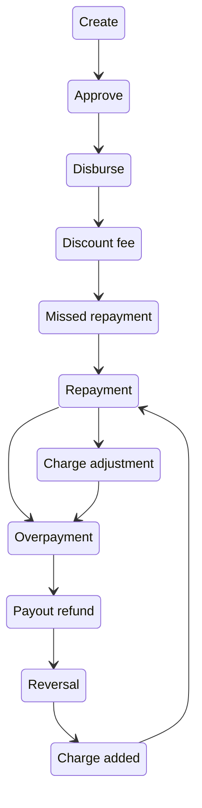

### Transaction testing scenarios

Transaction testing scenarios cover money-in transactions, discount fee transactions, charges and charge adjustments, delinquency management, breach and near-breach, payment holidays, re-age, hardship term-out, COB and jobs, events and API parity, charge-off, reschedule and payment holidays, accounting, credit balance refund, loan origination, backdating, delinquency pause, delinquency bucket calculation, arrears, write-off, N+1 installments, COB framework, datatables entity split, client 360, charges admin, permissions and maker-checker, external events and Avro, batch API and SDK, asset externalization, reports and search, amortization schedule and EIR math, discount fee scenarios, and backdating.

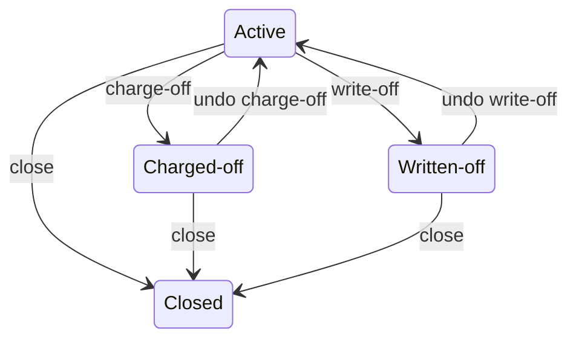

### Loan product and loan account lifecycle

A loan account is created from an existing loan product. After creation, the user can modify, approve, or reject the loan account. Approval authorizes the loan terms and may change financial parameters and trigger schedule recalculation. Disbursement releases funds to the borrower, activates the loan account, creates or updates the amortization schedule, books principal outstanding, and triggers accounting entries. The user can undo a disbursal, which returns the loan account to the approval state.

Loan creation generates the projected amortization schedule for the first time.

- Loan creation is the initial setup of the loan account where projected amortization is first generated.
- Loan disbursement is the release of loan funds to the borrower and establishes the actual financial baseline for amortization calculations.

Prepayment and charge-off handling follow these rules.

- Upon confirmation, the system processes the transaction using pre-calculated payoff values, reduces outstanding balances to zero, and updates loan status following existing loan closure rules.
- Whenever the Prepayment Date changes, the system recalculates the payoff amount, recalculates outstanding principal, interest, fees, and penalties as of the selected date, and displays the updated payoff amount before transaction submission.
- Charge-off handling involves step 1: charge-off, step 2: having rules plus a job to automatically trigger it.

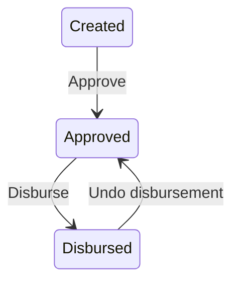

### Amortization schedule lifecycle

The amortization schedule lifecycle runs through three stages: Create, Disburse, and Repayment. The system generates the initial schedule from application parameters at creation, recalculates it at disbursement using actual disbursement amounts and dates while preserving applied payments, and rebuilds it fully whenever a payment is applied. Projected amortization is generated automatically at loan creation, and the schedule is recalculated at both approval and disbursement stages. On each payment, the system calculates the amortised portion, updates the schedule, and generates a non-monetary Discount fees Amortization transaction.

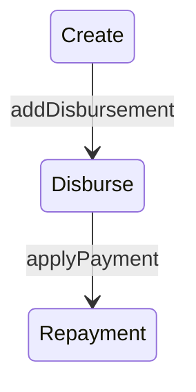

### Backdated transaction processing

When a transaction is backdated, the system recalculates the amortization schedule, recomputes EIR if applicable, replays all amortization values, recalculates outstanding balances, replays all subsequent transactions, and replays all associated accounting entries.

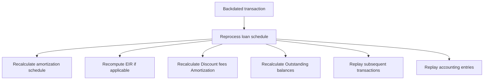

### Reversal behavior

Reversal behavior creates a linked reversal transaction and fully reverses both the financial impact and the accounting entries.

Because the discount fee is applied as of the disbursement date, the system recomputes EIR and reprocesses amortization, outstanding balances, and subsequent transactions.

CBR reversal creates a linked reversal transaction, and the system recomputes balances accordingly.

On backdated CBR execution, the system reprocesses subsequent transactions and recalculates balances and accounting entries.

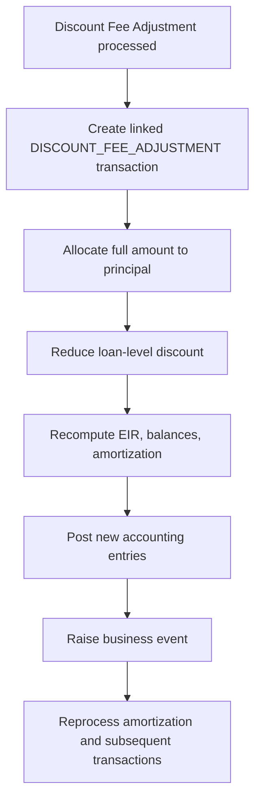

### Goodwill Credit

Goodwill Credit reduces the outstanding balance, recalculates the actual amortization amount, posts a Discount Fees Amortization transaction, adjusts the amortization schedule, and allocates payment across components.

Reversing Goodwill Credit triggers the following system behaviour:

- The system reprocesses the amortization schedule.
- The system replays subsequent transactions if applicable.

For backdated payments, the system performs the following:

- The system reprocesses the schedule.
- The system replays all subsequent transactions and accounting entries.

### Discount fees Amortization on payments

The system creates Discount fees Amortization automatically alongside payment transactions such as Repayment, Goodwill Credit, and Discount fees Adjustment. On payment execution, it calculates the amortised portion of deferred income, creates the Discount fees Amortization transaction, and links it to the parent payment transaction.

Amortization transactions are handled during replay and reversal as follows:

- The system replays Amortization transactions along with payment transactions and schedule reprocessing.
- On parent reversal, the associated income amortization transaction is automatically reversed or removed.

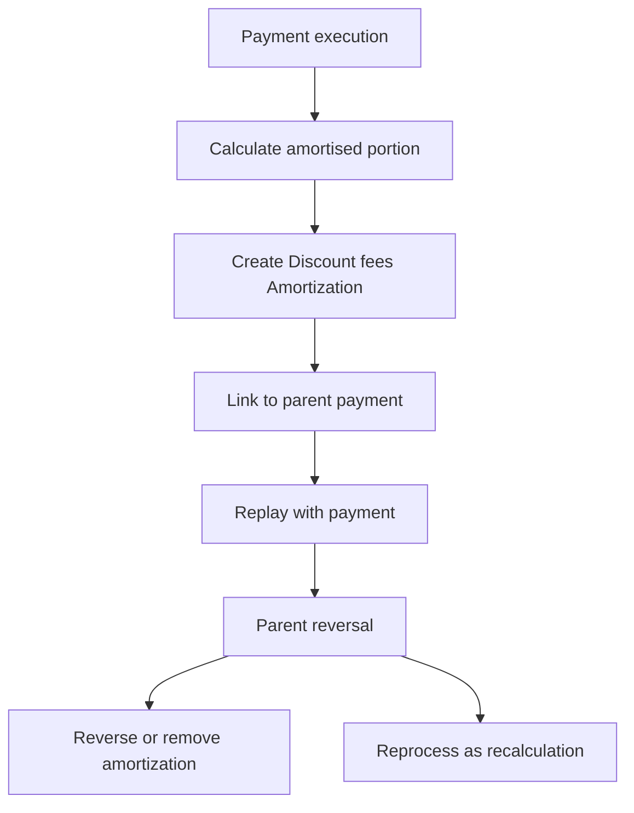

### Payout Refund

A Payout Refund transaction lets you submit a refund amount and a transaction date. The system validates eligibility before applying the refund against the outstanding principal and Fees/Penalty balance according to allocation rules.

After the refund is applied, future periods are regenerated as follows:

- All future periods not yet evaluated are deleted.
- The system regenerates them with the new frequency and expected amount.

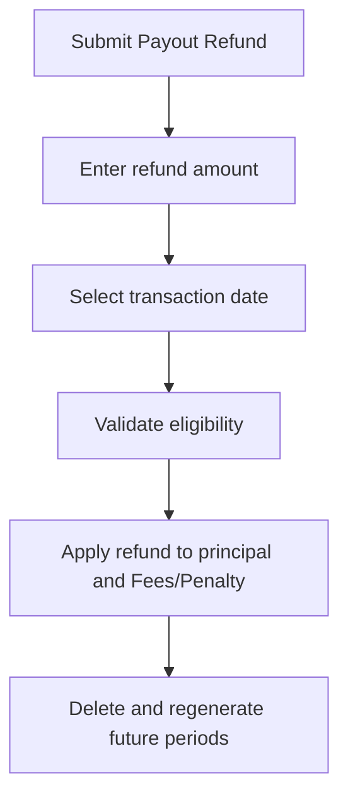

### Cut of Business processing

Close of Business processing selects loans for processing and applies all enabled business steps to each selected loan.

1. The system selects loans for processing.
2. Selected loans are partitioned into batches based on a configured size.
3. Partitions are marked for batch execution.
4. Loans are processed sequentially within each partition.
5. A lock is applied on loans within a single partition.
6. Each loan is read.
7. Applicable business steps are resolved and determined.
8. The processed loan is persisted.
9. The last COB run date on the loan is updated.

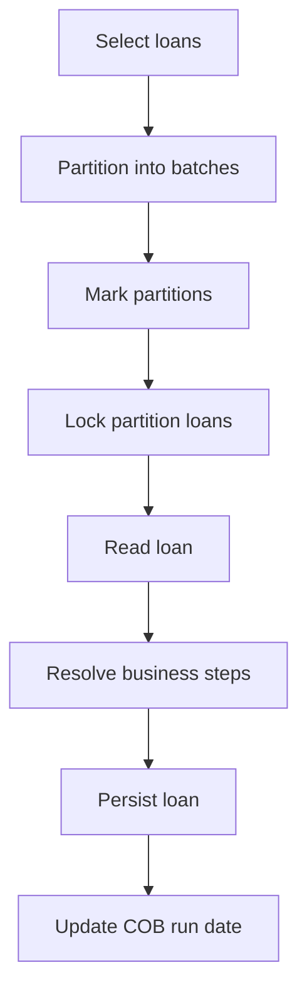

### Service responsibilities

The Working Capital loan services divide responsibilities across reading, writing, disbursement, balance, lock, and product operations.

Working Capital loan services handle the following responsibilities:

- WorkingCapitalLoanProductReadService fetches product details, fetches product defaults, and lists active products.
- WorkingCapitalLoanWriteService creates a loan from a product, updates a draft or submitted loan, approves a loan, rejects a loan, closes a loan, updates loan-level payment allocation rules, and adds notes.
- WorkingCapitalLoanDisbursementService records an expected disbursement, disburses a loan or tranche, validates disbursement totals, and updates maturity and balance.
- WorkingCapitalLoanBalanceService initializes a balance, applies repayment effects, applies accrual and realization, and recomputes derived totals.
- WorkingCapitalLoanLockService acquires a lock, releases a lock, and records a processing error on lock.
- WorkingCapitalLoanReadService retrieves a loan summary, retrieves full loan details, and lists notes, balances, disbursements, and allocation rules.

### Channel access for loan actions

You can create, approve, and disburse working capital loans through both the UI and API, and you can create loan products through either channel. Repayment API parameters follow the same pattern as term loans.

### Datatable management

You manage Working Capital Product (WCP) datatables and their entries through the datatable API. Datatables use apptableName m_wc_loan or m_wc_loan_product.

Datatable lifecycle operations:

- Create a datatable with POST /v1/datatables using apptableName m_wc_loan or m_wc_loan_product.
- Update datatable columns with PUT /v1/datatables/{datatable}.
- List datatables and retrieve a datatable definition with GET /v1/datatables filtered by ?apptable=m_wc_loan or ?apptable=m_wc_loan_product.
- Remove a WCP-scoped datatable with DELETE /v1/datatables/{datatable}.
- Register an existing datatable against WCP entities with POST /v1/datatables/register/{datatable}/{apptable}.
- Deregister a datatable without dropping the table with POST /v1/datatables/deregister/{datatable}.

Entry operations:

- Create a new entry with POST /v1/datatables/{datatable}/{apptableId}.
- Fetch entries with GET /v1/datatables/{datatable}/{apptableId}.
- Fetch a specific multi-row entry with GET /v1/datatables/{datatable}/{apptableId}/{datatableId}.
- Update a single-row entry with PUT /v1/datatables/{datatable}/{apptableId}.
- Update a multi-row entry with PUT /v1/datatables/{datatable}/{apptableId}/{datatableId}.
- Delete all entries for a parent with DELETE /v1/datatables/{datatable}/{apptableId}.
- Delete a specific multi-row entry with DELETE /v1/datatables/{datatable}/{apptableId}/{datatableId}.

Close of Business operations:

- Trigger inline COB for specific loans using their loan IDs.
- Trigger Catch-Up COB for a specific loan to process COB for past dates.

### Product APIs

The product APIs support working capital loan product management, including creation, updates, retrieval, listing, and configuration of overridable attributes and payment allocation rules.

### Loan APIs

The Loan APIs support creating, retrieving, listing, approving, rejecting, disbursing, and closing loans, adding loan notes, updating payment allocation rules, retrieving loan balances, and retrieving disbursement schedules and details.

### Loan product endpoints

You manage working capital loan products through the working capital loan product endpoints. You can create, update, delete, list, and fetch loan products.

| Method | Endpoint | Action |
| --- | --- | --- |
| POST | /working-capital-loan-products | Create a loan product |
| PUT | /working-capital-loan-products/<loanProductId> | Update a loan product by ID |
| PUT | /working-capital-loan-products/external-id/<loanProductExternalId> | Update a loan product by external ID |
| DELETE | /working-capital-loan-products/<loanProductId> | Delete a loan product by ID |
| DELETE | /working-capital-loan-products/external-id/<loanProductExternalId> | Delete a loan product by external ID |
| GET | /working-capital-loan-products | Fetch loan products |
| GET | /working-capital-loan-products/<loanProductId> | Fetch a loan product by ID |
| GET | /working-capital-loan-products/<loanProductExternalId> | Fetch a loan product by external ID |

### Loan application submission

You submit a working capital loan application by calling POST working-capital-loans. The request body includes clientId, productId, fundId, accountNo, externalId, principalAmount, totalPayment, submittedOnDate, expectedDisbursementDate, submittedOnNote, periodPaymentRate, repaymentEvery, repaymentFrequencyType, discount, delinquencyBucketId, paymentAllocationRules, locale, and dateFormat. The response includes resourceId, resourceExternalId, officeId, clientId, and loanId.

### Loan application modification

You can modify or delete a working capital loan application using its loan ID or external ID.

The Modify Loan Application endpoints accept the following request fields:

- clientId
- productId
- fundId
- accountNo
- externalId
- principalAmount
- totalPayment
- submittedOnDate
- expectedDisbursementDate
- submittedOnNote
- periodPaymentRate
- repaymentEvery
- repaymentFrequencyType
- discount
- delinquencyBucketId
- paymentAllocationRules
- locale
- dateFormat

The Modify Loan Application response includes:

- resourceId
- resourceExternalId
- officeId
- clientId
- loanId
- changes

The Delete Loan Application response includes:

- resourceId
- resourceExternalId
- officeId
- clientId
- loanId

1. Call PUT working-capital-loans/<loanId> or PUT working-capital-loans/external-id/<loanExternalId> to modify a loan application.
2. Call DELETE working-capital-loans/<loanId> or DELETE working-capital-loans/external-id/<loanExternalId> to delete a loan application.

### Loan rejection

You reject a working capital loan application using the Reject Loan Application endpoints. The request supplies the rejection date, a note, the locale, and the date format. The response returns the resource identifiers, office and client identifiers, loan ID, and a changes object with status REJECTED.

1. Call POST working-capital-loans/<loanId>?command=reject or POST working-capital-loans/external-id/<loanExternalId>?command=reject.
2. Include rejectedOnDate, note, locale, and dateFormat in the request body.
3. Read resourceId, resourceExternalId, officeId, clientId, loanId, and changes with status REJECTED from the response.

### Loan approval

You approve a working capital loan application using the Approve Loan Application endpoints, which set the loan status to APPROVED.

1. Call POST working-capital-loans/<loanId>?command=approve or POST working-capital-loans/external-id/<loanExternalId>?command=approve.
2. Include approvedOnDate, approvedLoanAmount, expectedDisbursementDate, discountAmount, note, locale, and dateFormat in the request body.
3. Expect a response containing resourceId, resourceExternalId, officeId, clientId, loanId, and changes with status APPROVED.

### Undo approval

You undo approval of a working capital loan application by calling the Undo Approval endpoint using either the loan ID or the external loan ID. The request body includes note, locale, and dateFormat. The response returns resourceId, resourceExternalId, officeId, clientId, loanId, and changes with status SUBMITTED_AND_PENDING_APPROVAL and note Undo approval.

### Loan disbursement

You disburse a working capital loan using the Disburse Loan endpoints, which set the loan status to ACTIVE. The request identifies the loan by ID or external ID and carries the disbursement date, amount, external ID, note, and payment details. The response returns resource and loan identifiers, office and client IDs, and the changes made. The loan status changes to ACTIVE. The response includes resourceId, resourceExternalId, subResourceId, subResourceExternalId, officeId, clientId, loanId, and changes with status ACTIVE.

1. Call POST working-capital-loans/<loanId>?command=disburse or POST working-capital-loans/external-id/<loanExternalId>?command=disburse.
2. Include actualDisbursementDate, transactionAmount, externalId, note, and paymentDetails with paymentTypeId, accountNumber, checkNumber, routingCode, receiptNumber, bankNumber, locale, and dateFormat in the request body.

### Undo disbursal

You can undo a disbursal for a working capital loan using the Undo Disbursal of Loan endpoints. The request body includes note, locale, and dateFormat, and the response includes resourceId, resourceExternalId, officeId, clientId, loanId, and changes with status APPROVED and note Undo disburse.

1. Call POST working-capital-loans/<loanId>?command=undodisbursal or POST working-capital-loans/external-id/<loanExternalId>?command=undodisbursal.
2. Include note, locale, and dateFormat in the request body.
3. Expect a response containing resourceId, resourceExternalId, officeId, clientId, loanId, and changes with status APPROVED and note Undo disburse.

### Payment and balance reconciliation

Payment and balance reconciliation confirms that expected and actual payments, together with expected future payments, equal net disbursement plus discount fee minus discount fee adjustment plus principal adjustment. Amortized amounts plus amounts not yet amortized equal discount fee minus discount fee adjustment. Expected and actual running balances reach zero with the last payment period, as do expected and actual running balances of the discount fee. The amortization schedule is generated from the minimum expected payment amount, calculated loan term, and total deferred income.

On modification, the system recomputes the following:

- EIR based on remaining outstanding balance, remaining deferred income, and updated repayment projections.
- Projected repayment amounts for future periods only.
- Remaining loan tenure when dynamically derived.
- Future deferred Discount fees Amortization values.
- The amortization schedule from the current date onward.

### Repayment application

On repayment, the system applies the transaction amount up to the outstanding obligation and records any excess as an overpayment amount. Amortization is calculated based on EIR methodology or configured logic.

The repayment calculation uses the following formulas:

- amountAppliedToOutstanding equals min(transactionAmount, principalOutstandingBeforeRepayment).
- overpaymentIncrement equals transactionAmount minus amountAppliedToOutstanding.

Other repayment-related calculations include:

- Period Past Due Amount equals Total Amount Due in the Period minus Total Amount Paid in the Period.
- Breach Past Due Amount equals Previous Period Past Due Amount plus Current Period Past Due Amount.
- When a reschedule action is active, expectedAmount equals approvedPrincipal * minimumPayment / 100, or expectedAmount equals the user entered FLAT amount.
- Day count is the number of days between disbursement date and installment date, used for discounting calculations.

### Worked examples

A zero-interest working capital loan is disbursed, an upfront discount fee is deferred as income, and a borrower repayment triggers discount fee amortization. The figures are illustrative. Setup: net disbursement of 1000.00, discount fee of 100.00, total obligation of 1100.00, repayment of 100.00, and a system-derived amortization of 10.00 on that payment.

| Step | Transaction | Debit GL | Credit GL | Amount | Principal outstanding | Deferred fee balance |
| --- | --- | --- | --- | --- | --- | --- |
| 1 | Disbursement | 112601 Loans Receivable Principal | 145023 Suspense/clearing account | 1000.00 | 1000.00 | 0.00 |
| 2 | Discount fee | 112601 Loans Receivable Principal | 240005 Deferred Interest | 100.00 | 1100.00 | 100.00 |
| 3 | Repayment | 145023 Suspense/clearing account | 112601 Loans Receivable Principal | 100.00 | 1000.00 | 100.00 |
| 4 | Discount fee amortization | 240005 Deferred Interest | 404000 Interest income | 10.00 | 1000.00 | 90.00 |

A discount fee adjustment reduces the deferred fee before maturity. The system recalculates the effective interest rate and applies it prospectively; historical amortization entries remain unchanged. Setup: original discount fee 100.00, remaining deferred balance 90.00, adjustment of 40.00, net discount after adjustment 60.00. A partial adjustment leaves a remaining balance and recalculates EIR; a full adjustment sets EIR to zero and stops future amortization.

| Step | Transaction | Debit GL | Credit GL | Amount | Principal outstanding | Deferred fee balance | EIR applied to |
| --- | --- | --- | --- | --- | --- | --- | --- |
| 1 | Original state | - | - | - | 1000.00 | 90.00 | Original EIR |
| 2 | Discount fee adjustment | 240005 Deferred Interest | 112601 Loans Receivable Principal | 40.00 | 960.00 | 50.00 | Future periods only |

A working capital loan is written off while part of the discount fee is still unearned. The system posts a final discount fee amortization on the write-off date so that realized income equals the net discount fee, unrealized income is zero, and the deferred interest account clears. Setup: principal 1000.00, discount fee 100.00, income already realized 10.00, unrealized income 90.00 at write-off.

| Step | Event | Debit GL | Credit GL | Amount | Realized income | Unrealized income | Deferred balance |
| --- | --- | --- | --- | --- | --- | --- | --- |
| 1 | Prior amortization | - | - | - | 10.00 | 90.00 | 90.00 |
| 2 | Write-off principal | 744008 Recoveries | 112601 Loans Receivable Principal | 1000.00 | 10.00 | 90.00 | 90.00 |
| 3 | Final discount fee amortization | 240005 Deferred Interest | 404000 Interest income | 90.00 | 100.00 | 0.00 | 0.00 |

A payout refund recovers disbursed funds from an active working capital loan. The refund reduces principal according to the allocation order, and the system posts discount fee amortization at close of business. Setup: principal outstanding 1000.00, deferred fee balance 50.00, refund 400.00, COB amortization 10.00.

| Step | Transaction | Debit GL | Credit GL | Amount | Principal outstanding | Deferred fee balance |
| --- | --- | --- | --- | --- | --- | --- |
| 1 | Before refund | - | - | - | 1000.00 | 50.00 |
| 2 | Payout refund | 145023 Suspense/clearing account | 112601 Loans Receivable Principal | 400.00 | 600.00 | 50.00 |
| 3 | COB amortization | 240005 Deferred Interest | 404000 Interest income | 10.00 | 600.00 | 40.00 |

## Effective Interest Rate Product

### Working Capital loan product overview

Working Capital loan products use a dedicated loan product entity separate from the existing loan product entity. You can create, modify, and delete a Working Capital loan product, and delete one only if it has not yet been used anywhere. The product supports discount/fees-based working capital financing commonly offered by PayPal to merchants, with loans calculated and amortized using EIR methodology for transparent cost of credit and compliance with accounting and regulatory standards.

Working Capital loan product configuration includes the following capabilities:

- Users can set Configurable Terms and Settings on Working Capital loan products.
- Selected fields on Working Capital loan products can be overridden during loan creation.
- Existing fields and configurations behave like they do on term loan products.
- Mandatory field validation and correct value validation apply to Working Capital loan product configuration.
- Accounting mappings and reports in Fineract support reconciliation, GL postings, and portfolio-level monitoring of working capital exposure.
- A dedicated module named fineract-working-capital-loan handles Working Capital loan product configuration.

Payment allocation and amortization behaviour for Working Capital loan products is as follows:

- Payment allocation rules specify only whether the payment pays principal, fee, or penalty portion.
- Payment allocation rules have no Past due, due, or in advance rules.
- The loan framework supports excess payments, fewer payments, and no payment calculation scenarios without impacting financial accuracy.
- Daily amortization calculation supports EIR accelerated recognition of deferred fee income for origination and buy-down fees.

Working Capital loan products have input parameters specific to WCP types.

### Working Capital loan product configuration

You can create a loan application from a Working Capital loan product (WCP). The application inherits all default values from the product, and mandatory field checks and correct value checks apply when you create the WCP loan account. Product rule changes do not retroactively alter existing loans, so loan behavior remains stable and auditable.

### Working Capital loan account lifecycle

A Working Capital loan account follows a lifecycle from creation through disbursement, with users able to approve, undo approval, disburse, undo disbursement, and modify the account while it remains in the created state. The system creates a new entity for this kind of loan.

Payment allocation rules for this loan product work as follows:

- Payment allocation rules have no Past due, due, or in advance rules.
- Payment allocation rules only specify whether a payment covers principal, fee, or penalty portions.

1. Create a new Loan account of this loan product.
2. Approve the created loan account.
3. Undo the approval to return the loan to the created state.
4. Disburse the approved loan account.
5. Undo the disbursal after disbursement.

### Charge transactions

A Charge Transaction represents the application of fees or penalties to a loan account and ensures accurate tracking of charge liabilities, proper adjustment of paid charges, and consistent accounting and receivable handling. Charges can be fees or penalties, and a Charge Transaction does not impact principal. It is system-generated and not manually triggered as a transaction.

A Charge Transaction is created in the following situations:

- A charge is applied at the loan account level.
- A charge is added at the disbursement level.
- Charges are configured with specific due dates.

Accounting entries are created as follows:

- As of the transaction date when the charge is added for Disbursement Charge.
- As of the submitted date when the charge is added for the specific due date charge.

### Charge adjustment transactions

A Charge Adjustment Transaction is a monetary transaction used to offset charges that have already been paid. It applies when previously paid charges need to be adjusted or refunded, and it reduces the collected amount.

Charge adjustment follows these rules:

- The adjustment amount must be greater than zero.
- The adjustment amount cannot exceed the paid charge amount.
- The adjustment cannot exceed the available charge balance.
- Charges must have been previously paid before an adjustment can be performed.
- The adjustment applies only to fees, penalty, or principal components based on allocation priority.
- The adjustment adjusts principal or charge balances depending on the allocation strategy priority.
- The adjustment date must comply with business date rules and backdating rules.
- The adjustment triggers accounting entries, including nullification of receivables or reversal of income standard accounting entry.

Charge adjustment works similar to a repayment transaction.

### Charge receivables and income

Charge receivables are created when a charge is applied to a loan account. Repayment reduces the receivable, while charge adjustment reverses previously recognized income and clears the receivable. Payment or adjustment clears charge receivables.

### Charge adjustment rules

Charge adjustment supports backdated processing. Charge adjustment transactions support reversal subject to validations, and reversal reverses the charge impact or adjustment impact and accounting entries.

### Charge configuration and behavior

Charges are predefined or event-based amounts applied during the loan lifecycle to support consistent fee management and accurate accounting. They are created at the product level and inherited by loan products and loan accounts, and they must be reusable across products with the same currency.

Charges support the following configuration and behavior:

- You can configure charges through the API and UI, aligned with term loan charge structures.
- At disbursement, charges are applied immediately and are typically added to the disbursement amount.
- Charges applied on a specified due date are applied based on configured triggers such as fixed date charges.
- Each charge type must be mapped to specific GL accounts.
- Accounting behavior for charges is configurable at product level and executed as per defined Journal Entry rules.
- Configuration determines whether accounting entries for charges post in real time or at end of day.
- Charges may be configured as tax-inclusive.
- For tax-enabled charges, the tax component is calculated and split at the accounting level, with separate GL entries created for the charge amount and the tax amount.

### Charge waivers and restrictions

You can waive a charge only when it has not been paid. A waiver reverses or adjusts the charge amount and produces the accounting impact defined by the charge configuration.

Charge application and modification are subject to the following restrictions:

- The system does not apply charges to a loan account that is Closed or Written-Off.
- Charges applied after the Maturity date create an N+1 Installment as of the charge date.
- Backdated charge application recalculates and reprocesses transactions and accounting entries.
- Modifying historical transactions causes related charges or penalties to be re-evaluated and reapplied or reversed accordingly.
- Additional restrictions may apply based on loan status and charge configuration.

Charges are configurable, reusable, and auditable, and they align with product-level definitions. The system supports accurate accounting and reprocessing when backdated changes occur.

### Delinquency range schedule

The delinquency range schedule tracks delinquency, expected payments, actual payments, and outstanding balances across defined time periods based on configurable repayment intervals and percentage allocations. It supports flexible repayment tracking instead of fixed installment amounts, visibility into expected versus actual payments, unpaid balances carried forward across periods, dynamic schedule generation from user-defined parameters, and tracking of overdue and delinquency at defined periods.

The system generates the range schedule based on the input parameters of the delinquency configuration, which can be overridden at the loan level using the Reschedule delinquency action to change the minimum payment percentage and frequency for a specific loan without modifying the product-level configuration.

- The first installment period starts from the loan disbursement date plus grace days.
- Each subsequent period follows sequentially based on the defined interval.
- Schedule generation continues until repayment allocation is completed or the loan closure condition is met.
- One period is created at a time, and the next period is generated when the current date crosses the last period due date.
- Each schedule record includes From Date, To Date, Expected Amount, Paid Amount, Outstanding Amount, Delinquent days, and Delinquent amount.

The system recalculates the minimum payment amount when any of the following occur:

- A period is generated.
- A reschedule occurs and the minimum payment amount or frequency was changed.
- A backdated or reversed monetary transaction occurred affecting only the period where the outstanding loan balance is lower than the originally calculated minimum payment.

### Delinquency pause

The Delinquency Pause action temporarily suspends delinquency tracking for a Working Capital loan. It applies only to the delinquency schedule and evaluation and has no impact on breach management.

Pause periods follow these rules:

- Pause is allowed only on loans with active status.
- startDate and endDate are mandatory, and startDate must be before endDate.
- startDate cannot be before the first disbursement date.
- Pause cannot start within an already evaluated range schedule period where minPaymentCriteriaMet is not null.
- Pause periods cannot overlap with other existing pause periods.

During the pause period, the delinquency range schedule is extended as follows:

- The active and all future periods shift forward by the number of pause days.
- All non-evaluated range schedule periods that overlap with or follow the pause start date have their toDate shifted forward by the pause duration.
- Future periods' fromDate values shift accordingly to maintain continuity.

### Delinquency resume

You can resume delinquency only while an active delinquency pause period is running, between its configured start date and end date. Resumption ends the pause as of the resume date, and the system then recalculates delinquency based on the revised shortened pause duration. Resume affects only the Delinquency schedule and calculation and has no impact on Breach management.

The pause timing follows these rules:

- The delinquency pause is applied as of the current business date at the time of initiation.
- The delinquency pause is considered terminated as of the resume date.

### Delinquency reschedule

The Delinquency Reschedule action lets you change the minimum payment amount and/or the frequency of the delinquency range schedule for a Working Capital loan.

The minimum payment can be rescheduled using one of two options:

- Percentage Amount, calculated based on principal plus discount.
- Flat Amount, where you provide the new minimum payment amount.

When rescheduling occurs:

- The start date is set automatically to the current business date.
- The system identifies the current period containing the business date and updates its expected amount based on the new minimum payment percentage or flat amount.

### Delinquency reset

Delinquency reset marks a delinquent Working Capital Product (WCP) account as regularized once compliance is restored, restarts delinquency monitoring cycles, and stops further penal actions where applicable. Reset takes effect only from the current system date; backdated resets are not permitted.

After a reset, delinquency evaluation behaves as follows:

- Evaluation restarts from the current evaluation period.
- All delinquency records and evaluations before the reset date are nullified and are not considered for future delinquency tracking or calculations.
- Backdated repayments or adjustments with a value date before the reset date do not impact or alter the delinquency evaluation after the reset.
- Multiple delinquency resets are permitted for an account over time, but only one reset per account per day is allowed.

Undoing or deleting a delinquency reset has these effects:

- The delinquency status reverts to its previous state before the reset.
- Delinquency evaluation is recomputed accordingly.
- All undo or deletion actions are captured in the audit trail.

> **Note:** A delinquency reset can be undone or deleted only with appropriate user permissions and controls.

### Delinquency reset restart period option

A Delinquency Reset can include an optional Restart Period from Reset Date option. When selected, the reset date becomes the new starting point for delinquency period calculations. When not selected, the reset behaves as it does today and existing delinquency period calculations do not change.

When you select Restart Period from Reset Date:

- The system resets all existing delinquency periods as part of the delinquency reset process.
- The system creates a new delinquency period starting from the delinquency reset date.
- The system calculates subsequent delinquency periods using the new start date following existing delinquency-period generation logic.

### Delinquency disable

Delinquency Disable lets authorized users stop delinquency evaluation for a loan account in business scenarios such as charge-off or write-off. It applies only as of the current system date; backdated disability is not permitted.

While Delinquency Disable is active, the following restrictions apply:

- Delinquency evaluation stops for the account from the disable date onward.
- Delinquency Reschedule is not permitted.
- Delinquency Reset is not permitted.
- Delinquency Pause is not permitted.
- Delinquency Disable can be applied only once until the active disable is undone or reversed.

Undoing or reversing Delinquency Disable re-triggers delinquency evaluation and recomputes it as of the undo date.

### Delinquency payment behavior

Delinquency payment behavior applies when a borrower misses the minimum payment amount for a delinquency period. The system recognizes the past due amount as the minimum payment amount minus the amounts already paid for that period.

Consecutive payments are applied in the following order:

- Payments first pay off the outstanding amount of the oldest past due, delinquent period.
- After that period is cleared, payments then pay the current period.
- Any excess amount is not applied to upcoming delinquency periods.

### Breach management overview

Breach Management identifies, monitors, and resolves violations of predefined loan conditions and merchant performance thresholds. It supports early detection of risk signals such as repayment delays and revenue declines so timely corrective actions can be taken. This helps minimize credit losses, maintain portfolio health, and ensure compliance with internal risk policies.

### Breach range schedule

Breach Management in Merchant Capital Loan identifies, tracks, and resolves violations of predefined loan conditions. The range schedule tracks Breach, expected payments, actual payments, and outstanding balances across defined time periods, supporting flexible repayment tracking based on time ranges instead of fixed installment amounts.

The range schedule operates under the following rules:

- Users generate and maintain a Range Schedule based on configurable repayment intervals and percentage allocations.
- The schedule provides visibility into expected versus actual payments within defined periods and supports dynamic schedule generation based on user-defined payment parameters.
- The feature tracks Overdue and Delinquency at defined periods.
- One Period is created at a time, and no pre-generated future periods exist.
- The next period is generated when the current date crosses the last period due date.
- The minimum payment amount is recalculated when a period is generated, when Reschedule occurs and the minimum payment amount or frequency changes, or when a backdated or reversed monetary transaction occurs affecting only the period where the outstanding loan balance is lower than originally calculated minimum payment.
- Each schedule record includes Near Breach, evaluating whether payment tendency shows a possibility for breach.
- Each schedule record includes Breach, True or False whether breach occurred.

### Breach pause

Breach Pause temporarily suspends Breach tracking for a Working Capital loan. It applies only to the Breach schedule and breach evaluation, and does not affect delinquency, repayment schedules, or other loan calculations.

The following rules govern Breach Pause:

- During the pause period, the Breach range schedule is extended by shifting the active and all future periods forward by the number of pause days.
- The system allows backdated Breach Pause entries and re-triggers and recomputes breach evaluation for the affected period upon application.
- Multiple Breach Pause records are allowed for an account, but overlapping pause periods are not permitted and are validated by the system.

### Breach resume

You can resume a breach only while the breach pause is active, meaning between its configured start date and end date. The system applies the pause as of the current business date when it starts. After you resume, the system recalculates the breach using the revised shortened pause duration.

### Breach reschedule

The Breach Reschedule action changes the minimum payment amount and/or the frequency of the Breach range schedule for a Working Capital loan.

You can set the minimum payment using one of two options:

- Percentage Amount calculated based on principal plus discount.
- Flat Amount where you provide the new minimum payment amount.

Already evaluated periods where minPaymentCriteriaMet is not null are not affected, so historical data is preserved.

### Breach reset

Breach Reset restarts breach monitoring cycles for a Working Capital Product (WCP) account after compliance is restored, marks the account as regularized, and stops further penal actions if applicable.

### Loan notes, payment allocation rules, and account locks

A loan can have many notes, many payment allocation rules, and at most one account lock.

### Database schema and tables

The Working Capital product uses several dedicated tables to store loan disbursement details, notes, payment allocation rules, and amortization models. Each table references the Working Capital loan table, m_wc_loan, through a foreign key.

| Table | Owner | Key fields |
| --- | --- | --- |
| m_wc_loan_disbursement_detail | postgres | disbursedon_userid (bigint FK to m_appuser) |
| m_wc_loan_note | not stated | wc_loan_id (bigint FK to m_wc_loan), note (varchar(1000)), created_by, last_modified_by, created_on_utc, last_modified_on_utc |
| m_wc_loan_payment_allocation_rule | not stated | wc_loan_id (bigint FK to m_wc_loan), transaction_type (varchar(255)), allocation_types (text), created_by, last_modified_by, created_on_utc, last_modified_on_utc |
| m_wc_loan_amortization_model | not stated | loan_id (bigint FK to m_wc_loan), json_model (text), business_date (date), json_model_version (varchar(10)), last_modified_on_utc (timestamp with time zone) |

The following structural rules apply to these tables:

- Table m_wc_loan_note stores internal notes on the loan and maintains loan-specific commentary, remarks, or operational notes.
- Table m_wc_loan_note has a one-loan-to-many-notes relationship.
- Table m_wc_loan_payment_allocation_rule stores account-level payment allocation rules and overrides or persists payment allocation logic at loan level and supports different allocation sequences by transaction type.
- Table m_wc_loan_payment_allocation_rule has a one-loan-to-many-rules relationship and defines unique constraint uq_m_wc_loan_payment_allocation_rule on (wc_loan_id, transaction_type).
- Table m_wc_loan_amortization_model defines id as bigint generated by default as identity primary key, version as integer not null, and unique constraint uc_m_wc_loan_amort_model_loan on loan_id.
- Table m_wc_loan_payment_allocation_rule defines id as bigint generated by default as identity primary key and creates index IND_m_wc_loan_payment_allocation_rule_loan_id on wc_loan_id.

Product configuration defines the default allocation order for each transaction type, and allocation_types should be parsed into ordered values such as PENALTY, FEE, PRINCIPAL; exact values depend on business rules.

Delinquency actions store PAUSE and RESCHEDULE applied to a Working Capital loan, drive schedule modifications where pause extends periods and reschedule changes expected amounts and frequency, and provide override parameters for COB period generation.

The delinquency action action field is a VARCHAR enum with values PAUSE or RESCHEDULE.

For PAUSE, start_date is user-provided and end_date is user-provided; for RESCHEDULE, start_date is automatically set to the current business date and end_date is not used (null).

minimum_payment, frequency, and frequency_type are RESCHEDULE only fields; minimum_payment is DECIMAL(19,6), frequency is INT, and frequency_type is VARCHAR(50) with values DAYS, WEEKS, MONTHS, or YEARS.

### Repositories and locking

The product uses pessimistic application-level locking through m_wc_loan_account_locks, combined with DB optimistic locking through version for long-running business operations. Product repositories include WorkingCapitalLoanProductRepository, WorkingCapitalLoanProductConfigurableAttributesRepository, and WorkingCapitalLoanProductPaymentAllocationRuleRepository. Loan repositories include WorkingCapitalLoanRepository, WorkingCapitalLoanBalanceRepository, WorkingCapitalLoanDisbursementDetailRepository, WorkingCapitalLoanNoteRepository, WorkingCapitalLoanPaymentAllocationRuleRepository, and WorkingCapitalLoanAccountLockRepository.

| Currency | Subledger account | G/L accounts |
| --- | --- | --- |
| USD | ZB1CR001 | ZB4CR001, ZB4CR022, ZB1CR003, ZB5CR007, ZB5CR028, ZB1CR005 |

Transaction types map to cash flow directions as follows:

- Cash Advance is Outflow.
- Cash Advance Adjustment (Decrease) is Inflow.
- Cash Advance Adjustment (Increase) is Outflow.
- Charge-Off (Fraud) is Inflow.
- Charge-Off (Non-Fraud) is Inflow.
- Credit Balance Refund is Outflow.
- Fixed Fee is Inflow.
- Fixed Fee Adjustment (Decrease) is Inflow.
- Fixed Fee Adjustment (Increase) is Outflow.
- Initialization Fixed Fee is Outflow.
- Initialization Principal is Outflow.
- Recovery - Collector is Inflow.
- Recovery - PayPoint is Inflow.
- Recovery - Wallet is Inflow.
- Reinstatement is Inflow.
- Repayment - PayPoint is Inflow.
- Repayment - Wallet is Inflow.
- Repayment Reversal - PayPoint is Outflow.
- Repayment Reversal - Wallet is Outflow.
- Skipped Payment is dash.

### Delinquency configuration parameters

Delinquency configuration parameters defined at the loan account level include Name, Frequency, Frequency Type, Breach amount type (calculation), and Breach amount.

Frequency and Frequency Type define the range interval.

- Frequency is a numeric value representing the range interval.
- Frequency Type is the time unit of the range interval, such as days, weeks, or months.

Breach amount type supports two calculation options.

- Breach amount type supports Percentage of loan amount.
- Breach amount type supports Flat amount.

The range schedule is generated from the input parameters.

- Multiple Breach configurations can be done, and the relevant configuration can be mapped to the relevant loan product.
- Each schedule record must include From Date, the start date of installment period.
- Each schedule record must include To Date, the end date of installment period.

Key charge configuration parameters include Charge Name, Currency, Charge Type (Flat amount or Percentage-based), Application Timing (At disbursement or On a specified due date), Calculation Basis (Principal, Outstanding balance, or Flat), Penalty Configuration, and Tax Applicability.

### Product lifecycle

When you create a loan product, product-level rules are copied into loan-level rules, and those loan-level rules become the effective rules used at runtime. Users can create loan products through the API. The WorkingCapitalLoanProductWriteService handles product creation, updates, closure, configurable attribute maintenance, and product payment allocation rule maintenance.

### Loan lifecycle

You manage a Working Capital loan account through its lifecycle using API calls: create the loan, approve it, disburse it, modify it, or undo disbursement to return the account to the approval state. Template API calls expose the available fields and their available values for Working Capital loan products. The template response lists each field and the values that field can take.

### Delinquency actions

You create delinquency actions on a working capital loan account to pause delinquency processing or reschedule payment terms. The system exposes endpoints to create actions and to retrieve the actions recorded for a loan.

The Create Delinquency Action endpoint accepts different parameters depending on the action type:

- action is required and must be pause or reschedule.
- startDate and endDate apply only to pause actions.
- minimumPayment, frequency, and frequencyType apply only to reschedule actions.
- frequencyType must be one of DAYS, WEEKS, MONTHS, or YEARS.
- dateFormat and locale are optional.

When you execute delinquency actions, the system behaves as follows:

- A pause action is created with a start date and an end date.
- Executing a resume action updates the pause end date to the resume date and terminates the breach pause as of that date.
- A reschedule action is created with a new minimum payment, frequency, and frequency type.
- The system identifies the current period, which contains the business date, and updates its expected amount based on the new minimum payment percentage or flat amount.
- On backdated execution, the system reprocesses loan balances, recalculates charge components, and replays subsequent transactions and accounting entries.

The Create Delinquency Action response and retrieval endpoint are as follows:

- The response includes commandId, officeId, resourceId, and changes.
- Use GET /v1/working-capital-loans/{loanId}/delinquency-actions to retrieve delinquency actions for a loan.

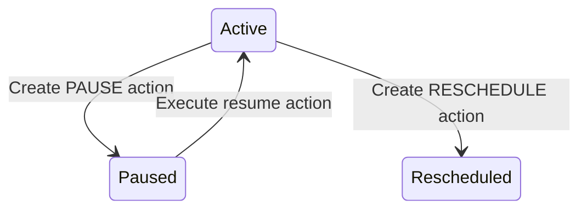

### Charge accounting

A Charge transaction increases charge receivable and charge income, and adds the charge amount to the loan balance charge portion only. It also adds to the amount to be collected under Fees or Penalties based on configuration.

| Entry | Account |
| --- | --- |
| Debit | Charge Receivable / Loan Account |
| Credit | Fee Income / Penalty Income Account |

Reversing a charge adjustment creates a linked reversal transaction.

### Delinquency calculation

Delinquency calculation compares the expected amount against payments made within a date range to determine whether an amount is overdue and how long it has remained unpaid.

The calculation uses the following rules:

- Expected Amount is calculated using % per frequency applied to the configured base amount.
- Paid Amount is the sum of payments made within the date range.
- Outstanding Amount is Expected Amount minus Paid Amount.
- Delinquent days is the number of days between To date and current date where Outstanding Amount is greater than 0.
- Delinquent amount is the Outstanding Amount after To date.

The balance is recalculated when the loan is disbursed, repayment is posted, income is accrued or realized, adjustments or reversals happen, or COB processing executes.

Locking covers COB processing, accrual calculation, repayment posting, concurrent update prevention, and failure diagnostics. The lock flow attempts to insert or update a lock row for loan_id; if a lock exists, processing is rejected or retried; on success the loan is processed and the lock is deleted; on error the error and stacktrace are stored.

The pause duration in days is calculated as the difference between start and end dates.

Daily Payment Rate value is 30%.

EIR calculation uses formula CALC_EIR_2 with inputs Loan Balance, - Net Deferred, Daily Payment Amount.

UseCase examples for Payout Refund are defined in the spreadsheet at https://docs.google.com/spreadsheets/d/1vC9qBvqvTC5L2x3dKaGj_ioBcUtuH0soVYFPbXB2TM0/edit?pli=1&amp;amp;gid=393081481#gid=393081481&amp;amp;range=A1.

The amortization schedule endpoint is GET /v1/working-capital-loans/{loanId}/amortization-schedule, exemplified by GET /fineract-provider/api/v1/working-capital-loans/1/amortization-schedule.

### Worked examples

A loan is disbursed on day zero with a principal of 1,000.00 and an origination fee of 100.00 added to the amount financed, giving a total payable value of 1,100.00. The borrower repays 10.00 each day for 110 days at a daily effective interest rate of 0.10 percent. These figures are illustrative. The system discounts every expected payment back to day zero and sums the discounted cash flows to solve for the effective interest rate. Shifting the disbursement to day one or day two moves the initial period and changes the discounting start date, while the payment amounts remain unchanged.

| Period | Date | Expected payment | Discount factor | NPV cash flow |
| --- | --- | --- | --- | --- |
| 0 | Day 0 | (1,100.00) | 1.000000 | (1,100.00) |
| 1 | Day 1 | 10.00 | 0.999001 | 9.99 |
| 2 | Day 2 | 10.00 | 0.998003 | 9.98 |
| 3 | Day 3 | 10.00 | 0.997006 | 9.97 |
| 4 | Day 4 | 10.00 | 0.996010 | 9.96 |
| 110 | Day 110 | 10.00 | 0.895890 | 8.96 |

A loan opens with a balance of 1,000.00 and a net deferred origination fee of (100.00). The daily payment amount is 10.00. Each day the system accrues interest at a daily rate of 0.10 percent, amortizes 1.00 of the deferred fee, and applies the rest of the payment to principal. These figures are illustrative. The deferred fee balance declines as fee income is recognized, and the loan balance falls by the principal portion of each payment.

| Date | Opening balance | Interest | Fee amortization | Principal paid | Closing balance |
| --- | --- | --- | --- | --- | --- |
| Day 1 | 1,000.00 | 1.00 | 1.00 | 8.00 | 992.00 |
| Day 2 | 992.00 | 0.99 | 1.00 | 8.01 | 983.99 |
| Day 3 | 983.99 | 0.98 | 1.00 | 8.02 | 975.97 |
| Day 4 | 975.97 | 0.98 | 1.00 | 8.02 | 967.95 |
| Day 5 | 967.95 | 0.97 | 1.00 | 8.03 | 959.92 |

At disbursement the product applies an origination fee charge of 100.00 to the loan account. The charge is added to the amount to be collected, creates a charge receivable, and recognizes fee income. Accounting entries post as of the transaction date: debit charge receivable and credit fee income. These figures are illustrative. The charge does not touch principal and is collected separately through repayment.

| Event | Debit | Credit | Account |
| --- | --- | --- | --- |
| Fee applied | 100.00 |  | Charge receivable |
| Fee applied |  | 100.00 | Fee income |
| Fee paid | 100.00 |  | Cash |
| Fee paid |  | 100.00 | Charge receivable |
| Disbursement | 1,000.00 |  | Cash |
| Disbursement |  | 1,000.00 | Loan principal |

A fee charge of 100.00 has been applied and paid in full. A charge adjustment of 40.00 reverses part of the collected fee. The adjustment reduces recognized fee income and the collected amount, and it cannot exceed the paid charge amount. These figures are illustrative. After the adjustment, only 60.00 of the fee remains recognized and collected.

| Stage | Charge receivable | Fee income recognized | Cash collected |
| --- | --- | --- | --- |
| Charge applied | 100.00 | 100.00 | 0.00 |
| Payment received | 0.00 | 100.00 | 100.00 |
| Charge adjustment | 0.00 | (40.00) | (40.00) |

See also: [EIR New Scope](#eir-new-scope).

## Batch Job Foundation

Working Capital loans use a dedicated COB job that mirrors the regular Loan COB job by reusing BatchBusinessStep and sharing manager and worker implementations where possible. COBExecutionListenerRunner supports optional before and after job execution listeners for these jobs. You can also trigger Working Capital COB execution inline and synchronously on a chosen business date, including catch-up for past days.

Functional documentation for PPWC batch job management appears in the standard Fineract documentation, with limitations and constraints taken from the epic description.

The product identifier field is named id. The product also carries name, short_name, external_id, start_date, close_date, currency_code, currency_digits, currency_multiplesof, amortization_type, npv_day_count, principal_amount, min_principal_amount, and max_principal_amount.

| Table | Description |
| --- | --- |
| m_wc_loan_product | Working Capital Loan Product table |
| m_wc_loan_amortization_model | Stores json_model_version as VARCHAR(10), currently "1" |

An attached Excel file covers three disbursement scenarios: without a discount fee or added charges, with a discount fee but no added charges, and with both a discount fee and added charges. Each scenario has its own sheet and details actions and covered aspects such as transactions and accounting entries.

A working capital loan is disbursed with a principal of 1,000.00 and no discount fee or added charges. The figures are illustrative. The COB job writes the opening balance to m_wc_loan_balance, and each repayment reduces principal_outstanding while total_paid_principal and total_payment rise. Adding a 50.00 discount fee with no added charges reduces net disbursement to 950.00 while principal outstanding still repays to 0.00.

| Step | Principal | Fee | Charge | Principal outstanding | Total paid |
| --- | --- | --- | --- | --- | --- |
| Disbursement | 1,000.00 | 0.00 | 0.00 | 1,000.00 | 0.00 |
| Repayment 1 | 0.00 | 0.00 | 0.00 | 600.00 | 400.00 |
| Repayment 2 | 0.00 | 0.00 | 0.00 | 250.00 | 750.00 |
| Repayment 3 | 0.00 | 0.00 | 0.00 | 0.00 | 1,000.00 |

A working capital loan is disbursed with a principal of 1,000.00, a discount fee of 50.00, and added charges of 25.00. The client receives 925.00, and the opening balance carries the 25.00 charge as an amount due. Compared with fee-only disbursement, adding 25.00 charges raises total due to 1,025.00 while principal outstanding still repays to 0.00.

| Step | Principal | Fee | Charge | Principal outstanding | Total due |
| --- | --- | --- | --- | --- | --- |
| Disbursement | 1,000.00 | 50.00 | 25.00 | 1,000.00 | 25.00 |
| Repayment 1 | 0.00 | 0.00 | 0.00 | 600.00 | 425.00 |
| Repayment 2 | 0.00 | 0.00 | 0.00 | 250.00 | 775.00 |
| Repayment 3 | 0.00 | 0.00 | 0.00 | 0.00 | 1,025.00 |

A working capital COB worker locks loan 42 in m_wc_loan_account_locks before it updates m_wc_loan_balance. The lock row holds the owner, placement timestamp, business date, and diagnostic fields for failed processes, and it blocks other workers until the transaction releases it.

| Step | loan_id | version | lock_owner | Principal outstanding | Outcome |
| --- | --- | --- | --- | --- | --- |
| Acquire | 42 | 1 | wc-cob-worker-1 | 1,000.00 | Lock granted |
| Update | 42 | 2 | wc-cob-worker-1 | 600.00 | Balance reduced |
| Release | 42 | 3 | wc-cob-worker-1 | 600.00 | Lock cleared |

See also: [EIR New Scope](#eir-new-scope), [Effective Interest Rate Product](#effective-interest-rate-product).

## Inspection and Design

Working Capital EIR uses a 360-day NPV day count and calculates EIR as CALC_EIR_2(Loan Balance, - Net Deferred, Daily Payment Amount).

A contract is disbursed on day 0, day 1, or day 2 and then repaid by equal daily amounts. The figures are illustrative. The setup uses a principal of 1,000, a fixed fee of 100, a daily repayment of 50, a forecasted term of 20 days, an annual EIR of 12%, and a day count of 360. Moving the disbursement from day 0 to day 1 or day 2 shifts the period count and discount factors but leaves the NPV method unchanged. The table shows how each daily cash flow is discounted to day 0 and summed to obtain net present value.

| Day | Period | Cash flow | Discount factor | NPV of cash flow |
| --- | --- | --- | --- | --- |
| 0 | 0 | -1,000.00 | 1.000000 | -1,000.00 |
| 1 | 1 | 50.00 | 0.999667 | 49.98 |
| 2 | 2 | 50.00 | 0.999334 | 49.97 |
| 3 | 3 | 50.00 | 0.999001 | 49.95 |
| 4 | 4 | 50.00 | 0.998669 | 49.93 |
| Total |  | -800.00 |  | -850.17 |

A loan with an opening balance of 1,000 and a net deferred amount of 100 is repaid by equal daily payments of 30 over five days. The annual interest rate is 12%, the day count is 360, and the daily rate is therefore 0.0333%. The daily EIR is solved from CALC_EIR_2(Loan Balance, - Net Deferred, Daily Payment Amount); each day interest is opening balance times the daily rate and the remainder of the payment reduces principal. The schedule shows that balances decline by the principal paid each day and that interest and principal totals reconcile to the payments.

| Day | Opening balance | Payment | Interest | Principal paid | Ending balance |
| --- | --- | --- | --- | --- | --- |
| 1 | 1,000.00 | 30.00 | 0.33 | 29.67 | 970.33 |
| 2 | 970.33 | 30.00 | 0.32 | 29.68 | 940.65 |
| 3 | 940.65 | 30.00 | 0.31 | 29.69 | 910.96 |
| 4 | 910.96 | 30.00 | 0.30 | 29.70 | 881.26 |
| 5 | 881.26 | 30.00 | 0.29 | 29.71 | 851.55 |
| Total |  | 150.00 | 1.55 | 148.45 |  |

A contract posts a cash advance, a fixed fee, a repayment, an interest accrual, and a charge-off. Each lifecycle event creates debit and credit postings to subledgers and GL accounts; the postings persist and the grand total of debits and credits is zero for every event day. The setup uses a cash advance of 1,000, a fee of 100, a repayment of 200, interest of 10, and a charge-off of 5.

| Event | Debit account | Debit amount | Credit account | Credit amount |
| --- | --- | --- | --- | --- |
| Cash advance | ZB1CR001 / 112601 Loans Receivable Principal | 1,000.00 | ZTCR0001 / 299980 In-Transit Account | 1,000.00 |
| Fixed fee | ZB1CR001 / 112601 Loans Receivable Principal | 100.00 | ZB1CR003 / 240005 Deferred Interest | 100.00 |
| Repayment | ZTCR0002 / 109922 Cash Clearing | 200.00 | ZB1CR001 / 112601 Loans Receivable Principal | 200.00 |
| Interest accrual | ZB4CR001 / 404000 Interest Income | 10.00 | ZB1CR003 / 240005 Deferred Interest | 10.00 |
| Charge-off | ZB5CR028 / 404023 Credit Loss | 5.00 | ZB1CR001 / 112601 Loans Receivable Principal | 5.00 |
| Total |  | 1,315.00 |  | 1,315.00 |

Lifecycle events map to subledger accounts and then to GL accounts, with offsets determining where amounts persist. The setup shows a fixed fee of 100 and a premium of 5 posted under two source systems; each row maps one lifecycle and sublifecycle combination to an SL account, a short name, and a GL account.

| Lifecycle | Sublifecycle | Source system | SL account | Short name | GL account |
| --- | --- | --- | --- | --- | --- |
| Fixed Fee | Fixed Fee | FDR_PPWC | 10010101 Receivables/Payables (Not Due) | Short Receiv./Payables | ZAC1100000 TOTAL ASSETS |
| Fixed Fee | Premium WB (5%) - FixFee | B_FDR_PPWC | 10020101 Accruals: Interest Income (Debit) | Short Accr.: Interest Dr | ZAC1100030 Cash & Cash Equivalents |
| Fixed Fee Adjustment (Increase) | Fixed Fee Adj Inc | FDR_PPWC | 10020102 Accruals: Income from Fees (Debit) | Short Accruals: Fees Dr | ZAC1100031 Cash & Cash Equivalents Main |
| Fixed Fee Adjustment (Increase) | Premium WB (5%) Adj INC - FixFee | B_FDR_PPWC | 10030101 Deferrals: Interest Income (Debit) | Short Defer.: Interest Dr | 103002 Payroll - outgoing |
| Fixed Fee Adjustment (Decrease) | Fixed Fee Adj Dec | FDR_PPWC | 10030102 Deferrals: Interest Income (Credit) | Short Defer.: Interest Cr | 111194 GCE-UK Disbursements Clearing |

## Delinquency Restrictions

### Delinquency evaluation and re-evaluation

Delinquency evaluation for Working Capital loans covers minimum payment evaluation and delinquency range evaluation. Minimum payment evaluation checks whether a period became delinquent based on minimum payment rules, while delinquency range evaluation checks whether a period was cured or changed. Both evaluations run periodically at end of day or in real time depending on configuration.

The following events trigger delinquency re-evaluation:

- Real-time monetary events such as payments update or lift delinquency tags on the loan.
- Backdated payments or reversals of past payments reprocess the delinquency schedule and evaluation, which may cure earlier periods or make them delinquent.
- Rescheduling and changes to periods cause paid amounts to be reevaluated.
- After the minimum payment amount is updated, the system reevaluates the ranges and updates balances and delinquency status if applicable.
- After payment or close of business, tags and delinquent amounts are re-evaluated.

The global configuration 'Delinquency re-evaluation real-time in case of monetary events' applies to regular loans as well and defaults to true.

For Working Capital loans, the business step 'Delinquency evaluation' evaluates minimum payment rules and updates or lifts delinquency tags on the loan.

Backdated actions reprocess the delinquency schedule and evaluation, usually with no change in the evaluation before the reset date.

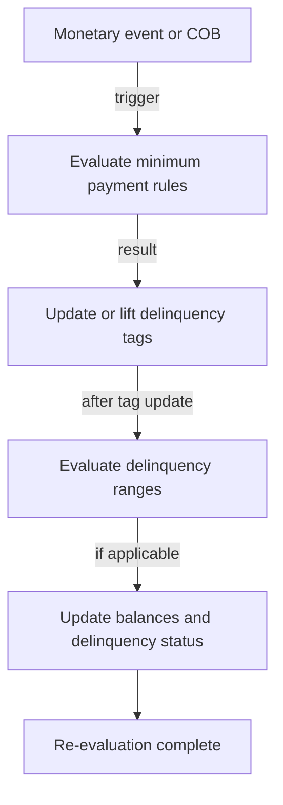

### Delinquency range schedule

The Range Schedule calculates overdue, delinquency, and payment holidays for a working capital loan account using parameters set at the delinquency configuration step. Each installment acts as a range id, and the full range model is stored as-is rather than as normalized table entries. Installment start dates are calculated from the disbursement date and the repaid-every parameter.

| Column | Description |
| --- | --- |
| From Date | Start of the range |
| To Date | End of the range |
| Expected Amount | Amount expected for the range |
| Paid Amount | Amount paid toward the range |
| Outstanding Amount | Expected Amount minus Paid Amount |
| Delinquent days | Number of days the range is delinquent |
| Delinquent Amount | Amount delinquent for the range |

Payment and minimum payment rules apply as follows:

- RangeSchedule.applyPayment updates range outstanding amounts using the full transaction amount and transaction date.
- Only the aggregate of the range plus previous ranges minimum payment amount is payable; for example, a range maximum of 300 followed by another range maximum of 300 makes 600 payable.

### Working Capital loan product configuration

When Working capital is selected, you must define the minimum payment period and rule, frequency, numeric value representing the range interval, frequency type, minimum payment amount type, and minimum payment amount.

Minimum payment amount type supports two options:

- Percentage (Percentage of loan amount)
- Flat (Flat amount)

Delinquency management start dates for Working Capital loans are:

- Loan creation date
- Disbursement date

The table m_delinquency_payment_rule is renamed to m_wc_delinquency_configuration.

| Loan product | Delinquency grace days | Delinquency start type |
| --- | --- | --- |
| US_PPWC | 3 | DISBURSEMENT |

| Bucket ID | Frequency | Minimum payment |
| --- | --- | --- |
| 1 | 90 DAYS | 10.000000 PERCENTAGE |

| Range | Min age days | Max age days |
| --- | --- | --- |
| D00 | 1 | 1 |
| D02 | 2 | 30 |
| D360 | 361 | No maximum |

Delinquency ranges can and must be provided to bucket, with the same behaviour as existing delinquency.

### Grace days and period dates

Grace days can be 0 or a positive number. Delinquency grace days extend the first delinquency period by shifting its end date forward by the configured grace days; the first period start date remains the original submitted-on or disbursed-on date. Breach grace days follow the same pattern for the first breach period. A first delinquency or breach period is repayable when the customer pays it before the grace days end.

Delinquency grace days do not affect classification or schedule construction:

- Delinquency classification computes rangeDelinquentDays as a raw day-count from the period's toDate to the business date with no delinquencyGraceDays offset, so a loan is tagged delinquent as soon as the business date passes range.getToDate by even one day.
- The COB business step calls classifyDelinquency(loan, businessDate.plusDays(1)) with no grace-day adjustment.
- WorkingCapitalLoanDelinquencyRangeScheduleServiceImpl.calculateToDate builds each period's fromDate/toDate schedule with no delinquencyGraceDays reference.
- delinquencyGraceDays is used only at read time to compute a cosmetic delinquencyStartDate = period.getFromDate + delinquencyGraceDays; it has zero effect on delinquency classification.

Breach grace days are applied differently:

- WorkingCapitalLoanBreachScheduleServiceImpl applies breachGraceDays via anchorDate.plusDays(getBreachGraceDays(loan)) when building the actual breach schedule.
- The first breach period start date is the original start date (submitted on / disbursed on date) and the first period end date is shifted by the grace days configured.

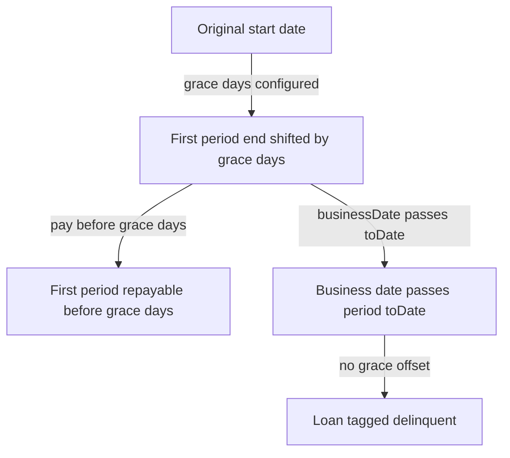

### Delinquency pause

Delinquency pause is supported for Working Capital loans with existing delinquency actions, applying the same rules and allowing no overlapping pauses. Creating overlapping pauses produces an error message stating that pauses overlap.

The pause is applied as of the current business date at initiation. A user can perform a backdated pause for Delinquency Evaluation, and the system retriggers and recomputes the Delinquency schedule and evaluation based on the new backdated pause.

Pause intervals and resume behaviour follow these rules:

- Delinquency pause intervals extend the current minimum payment and breach ranges, which are calculated based on delinquency configuration and loan configuration.
- Resume affects only the Delinquency schedule and calculation, with no impact on Breach management.
- No undo of resume, backdated resume, or multiple resumes are allowed.
- Only a user with specific permission or all functions permissions can perform the resume action.
- The Delinquency breach action is permitted only during an active Delinquency pause period, between the configured pause start date and end date.
- The Resume Delinquency action is permitted only during an active Delinquency pause period, between the configured pause start date and end date.

| Action | Permission required | Effect on pause |
| --- | --- | --- |
| Resume Delinquency | Specific permission or all functions permissions | Pause is terminated as of the resume date |

### Delinquency reset

Delinquency reset clears prior delinquency records and evaluations so they are no longer considered for future tracking or calculations, and evaluation restarts from the current period.

The following rules govern Delinquency reset:

- Only a user with the specific Delinquency reset permission and super user access can perform a reset.
- A reset is effective only from the current system date; backdated resets are not permitted.
- Multiple resets are allowed on the Delinquency schedule, but only one reset per period is permitted.
- A reset flag is added to periods to reflect why they have NULL values.
- A validation message appears if a user attempts to reset a second time on the same Delinquency period.
- Reset history is maintained to support undo or delete of the latest reset, subject to appropriate user permissions and controls.
- Upon undo or deletion, the Delinquency status reverts to its previous state and Delinquency evaluation is recomputed accordingly.
- When breach is reset, the breach past due amount is reset to $0.
- A user can reschedule the active loan account multiple times, even on the same date.
- Once delinquency is reset, no prior period matters or is maintained.
- Repayment on past due periods updates the breach past due amount; otherwise it is evaluated at period due date COB.
- Backdated repayment updates the past period.
- No audit is recorded if still updating the past period during backdated repayment.
- Past periods before reset should not be changed.
- All reset history is maintained to help on undo/delete of latest reset.

The optional Start New Period from Reset Date option changes how period dates behave after a reset:

- When not selected, Delinquency Reset works normally without changes to period dates.
- When selected, new Delinquency periods are created from the Delinquency reset date.

After reset, Delinquency monitoring cycles restart and further penal actions stop if applicable.

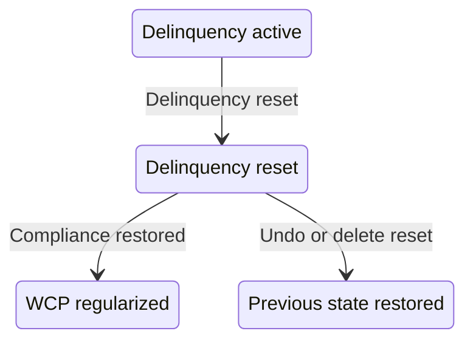

### Delinquency disable

Delinquency Disable applies only as of the current date, and backdated disable is not permitted. Once applied, delinquency evaluation stops for the account from the disable date onward. While delinquency is disabled, delinquency reschedule, reset, and pause are not allowed. Delinquency Disable can be applied only once until the current disable is reversed, and reversal re-triggers and recomputes delinquency evaluation as of the undo date. After reversal, Delinquency Disable can be applied again as of the current date.

Permission requirements:

- Only a user with the specific permission "disable Delinquency" or with "all functions" can perform Delinquency Disable.

### Delinquency actions and configuration changes

A delinquency action can change the minimum payment amount for a Working Capital loan from a provided date, targeting the appropriate minimum payment or breach ranges and updating all consecutive periods with the new value. The change uses the current date implicitly and affects only the future schedule from that date. Minimum payment ranges are updated after the change.

The following delinquency configuration fields can change in the middle of the loan cycle:

- Minimum payment amount
- Minimum payment type
- Frequency
- Frequency type

Deleting certain objects assigned to a Working Capital loan product produces an error message stating that the object is assigned to a loan product and already in use:

- A delinquency bucket
- A breach

Grace Days and Grace Days Start date may be left blank on a Working Capital loan account when the product does not allow overriding terms and settings at loan account level.

### Reschedule parameter inheritance

When a reschedule action omits a parameter group, the omitted group inherits its value from the latest previous reschedule action that set it; the product or breach configuration is used only when no earlier reschedule ever set that group. This inheritance rule applies identically to the Delinquency reschedule action and the Breach reschedule action.

Delinquency or Breach schedule and evaluation are recalculated according to the resolved inherited parameters. The reschedule action history remains append-only, and each action stores only the fields it was created with.

### Minimum payment based on remaining balance

When a Working Capital loan's remaining principal balance is lower than the computed minimum payment, the delinquency period's expected amount equals the remaining balance. This handling applies to both product-configuration-based amounts and reschedule-based amounts. The period is evaluated as meeting the minimum payment criteria once the remaining balance is fully paid.

Delinquency grace days are honoured.

A new delinquency action targets the appropriate minimum payment or breach ranges based on a provided date, updates the minimum payment amount, and updates all consecutive periods with the new value.

Delinquency Schedule and Evaluation are recalculated according to the latest reschedule, and the system maintains the reschedule history.

### APIs

The APIs let you fetch delinquency configuration options, delinquency information, and delinquency status and balance for a loan.

The following APIs are available:

- A template API fetches the options for delinquency configuration.
- An API fetches delinquency information similar to the fetch Loan details API and fetch delinquency tags of loan API.
- Delinquency status and balance can be fetched via API, similarly as progressive loan, with a separate API plus loan details.

### Worked examples

A Working Capital loan is disbursed for a principal of 1,000 on 01-01-2026. The product defines a delinquency range of 25 percent of the loan amount every 30 days, so each 30-day delinquency period expects 250.00, and a breach range of 50 percent every 60 days, so each 60-day breach period expects 500.00. Months are 30 days. At the current date of 04-03-2026 with no pause, the delinquency service builds periods from the disbursement date and the repaid-every interval, applies each payment to outstanding amounts using the transaction date and the full transaction amount, and classifies each period by the raw day-count from its toDate to the business date. The figures in this example are illustrative. Adding a delinquency pause from 03-20-2026 to 03-29-2026 together with a breach pause over the same dates extends the affected periods by ten days and shifts all later periods, so the same payments fall into later buckets, and the breach schedule extends the same way.

| Period | From | To | Expected | Paid | Outstanding | Past due | Bucket |
| --- | --- | --- | --- | --- | --- | --- | --- |
| D1 | 01-01-2026 | 01-30-2026 | 250.00 | 250.00 | 0.00 | 0.00 | - |
| D2 | 01-31-2026 | 03-01-2026 | 250.00 | 100.00 | 150.00 | 150.00 | D30 |
| D3 | 03-02-2026 | 03-31-2026 | 250.00 | 0.00 | 250.00 | 250.00 | D00 |
| D4 | 04-01-2026 | 04-30-2026 | 250.00 | 0.00 | 250.00 | 0.00 | - |
| Total |  |  | 1,000.00 | 350.00 | 650.00 | 400.00 |  |

The same loan reaches a delinquency reset on 04-15-2026, which is the current system date, and backdated resets are not permitted. The reset nullifies every delinquency record and evaluation before the reset date, so prior periods are no longer considered for future tracking or calculations, and a reset flag marks why those periods hold NULL values. Evaluation restarts from the reset date and builds new 30-day delinquency periods from 04-15-2026. One reset per period is allowed, and all reset history is kept. With no payment after the reset, the first new period stays current and the second becomes delinquent one day after its toDate. This shows that reset nullifies prior delinquency records and restarts evaluation from the reset date.

| Period | From | To | Expected | Paid | Past due | Bucket | State |
| --- | --- | --- | --- | --- | --- | --- | --- |
| D1 | 01-01-2026 | 01-30-2026 | - | - | - | - | Nullified |
| D2 | 01-31-2026 | 03-01-2026 | - | - | - | - | Nullified |
| D3 | 03-02-2026 | 03-31-2026 | - | - | - | - | Nullified |
| P1 | 04-15-2026 | 05-14-2026 | 250.00 | 0.00 | 0.00 | - | Active |
| P2 | 05-15-2026 | 06-13-2026 | 250.00 | 0.00 | 250.00 | D00 | Active |

A loan principal of 1,000 carries a product default of 25 percent of the loan amount every 30 days, so each period expects 250.00. Reschedule 1 sets the minimum payment to 33.33 percent of the loan amount, so each period expects 333.30. Reschedule 2 changes only the frequency from 30 days to 15 days and omits the minimum-payment group; the omitted group inherits 33.33 percent from Reschedule 1 instead of reverting to the product default, so each 15-day period still expects 333.30. When the remaining principal balance falls to 100.00, below the computed minimum payment, the period's expected amount equals the remaining balance, 100.00, and the minimum-payment criteria are met once that balance is fully paid. This inheritance rule applies identically to delinquency and breach reschedules, and each reschedule action stores only the fields it was created with.

| Action | Frequency | Min payment type | Min payment amount | Expected per period | Basis |
| --- | --- | --- | --- | --- | --- |
| Reschedule 1 | 30 days | Percentage | 33.33% | 333.30 | Set explicitly |
| Reschedule 2 | 15 days | - | 33.33% (inherited) | 333.30 | Inherited from 1 |
| Final period | 15 days | - | 33.33% (inherited) | 100.00 | Capped by remaining balance |

A loan of 1,000 is disbursed on 01-01-2026 with a delinquency range of 10 percent of the loan amount every 30 days, so each period expects 100.00, and the business date is 02-01-2026. Grace days set the period start and the cosmetic delinquencyStartDate, which is fromDate plus grace days, but they do not offset classification: rangeDelinquentDays is the raw day-count from the period's toDate to the business date, and the COB step calls classifyDelinquency with the next business date. With three grace days the first period runs 01-04-2026 to 02-02-2026, so 02-01-2026 is not yet past its toDate. With zero grace days the first period runs 01-01-2026 to 01-30-2026, so 02-01-2026 is two days past toDate and the loan is tagged delinquent. Changing only the grace days therefore moves the bucket from - to D00 while the classification rule stays a raw day-count from toDate.

| Grace days | Period 1 | To date | Business date | Days past toDate | Past due | Bucket |
| --- | --- | --- | --- | --- | --- | --- |
| 3 | 01-04-2026 to 02-02-2026 | 02-02-2026 | 02-01-2026 | 0 | 0.00 | - |
| 0 | 01-01-2026 to 01-30-2026 | 01-30-2026 | 02-01-2026 | 2 | 100.00 | D00 |

See also: [EIR New Scope](#eir-new-scope), [Effective Interest Rate Product](#effective-interest-rate-product), [Batch Job Foundation](#batch-job-foundation).

## Transaction Types

### Repayment transaction

A Repayment transaction requires a transaction amount, transaction date, classification, and payment type. It allocates in real time to Principal and Deferred Income Amortization based on the current amortization schedule plus the full repayment amount. Backdated repayment is out of scope.

The system persists and updates the following as part of a Repayment transaction:

- The transaction is stored in the transaction table and its allocations are stored in the allocation table.
- Balances are stored in the balances table and updated after the transaction.
- Accounting entries are created based on the allocation.
- External business events are triggered for Repayment.
- The amortization schedule is updated with the payment.
- Based on the amortization schedule, repayments can result in Closed (fully paid) or Overpaid status.

### Discount fee transaction

A Discount fee transaction requires a transaction amount using the default value, a classification, and a payment type. It must occur on the same day as the Disbursement, and only one Discount transaction is allowed per Disbursement, with a relation made between them. Additional Discount fees cannot be added after creation.

The system handles Discount fee transactions as follows:

- A Disbursement without any Discount fee amount creates one Disbursement transaction.
- A Disbursement with a Discount fee creates one Disbursement transaction and one Discount fee transaction in one shot.
- The Discount transaction is stored in the transaction table with basic details that rarely change.
- Allocations are stored in the allocation table as transaction portions.
- Real-time allocation covers Principal.
- The Discount balance is set by the Discount transaction.
- The amortization schedule reflects and calculates the Discount fee as Capitalized.
- External business events are triggered for Discount transactions.

### Discount fee amortization

Discount fee amortization recognizes the discount fee as interest income over the life of the loan. It occurs only when a payment has been made and a Discount fee exists on the loan. The system uses the COB date as the transaction date and calculates the amortization amount based on the current date total payments. The amortization schedule maintains the net amortization balance in real time.

| Entry | Account | Type | Category |
| --- | --- | --- | --- |
| Debit | 240005 Deferred Interest | Liability | Deferred Income |
| Credit | 404000 Interest income | Income | Income from Discount Fee |

> **Note:** Accounting and business events are out of scope for Discount transactions, including business event handling, backdated transaction handling, and Discount Fee amortization adjustment.

### Credit Balance Refund

A Credit Balance Refund (CBR) can be initiated when a loan is overpaid. It requires a transaction amount, transaction date, classification, and payment type, and its real-time allocation covers overpayment.

The following rules apply to CBR:

- The CBR transaction is stored in the transaction table.
- External business events are triggered for CBR.
- Loan statuses are Created, Approved, Disbursed → Active, Closed (fully paid), and Overpaid.
- No backdated transactions and no reversed repayment prior to CBR are allowed.
- Accounting entries creation and external business events for accounting, balances and status change are out of scope.

### Disbursement transaction

A disbursement requires the disbursement amount, transaction date, classification, and payment type, and its real-time allocation covers Principal. The transaction is stored in the transaction table with basic details that rarely change, and external business events are triggered for it. No multi-disbursement is supported.

Undo disbursement behaviour:

- Undo disbursement reverts the current disbursement transaction.
- Undo disbursement is not allowed if there was any monetary transaction except Disbursement and Discount.
- The amortization schedule reflects and calculates Disbursement and Undo disbursement based on what was approved.
- Loan disbursement detail is updated.

### Discount setup during loan creation

When overriding select terms and settings is disabled, setting a discount field value causes loan account creation with discount set up to fail. When no discount field value is set, loan account creation with discount set up also fails, and discount is inherited from product level after loan creation.

### Charge Adjustment

Charge Adjustment behaves like a repayment and decreases the income of the target charge, with the amount allocated as repayment. It is related to an existing charge through a transaction relationship.

Charge Adjustment follows these rules:

- Charge Adjustment allocation pays principal directly.
- Charge Adjustment adds charge adjustment balance into the balances table, maintains its value, increases total payment and total_paid_principal if applicable, and decreases principal_outstanding.
- Total Charge adjustment amount cannot be more than the original charge amount.
- Charge Adjustment cannot be earlier than the original charge was added to the loan.
- Charge adjustment can be reverted at any time with no validation on reversal.

### Goodwill Credit

Goodwill Credit behaves like a repayment and allocates based on the configured rules.

Goodwill Credit updates the loan balances as follows:

- It adds the goodwill credit balance to the balances table and maintains its value.
- It increases total payment and total paid principal where applicable.
- It decreases principal outstanding.

### Discount fee adjustment

A Discount fee adjustment reduces the Discount fee and allocates in real time to a Principal decrease. The adjustment requires a classification and payment type, and its amount cannot exceed the Discount fee.

The adjustment is processed as follows:

- The system stores the Discount fee adjustment transaction in the transaction table with basic details that rarely change.
- The system triggers external business events for the Discount fee adjustment.
- The amortization schedule reflects and calculates the Discount fee adjustment as Un(capitalized) from the Discount fee transaction date.

If the discount field is set during disbursement, the system creates Disbursement and Discount transactions and returns the Disbursement transaction ID as primary and the Discount transaction ID as secondary.

### Backdated repayment and reversal

You can post a backdated repayment or reverse any repayment on an active loan account. On closed or charge-off loan accounts, only reversal is allowed. Written-off loan accounts do not allow backdated repayment or reversal. The loan status changes according to the new loan balance created by the backdated repayment or reversal. Delinquency and Breach Evaluation are recalculated when either happens.

The loan status changes as follows:

- If the loan balance becomes zero because of backdated repayment, the loan moves to closed status.
- If the loan balance becomes negative because of backdated repayment, the loan moves to overpaid status.
- If reversal of repayment is done on a closed loan account, the loan becomes active again.

Transaction allocation rules are:

- Transaction allocation and allocation changes only occur if there are charges on the loan and a backdated transaction occurs.
- If all charges are fully paid before the backdated transaction, the backdated transaction pays no charges and no transaction allocation changes occur.
- If an undo transaction reverts a transaction that paid portions of any charges, existing transactions after the reverted transaction might need reevaluation and allocation changes.
- Otherwise allocation is always principal and no allocation of an existing transaction changes.

### Repayment on closed and charge-off loans

You can post a repayment transaction on an active loan account or on a closed or charge-off loan account. Repayments on closed accounts apply only when the account is fully paid or overpaid, and the system treats such a repayment as an overpayment and moves the loan to overpaid status. You can also post a repayment and close the loan when it is fully paid.

Repayment transactions support the following actions:

- You can view repayments on the transaction tab.
- You can undo a repayment transaction.

### Goodwill Credit on closed and charge-off loans

You can post backdated goodwill credit (GWC) or reverse any GWC on active or closed loans. GWC on a closed loan is treated as an overpayment and moves the loan to overpaid status. Backdated GWC or reversals are not allowed on written-off loan accounts.

The loan status changes according to the new loan balance created by backdated GWC or reversal:

- If the balance becomes zero, the loan moves to closed status.
- If the balance becomes overpaid, the loan moves to overpaid status.
- If a GWC reversal is done on a closed loan account, the loan becomes active again.

### Credit Balance Refund status transitions

A Credit Balance Refund (CBR) handles overpayment situations and moves money in the opposite direction to repayment transactions. It is processed during reprocessing in the same way as a CBR on a Term loan.

The loan status after a CBR depends on how the overpayment amount compares with the CBR amount:

- When the overpayment amount equals the CBR amount, the loan moves from Overpaid to Closed (fully paid).
- When the overpayment amount is greater than the CBR amount, the loan remains Overpaid and the overpayment balance becomes the difference between the CBR and the overpayment amount.
- When the overpayment amount is lower than the CBR amount, the loan moves from Overpaid to Active and the due principal becomes the difference between the CBR and the overpayment amount.
- A CBR amount greater than the overpayment amount is not allowed and is blocked by validation.

A user can still perform backdated repayments or reverse old transactions after the loan has completed the CBR.

### Charge Adjustment on closed loans

You can post charge-adjustment transactions on closed loan accounts, but backdated charge adjustments are not supported because charge adjustments are posted as of the current date. A user can reverse any Charge Adjustment on active or closed loans using a reversal transaction only. Loan status changes according to the new loan balance created by the reversal transaction, and if a reversal of payment is done on a closed loan account, the loan becomes active again.

Charge-adjustment transactions on closed loans follow these rules:

- Charge-adjustment transactions on closed loans are treated as overpayment and the loan is moved to overpaid status.
- An Accrual Transaction is created for Charge Income because there is no Interest income for Working Capital Product (WCP) as of now.
- When the accrual configuration is submitted_date, the accrual transaction is created in real time when the Charge is added.

### Transaction reversal

You can undo any monetary transaction so that it has the same effect as if it never happened, while keeping its details for auditing and compliance. The system recalculates schedules and balances after the reversal.

A reversal marks the undone transaction and updates accounting and schedules:

- The undone transaction is marked with a reversal flag.
- Mirror accounting entries undo the transaction from an accounting point of view.
- Balances are updated, including paid and outstanding.
- The amortization schedule is updated, and recalculation can happen from the original transaction date only.
- The delinquency schedule is updated.
- The breach schedule is updated.

The reversal API accepts only non-reversed transactions:

- Validation allows non-reversed transactions only.
- Reversal external id can be provided or auto generated if applicable.
- The reversal external id is accepted, the transaction is marked for revert with reversed=true, reversed on date is set, and the external id is set or generated.
- The note field is supported and the note is created accordingly.
- Reversal journal entries are created.

> **Note:** Disbursement is rejected on this API; use the dedicated undo disbursal API instead.

### Reversal allocation and accounting

Reversing a transaction changes its allocation rather than reversing and replaying the transaction itself. Allocation follows the configured payment allocation by transaction type and may need reprocessing when a reversal or backdated transaction alters it. If the Advance accounting rule is enabled and fund sources for payment channels are mapped, the Advance accounting rule takes priority over the regular fund source mapping.

### Charge-off discount amortization

When a charge-off occurs on an active loan account, the system creates a final discount fee amortization transaction as of the charge-off date for the unreleased deferred income balance. All unreleased deferred income moves to expenses, and no further discount amortization happens after charge-off. Balance has no unrealized discount fee; all goes into realized as part of expense.

If a charge-off is reversed after a certain period, the final amortization transaction and relevant accounting entries are undone, including balances. Discount fee amortization is then recalculated and a new discount fee amortization or adjustment transaction is posted as of the current date.

Discount fee amortization works similar to buydown fees of term loans.

Payment Allocation behaves like a repayment where priority is based on configured rules set for a specific transaction or a default, even when the amount is paid in full, partial or excess.

Undo disbursement reverts accounting, reverts balances, moves the loan back from Active to Approved, triggers external business events, and records LoanTransaction reversed.

### Write-off

Write-off zeros all outstanding balances and closes the loan with status written-off. Written-off status can be undone. Backdated transactions or undoing any transactions on a written-off loan are not supported. Incoming parameters follow the current behaviour from progressive loans. Write-off on a loan can be undone.

### Discount fee adjustment rules

A discount fee adjustment cannot exceed the discount fee, and multiple adjustments are allowed. The total value of all adjustments is validated against the discount fee.

The system creates the transaction as of the current date, using the COB date as the transaction date, regardless of any backdated transaction date:

- A positive difference results in a Discount fee amortization transaction.
- A negative difference results in a Discount fee amortization adjustment transaction.

### Payout Refund transaction

The Payout Refund transaction works similar to a repayment transaction and can only be applied to active, closed or overpaid Working Capital Product (WCP) loans.

The transaction applies funds as follows:

- It reduces the outstanding principal and fees balance as per the allocation rule.
- If the Payout Refund exceeds the outstanding principal balance, the excess amount is recorded as overpayment.
- Loan status changes to Overpaid when excess funds exist after a Payout Refund.

### Payout Refund accounting entries

Payout Refund accounting entries depend on whether the loan account is active or charge-off and whether the movement is Cash In or Cash Out. Every entry debits or credits GL 145023 Fund source on one side. If the Restart Period from Reset Date option is selected, previous Delinquency periods remain available for audit/history purposes but must not influence newly generated Delinquency periods after the reset.

| Loan state | Movement | Entry type | Debit | Credit |
| --- | --- | --- | --- | --- |
| Active | Cash In | Penalty | 145023 Fund source | 112603 Penalties Receivable |
| Active | Cash In | Fees | 145023 Fund source | 112603 Fees Receivable |
| Active | Cash In | Principal | 145023 Fund source | 112601 Loan portfolio |
| Active | Cash In | Unallocated Credit (UNC) | 145023 Fund source | 245000 Over payment liability |
| Charge-off | Cash In | Penalty | 145023 Fund source | 404008 Income from ChargeOff Penalty |
| Charge-off | Cash In | Fees | 145023 Fund source | 404008 Income from ChargeOff Fees |
| Charge-off | Cash In | Principal | 145023 Fund source | 744007/740037 ChargeOff Expense/Charge Off Fraud Expense |
| Charge-off | Cash In | Unallocated Credit (UNC) | 145023 Fund source | 245000 Over payment liability |
| Active | Cash Out | Penalty | 112603 Penalties Receivable | 145023 Fund source |
| Active | Cash Out | Fees | 112603 Fees Receivable | 145023 Fund source |
| Active | Cash Out | Principal | 112601 Loan portfolio | 145023 Fund source |
| Active | Cash Out | Unallocated Credit (UNC) | 245000 Over payment liability | 145023 Fund source |
| Charge-off | Cash Out | Penalty | 404008 Income from ChargeOff Penalty | 145023 Fund source |
| Charge-off | Cash Out | Fees | 404008 Income from ChargeOff Fees | 145023 Fund source |
| Charge-off | Cash Out | Principal | 744007/740037 ChargeOff Expense/Charge Off Fraud Expense | 145023 Fund source |
| Charge-off | Cash Out | Unallocated Credit (UNC) | 245000 Over payment liability | 145023 Fund source |

### Journal entries

Each transaction type posts to specific general ledger accounts. The entries depend on whether the loan account is active or charge-off.

| Transaction | Debits | Credits |
| --- | --- | --- |
| Discount fees | GL 112601 Loans Receivable Principal | GL 240005 Deferred Interest |
| Discount fees Adjustment | GL 240005 Deferred Interest | GL 112601 Loans Receivable Principal |
| Disbursement | GL 112601 Loans Receivable Principal | GL 145023 Suspence/clearing account |
| Disbursement Reversal | GL 145023 Suspence/clearing account | GL 112601 Loans Receivable Principal |
| Repayment | GL 145023 Suspence/clearing account | GL 112601 Loans Receivable Principal, GL 245000 Other Credit liability, GL 112603 Fee Receivable Fees Receivable, GL 112603 Fee Receivable Penalty Receivable |
| Repayment Reversal | GL 112601 Loans Receivable Principal, GL 245000 Other Credit liability, GL 112603 Fee Receivable Fees Receivable, GL 112603 Fee Receivable Penalty Receivable | GL 145023 Suspence/clearing account |
| Amortization | GL 240005 Deferred Interest | GL 404000 Interest income |
| Write-off | GL 744008 recoveries | GL 112603 Fee Receivable Fees Receivable, GL 112603 Fee Receivable Penalty Receivable, GL 112601 Loans Receivable Principal |
| Write-off Reversal | GL 112601 Loans Receivable Principal, GL 112603 Fee Receivable Fees Receivable, GL 112603 Fee Receivable Penalty Receivable | GL 744008 recoveries |
| CBR | GL 245000 Other Credit liability | GL 145023 Suspence/clearing account |
| CBR Reversal | GL 145023 Suspence/clearing account | GL 245000 Other Credit liability |
| Goodwill Credit | GL 744003 Principal bal adjustment, GL 404008 Fee Charge off Income from Goodwill Credit Fees, GL 404008 Fee Charge off Income from Goodwill Credit Penalty | GL 112601 Loans Receivable Principal, GL 112603 Fee Receivable Fees Receivable, GL 112603 Fee Receivable Penalty Receivable, GL 245000 Other Credit liability |
| Goodwill Credit Reversal | GL 112601 Loans Receivable Principal, GL 112603 Fee Receivable Fees Receivable, GL 112603 Fee Receivable Penalty Receivable | null |
| Charge addition | GL 112603 Fee Receivable | GL 404007 Fee Income |
| Charge waive | GL 404007 Fee Income | GL 112603 Fee Receivable |
| Charge-off | GL 744007/744037 Credit loss-bad dept/credit loss-bad dept- fraud, GL 404008 Fee Charge off Income from ChargeOff Fees, GL 404008 Fee Charge off Income from ChargeOff Penalties | GL 112601 Loans Receivable Principal, GL 112603 Fee Receivable Fees Receivable, GL 112603 Fee Receivable Penalty Receivable |
| Charge-off Reversal | GL 112603 Fee Receivable Fees Receivable, GL 112603 Fee Receivable Penalty Receivable | GL 112601 Loans Receivable Principal, GL 404008 Fee Charge off Income from ChargeOff Fees, GL 404008 Fee Charge off Income from ChargeOff Penalties |

| Transaction on charge-off loan account | Debits | Credits |
| --- | --- | --- |
| Repayment | GL 145023 Suspence/clearing account | GL 744008 recoveries Income from Recovery Repayment, GL 245000 Other Credit liability Overpayment Liability, GL 744008 recoveries Income from Recovery Repayment, GL 744008 recoveries Income from Recovery Repayment |
| Repayment Reversal | GL 744008 recoveries Income from Recovery Repayment, GL 245000 Other Credit liability Overpayment Liability, GL 744008 recoveries Income from Recovery Repayment, GL 744008 recoveries Income from Recovery Repayment | GL 145023 Suspence/clearing account |
| Amortization | GL 240005 Deferred Interest | GL 404000 Interest income |
| CBR | GL 245000 Other Credit liability | GL 145023 Suspence/clearing account |
| CBR Reversal | GL 145023 Suspence/clearing account | GL 245000 Other Credit liability |
| Goodwill Credit | GL 744003 Principal bal adjustment, GL 404008 Fee Charge off Income from Goodwill Credit Fees, GL 404008 Fee Charge off Income from Goodwill Credit Penalty | GL 744008 recoveries Income from Recovery Repayment, GL 744008 recoveries Income from Recovery Repayment, GL 744008 recoveries Income from Recovery Repayment, GL 245000 Other Credit liability |
| Goodwill Credit Reversal | GL 744008 recoveries Income from Recovery Repayment, GL 744008 recoveries Income from Recovery Repayment, GL 744008 recoveries Income from Recovery Repayment, GL 245000 Other Credit liability | GL 404008 Fee Charge off Income from Goodwill Credit Fees, GL 404008 Fee Charge off Income from Goodwill Credit Penalty |

Configuration controls the following behaviour:

- A principal adjustment balance increases the principal to be paid for CBR edge cases where CBR issued more money back to the customer than it should based on current state.
- Accrual transaction is posted as of due_date or submitted_date based on the configuration set at global configuration (charge-accrual-date).
- A user can configure an allocation rule specific to Payout Refund.

### Goodwill Credit user actions

You can perform a Goodwill Credit transaction on active and closed or charge-off loan accounts. You can view the transaction on the transaction tab and undo it when needed.

You can perform a charge adjustment transaction on active loan accounts.

### Loan application modifiable fields

You can modify the following fields in the Term category of a loan application.

The modifiable Term category fields are:

- Disbursement Amount shows the default amount and you can change it between Min and Max values.
- Period Payment Rate shows the default amount and you can change it between Min and Max values.
- Total Payment Value is user entered.
- Discount shows the default amount and you can change it.
- Loan Application Submitted Date uses the current date if you do not provide one.
- Expected Disbursement Date is modifiable.
- LP overridables are modifiable if enabled.
- Flat - % amount is modifiable.
- Delinquency Bucket Classification is modifiable.
- Period payment frequency is modifiable.

### Approval modifiable fields

During loan approval, you can modify the principal amount, discount amount, approved date, expected disbursement date, and notes. Principal amount and approved date are mandatory; discount amount and notes are optional.

The following fields are modifiable during approval:

- Principal Amount is mandatory and defaults to the amount entered during loan creation; you can change it to a lesser amount.
- Discount Amount is non-mandatory and defaults to the amount entered during loan creation; you can change it to a lesser amount.
- Approved Date is mandatory.
- Expected Disbursement Date is mandatory and represents the expected disbursement of the loan account.
- Notes is non-mandatory.

### Disbursal fields

During Disbursal, Disbursed on and Disbursement amount are mandatory fields; Discount Amount, External ID, Payment Type, Payment Details, and Notes are non-mandatory fields.

The following rules apply to each field:

- Disbursed on is mandatory and records the Actual Disbursement date.
- Disbursement amount is mandatory, defaults to the approved amount, and can be modified to any amount lesser than the approved amount.
- Discount Amount is non-mandatory, defaults to the amount entered during loan Approval, and can be changed to a lesser amount than the created amount.
- External ID is non-mandatory.
- Payment Type is non-mandatory and is a drop-down of payment type entities.
- Payment Details is non-mandatory and contains Account No, Cheque No, Routing Code, Receipt No, and Bank code.
- Notes is non-mandatory.

### Amortization EOD processing

The system calculates and creates the amortization transaction at end of day as part of close of business. It recalculates amortization and posts the difference as a discount fee amortization transaction, or as a discount fee amortization adjustment transaction when the difference is negative.

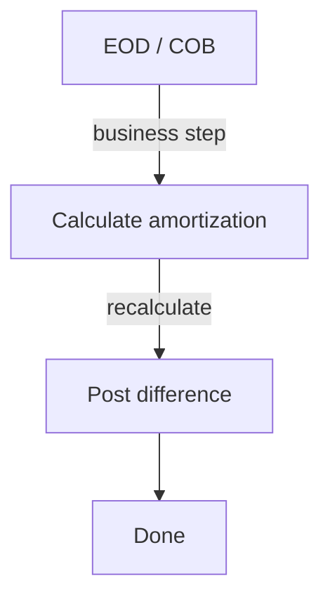

### Backdated GWC and reversal

When a backdated goodwill credit (GWC) or reversal occurs, delinquency and breach evaluation are recalculated. Backdated actions after a credit balance refund (CBR) trigger reprocessing and recalculation, and any difference in amortization is adjusted at the end-of-day jobs.

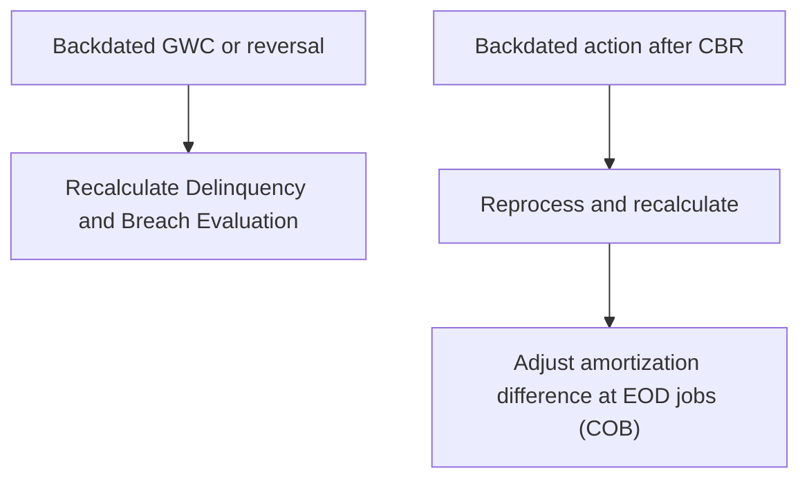

### Schedule and balance updates

When a transaction posts, the system updates the amortization schedule, reverses the schedule payment related to the transaction, updates and saves the schedule again, updates the loan balance, updates the delinquency schedule by subtracting the unpaid amount from the last paid period and recursing into earlier periods when needed, and updates the breach schedule without modifying the near breach flag.

The breach schedule is updated as follows:

- The breach flag is set to null if the related period ends before the business day.
- The near breach flag is not modified.

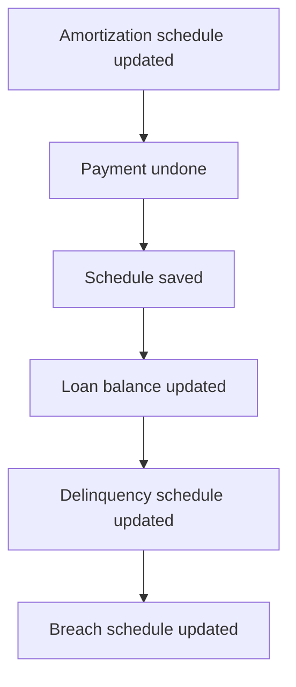

### Discount adjustment backdated and undo

You can post a discount adjustment backdated, undo a discount adjustment transaction, post a payout refund transaction backdated like a repayment, and undo a payout refund transaction. After a discount adjustment is posted or undone, the amortization schedule is recalculated and the relevant amortization adjustment or amortization transaction is posted for the difference amount; when undone, that amortization adjustment or amortization transaction is reversed as well.

Amortization or amortization adjustment transactions are calculated and created at end of day by a business step.

Charge accounting entries:

- Charge addition as accrual transaction: Dr 112603 Fee Receivable Fees Receivable Asset fees; Cr 404007 Fee Income Income from Fees Income fees.
- Charge waive when charge is waived: Dr 404007 Fee Income Income from Fees Income fees; Cr 112603 Fee Receivable Fees Receivable Asset fees.

Discount fees transaction entries:

- Discount Fees Transaction: Dr 112601 Loans Receivable Principal Loan Portfolio Asset Prin, Fees, and Penalty; Cr 240005 Deferred Interest Deferred Income Liability Prin, Fees, and Penalty.
- Discount Fees Adjustment Transaction: Dr 240005 Deferred Interest Deferred Income Liability Prin, Fees, and Penalty; Cr 112601 Loans Receivable Principal Loan Portfolio Asset Prin, Fees, and Penalty.

| Scenario | Debit | Credit |
| --- | --- | --- |
| Charge-off (non-fraud) | 240005 Deferred Interest Deferred Income Liability Int | 744007/744037 Credit loss-bad dept Charge off expense Expense Int |
| Charge-off (fraud) | 240005 Deferred Interest Deferred Income Liability Int | 744007/744037 credit loss-bad dept- fraud charge-off fraud expense Expense Int |

You can fetch journal entries of working capital transactions through the API.

Backdated transaction handling, business event handling, accounting entries, full/partial/excess amount payment allocation handling, overpayment scenario, and closed/charge-off/written-off handling are out of scope.

### Write-off journal entries

A write-off transaction posts losses written off against principal, fees, and penalty receivables. An undo write-off reverses those entries.

| Transaction | Debit | Credit |
| --- | --- | --- |
| Write-off | 744008 recoveries Losses Written-off Expense Prin, fees, and Penalty | 112603 Fee Receivable Fees Receivable Asset fees; 112603 Fee Receivable Penalty Receivable Asset Penalty; 112601 Loans Receivable Principal Loan Portfolio Asset Prin |
| Undo write-off | 112601 Loans Receivable Principal Loan Portfolio Asset Prin; 112603 Fee Receivable Fees Receivable Asset fees; 112603 Fee Receivable Penalty Receivable Asset Penalty | 744008 recoveries Losses Written-off Expense Prin, fees, and Penalty |

When Accounting is enabled for a Working Capital Product, attached journal entries are passed for the payout refund transaction type.

### Amortization schedule calculations

The amortization schedule calculates and maintains the net amortization balance in real time. The current day amortized amount equals the total amortized amount minus the previous total amortized amount, where total amortized amount is the sum of the running NPV value of each past and projected payment. The calculated amount is based on current date total payments versus total amortization amount from the amortization schedule.

### Worked examples

A Credit Balance Refund is posted when a loan is overpaid. Suppose a repayment leaves the loan overpaid by 600.00, and a Credit Balance Refund of 600.00 is submitted. The figures are illustrative.

| Step | Overpayment before | Refund amount | Overpayment after | Loan status |
| --- | --- | --- | --- | --- |
| Overpayment created | 600.00 | — | 600.00 | Overpaid |
| Refund posted | 600.00 | 600.00 | 0.00 | Closed |

When the refund equals the overpayment, the balance reaches zero and the loan moves to Closed.

A Credit Balance Refund can be smaller than or larger than the overpayment. A loan is overpaid by 600.00. One variant posts a refund of 400.00; another attempts a refund of 800.00.

| Step | Overpayment before | Refund amount | Overpayment after | Loan status | Allowed |
| --- | --- | --- | --- | --- | --- |
| Overpayment created | 600.00 | — | 600.00 | Overpaid | Yes |
| Partial refund posted | 600.00 | 400.00 | 200.00 | Overpaid | Yes |
| Excess refund requested | 600.00 | 800.00 | — | — | No |

A partial refund leaves the loan overpaid by the difference, while a refund larger than the overpayment is rejected by validation.

A backdated repayment reversal can reopen a loan after a Credit Balance Refund. A loan is overpaid by 900.00. A refund of 900.00 brings the balance to zero and the loan to Closed. A backdated reversal of a 300.00 repayment is then posted, restoring principal and leaving 300.00 outstanding.

| Step | Balance before | Transaction | Balance after | Loan status |
| --- | --- | --- | --- | --- |
| Overpayment | -900.00 | — | -900.00 | Overpaid |
| Refund posted | -900.00 | +900.00 | 0.00 | Closed |
| Repayment reversal posted | 0.00 | +300.00 | 300.00 | Active |

After the refund closes the loan, the reversal restores principal and moves the loan back to Active.

Transaction reprocessing changes the allocation of later transactions when an earlier transaction is reverted or backdated. Transaction 1 pays 40.00, split as 10.00 fee and 30.00 principal. Transaction 2 pays 30.00 principal.

| Step | Transaction 1 | Transaction 2 | Trigger | Resulting allocation |
| --- | --- | --- | --- | --- |
| Initial | 10.00 fee + 30.00 principal | 30.00 principal | — | — |
| Transaction 1 reverted | — | 10.00 fee + 20.00 principal | Reversal | Transaction 2 absorbs the fee |
| Transaction 2 backdated | 40.00 principal | 10.00 fee + 20.00 principal | Backdating | Transaction 1 becomes principal only |

The result changes with the trigger: a reversal lets the later transaction take the fee, while backdating makes the earlier transaction principal only.

See also: [EIR New Scope](#eir-new-scope), [Effective Interest Rate Product](#effective-interest-rate-product), [Batch Job Foundation](#batch-job-foundation).

## Accounting

### Accounting rule options

Working Capital loan products use two accounting options: None (default) and Cash based. The accountingRule parameter is mandatory when creating a Working Capital product and must be NONE or CASH_BASED; it defaults to NONE so creation succeeds without a missing-accounting error.

### Accounting mode behavior

Working Capital loans support None, Cash Based, and Advanced accounting modes. Advanced accounting is out of scope for this product. None accounting requires no accounting configuration and creates no journal entries during the loan lifecycle.

Cash Based accounting recognizes interest only when a monetary event such as a repayment occurs and calculates income based on the transaction amount.

- Cash Based accounting recognizes interest only when a monetary event such as a repayment occurs and calculates income based on the transaction amount.
- When Cash Based is selected, GL mappings are available for configuration, similar to regular term loans.
- Accounting entries remain the same for both Cash Based and accrual based accounting types.
- When No Accounting is selected, the loan product is created or updated without accounting mapping.

### GL mapping configuration

GL account mapping can be configured for Working Capital loan products when Cash based accounting is selected, and existing mappings can be updated or deleted on the product. New account mapping parameters are introduced for charge-off specific mappings. Backend validations are adapted to the UI so each parameter must be mapped to a GL before submission. Created journal entries for Working Capital loans are stored in the regular table acc_gl_journal_entry.

### Repayment journal entries

A repayment transaction posts fund source amounts to the suspense clearing account and allocates principal, fees, penalties and excess to their respective receivable or liability accounts. On a closed loan account, the same debit posts to the suspense clearing account while any excess posts to the overpayment liability account. The system applies these entries through the API.

| GL code | Account | Type | Allocation type | Entry |
| --- | --- | --- | --- | --- |
| 145023 | Suspense/clearing account | Liability | Prin, Fees, Penalty and excess | DEBIT |
| 112601 | Loans Receivable Principal | Asset | Prin | CREDIT |
| 245000 | Other Credit liability | Liability | excess | CREDIT |
| 112603 | Fee Receivable | Asset | Penalty | CREDIT |
| 112603 | Fee Receivable | Asset | Fees | CREDIT |

| GL code | Account | Type | Allocation type | Entry |
| --- | --- | --- | --- | --- |
| 145023 | Suspense/clearing account | Liability | Prin, Fees, Penalty and excess | DEBIT |
| 245000 | Other Credit liability | Liability | excess | CREDIT |

### Goodwill credit journal entries

A goodwill credit posts debit entries to principal, fee, and penalty adjustment accounts and credit entries to principal, fee receivable, penalty receivable, and overpayment liability accounts. The debit side records expense or income, while the credit side reduces receivables or records a liability.

| Direction | GL code | Account | Type | Category |
| --- | --- | --- | --- | --- |
| Dr | 744003 | Principal bal adjustment | Expense | Principal, excess |
| Dr | 404008 | Fee Charge off | Income | Fees |
| Dr | 404008 | Fee Charge off | Income | Penalty |
| Cr | 112601 | Loans Receivable Principal | Asset | Principal |
| Cr | 112603 | Fee Receivable | Asset | Fees |
| Cr | 112603 | Fee Receivable | Asset | Penalty |
| Cr | 245000 | Other Credit liability | Liability | Excess |

### Goodwill credit reversal journal entries

| Transaction | Debit GL code | Debit account | Credit GL code | Credit account |
| --- | --- | --- | --- | --- |
| Goodwill credit reversal | 112601 | Loans Receivable Principal (Loan Portfolio, Asset, prin) | 404008 | Fee Charge off (Income from Goodwill Credit Fees, Income, fees) |
| Goodwill credit reversal | 112603 | Fee Receivable (Fees Receivable, Asset, fees) | 404008 | Fee Charge off (Income from Goodwill Credit Penalty, Income, Penatly) |
| Goodwill credit reversal | 112603 | Fee Receivable (Penalty Receivable, Asset, Penalty) | 744003 | Principal bal adjustment (Expense from Goodwill Credit, Expense, Prin,excess) |
| Goodwill credit reversal | 245000 | Other Credit liability (Overpayment Liability, Liability, excess) | 744003 | Principal bal adjustment (Expense from Goodwill Credit, Expense, Prin,excess) |
| GoodwillCredit Transaction on closed loan account | 744003 | Principal bal adjustment (Expense from Goodwill Credit, Expense, Prin,excess) | 245000 | Other Credit liability (Overpayment Liability, Liability, excess) |

### CBR transaction journal entries

| Transaction | Dr GLCode | Cr GLCode |
| --- | --- | --- |
| CBR Transaction | 245000 Other Credit liability (Overpayment Liability, Liability, excess) | 145023 Suspence/clearing account (Fund source, Asset/Liability, excess) |
| UNDO CBR Transaction | 145023 Suspence/clearing account (Fund source, Asset/Liability, excess) | 245000 Other Credit liability (Overpayment Liability, Liability, excess) |

### Charge adjustment journal entries

| Transaction | Dr GLCode | Cr GLCode | Description | Category | Type |
| --- | --- | --- | --- | --- | --- |
| Charge Adjustment Transaction | 404007 | 112601 | Fee Income / Penalty Income | Income from charges, Income, prin,fees, and excess | Income |
| Charge Adjustment Transaction | 404007 | 112603 | Fee Receivable | Fees Receivable, Asset, fees | Asset |
| Charge Adjustment Transaction | 404007 | 112603 | Fee Receivable | Penalty Receivable, Asset, Penalty | Asset |
| Charge Adjustment Transaction | 404007 | 245000 | Other Credit liability | Overpayment Liability, Liability, excess | Liability |

### Charge adjustment on charge-off loan account

| Dr/Cr | GLCode | GL name | Account type | Category |
| --- | --- | --- | --- | --- |
| Dr | 404007 | Fee Income | Income | prin, fees, and excess |
| Cr | 404008 | Fee Charge off | Asset | prin |
| Cr | 404008 | Fee Charge off | Asset | fees |
| Cr | 245000 | Other Credit liability | Liability | excess |

### Charge-off transaction journal entries

A charge-off transaction posts debit entries to charge-off expense and fee charge-off accounts, and credit entries to loan receivable and fee receivable accounts.

| Entry type | GL code | Account name | Account type | Category |
| --- | --- | --- | --- | --- |
| Debit | 744007/744037 | Credit loss-bad dept / credit loss-bad dept- fraud | Expense | Principal |
| Debit | 404008 | Fee Charge off | Income | Fees |
| Debit | 404008 | Fee Charge off | Income | Penalty |
| Credit | 112601 | Loans Receivable Principal | Asset | Principal |
| Credit | 112603 | Fee Receivable | Asset | Fees |
| Credit | 112603 | Fee Receivable | Asset | Penalty |

### Undo charge-off transaction journal entries

| Transaction | Debit GL code | Debit account | Credit GL code | Credit account |
| --- | --- | --- | --- | --- |
| UNDO charge-off | 112603 | Fee Receivable (Fees Receivable, Asset, fees) | 404008 | Fee Charge off (Income from ChargeOff Fees, Income, fees) |
| UNDO charge-off | 112603 | Fee Receivable (Penalty Receivable, Asset, Penalty) | 404008 | Fee Charge off (Income from ChargeOff Penalties, Income, Penalty) |
| UNDO charge-off | 112601 | Loans Receivable Principal (Loan Portfolio, Asset, Prin) | 744007/744037 | Credit loss-bad dept/credit loss-bad dept- fraud (Charge off expense/charge-off fraud expense, Expense, Prin) |

The fraud flag determines which mapped GL account is affected for charge-off expense and charge-off fraud expense.

### Payout refund cash-in journal entries

| Transaction type | Loan account state | Debit GL | Credit GL |
| --- | --- | --- | --- |
| Payout Refund Penalty Cash in | Active | 145023 Fund source | 112603 Penalties Receivable |
| Payout Refund Fees Cash in | Active | 145023 Fund source | 112603 Fees Receivable |
| Payout Refund Principal Cash in | Active | 145023 Fund source | 112601 Loan portfolio |
| Payout Refund Unallocated Credit (UNC) Cash in | Active | 145023 Fund source | 245000 Over payment liability |
| Payout Refund Penalty Cash in | Charge-off | 145023 Fund source | 404008 Income from ChargeOff Penalty |
| Payout Refund Fees Cash in | Charge-off | 145023 Fund source | 404008 Income from ChargeOff Fees |
| Payout Refund Principal Cash in | Charge-off | 145023 Fund source | 744007/740037 ChargeOff Expense/Charge Off Fraud Expense |
| Payout Refund Unallocated Credit (UNC) Cash in | Charge-off | 145023 Fund source | 245000 Over payment liability |

### Payout refund cash-out journal entries

| Loan account state | Refund type | Debit GL | Credit GL |
| --- | --- | --- | --- |
| Active | Penalty | 112603 Penalties Receivable | 145023 Fund source |
| Active | Fees | 112603 Fees Receivable | 145023 Fund source |
| Active | Principal | 112601 Loan portfolio | 145023 Fund source |
| Active | Unallocated Credit (UNC) | 245000 Over payment liability | 145023 Fund source |
| Charge-off | Penalty | 404008 Income from ChargeOff Penalty | 145023 Fund source |
| Charge-off | Fees | 404008 Income from ChargeOff Fees | 145023 Fund source |
| Charge-off | Principal | 744007/740037 ChargeOff Expense/Charge Off Fraud Expense | 145023 Fund source |
| Charge-off | Unallocated Credit (UNC) | 245000 Over payment liability | 145023 Fund source |

### Backend validations and UI behavior

Backend validations govern Working Capital product creation, GL mapping for charge-off, and fund source priority under Advance accounting.

Product creation and GL mapping rules:

- Creating or editing a WC product fails with an error that receivableFeeAccountId is mandatory when Cash Based accounting is selected.
- It is possible to create a WC product without error if all mandatory fields are set.
- Validation at loan account performs GL mapping of new parameters to use the charge-off feature.
- All new parameters should be non mandatory for users to map to GL.

Breach grace days behaviour:

- Breach grace days left empty are treated as not set or 0 and product creation succeeds.
- If breachGraceDays is genuinely required, the API returns HTTP 400 validation error naming breachGraceDays and the UI marks the field as required instead of returning 500.

Accounting rule priority:

- If Advance accounting rule is enabled and Configure Fund Sources for Payment Channels is mapped, then Advance accounting rule takes priority over the regular Fund Source mapping.

> **Note:** UNDO Repayment Transaction journal entries are not implemented yet.

See also: [EIR New Scope](#eir-new-scope), [Transaction Types](#transaction-types).

## Breach Management

### Breach management scope and availability

Breach management applies only to Working Capital (WC) loan products. Near breach management is also limited to WC loan products, and breach management affects WC loans only. You cannot use these capabilities for other product types. WC stands for Working Capital.

### Breach schedule creation and structure

The system creates a Breach schedule to calculate breach and near breach for working capital loan accounts. It builds the schedule from the parameters specified at the Breach configuration step, starting each installment from the Disbursement date and repeating every Repaid every period. Each schedule row covers one installment period and shows whether the account is in near breach or breach. Facts:,,,.

| Column | Description |
| --- | --- |
| From Date | Created from given input parameters and starts from Disbursement date |
| To Date | Period End date of that Installment |
| No of Days | Total number of days in a period |
| Min Payment Amount | Calculated based on above input parameters |
| Outstanding | Outstanding amount of that period |
| Near breach | True / false |
| Breach | True / false |

### Breach evaluation timing and rules

The system evaluates a breach at the end of every period as of the current date. It compares the total payment received in that period with the minimum payment amount. Breach status is stored at each period level and remains independent of payments made in other periods. Only the breach status is maintained; breach days and breach amount are not stored.

### Near breach configuration and evaluation

Near breach configuration is available at the product level for Working Capital loan products. The system evaluates whether a Working Capital loan is near-breach based on the near-breach configuration, and evaluation occurs only if breach is enabled. Near breach evaluation occurs a maximum of one time, at the end of every near-breach period frequency as per the configuration. Near breach frequency and frequency type must be lower than breach frequency and frequency type.

A period is considered near breach when any of the following conditions holds:

- The percentage of outstanding amount in the period is greater than the Near Breach Threshold percentage.
- The percentage of paid amount in the period is lower than the Near Breach Threshold percentage.
- The total outstanding percentage is greater than the Near breach threshold configuration.

Near breach status behaves as follows:

- Near Breach status is stored at each period level.
- Near Breach status of one period does not change if the customer pays excess amount in another period.

The initial start date shifts when breach or near breach is allowed:

- If Breach is allowed, the initial start date (start date of 1st period) is shifted by the number of grace days.
- If near-breach is allowed, the initial start date is similarly shifted.

### Breach pause behavior

Breach Pause applies only to the Breach schedule and affects breach evaluation exclusively. It does not affect delinquency, repayment schedules, or other loan calculations.

The following rules govern Breach Pause:

- Multiple Breach Pause records can exist for an account, but overlapping pause periods are not permitted and must be validated.
- The pause is applied as of the current business date at initiation.
- The pause duration is DAYS.between(startDate, endDate) + 1, so both the start date and end date count as paused days.
- The Resume breach action is permitted only during an active breach pause period, between the configured pause start date and end date.
- Upon executing the resume action, the pause end date is updated to the resume date, and the breach pause is considered terminated as of the resume date.
- The resume date is also treated as still paused; effectivePauseEnd means the resume date itself becomes the effective inclusive end and is still treated as a paused day.
- After resumption, the system recalculates breach based on the revised shortened pause duration.
- No Undo of Resume, backdated resume, and Multiple resumes are allowed.

> **Note:** Every date after a pause in the sheets is currently 1 day earlier than what the system produces.

### Breach reset behavior

A breach reset occurs on the current date and resets all prior periods. The flag is removed, the past due amount is removed, and the cycle resets to 0. No breach period recalculation or operations occur before the current period, and post-reset breach evaluation restarts from the current evaluation period.

The following rules apply to breach reset behavior:

- All breach records and evaluations prior to the reset date are nullified and are not considered for future breach tracking or calculations.
- The system maintains breach reset records so that a reset can be undone, subject to appropriate user permissions and controls.
- Upon undo or deletion, the reset is lifted and all prior breach periods are recalculated.
- Only users with the specific breach reset permission or super users can perform a breach reset.
- Multiple resets on the breach schedule are supported, but only one reset per period is allowed.
- All reset history is maintained to support undo or deletion of the latest reset.
- Any backdated actions that happened before the reset are ignored; transaction date matters.
- Breach recalculation due to backdated actions is out of scope.
- Breach recalculation due to backdated actions before the reset date is not performed.

Near Breach changes apply only to periods after the current date on field change. If the Restart Period from Reset Date option is not selected, breach reset works normally without changes to the period dates.

Only users with permissions or super users can perform this action.

### Breach disable and re-enable

Breach Disable applies only as of the current date; backdated disable is not permitted. Once applied, breach evaluation stops for the account from the disable date onward, and Near Breach evaluation, Breach Past Due amount evaluation, Breach Reschedule, Breach Reset, and Breach Pause are also stopped. A user needs the specific permission "disable breach" or "all functions" to perform this action, and history is maintained like other breach actions. Breach Disable can be reversed through the BREACH enable action, after which breach evaluation is re-triggered and recomputed as of the undo date. The disable can be reversed and applied again as of the current date.

From the UI, a disabled breach blocks the following actions:

- Breach Reschedule
- Breach Reset
- Breach Pause

Breach Disable is subject to these limits:

- It is allowed only once until the current Breach disable is reversed.
- It must be applied as of the current date; backdated disable is not permitted.

### Breach past due amount

The system calculates the Breach Past Due Amount as part of breach evaluation at the end of each breach period defined in the breach schedule. The amount never goes negative and carries forward cumulatively across periods until it is fully resolved or reset. Breach schedule start dates are calculated based on the selected anchor or fallback value plus grace days. Breach Past Due Amount is calculated at the end of each period as part of COB in every scenario.

The following rules govern when and how the Breach Past Due Amount is calculated:

- Backdated repayments or adjustments trigger recalculation of the Breach Past Due Amount for the affected periods.
- A breach reschedule recomputes the Breach Past Due Amount based on the revised breach schedule.
- Breach pause has no impact on the calculation of the Breach Past Due Amount.
- When breach disable is active, the system stops calculating the Breach Past Due Amount from the disable date onward.
- Backdated transactions and backdated reversals trigger real-time recalculation of the Breach Past Due Amount.

The following rules govern breach schedule frequency changes:

- When the frequency changes, the new period end date is calculated as the period start date plus the new frequency.
- If the resulting end date is in the past compared to the current business date, the system throws the validation error: “Frequency change results a breach period endDate before current businessDate is not allowed”.

### Product-level breach configuration

You can configure breach management at the product level for a Working Capital Loan product, similar to Delinquency Management. The breach configuration table is named m_wc_breach_configuration.

Breach management parameters include:

- Breach period and rule.
- A unique name for the breach configuration.
- Frequency as a numeric value representing the range interval.
- Frequency Type as the time unit of the range interval, such as days, weeks, or months.
- Breach amount type as Percentage of loan amount or Flat amount.
- Breach amount.

Near Breach settings are configured as follows:

- The Enable Near Breach checkbox is disabled by default.
- When enabled, the Near Breach Threshold (%) field becomes available for configuration.
- Near Breach Evaluation Frequency consists of a Frequency numeric value representing the range interval.

Additional product-level fields include:

- Breach grace days.
- Start date type for breach on the loan product.

The start date can be selected from:

- Loan creation date.
- Disbursement date, which is the default if no value is provided.

By default, charge-off has no automatic impact on delinquency or breach status.

### Near breach mid-loan changes and history

You can change the Near Breach Threshold (%) and Frequency fields while a loan is active, and the system applies the new threshold to near breach evaluation. Multiple changes are supported, including changes made on the same date. The system maintains a history of these changes, showing what actions were made with what values.

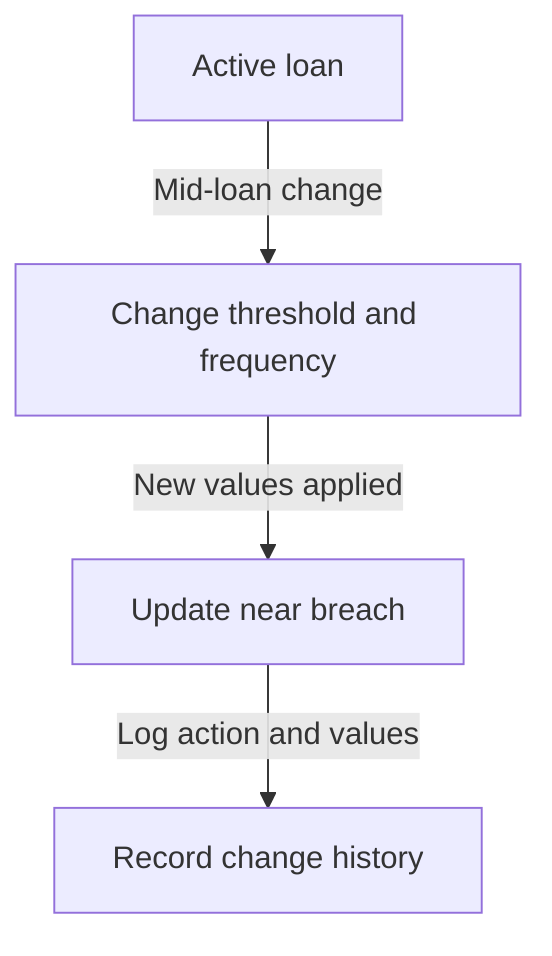

### Breach schedule reschedule and reprocessing

You can reschedule a breach on an active loan account multiple times, including multiple times on the same date. Each reschedule recalculates the breach schedule and evaluation from the current date according to the latest reschedule, and the system maintains the reschedule history.

Backdated repayments or reversals trigger reprocessing of the breach schedule and evaluation.

- Backdated repayments trigger reprocessing of the breach schedule and evaluation.
- Reversals trigger reprocessing of the breach schedule and evaluation.

Undoing a breach reset restores any new period that was started and reprocesses the breach schedule.

- If a breach reset is undone and a new period was started, that period is restored.
- When a breach reset is undone, the breach schedule is regenerated and the periods and payments on them are reprocessed.

A breach reset can restart periods from the reset date.

- You can perform a Breach Reset with an additional option to Restart Period from Reset Date.
- When the Restart Period from Reset Date option is selected, new breach periods are created from the breach reset date.

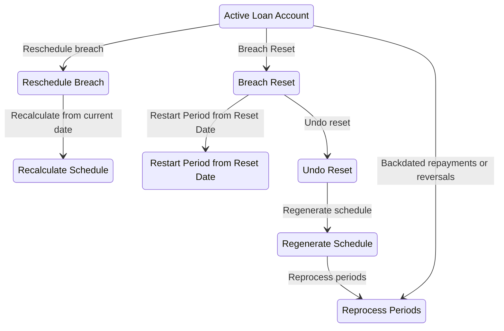

### Breach evaluation anchor and frequency

Breach evaluation runs at a point determined by the breach start date plus the configured length. Each evaluation date comes from the breach range start date plus the frequency and frequency type.

Backdated breach pause entries cause the system to re-trigger and recompute breach evaluation for the affected period when applied.

- The system allows backdated Breach Pause entries.
- Applying a backdated Breach Pause re-triggers breach evaluation for the affected period.
- Applying a backdated Breach Pause recomputes breach evaluation for the affected period.

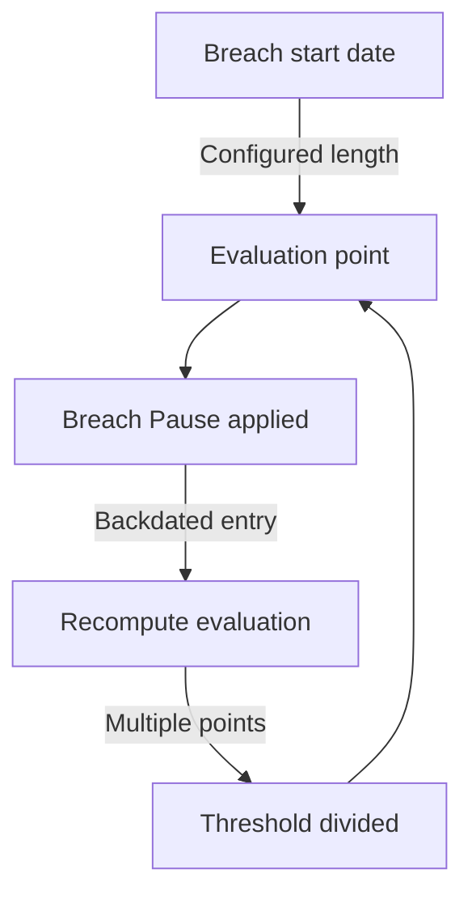

### Breach APIs and templates

The system provides APIs to fetch template options and breach schedules, and to trigger charge-off manually.

Available APIs include:

- A template API fetches the options for breach configuration.
- A separate API fetches the breach schedule.
- A template API fetches the options for near breach configuration.
- Charge-off can be triggered manually via API or UI.

### Charge-off overview and status

Charge-off lets a lender recognize a loan or account as uncollectible after prolonged delinquency or breach by writing off outstanding balances for accounting purposes while optionally continuing recovery efforts. It is an accounting classification, not a loan closure. The loan account status changes from Active Delinquent to Charged-Off, and the loan remains eligible for recovery tracking and reporting.

### Charge-off accounting and balances

Charge-off writes off all outstanding dues, including principal, fees, and penalties, and removes the outstanding balances from the loan asset books.

Charge-off accounting works as follows:

- The system posts accounting entries according to the configured charge-off journal entry rules.
- The system posts accounting entries for deferred income amortization as defined in the accounting configuration.
- No further income amortization occurs after charge-off.
- Transactions after the charge-off date follow charge-off-specific accounting rules and are typically treated as recoveries based on configuration.

### Charge-off timing and transactions

Charge-off applies only to active loan accounts. A backdated charge-off must not precede the last monetary transaction date. Backdated repayments and reversals before the charge-off date are allowed, while any transaction or reversal after the charge-off date must strictly follow charge-off accounting rules. Charge-off reversal is supported subject to configuration and controls.

### Write-off overview and status

The write-off process permanently closes a loan account by extinguishing all outstanding dues when recovery is no longer feasible. It updates the account status to Closed (Written-Off) and removes outstanding balances from the accounting books through accounting entries.

The following rules govern activity on a written-off account:

- All monetary transactions are blocked on a written-off account.
- Only recovery payments are allowed on a written-off account.
- Backdated repayments or reversals before the write-off date are allowed.
- Write-off can be backdated or reversed provided there are no monetary transactions after the effective write-off date.

### Write-off eligibility and permissions

Write-off applies only to active loan accounts and can be performed manually through the UI or API. Charged-off accounts cannot be written off.

After write-off, the following behaviour applies:

- No further amortization occurs.
- Delinquency evaluation is disabled.
- Breach evaluation is disabled.

> **Note:** At charge-off, a user may manually disable delinquency tracking and breach tracking.

### Auditability and fraud

All actions are auditable with proper user or system traceability. No business logic or functionality for fraud exists at the moment. The fraud flag is only used to determine the accounting journal entry for charge-off.

The system performs a one-time amortization of total deferred income at these points:

- On charge-off, as of the charge-off date.
- On write-off, as of the write-off date.

The system replays the write-off transaction and corresponding accounting entries for backdated repayments or reversals before the write-off date.

### Worked examples

A Working Capital loan is disbursed for a principal of 1,000. The breach configuration requires a minimum payment of 500 at the end of each 30-day breach period. These figures are illustrative. At the end of each period, the period past due amount is the greater of zero and the amount due minus the amount paid. The breach past due amount is the previous breach past due amount plus the current period past due amount, and it carries forward cumulatively until a reset occurs. The example shows that unpaid amounts accumulate across periods and are not reduced by overpayments in later periods.

| Period | Amount Due | Amount Paid | Period Past Due | Breach Past Due |
| --- | --- | --- | --- | --- |
| 1 | 500.00 | 300.00 | 200.00 | 200.00 |
| 2 | 500.00 | 600.00 | 0.00 | 200.00 |
| 3 | 500.00 | 200.00 | 300.00 | 500.00 |
| 4 | 500.00 | 500.00 | 0.00 | 500.00 |

A Working Capital product has a breach frequency of 90 days. Near-breach evaluation is configured at a frequency lower than the breach frequency, using 10 January as the anchor. With a monthly near-breach frequency, the first evaluation date is 10 February. With a 30-day near-breach frequency, the first evaluation date is 9 February. A near-breach frequency equal to or longer than the breach frequency is not permitted. Changing the near-breach frequency type from one month to 30 days moves the first evaluation date from 10 February to 9 February.

| Breach Frequency | Near-Breach Frequency | Frequency Type | Allowed | First Evaluation Date |
| --- | --- | --- | --- | --- |
| 90 days | 30 days | days | Allowed | 9 February |
| 90 days | 90 days | days | Not allowed | — |
| 3 months | 1 month | months | Allowed | 10 February |
| 3 months | 3 months | months | Not allowed | — |

A breach pause is initiated on a Working Capital loan with a pause start date of 1 March and a pause end date of 5 March. The pause is inclusive, so both the start and end dates count as paused days, giving five paused days. While the pause is active, breach evaluation is suspended. A resume action on 3 March is permitted because it falls inside the active pause window. Resuming sets the effective pause end date to 3 March, terminates the pause as of that date, and causes breach evaluation to restart over the shortened pause window. Backdated resume, multiple resume, and undo of resume are not allowed. The example shows that resume shortens the inclusive pause window and that evaluation restarts after the revised end date.

| Pause Start | Pause End | Resume Date | Effective Pause End | Inclusive Paused Days | Evaluation Status |
| --- | --- | --- | --- | --- | --- |
| 1 March | 5 March | — | — | 5 | Suspended |
| 1 March | 5 March | 3 March | 3 March | 3 | Resumed; reprocessing |

A breach period is scheduled to end on 10 March. A breach pause runs from 1 March to 5 March. Because the pause is inclusive, the pause length is five days, and every date after the pause shifts forward by five days. The period end date therefore moves from 10 March to 15 March. Counting only the days between the dates would shift the period by four days to 14 March, which is not the system behavior. The example shows that the pause end date is a paused day, so the schedule shifts by the inclusive pause length.

| Method | Pause Start | Pause End | Paused Days | Period End Before | Period End After |
| --- | --- | --- | --- | --- | --- |
| Inclusive (system) | 1 March | 5 March | 5 | 10 March | 15 March |
| Exclusive (not applied) | 1 March | 5 March | 4 | 10 March | 14 March |

See also: [EIR New Scope](#eir-new-scope), [Effective Interest Rate Product](#effective-interest-rate-product), [Transaction Types](#transaction-types), [Batch Job Foundation](#batch-job-foundation), [Delinquency Restrictions](#delinquency-restrictions).

## Cross-Cutting Capabilities

### Cross-cutting capability scope

Cross-cutting capabilities cover the charge module, credit balance refund, flat amortization calculation, and chargeback support. Enhancements to these capabilities in the upstream Fineract and Mifos X SOR extend them to support PPWC and EWC products.

The following capabilities are out of scope on WC product and must not be offered or silently accepted:

- Flat amortization calculation
- Prepayment
- Charge waiver
- Chargeback
- Real-time charge accrual
- EIR for MTR
- Repayment-% API
- Payment-amount strategies
- Disbursement charges
- Tax component

### Charge product configuration

Charge products created with the WCP Loans entity support WCP loan products and accounts. Selecting WCP Loans filters charge parameter options based on the charge applies to value.

| Parameter | Type | Options |
| --- | --- | --- |
| Charge name | Text |  |
| Currency | Dropdown | Regular currency dropdown values |
| Charge time type | Dropdown | Disbursement / Specified due date charges |
| Charge calculation type | Dropdown | Flat, % amount |
| Charge payment mode | Dropdown | Regular |
| Amount | Numeric |  |
| Tax Group | Dropdown | Tax component created values |
| Active | Boolean |  |
| Is penalty | Boolean |  |

Charge calculation type depends on charge time type:

- Flat applies only when charge time type is Specified due date.
- Flat or % amount applies when charge time type is Disbursement.

Charge payment mode can be null; when null, Regular is used as the default value.

The existing Loans entity during charge product creation is broken down into Term Loans, which supports regular loan products and accounts, and WCP Loans, which supports WCP loan products and accounts.

When WCP Loans is selected, charge parameters available are Charge name, Currency, Charge time type, Charge calculation type, Charge payment mode, Amount, Tax Group, Active, and Is penalty.

### Charge lifecycle on loans

Charges on a loan account follow the same fields and values as a regular loan account, including balance, fee or penalty due, paid, and outstanding amounts. Charges defined at the loan product level are inherited when the loan account is created. You can add, modify, or delete charges while the loan is in the create, modify, approved, or disbursed state.

Charge management rules:

- You can add a charge backdated to the current date.
- You can add a specified due date charge on a disbursed or active loan account for the current date or a future date.
- You can waive an unpaid charge on an active loan account.
- Charge deletion is prevented if the charge is assigned to a Working Capital Loan.

### Originator ID handling

The system accepts and stores an Originator ID during loan creation to identify the merchant or channel that originated the loan, and it persists the captured ID in the Fineract database at loan level.

Originator ID handling for Working Capital Product loans works as follows:

- Loan origination functionality extends to the WCP loan module, with all term loan loan origination features available on WCP loans.
- You can map an Originator to a WC loan and fetch assigned originators of a WC loan.
- Retrieve assigned originators of a particular WC loan similarly as this can be fetched for progressive loans.
- The Retrieve a Loan API response payload includes the Originator ID.
- The Originator ID appears in all Fineract events.
- The MerchantOriginator ID appears in the Transaction Summary Report and the Trial Balance Report.

### Validation rules

Validation rules apply to negative balances, schedule cells and calculated values, repayment on disbursement day, undoing disbursement with discount, and submitted or created dates against the business date setting. They run whenever the system checks these conditions.

### Payment allocation

Payments allocate to penalty first, then fee, then principal when DUE or IN_ADVANCE modifiers apply. Delinquent allocations target the oldest past-due period first, and any excess never moves to future periods. An overpayment results in OVERPAID status.

### Discount fee adjustment

Discount fee adjustment applies to Working Capital (EIR) loans and supports partial adjustments, multiple adjustments until the remaining balance reaches zero, backdated adjustments, and undoing an adjustment. Adjustments greater than the remaining balance are rejected, waive is not offered, and undoing an adjustment on a repaid or closed loan is validated.

Near-breach thresholds use a sticky flag.

- Near-breach thresholds are 33.33 and 66.66.

A backdated repayment made before the latest reset is ignored.

### Business date behavior

Business Date behavior controls the date used for created_date and submitted_date when Working Capital (EIR) features create or submit records. It applies across all WCP features and tabs, including Delinquency, Breach, Period Payment Rate, Transactions, Accounting Entries, and Charges, in both the UI and the backend.

The date source depends on whether Business Date is enabled:

- When Business Date is enabled, WCP features use the configured Business Date for created_date and submitted_date wherever applicable and must not use the current system date/time.
- When Business Date is disabled, WCP features use the current system date/time for created_date and submitted_date.

### Datatables on WCP loans

You can add supported datatables to Working Capital Product (WCP) loan accounts and view, modify, update, and delete their records where datatable rules and user permissions allow. Datatable operations apply only where permitted by those rules and permissions.

### Discount fee amortization rules

Discount fee amortization keeps the running amortized total and the not-yet-amortized balance equal to the discount fee net of discount fee adjustments at all times, and realized income never exceeds the discount fee while the loan is active. A deferred discount fee balance can never be negative.

Daily amortization follows these rules:

- Every daily amortization is the increment of the running once-rounded total, so the schedule and the loan show the same numbers after every COB.
- Case 1 expected daily amortization sequence: 9.61, 9.04, 9.00, 8.96, 8.91, 8.89 … (54.41 / 945.59 after day 6).
- Compact variant expected daily amortization sequence: 8.87, 8.03, 7.19, 6.36, 5.49, 4.63, 3.73, 2.83, 1.90, 0.97 → 49.03 after 9 payments, 0.97 on payoff.
- From day 5 the schedule and the loan disagree by 0.01 and the gap keeps growing (0.02 by day 12).

> **Note:** No Discount Fee Amortization Adjustment is generated unless a Discount Fee Adjustment was actually made.

View Transaction is available consistently for all WC transaction types and opens the transaction detail view, including Discount Fee Adjustment.

Payment is defined as all repayment like transaction; Repayment is defined as Repayment transaction.

Start date is calculated based on configured delinquency start date plus grace days and can be fetched from delinquency or breach schedule (1st start date).

When Disbursement is the start date during Loan submission, use Expected disbursement; during Loan approval, use expected disbursement; before disbursement, Null; at Disbursement, use actual disbursement.

The user can set the loan fraud status as true or false from API level; by default the flag is set to non-fraud; only on Active loan.

### Charge-off

Charge-off is an accounting treatment that marks a Working Capital loan as charged off without changing its balance. The loan account remains active, and all actions, calculations, and transactions continue to work as they do for a non-charge-off loan.

Charge-off rules:

- A new non-monetary charge-off transaction is created for the charge-off amount and has no impact on the loan balance.
- The loan stays ACTIVE unless its balance is cured, and the CHARGED_OFF status is never removed, even if the loan is PAID_OFF.
- Charge-off does not affect data returned by existing APIs.
- A charge-off can be reversed only if it was completed in error and no transactions exist after the charge-off transaction.
- A second charge-off returns a validation error, and adding charges after charge-off is not allowed.
- A charge-off transaction can be backdated but cannot be dated before the last transaction date.

Charge product and external ID behaviour:

- You can extend charges products to Working Capital loan products.
- The charge payment mode can be null; if null, the system uses Regular as the default value.
- When automatic external ID generation is enabled and no external ID is provided manually, Fineract generates an external ID for Working Capital loan transactions.
- External ID generation applies to loans and transactions where applicable.

### Business events

The system emits business events for Working Capital loan lifecycle changes, delinquency and breach state changes, and monetary transactions. Events fire when a loan is created, modified, rejected, approved, unapproved, disbursed, charged off, uncharged off, or becomes fully paid or overpaid.

Delinquency and breach actions each emit their own events:

- Delinquency range change emits WorkingCapitalLoanDelinquencyRangeChangeBusinessEvent only when the range changes or is lifted.
- Pausing delinquency emits WorkingCapitalLoanDelinquencyPauseBusinessEvent.
- Resuming delinquency emits WorkingCapitalLoanDelinquencyResumeBusinessEvent.
- Rescheduling delinquency emits WorkingCapitalLoanDelinquencyRescheduleBusinessEvent.
- Resetting delinquency emits WorkingCapitalLoanDelinquencyResetBusinessEvent.
- Undoing a delinquency reset emits WorkingCapitalLoanDelinquencyUndoResetBusinessEvent.
- Disabling delinquency emits WorkingCapitalLoanDelinquencyDisableBusinessEvent.
- Enabling delinquency emits WorkingCapitalLoanDelinquencyEnableBusinessEvent.
- A breach or not-breach change emits WorkingCapitalLoanBreachChangeBusinessEvent.
- A breach past-due change emits WorkingCapitalLoanBreachPastDueChangeBusinessEvent.
- A near-breach change emits WorkingCapitalLoanNearBreachChangeBusinessEvent.
- Pausing breach emits WorkingCapitalLoanBreachPauseBusinessEvent.
- Resuming breach emits WorkingCapitalLoanBreachResumeBusinessEvent.
- Rescheduling breach emits WorkingCapitalLoanBreachRescheduleBusinessEvent.
- Resetting breach emits WorkingCapitalLoanBreachResetBusinessEvent.
- Undoing a breach reset emits WorkingCapitalLoanBreachUndoResetBusinessEvent.
- Disabling breach emits WorkingCapitalLoanBreachDisableBusinessEvent.
- Enabling breach emits WorkingCapitalLoanBreachEnableBusinessEvent.

Charge and transaction events include:

- Adding a charge emits WorkingCapitalLoanAddChargeBusinessEvent.
- Repayment emits WorkingCapitalLoanRepaymentTransactionBusinessEvent.
- A goodwill credit emits WorkingCapitalLoanGoodWillCreditTransactionBusinessEvent.
- A payout refund emits WorkingCapitalLoanPayoutRefundTransactionBusinessEvent.
- A discount fee emits WorkingCapitalLoanDiscountFeeTransactionBusinessEvent.
- A discount fee adjustment emits WorkingCapitalLoanDiscountFeeAdjustmentTransactionBusinessEvent.
- Discount fee amortization emits WorkingCapitalLoanDiscountFeeAmortizationTransactionBusinessEvent.
- A discount fee amortization adjustment emits WorkingCapitalLoanDiscountFeeAmortizationAdjustmentTransactionBusinessEvent.
- A charge adjustment emits WorkingCapitalLoanChargeAdjustmentBusinessEvent.
- A credit balance refund emits WorkingCapitalLoanCreditBalanceRefundTransactionBusinessEvent.
- Disbursement emits WorkingCapitalLoanDisbursalTransactionBusinessEvent.
- Charge-off emits WorkingCapitalLoanChargeOffTransactionBusinessEvent.
- Accrual emits WorkingCapitalLoanAccrualTransactionBusinessEvent.
- An accrual adjustment emits WorkingCapitalLoanAccrualAdjustmentTransactionBusinessEvent.
- A write-off emits WorkingCapitalLoanWriteOffTransactionBusinessEvent.

Balance and adjustment events include:

- Any monetary transaction emits WorkingCapitalLoanBalanceChangedBusinessEvent.
- Adding a charge emits WorkingCapitalLoanBalanceChangedBusinessEvent.
- Reversing a transaction emits WorkingCapitalLoanAdjustTransactionBusinessEvent with transactionToAdjust set to the reversed transaction details and newTransactionDetail set to null.
- Reprocessing an existing transaction with changed allocation emits WorkingCapitalLoanAdjustTransactionBusinessEvent with transactionToAdjust set to the old allocation details and newTransactionDetail set to the new allocation details.

> **Note:** Changes to the delinquency amount or past due amount do not trigger any business event.

Product accounting values are NONE, ACC_DEF_REV_AM (accrual / deferred-revenue amortization), and ADVANCED (with rules). Business date can be enabled or disabled; tenant time zone can be UTC or non-UTC. NPV day count values are 360 and 365. Period payment frequency values are DAYS (1, 7, 30), WEEKS, and MONTHS (month-end anchor). Discount timing values are none, at approval, at disbursement, added after disbursement, and adjusted.

Delinquency start type values are LOAN_CREATION and DISBURSEMENT; grace days can be null, 0, or n; min payment rule can be FLAT or PERCENTAGE. Breach / near-breach values are none, breach only, and breach + near-breach; grace days can be 0 or n; frequency shorter or equal must be rejected. Allocation values are product default, per-transaction-type, loan-level override, and DUE / IN_ADVANCE modifiers. Charge values are none, specified-due-date before maturity, after maturity (N+1), penalty vs fee. Override values are allowAttributeOverrides all true and all false; loan must reject when all false.

The system adds a new WC_LOAN entity type; existing LOAN / CLIENT / SAVINGS formats and prefixes are unaffected. Precision for annual effective interest rate storage is DECIMAL(19,6).

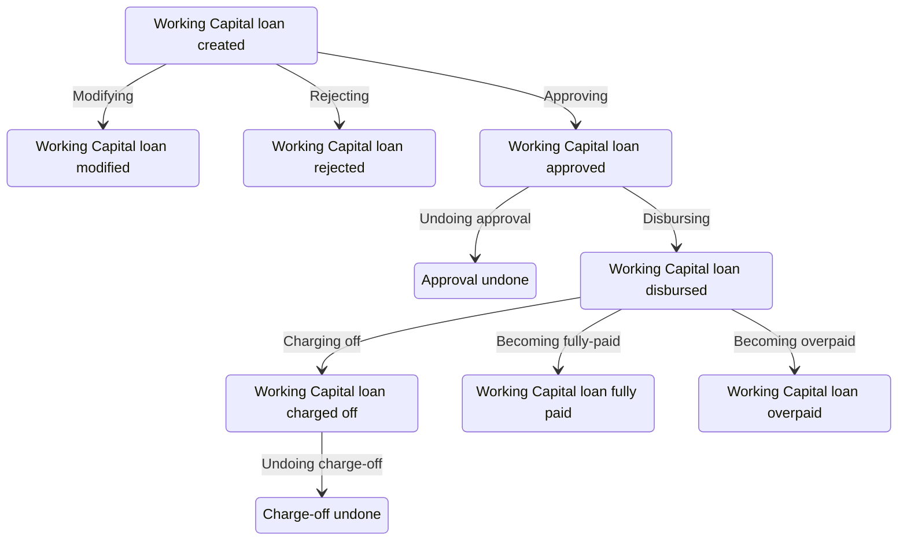

### Template API behavior

The Template API returns every template option and field when no query param is supplied. When a query param is supplied, it filters options and fields based on the charge applies to value so that working capital options that are not relevant or applicable are not fetched or returned. This filtering applies to working capital only.

Delinquency start date and breach start date are calculated the same way: the configured delinquency start date from the loan product plus the number of delinquency grace days.

No delinquency bucket select or override is available on WC loan account creation, and the Account Details page shows no delinquency data at all.

The loan charge-off template includes a non-editable, auto-calculated charge-off amount based on the loan balance as of the charge-off date, plus an editable charge-off date field.

Fraud is a flag set at the loan account level through API or UI.

The loan lifecycle covers these actions:

- Create, modify, approve (lower principal plus discount), undo-approve, reject, disburse (lower amount, discount, payment details), undo-disburse with transactions, charges, and discount fee present, and delete.
- Money-in transactions include repayment, goodwill credit, and payout refund, each tested on-time, backdated, undo, on CLOSED, on OVERPAID, and on CHARGED-OFF.
- Discount fee transactions occur at disbursement, after disbursement (effective disbursement date), and disbursement plus discount fee in one transaction.
- Charges and charge adjustments include specified-due-date charges before or after maturity (N+1), backdated charges, charges on CLOSED or OVERPAID, and full, partial, backdated, or undo adjustments on CLOSED, OVERPAID, or CHARGED-OFF.
- Delinquency management includes a one-period-at-a-time schedule, start type, grace days, FLAT or PERCENTAGE fees (base = principal + discount), tags D00 through D270 with history, and pause, resume, reschedule, reset, and disable-enable.
- Breach and near-breach include a schedule from disbursement plus grace, evaluation on toDate, cumulative past-due that is never negative, pause and resume inclusive, reschedule, reset including split current period and undo with new period, and disable.
- Payment holiday combines delinquency pause and breach pause, backdated, multiple, and non-overlapping.
- Re-age combines delinquency reset and breach reset, today only, once per day, with near-breach and breach past-due untouched.
- Hardship term-out uses resets and reschedules; near-breach stops and past-due is recalculated.
- COB and jobs include WC step order and enable-disable, inline COB on transaction, catch-up after N missed days, locks, business-date jumps, idempotent re-run, mixed term and WC loans in one run, CLOSED, CHARGED-OFF, and WRITTEN-OFF exclusions, and COB after undo.
- Events and API parity include every business event per lifecycle, transaction, charge, delinquency, and breach action with payload versus LoanAccountDataV1 parity page, external-event config on or off, GET loan general fields versus term loan, action templates, external-id variants of every endpoint, batch API, and fineract-client or feign SDK.
- Charge-off includes fraud or non-fraud reason plus journal entry including deferred-income leg, backdated charge-off not before the last monetary transaction, repayment, goodwill, payout refund, or charge adjustment on CHARGED-OFF under charge-off accounting, undo charge-off restores amortization and schedule, delinquency and breach disable on charge-off, and write-off blocked on charged-off.
- Re-age includes delinquency reset and breach reset with restart-period option, undo, once per day, and backdated transactions after reset; delinquency ignores them, breach updates the affected period only, current evaluation untouched.
- Reschedule and payment holidays include delinquency and breach reschedule: payment group versus frequency group, replacement not carry-forward, on period edge and month-end, while paused honoured, while disabled rejected, date validation, duplicate periods, UI validation and stale table; payment holiday pauses are inclusive, resume shortens only, overlap rejected.
- Accounting includes product accounting NONE, ACC_DEF_REV_AM, or ADVANCED, journal entry per transaction versus WC accounting entries sheet: disbursement with discount and charge, repayment allocations, goodwill expense, payout refund, discount fee and discount fee adjustment, discount fee amortization from deferred income to realized, charge and charge adjustment, credit balance refund, charge-off fraud or non-fraud, write-off and recovery, reversals mirror.
- Credit balance refund includes partial versus full credit balance refund (requirement says full only, implementation validates less than or equal to overpayment), backdated credit balance refund at or after the earliest repayment, undo credit balance refund, repayment reversal after credit balance refund making the balance positive and triggering reverse-replay, credit balance refund on CLOSED rejected, multiple credit balance refunds, journal entry, OVERPAID to CLOSED_OBLIGATIONS_MET, UI menu on overpaid, and events.
- Loan origination includes originators on WC product or loan, link and unlink, originators tab, and listing by originator mixing term and WC.
- Backdate grid covers each transaction type before previous transaction, before discount fee, before charge due date, inside pause, before reset, before charge-off, before write-off, with business date ON; submittedOnDate always equals business date.
- Delinquency pause includes WC pause and resume boundaries inclusive, overlap, pause in evaluated period, pause across a period boundary, pause then reschedule then resume, and backdated pause.
- Delinquency bucket calculation includes shared m_delinquency_bucket: WC bucket with minimum-payment rule versus plain term bucket, delete bucket linked to WC product, classification from range schedule, bucket edit with open loans, and UI bucket screens.
- Arrears includes WC delinquent amount, days, and date, overdueSinceDate, breach past-due cumulative, next payment amount and date in loan details and events, after pause, reset, or disable.
- Write-off includes WC write-off and undo, backdated with no monetary transaction after, blocked on charged-off, delinquency and breach auto-disabled, discount fee final amortization, recovery payment less than or equal to written-off amount, backdate at or after write-off date, reversible, and journal entry.
- N+1 installments: WC charge after maturity creates an N+1 row, only a repayment after the due date pays it, maturity unchanged, on CLOSED or OVERPAID loans.
- COB framework includes term and progressive COB, inline COB, catch-up, locks, StayedLockedLoansTasklet after the WC-driven refactor of AbstractLoanItemReader, Writer, and Processor, LoanCOBFilterHelper, plus term-loan accrual activity spot-check.
- Datatables entity split includes term LOAN and LOAN_PRODUCT datatables register, list, CRUD, and entity checks still work; WC and term isolation both directions; column-name guards; UI.
- Client 360 includes client accounts summary listing WC loans; client close, transfer, activate, reject, and undo with WC loans in each status; client search.
- Charges admin includes ChargeAppliesTo WC value, templates and dropdowns, term-loan charge CRUD unaffected, and product-charge linkage.
- Permissions and maker-checker include WC permissions granted or denied per command, maker-checker on WC commands, audit entries, and external-id endpoints respecting permissions.
- External events and Avro include new WC event types in config list, per-event enable or disable, term-loan events untouched, and schema versions.
- Batch API and SDK include batch request mixing WC and term commands, feign and fineract-client.
- Asset externalization: term-loan externalization unaffected; WC products not offered.
- Reports and search include loan reports with the new LoanTransactionType values 22, 23, 44–47, trial balance, and journal-entry search.

### EIR calculation

The system calculates an annual effective interest rate and stores it on the amortization schedule, then back-calculates the daily effective interest rate used for calculations. The annual rate is rounded to six decimal places, and the back-calculated daily rate and discount factor precision come from MonetHelper.getMathContext.

### Worked examples

A working capital loan is disbursed with a principal of 1,000.00 and a discount fee of 100.00. The borrower repays 250.00 each day for four days, so the principal reaches zero on day 4. The discount fee is amortized in equal daily amounts of 25.00, and amortized plus not yet amortized always equals the discount fee. The figures in this example are illustrative.

| Day | Payment | Principal paid | Fee amortized | Principal balance | Fee balance |
| --- | --- | --- | --- | --- | --- |
| 0 | — | — | — | 1,000.00 | 100.00 |
| 1 | 250.00 | 250.00 | 25.00 | 750.00 | 75.00 |
| 2 | 250.00 | 250.00 | 25.00 | 500.00 | 50.00 |
| 3 | 250.00 | 250.00 | 25.00 | 250.00 | 25.00 |
| 4 | 250.00 | 250.00 | 25.00 | 0.00 | 0.00 |

A working capital loan is disbursed with a principal of 1,000.00 and a discount fee of 100.00. The borrower repays 100.00 on day 1. On day 2 a backdated repayment of 800.00 with value date day 1 is posted. The payment reduces principal as of its value date and accelerates discount fee amortization so the fee balance reaches zero; the remaining principal is cleared on day 3.

| Day | Event | Payment | Principal paid | Fee amortized | Principal balance | Fee balance | Status |
| --- | --- | --- | --- | --- | --- | --- | --- |
| 0 | Disbursement | — | — | — | 1,000.00 | 100.00 | Active |
| 1 | Repayment | 100.00 | 100.00 | 10.00 | 900.00 | 90.00 | Active |
| 2 | Backdated repayment (value date day 1) | 800.00 | 800.00 | 90.00 | 100.00 | 0.00 | Active |
| 3 | Repayment | 100.00 | 100.00 | 0.00 | 0.00 | 0.00 | Closed |

A working capital loan is disbursed with a principal of 1,000.00 and a discount fee of 100.00. The borrower repays the full principal on day 1, leaving the discount fee outstanding while the loan remains active. A discount fee adjustment of 100.00 on day 2 settles the fee and closes the loan. Undoing that adjustment on day 3 reopens the loan and restores the discount fee to the amortization schedule.

| Day | Event | Principal balance | Fee balance | Status |
| --- | --- | --- | --- | --- |
| 0 | Disbursement | 1,000.00 | 100.00 | Active |
| 1 | Repayment of principal | 0.00 | 100.00 | Active |
| 2 | Discount fee adjustment 100.00 | 0.00 | 0.00 | Closed |
| 3 | Undo discount fee adjustment | 0.00 | 100.00 | Active |

A working capital loan is disbursed with a principal of 1,000.00 and a discount fee of 100.00. The borrower repays 100.00 daily for ten days. Realized income is the running total of fee amortization and never exceeds the discount fee while the loan is active. On day 10 the realized total reaches exactly 100.00 and the loan closes; no amortization adjustment is posted unless an adjustment was actually made.

| Day | Realized income | Unrealized fee | Fee balance | Status |
| --- | --- | --- | --- | --- |
| 0 | 0.00 | 100.00 | 100.00 | Active |
| 1 | 10.00 | 90.00 | 90.00 | Active |
| 5 | 50.00 | 50.00 | 50.00 | Active |
| 9 | 90.00 | 10.00 | 10.00 | Active |
| 10 | 100.00 | 0.00 | 0.00 | Closed |

See also: [EIR New Scope](#eir-new-scope), [Effective Interest Rate Product](#effective-interest-rate-product), [Breach Management](#breach-management), [Transaction Types](#transaction-types), [Batch Job Foundation](#batch-job-foundation), [Delinquency: Collections Programs](delinquency.md#collections-programs).

## Projected Balances

Projected balances describe the Working Capital amortization schedule, which the system calculates when a loan is created and recalculates at approval using the approved amount and at disbursement using the disbursement amount. After disbursement, the schedule updates as payments are made, missed, or overpaid, and a delinquency schedule and a breach schedule are created if enabled. For Working Capital loans, DUE and IN ADVANCE balances apply; PAST DUE does not.

| Column | Meaning |
| --- | --- |
| Amortization Installment No | Sequence number of the installment |
| Amortization Installment Date | Date the installment falls due |
| Expected Payment Amount | Amount expected to be paid |
| Discount Factor | Factor used to calculate net present value |
| NPV Value | Net present value of the installment |
| Balance | Projected balance after the installment |
| Net Amortization Amount | Principal portion of the installment |
| Actual Payment Amount | Amount actually paid |
| Actual Amortization Amount | Principal actually amortized |
| Income Modification | Adjustment to income recognition |
| Deferred Balance | Balance deferred to a later date |

DUE and IN ADVANCE balances are defined as follows:

- DUE Principal is projected principal payment.
- DUE Fee / Penalty is current or older charges based on a specific due date.
- IN ADVANCE Principal is over projected principal payment.
- IN ADVANCE Fee / Penalty is future charges based on a specific due date.

Fine-grained transaction allocation rules cover DUE PRINCIPAL, DUE FEE, DUE PENALTY, IN ADVANCE PRINCIPAL, IN ADVANCE FEE, and IN ADVANCE PENALTY.

End-of-day processing fills elapsed days on Working Capital loans as follows:

- COB zero-fills elapsed days on WC loans.
- If a day passes and no payments land on a WC loan when COB runs, the actual column is filled as if a 0 amount repayment landed on the day.
- Zero-filled rows do not create an actual transaction; they are cosmetic changes on the schedule.
- Zero-filled rows are considered actual payments by the expected payment schedule, so expectations are recalculated as if a 0 amount repayment transaction landed.

The amortization schedule endpoint returns only expected payment and balances and actual payment and balances. It excludes fields and balances for internal usage, including discount factor, NPV value, deferred balance, and income modification.

```mermaid
flowchart TD
  n1["WC Loan Created"]
  n2["Projected Amortization Schedule"]
  n3["Disbursement"]
  n4["Schedule Updated"]
  n5["COB Runs"]
  n6["Zero-fill Elapsed Days"]
  n7["Actual Column Filled"]
  n8["No Actual Transaction Created"]
  n9["Expectations Recalculated"]
  n1 -->|"Calculate for whole life cycle"| n2
  n2 -->|"Recalculate with disbursement amount"| n3
  n3 -->|"Payment made, missed, or overpaid"| n4
  n4 -->|"COB runs"| n5
  n5 -->|"No payments land"| n6
  n6 -->|"Fill as if 0 repayment"| n7
  n7 -->|"Cosmetic only"| n8
  n7 -->|"Considered actual payment"| n9
```

A working capital loan is disbursed for a principal of 1,000.00 with no discount amount, so the disbursement amount is 1,000.00. Interest accrues at 12% per year, treated as 1% per 30-day month, and the loan has three monthly installments on days 30, 60 and 90. The contract derives the expected payment for each installment from total payment value, period payment rate and NPV day count; the figures below are illustrative. Each row shows the projected schedule values and the actual values when the borrower pays exactly the expected amount, so the balance falls by the principal paid and no income modification arises.

| No. | Day | Expected Pay. | Disc. Factor | NPV Value | Balance | Net Amort. | Actual Pay. | Actual Amort. | Income Mod. | Deferred Bal. |
| --- | --- | --- | --- | --- | --- | --- | --- | --- | --- | --- |
| 1 | 30 | 343.33 | 0.9901 | 339.93 | 666.67 | -10.00 | 343.33 | 333.33 | 0.00 | 0.00 |
| 2 | 60 | 340.01 | 0.9803 | 333.31 | 333.33 | -6.67 | 340.01 | 333.34 | 0.00 | 0.00 |
| 3 | 90 | 336.66 | 0.9706 | 326.75 | 0.00 | -3.33 | 336.66 | 333.33 | 0.00 | 0.00 |

On a working capital loan, if no payment lands on an installment day, the end-of-day process zero-fills the elapsed day. The figures below are illustrative. Compared with the fully paid schedule, the only change is that no payment lands on day 60, so the actual payment is zero and the deferred balance accumulates until day 90. The zero-filled row creates no transaction, but the expected schedule treats it as a zero repayment and recalculates future expectations.

| No. | Day | Expected Pay. | Actual Pay. | Balance | Net Amort. | Actual Amort. | Income Mod. | Deferred Bal. |
| --- | --- | --- | --- | --- | --- | --- | --- | --- |
| 1 | 30 | 343.33 | 343.33 | 666.67 | -10.00 | 333.33 | 0.00 | 0.00 |
| 2 | 60 | 340.01 | 0.00 | 666.67 | 0.00 | 0.00 | -333.34 | 340.01 |
| 3 | 90 | 676.67 | 676.67 | 0.00 | -10.00 | 666.67 | 0.00 | 0.00 |

When a working capital loan is created, the system validates that the calculated loan term is a whole number before solving for the effective interest rate. The figures below are illustrative. With a principal of 1,000.00, a discount amount of 100.00 and an expected payment of 300.00, the term is 1,100.00 / 300.00 = 3.67 repeating, which is not a whole number, so the EIR calculation cannot be solved and returns #NUM!; if the term were whole, the rate would solve normally.

| Setting | Value | Check | Result |
| --- | --- | --- | --- |
| Principal + Discount | 1,100.00 | — | — |
| Expected Payment | 300.00 | — | — |
| Loan Term | 3.67 | Not whole | Invalid |
| EIR | — | — | #NUM! |

See also: [EIR New Scope](#eir-new-scope).

## Repayment Percentage API

Repayments for Pepper Soup Working Capital (PPWC) are made as a percentage of daily PayPal sales, with a configurable rate of 10-30%. Customers can increase the rate to pay off the loan faster or decrease it to increase cash flow.

The repayment percentage API supports the following changes on active loans:

- Changing the repayment percentage takes effect immediately, recalculates the schedule, and sends the customer a notification.
- Converting the loan repayment method between sales-based payments and fixed monthly payments is supported in both directions.

A payout transaction payment posts a refund against an active loan account. The fund source is debited and the penalty, fee, principal and unallocated-credit accounts are credited. For example, a refund of 1,000.00 is split into 200.00 for penalty, 100.00 for fees, 500.00 for principal and 200.00 for unallocated credit. The figures are illustrative. On a charge-off loan, the credit accounts become 404008 for penalty and fees and 744007/740037 for principal, while the debit account and amounts stay the same.

| Item | Debit Account | Debit Amount | Credit Account | Credit Amount |
| --- | --- | --- | --- | --- |
| Penalty refund | 145023 | 200.00 | 112603 | 200.00 |
| Fees refund | 145023 | 100.00 | 112603 | 100.00 |
| Principal refund | 145023 | 500.00 | 112601 | 500.00 |
| Unallocated credit refund | 145023 | 200.00 | 245000 | 200.00 |
| Total | 145023 | 1,000.00 | — | 1,000.00 |

A payout transaction reversal payment reverses a previously posted refund on an active loan account. The penalty, fee, principal and unallocated-credit accounts are debited and the fund source is credited. For example, a reversal of 1,000.00 is split into 200.00 for penalty, 100.00 for fees, 500.00 for principal and 200.00 for unallocated credit. On a charge-off loan, the debit accounts become 404008 for penalty and fees and 744007/740037 for principal, while the credit account and amounts stay the same.

| Item | Debit Account | Debit Amount | Credit Account | Credit Amount |
| --- | --- | --- | --- | --- |
| Penalty reversal | 112603 | 200.00 | 145023 | 200.00 |
| Fees reversal | 112603 | 100.00 | 145023 | 100.00 |
| Principal reversal | 112601 | 500.00 | 145023 | 500.00 |
| Unallocated credit reversal | 245000 | 200.00 | 145023 | 200.00 |
| Total | — | 1,000.00 | 145023 | 1,000.00 |
