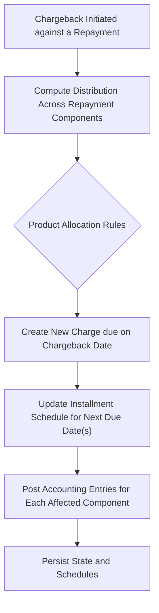

# Chargeback amount distribution

The Chargeback amount distribution feature enhances the existing chargeback capability to allocate chargeback amounts across all components of a repayment allocation (principal, interest, penalties, and fees). The distribution is driven by the repayment that is being chargebacked and is governed by product-level configuration that determines the exact order and rules of allocation. A critical design constraint is that interest on chargeback remains out of scope given the current advance allocation strategy. The practical effect is that a chargeback creates a new charge that becomes due at the chargeback initiation date, and the delinquency evaluation period starts from that same date. These behaviors are evidenced by the design guidance and calculations documented in the reference material for chargebacks.

The primary goal is to extend the current chargeback capability (which formerly supported only principal) to cover all relevant allocation components in a configurable and auditable manner. This includes support for creating new charges when a chargeback occurs, updating the installment schedule , and recording the standard accounting entries for the various chargeback use cases.

### Core capabilities and guarantees
- Allocation scope: Chargebacks can be distributed across principal, interest, penalties, and fees, rather than being limited to principal alone. The exact distribution is driven by the repayment allocation that is being chargebacked and by product-level allocation rules.
- Chargeback genesis: When a chargeback is initiated against a repayment, a new charge is created that becomes due on the date of the chargeback. The delinquency evaluation period for that new charge starts from the chargeback date, not from the original transaction date.
- Configurable allocation order: The order in which chargeback amounts are applied to repayment components is configurable at the product level. An example configuration shown in the reference demonstrates an allocation order that may prioritize Fees, then Penalty, then Interest, and finally Principal, though the system supports other orderings as defined by product settings.
- Partial vs. full chargeback: Scenarios in the reference illustrate cases where the chargeback amount partially offsets components of the repayment and cases where allocation consumes multiple components. The exact splits depend on the configured allocation order and the components present in the original repayment.
- Interest on chargeback: The reference notes explicitly that interest on chargeback is out of scope given the current allocation strategy. This means chargeback-related interest is not calculated or posted under the current design.

### Processing overview and lifecycle
- Initiation: A chargeback is initiated against a specific repayment, identifying the repayment allocation (principal, interest, fees, penalties) that is being charged back.
- Allocation calculation: The chargeback amount is distributed across the repayment’s allocated components according to the product’s allocation rules. The exact rules determine which components receive funds first and how much of the chargeback amount is applied to each component.
- New charge creation: A new charge is created as part of the chargeback process, set to be due at the chargeback initiation date. This verifies the customer remains current with consideration of the chargeback from the date of initiation rather than reversing the original transaction retroactively.
- Schedule impact: The distribution can affect the next installment(s) by rebalancing the components (e.g., principal, fees) of the upcoming due dates, depending on the allocation result and the product configuration.
- Accounting impacts: The chargeback and its allocations are reflected in journal entries consistent with the component being charged back (principal, fees, penalties, etc.). The reference material provides representative accounting entries for various chargeback scenarios, including chargebacks that involve fees and penalties, as well as cases where charges lead to accruals or to adjustments for overpayments or charge-offs. Note that the patterns shown in the references illustrate how debits and credits move between accounts such as Loan portfolio, fund source, fees receivable, penalties receivable, and related income accounts.

> Important: The design explicitly states that interest on chargebacks is out of scope for now, given that the current allocation strategy does not support it. This constraint governs the interpretation of any chargeback that would otherwise allocate to interest.

### Reference scenarios and practical illustrations
The reference material contains multiple reference sheets illustrating how chargebacks interact with repayment allocations under different scenarios. The core themes demonstrated across these sheets are:
- A repayment can be chargebacked entirely or partially, with the chargeback amount allocated to the repayment’s components (principal, fees, penalties, interest) in a configurable order.
- When a chargeback is initiated, a new charge is created with a due date anchored to the chargeback initiation date, and delinquency evaluation starts from that date.
- The distribution rules can be exercised in a variety of configurations to reflect different business needs (for example, prioritizing fees and penalties before principal, or placing principal last depending on the product’s rules).
- Scenarios cover chargebacks on principal alone, principal with fees, principal with penalties, and scenarios involving overpayments or chargebacks that also involve accruals for fees or penalties.

Two representative concepts illustrated in the reference are:
- The partial chargeback of a repayment component, and subsequent scheduling changes that reflect the new allocation in the installment plan.
- The creation of separate accruals or separate liability/receivable entries where fees or penalties are involved, including cases where a new charge is created at chargeback time and no accrual entry is passed for the new charge-off in certain paths.

### Worked example (conceptual; aligned with documented guidance)
Consider a repayment that originally consisted of principal P and a separate fee F, with a chargeback amount C. If the repayment’s allocation is such that the first component to absorb chargebacks is principal, the following outcomes apply (illustrative from the reference guidance):
- If C <= P, the full C is allocated to principal and the remaining principal balance is reduced by C; the fee portion remains unaffected.
- If C > P, the principal portion is exhausted first, and the remaining amount (C - P) is allocated to the next component according to the configured order (for example, to fees). If the remainder exactly matches the next component, that component is fully absorbed by the chargeback.
- If the repayment allocation is such that a chargeback amount is larger than all allocated components, the remaining chargeback amount is reflected according to the product’s rules for overpayments, new charges, or related adjustments as demonstrated in the reference scenarios.
- A concrete example from the guidance shows that if a repayment has Principal 90 and Fees 10, and the chargeback amount is 95, the distribution would be Principal 90 and Fees 5 (a new fee would be added as of the chargeback date).

These examples illustrate the principle that the chargeback amount is drawn from the repayment’s allocated components in the order defined by product configuration, with precise splits determined by the available component amounts and the chargeback value.

### Accounting implications and journal patterns (high-level)
The reference materials provide tabular representations of accounting entries that accompany chargeback events. General patterns include:
- A chargeback against principal typically reduces the loan portfolio balance and increases the fund source balance by the chargeback amount.
- When a chargeback involves fees or penalties, associated receivable and income accounts may be affected (for example, fees receivable and income from fees, penalties receivable and income from penalties).
- When accruals are involved (for example, accruals for fees or penalties), a contra-entry in the form of fees receivable or penalties receivable is paired with income accounts.
- In cases of overpayments or charge-offs, additional accounting considerations arise (such as overpaid liability adjustments and new charge creation) to reflect the net position after chargeback processing.

The reference material presents representative entries for these cases, including scenarios where a new charge is created at chargeback time and entries that accompany accruals forFees or Penalties. The exact debit/credit mappings depend on the specific scenario and the chart of accounts used by the implementation.

### Diagram: chargeback flow (high level)

This flow captures the verified progression: initiation, allocation according to product rules, new charge creation with a chargeback-date due, schedule updates, and associated accounting entries, all while keeping interest on chargeback out of scope per the current design.

### Edge cases and validated behaviors
- Overpayments and chargebacks: The reference contains use cases where chargebacks interact with overpayments, creating or adjusting liabilities . These cases demonstrate the need to reconcile remaining balances and to reflect any overpayment in the standard liability or asset accounts.
- Partial chargebacks: When a chargeback amount only partially offsets a repayment’s components, the remaining balance remains in the installment’s schedule with the updated allocation. The examples show how partial chargebacks influence the subsequent due amounts and the installment balance.
- Interest handling: Across the reference scenarios, interest on chargeback is explicitly noted as out of scope given the current allocation strategy. No charged-back interest calculations are produced under the documented rules.

### Calculation references and use cases (summary)
The design references multiple calculation sheets that define how chargebacks interact with repayments and installment schedules under various configurations and scenarios. These include scenarios where chargebacks affect principal, fees, penalties, and combinations thereof, as well as the effect on accrual entries and new charges at chargeback time. While the sheets present many detailed tables, the relevant, verified takeaway is that chargebacks are designed to portion against the repayment’s components based on the product’s allocation rules, create a new charge effective at the chargeback date, and reflect the distribution through the installment schedule and accounting entries.

### API and integration considerations
The design guidance emphasizes product-level configurability for chargeback allocation order. While explicit HTTP API contracts are not described in the reference material, it is clear that: (1) chargeback initiation must reference the repayment being chargebacked, (2) the allocation engine must apply the chargeback across the repayment’s components according to the product’s rules, and (3) a new charge is created with a due date equal to the chargeback date, with delinquency evaluation starting from that date. Implementations should verify the new charge is persisted and that downstream accounting entries reflect the component-wise distribution.

### What this means for architects and contributors
- When enhancing or configuring chargeback behavior, focus on the product-level allocation rules and the mapping between repayment components and the associated accounts used in journal entries.
- verify the chargeback creation step is triggered at initiation, with a due date aligned to the chargeback date and with the delinquency evaluation period starting from that moment.
- Respect the scope limitation that interest on chargeback is not currently supported; any attempt to allocate chargeback amounts to interest should be avoided or routed to future enhancement work.
- Validate edge cases involving partial chargebacks, overpayments, and charge-offs against the reference scenarios to verify consistency of schedules and accounting.

This page documents the verified behavior and the concrete design guidance for Chargeback amount distribution as evidenced in the reference design. It presents the functional goals, lifecycle cues, configurability, and representative accounting implications that shape how chargebacks are modeled, calculated, and posted in the system.