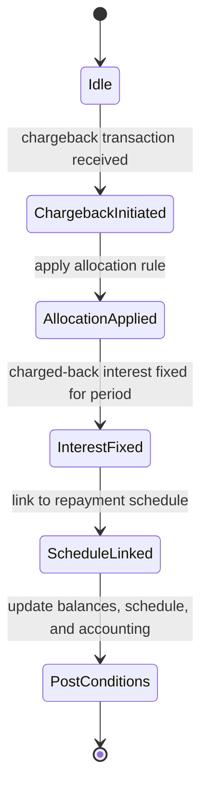

# Chargeback transaction posting for interest component

This page documents the behavioral model, processing rules, and calculation patterns for posting chargeback transactions that include an interest component on loan accounts. The guidance reflects verified material in the reference data: chargeback postings may include interest portions, the allocation of chargeback amounts is configurable, and the treatment of interest depends on whether a chargeback allocation rule exists and whether interest recalculation is configured for the loan product. The material also outlines how such postings interact with the repayment schedule, principal balances, and accrual timing.

### Scope and context

Chargeback posting for the interest component is an enhancement to the loan chargeback workflow. The primary actors are the loan product configuration (allocation rule and recalculation setting) and the loan accounting engine that executes chargeback postings against existing repayment schedules. The following verified conditions govern behavior:

- If a chargeback payment has an interest portion, the chargeback may carry that interest portion forward to the loan, in addition to the principal portion being charged back.
- Allocation priority for chargeback components is configurable. Typical examples shown in the reference data include prioritizing Interest first, then penalties and fees, and finally Principal; another example prioritizes Interest, fees, then Principal.
- Charged back interest is treated as a fixed amount for the period it belongs to and does not trigger a fresh accrual (income recognition) transaction for the chargeback portion.
- If the chargeback occurs before the loan’s maturity date, the outstanding principal increases by the charged-back principal, and future interest is calculated on the increased outstanding amount (original outstanding principal plus credited-back principal). If the chargeback occurs after maturity, no additional interest accrues on the chargeback portion.
- If any of the original transaction portions are changed, the system may recalculate and reallocate the chargeback .
- The linkage between the chargeback and the repayment schedule is retained, including the connection to subsequent installments (the chargeback amount is added to the next unpaid installment, when applicable).
- The calculation path for chargeback postings follows the same day-count conventions used in normal interest accrual, with the added constraint that chargeback components may be fixed per-period rather than re-derived from a fresh accrual for the chargeback portion.

> Note: The above rules are derived from the verified calculation references and acceptance criteria in the accompanying data. They describe verified product behavior and its impact on schedules and accounting, without introducing unverified capabilities.

### Core concepts and terminology

- Chargeback posting: A financial adjustment applied to a loan account that re-attributes a payment (or part of it) back to the loan, potentially including an interest component.
- Allocation rule: A configurable ordering that determines how a charged-back amount is split across interest, penalties, fees, and principal. Examples in the reference data show orders such as [Interest, Penalties, Fees, Principal] or [Interest, Fees, Principal].
- Interest recalculation: A configuration path that governs whether the system recomputes interest for open balances after a chargeback, taking into account the new outstanding principal and the remaining schedule. The reference dataset distinguishes scenarios where recalculation is ON versus OFF.
- Rate factor and day-count conventions: The reference calculations use a rate factor per period derived from a daily rate of the form dailyRate = annualRate / daysInYear, with a typical per-period factor over a fixed-day window (for example, 30 days). The example uses an annual rate of 7% and a 360-day year, yielding a daily rate of approximately 0.000194444, and a period factor around 1.0058333 for 30 days.
- Balance after payment: The standard amortization flow reduces the opening balance by the principal portion of the payment, while interest accrues on the opening balance for the period.
- Maturity boundary: The timing of the chargeback relative to the loan’s maturity influences whether interest accrues on the chargeback amount. Before maturity, principal increases and future interest accrues on the larger balance; after maturity, no interest accrues on the chargeback portion.

### Calculation model (conceptual overview)

The funding of interest in a chargeback context follows the same fundamental math used for ordinary amortization, with the addition that the chargeback may carry a fixed interest component and may alter the principal balance for future periods. Key elements of the verified model are:

- Periodic interest calculation (opening balance basis):
 - openingBalance is the loan balance at the start of the period.
 - dailyRate = annualInterestRate / daysInYear (for the reference, 7% / 360 = 0.000194444).
 - periodInterest = openingBalance × dailyRate × daysInPeriod.
 - For a 30-day period, periodInterest is openingBalance × (annualRate × 30 / daysInYear).
- Periodic rate factor (for reference exposure patterns):
 - rateFactor for a period with daysInPeriod is approximately (1 + dailyRate)^(daysInPeriod).
 - Example for 30 days with dailyRate ≈ 0.000194444 yields a rateFactor ≈ 1.005833333.
- Chargeback allocation and impact on balance:
 - The chargeback amount is distributed across components according to the configured allocation rule. The rule may place priority on interest or on principal, and on any combination of interest, penalties, fees, and principal.
 - If the chargeback includes a principal portion, the outstanding principal is increased by that amount, affecting subsequent interest calculations.
 - If the chargeback occurs before maturity, future interest is computed on the new, higher principal. If after maturity, no additional interest accrues on the chargeback portion.
- Fixed treatment of charged-back interest:
 - The interest portion charged back is treated as a fixed amount for the period in which the chargeback occurs and is not subjected to a fresh accrual after posting.
- Recalculation triggers and recourse:
 - If the original transaction portions are altered, the system may perform recomputation and reallocation of the chargeback to reflect the updated exposure.
- Schedule linkage:
 - Chargeback postings stay tied to the repayment schedule, and , the charged-back amount is integrated with the next unpaid installment.

These rules are verified by the reference acceptance criteria and UCs, which illustrate the behavior under different configurations and timing relative to maturity.

### Processing flow: step-by-step (public, verifiable behavior)

1) Identify loan and original payment being chargebacked. Determine whether a chargeback allocation rule is configured for the loan product.
2) Compute the chargeback amount from the referenced payment, including the interest portion if the payment carried interest. If the original payment portion included interest, the chargeback will reflect that interest amount.
3) Apply the chargeback according to the allocation rule:
 - Allocate the chargeback to components by priority (e.g., Interest first, then Penalties and Fees, then Principal, or other configured orders).
 - If the chargeback includes a principal portion, increase the outstanding principal ; if the chargeback occurs before maturity, this increases the amount on which future interest is calculated.
4) Treat charged-back interest as a fixed amount for the period; do not generate new accrual entries for that portion. The charged-back interest does not trigger a fresh income-recognition accrual.
5) Reconcile the repayment schedule:
 - The chargeback amount is linked to the associated repayment period; if necessary, the chargeback is added to the next unpaid installment, consistent with the practice for non-interest-bearing chargebacks.
 - If the chargeback is posted before maturity, recompute future interest on the updated balance; if it is posted after maturity, no further interest accrues on the chargeback portion.
6) If the chargeback changes any original transaction portions, recompute and reallocate the chargeback where the system rules require.
7) Persist updates to the loan balance, the repayment schedule, and associated accounting entries (). The model preserves linkage between the chargeback and the repayment flow and verifies consistency with subsequent installments.

The above steps describe the verified processing path for chargeback postings that involve the interest component, as demonstrated in the reference material.

### Configuration and integration touchpoints (high level)

- Allocation rule configuration: A loan product can specify an allocation rule that determines how a chargeback amount is split among Interest, Penalties, Fees, and Principal. The rule governs the per-chargeback distribution when a chargeback post occurs.
- Interest recalculation toggle: A control path that determines whether interest recalculation should occur after a chargeback posting. The reference data distinguishes scenarios where recalculation is ON (enabled) or OFF (disabled).
- Scheduling and linkage: The chargeback process maintains a connection to the original repayment schedule, and updates flow in a way that aligns the chargeback with the next unpaid period when applicable.
- No new accrual for charged-back interest: The system must refrain from recording a fresh accrual entry for the charged-back interest portion.

Note: The reference data does not describe REST API changes, database schema modifications, or internal service contracts. The scope here focuses on the observable behavior of the chargeback posting logic and its impact on repayment schedules and interest accounting.

### Example: canonical parameters and results (calculation context)

The reference materials use a canonical example with the following inputs:
- Interest Rate: 7% per year (0.000194444 daily rate)
- Days In Year: 360
- Days In Month: 30
- Principal: 100
- Repayment cadence: every 1 month

Key observations from the reference patterns:
- The per-period interest on a given opening balance is proportional to the balance and to the period’s day count; for a 30-day period, the simplified per-period interest approximates openingBalance × (annualRate × 30 / 360).
- The period’s rate factor for a 30-day window under the given daily rate is approximately 1.005833333, reflecting compounding over the 30-day window.
- The first amortization step reduces the balance by the principal portion of the EMI, while the interest portion is accrued for the period before applying the principal payment.

One representative per-period snapshot (illustrative, based on the canonical parameters) shows:
- Opening balance: 100
- Interest accrued for the period (approximate): 0.58
- Principal component of EMI: 16.43
- EMI total: 17.01
- New balance after payment: approximately 83.57

Because the reference set includes multiple sequences under different configurations (with and without allocation rules, with recalculation on/off, before/after maturity), the exact per-period balances and the distributions of chargeback amounts vary by scenario. The documentation here captures the governing rules and their implications, and the detailed numerical sequences are provided in the reference calculations.

### Visualizing the process lifecycle

Mermaid diagram (stateful view of the chargeback posting lifecycle):

This diagram shows the verified states involved in posting a chargeback that carries an interest component. The path emphasizes that the chargeback triggers an allocation decision, fixes the charged-back interest portion, and then ties the result back to the repayment schedule and the loan’s ongoing state.

### Related calculations and reference points

- Calculation references illustrate the interaction of rate factors with day-count conventions, including an explicit example using a 7% annual rate, 360-day year, and 30-day periods. The rate factor for a 30-day period is shown as approximately 1.005833333, with per-period interest around 0.58 when the opening balance is near

100. These figures underlie the standard amortization pattern used in the chargeback context.
- Acceptance criteria emphasize that chargebacks include the interest portion when the original payment carried interest, and that chargeback interest will not undergo a fresh accrual; the chargeback principal, when occurring before maturity, increases the outstanding balance for future interest calculations; if occurring after maturity, no additional interest is accrued on the chargeback portion.
- The UCs demonstrate variations with and without a chargeback allocation rule, and with interest recalculation toggled, illustrating both pre- and post-maturity behaviors and how chargebacks interact with repayment schedules and interest accrual.

### Data persistence and accounting considerations (high level)

- The chargeback process adjusts the loan’s opening and closing balances in alignment with the updated principal exposure. The updated balance then informs subsequent interest accrual calculations according to the per-period day-count convention.
- Allocation results (how much of the chargeback goes to interest, penalties, fees, and principal) are reflected in the loan’s schedule and in the recorded components for reporting purposes.
- Since charged-back interest is treated as fixed for the period, the accounting path for the chargeback portion does not create a new accrual entry for that interest amount.
- The system maintains the link between chargeback postings and their associated repayment installments, verifying reconciliation with future installments and totals.

### Summary of verified behavior

- A chargeback posting can include an interest portion when the original payment carried interest.
- Allocation rules determine how the chargeback amount is distributed across loan components and can be configured.
- Charged-back interest is fixed for the period and does not trigger a new accrual entry.
- If chargeback occurs before maturity, the outstanding principal increases and future interest is calculated on the updated balance; if after maturity, no additional interest accrues on the chargeback portion.
- If the original portions are modified, recalculation and reallocation of the chargeback may occur.
- The chargeback remains linked to the repayment schedule, and the chargeback amount is added to the next unpaid installment .

This publication reflects verified product behavior and its impact on loan balances, repayment schedules, and interest accounting, without speculation about internal implementation details beyond what is evidenced in the reference data.