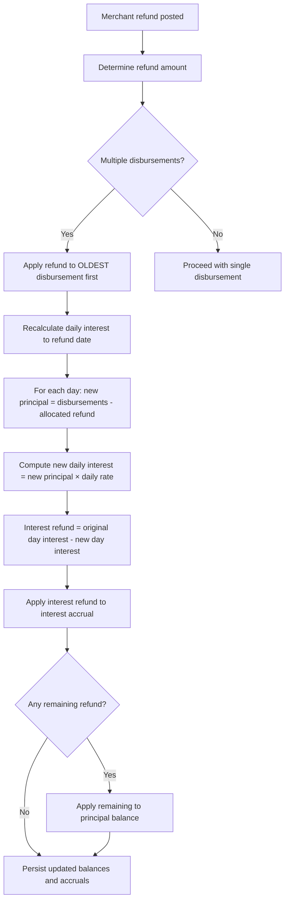

# Transaction type - Interest refund

This page documents the product behavior and calculation rules for the transaction type Interest refund within Pepper-Soup’s loan processing domain. The reference data defines how a posted merchant refund interacts with accrued interest across one or more disbursements, how the system reallocates the refund to reduce accrued interest, and how any remaining amount is applied to principal. The behavior is expressed through a deterministic calculation model that operates on a per-day basis using the loan’s daily periodic rate and the current schedule of disbursements and repayments.

Overview and scope
- Role of the feature: When a merchant refund is posted, the system calculates an interest refund and posts it against the loan’s accrued interest. If the refund amount exceeds accrued interest for the relevant days, the remainder is applied to principal. The refund logic follows a defined order: it reduces interest first, then applies any residual to principal, and it applies refunds to oldest disbursements first when multiple disbursements exist.
- Primary inputs: loan daily periodic rate, the list of disbursements (with dates and amounts), the daily interest accrual per day, and the total refund amount originating from the merchant refund.
- Primary outputs: updated per-day accruals, an interest refund amount posted against interest accrual, and any remaining adjustment to principal balances.
- Design guarantees evidenced in the source data: refunds are allocated in a deterministic sequence, and calculations are performed by re-simulating interest accruals after applying refunds to the affected days. The results are recorded as negative amounts for refunds and positive values can appear for adjustments to principal or balances, depending on the scenario.

Key concepts and inputs
- Daily periodic rate: the per-day interest rate used to accrue interest on the outstanding balance. Example in the reference data is 0.0002736986 for a 12-month loan with monthly payments of 91.67.
- Oldest disbursement principle: when a refund occurs, the system applies the refund to the OLDEST disbursement first, and continues to newer disbursements in chronological order if the refund amount exceeds the oldest disbursement’s balance.
- Per-day recalculation: after applying the refund to disbursements, the system recalculates interest accrual for each day up to the refund date by computing: new principal for the day × daily periodic rate.
- Interest refund calculation: the interest refund equals the difference between the original (historical) interest accrual for the day and the newly calculated interest accrual after applying the refund to principal.
- Allocation rule: after determining the total interest refund, the system applies it to interest accrual first. If there is any overpayment of interest refund beyond the accrual amount, the remainder is treated as a refund to principal.

Calculation model
The reference model documents the following sequence of steps to compute an interest refund when a merchant refund posts:
1) Determine the total refund amount from the merchant posting.
2) If there are multiple disbursements, apply the refund to the OLDEST disbursement first, and continue chronologically forward in time if the refund exceeds the oldest disbursement’s balance.
3) Recalculate total interest to date for the loan by simulating each day’s principal and interest according to the disbursement history and refunded amounts. For each day:
 - Compute the new principal for that day as: Disbursements minus the portion of the refund allocated to that day.
 - Compute the new interest accrual for that day as: new principal × daily periodic rate.
 - Compute the interest refund for that day as: original interest accrual for the day minus the new interest accrual for the day.
4) Apply the interest refunds: apply the total interest refund to the interest accrual first. If there is any overpayment of the interest refund, apply it as a reduction to principal balances.

Example reference: UC01 (Single disbursement, full refund within first installment period)
- Daily periodic rate: 0.0002736986
- Loan: 12-month installment, monthly payments of 91.67
- Disbursement: 1,000.00 on 1-Jan
- Interest accrual progression (PTD) begins at 0.27 on 1-Jan and increases by steps reflecting daily accruals as shown in the table below
- On 22-Jan, a full refund of 1,000.00 is posted. The calculation records an interest refund of 5.75 and clears the principal balance to 0.00, reflecting the refund applied against interest first and then principal.

 
UC01 Calculation Snapshot

 
<strong>Starting position:</strong> Disbursement 1,000.00 on 1-Jan; daily periodic rate 0.0002736986; schedule implies interest accrual grows with time while principal remains 1,000.00.

 
<strong>Refund event:</strong> 1,000.00 on 22-Jan (Refund line).

 
<strong>Per-day recalculation (illustrative):</strong> For 22-Jan, new principal is Disbursements – refunds allocated to that date; new interest accrual = new principal × daily rate; original interest accrual for 22-Jan minus new interest accrual yields the day’s interest refund.

 
<strong>Allocation:</strong> Interest refund applied to interest accrual first (-5.75), principal balance becomes 0.00 after refunds are finalized.

 
<strong>Result:</strong> Interest accrual is reduced to zero; principal is zeroed; the refund is fully consumed by interest on the day of refund .

Notes for UC01: The final row shows a refund of 1,000.00 with an accompanying Interest refund of -5.75; the Principal Balance becomes 0.00, indicating full recovery of the disbursed amount and settlement of the loan balance for that scenario.

Additional scenarios (reference patterns)
The reference data also documents a family of related scenarios that illustrate how the calculation behaves with different refund timings and multi-disbursement structures. Summaries below capture the essential behavior evidenced by the data:
- UC02: Single disbursement, full refund after the first installment period. The schedule progresses with repayments and interest accrual; the refund occurs after some payments have begun, resulting in a larger adjustment to the later balance and a different pattern for the interest refund (example values shown in the data).
- UC03: Single disbursement, full refund after all installments are paid. The refund occurs at a time when principal has been reduced to zero by repayments and the remaining calculations reflect adjustments to the accrued interest and closing balances.
- UC04 to UC07: Multi-disbursement scenarios (same day or different days) with full refunds at various points (within first installment period or after all installments are paid). In each case the refund interacts with the oldest disbursements first, and interest refunds are applied to interest accrual before any remaining refund reduces principal. The tables illustrate how the daily interest accrual and principal balances evolve, and how refunds are reflected in the transaction rows.
- UC08 to UC13: Partial refunds (within the first installment period and across different days) across single or multiple disbursements. The data demonstrates multiple patterns where Adj Princ Bal and Adj Int Acc may appear, and where notes indicate that INTEREST REFUND IS APPLIED TO INTEREST ACCRUED. These items emphasize that the system supports partial refunds and adjusts accruals while preserving day-by-day consistency.
- UC14 to UC18: Full and partial refunds, including multiple partial refunds over successive days, with multi-disbursement configurations. The entries show explicit notes about how interest refunds are allocated (sometimes to accruals) and how remaining amounts adjust principal balances across days.

Resting points and invariants
- Opening balances propagate deterministically: Each day’s opening balance equals the prior day’s closing balance, as shown by the progressive PTD interest accrual values and balance columns in UC scenarios.
- Refunds must reconcile across the schedule: The refund line (Refund) and the associated Interest refund line must reconcile with the amounts shown for daily balances and subsequent days (examples UC01, UC02, UC03).
- Interest refunds are applied to accruals before principal adjustments in the documented patterns: The reference entries consistently show explicit notes like "INTEREST REFUND IS APPLIED TO INTEREST ACCRUED" in the partial refund scenarios, indicating the order of operations used by the calculation engine.
- Adj Princ Bal safeguards: In several multi-disbursement partial refund scenarios, the data notes a constraint: Adj Princ Bal cannot be less than 0.00, reflecting a protective rule in the principal adjustment logic.

Flow and state transitions ( only)
- The reference data does not provide a state machine with named states and triggers for this component. As a result, no state transition table is described here. The observable behavior centers on a deterministic calculation sequence that starts from the merchant refund posting and ends with updated balances and accruals across the loan term.

Mermaid diagram: refund processing workflow

Notes and presentation of results
- The reference data is the source of truth for the calculation model and demonstrates how refunds interact with daily accruals under different disbursement configurations. All figures in the worked examples come from the reference data (UC01–UC18) and illustrate the per-day evolution of principal, interest accrual, and refunds.
- The principal balance after a full refund within the first installment period can reach zero, while interest accrual may be reduced to zero or adjusted as shown in UC01. In partial-refund scenarios, adjustments to supplementary fields such as Adj Princ Bal and Adj Int Acc appear to represent intermediate states used in the calculation, with safeguards that prevent negative principal balances.

Summary of the calculation formulae used in the reference calculations
- For each day, the new principal is determined by applying the day’s portion of the refund to the existing disbursement balances up to that date, respecting the oldest-disbursement rule.
- The daily interest accrual is computed as new_principal × daily_periodic_rate.
- The day’s interest refund is the difference between the original interest accrual for that day and the newly computed daily interest accrual.
- The total interest refund is first allocated to reduce interest accrual. If any refund remains after reducing interest, the remainder is applied to principal balances.

Example representations from the reference data
- UC01 (Single disbursement, full refund within first installment period): The sequence ends with a final line showing a refund of -1000.00 and an Interest refund of -5.75, with the Principal Balance reported as 0.00.
- UC02 (Single disbursement, full refund after first installment period): The schedule shows a repayment followed by a final line where a Refund of -1000.00 is paired with an Interest refund of -10.49, illustrating how regular repayments interact with credit refunds and interest recalculation when the refund comes after some installment activity.
- UC03 (Single disbursement, full refund after all installments): The final entries demonstrate full settlement with a negative interest refund and a reduced principal, consistent with the refund consuming both interest accrual and principal .

Impact on downstream processing
- The calculation results in updated daily accruals and balances that feed into the loan’s general ledger and cash/transaction postings. The reference data shows the per-day accumulations and the net effect on the loan’s balance following refunds.
- Whenever a multi-disbursement refund occurs, the oldest-disbursement-first rule guarantees a predictable distribution of the refund amount across disbursement histories.

Glossary (quick reference)
- Daily periodic rate: the per-day interest rate used to accrue interest on the outstanding loan balance.
- Interest accrual: the amount of interest that would accrue on a given day based on the outstanding principal and the daily rate.
- Interest refund: the amount by which the daily interest accrual is reduced as a result of a merchant refund.
- Principal balance: the remaining loan principal after accounting for disbursements, repayments, and refunds.
- Adj Princ Bal: adjusted principal balance used in partial refund scenarios to reflect intermediate calculation state; may not be negative in observed scenarios.
- Adj Int Acc: adjusted interest accrued balance used in partial refund scenarios to reflect intermediate calculation state.
- INTEREST REFUND IS APPLIED TO INTEREST ACCRUED: a note appearing in several scenarios indicating the allocation order for the refund.

Implementation note
- The behavior described here is grounded in the reference calculations and schedules (UC01–UC18) documented in the source data. The described calculation model is the basis for the Interest refund transaction type as evidenced by the examples and the stepwise rules.

End of documentation