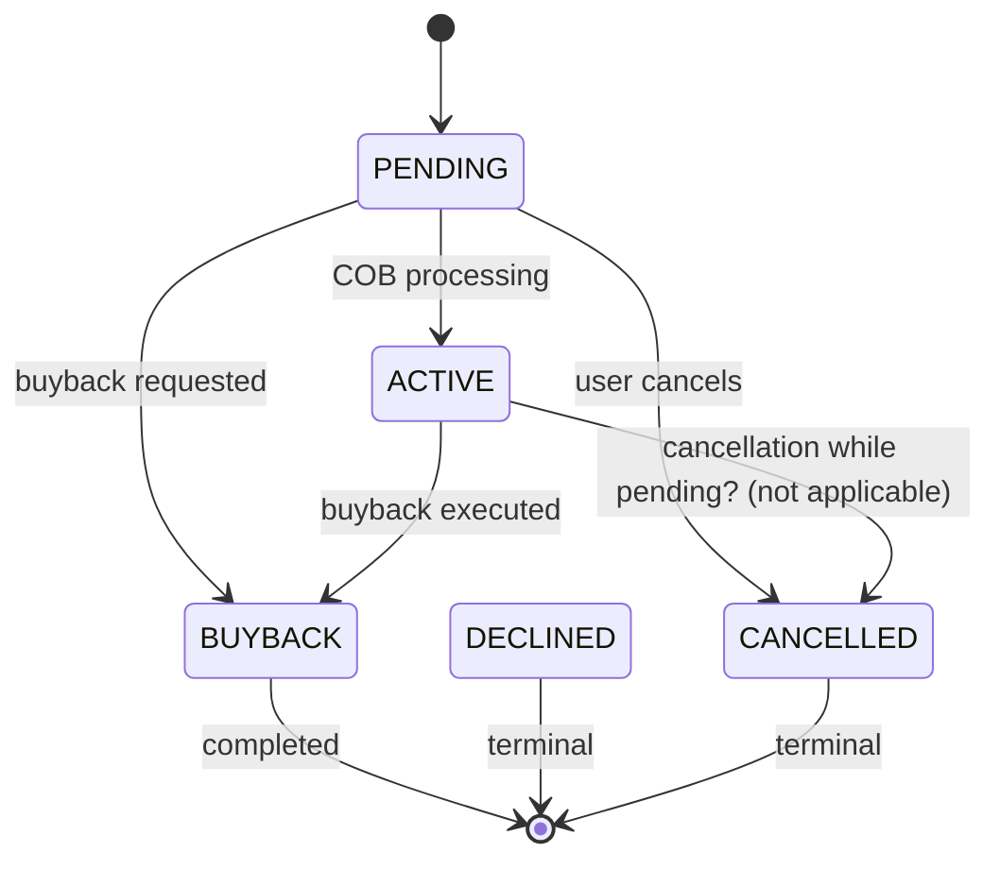

# Investor Module changes

This page captures the verified technical scope and concrete behavioral changes associated with the Investor Module enhancements for asset externalization. The design centers on the end‑to‑end lifecycle of asset transfers to external investors, including sale, buyback, settlement handling, and the associated journal entries. The changes are implemented to verify that sale and buyback decisions take into account the full balance of an asset, including interest components, and that ownership transfers are tracked with explicit state, timing, and accounting relationships.

### Overview and scope

The Asset Externalization capability introduces new domain entities and persistence mappings to represent external asset owners, transfer requests, and the relationships between transfers, loans, and journal entries. The key persistence entities are:

- External asset owner: represents an investor acting as an external owner of a loan asset.
- External asset owner transfer: records a transfer event (sale, buyback) for a loan to or from an external owner, including the settlement date and purchase price ratio.
- Active transfer–loan mapping: links an ongoing/active transfer to the loan that is being transferred.
- External asset owner journal entry mapping: connects journal entries to the asset owner, enabling traceability of investor-related postings.
- External asset transfer journal entry mapping: associates journal entries with a specific asset transfer.
- External asset owner transfer details: stores summarized and component balances for the transfer, including total outstanding amounts and breakdowns for principal, interest, fees, penalties, and any overpayments.

These structures are designed to preserve a precise audit trail of ownership changes and the associated accounting impact, while enabling external investors to participate in loan portfolios.

The surface area affected by the changes includes API endpoints for initiating, querying, and canceling transfers, and the internal data flows that reconcile ownership state with accounting postings at COB (close of business). The design also specifies events related to ownership changes and extended event content to include asset owner context.

### Data persistence: new tables and relationships

The following tables form the core of the asset externalization model. They store identifiers, provenance, status, timing, and the accounting context required for auditing and reporting.

- m_external_asset_owner
 - id: internal primary key
 - external_id: external identifier for the asset owner (unique)
 - created_by / created_on_utc / last_modified_by / last_modified_on_utc: provenance and audit fields

- m_external_asset_owner_transfer
 - id: internal primary key
 - owner_id: foreign key to m_external_asset_owner
 - external_id: external transfer id (string, up to 100 chars, indexed)
 - status: transfer status (indexed)
 - purchase_price_ratio: numeric string representing percentage-based share
 - settlement_date: date of settlement (indexed)
 - effective_date_from / effective_date_to: date range the transfer is valid
 - loan_id / loan_external_id: linkage to the loan being transferred
 - is_system_created: flag indicating COB-created transfers
 - related_to_id: link to a previous transfer 
 - created_by / created_on_utc / last_modified_by / last_modified_on_utc: provenance

- m_external_asset_owner_active_transfer_loan_mapping
 - id: internal primary key
 - loan_id / owner_transfer_id: linkage between loan and transfer
 - created_by / created_on_utc / last_modified_by / last_modified_on_utc: provenance

- m_external_asset_owner_journal_entry_mapping
 - id: internal primary key
 - journal_entry_id / owner_id: linkage between journal entry and asset owner
 - created_by / created_on_utc / last_modified_by / last_modified_on_utc: provenance

- m_external_asset_transfer_journal_entry_mapping
 - id: internal primary key
 - journal_entry_id / transfer_id: linkage between journal entry and asset transfer
 - created_by / created_on_utc / last_modified_by / last_modified_on_utc: provenance

- m_external_asset_owner_transfer_details
 - id: internal primary key
 - asset_transfer_id: linkage to the transfer
 - total_outstanding_amount: loan summary total outstanding amount
 - total_outstanding_principal: outstanding principal
 - total_outstanding_interest: outstanding interest
 - total_outstanding_fee: outstanding fees
 - total_outstanding_penalty: outstanding penalties
 - total_overpaid_amount: any overpayments
 - created_by / created_on_utc / last_modified_by / last_modified_on_utc: provenance

> Note: These tables are designed to preserve the association between external ownership, transfer events, and the associated financial postings, with explicit timing (settlement and effective dates) and state (PENDING, ACTIVE, BUYBACK, DECLINED, CANCELLED).

### API surface and surface behavior

The investment module exposes REST endpoints for asset ownership transfers and for querying transfer and journal information. The primary workflows are:

- Initiate a sale for a loan to an external asset owner
- Initiate a buyback for a loan from an external asset owner
- Cancel a pending transfer
- Retrieve transfer information by transfer id, loan id, or loan external id
- Retrieve transfer journal entries and owner journal entries

Request and response examples below illustrate the surface, with fields aligned to the verified data model. Values shown are representative shapes and sizes; actual deployments use real identifiers and timestamps.

- Initiate sale (target loan by internal loan id)
 - Endpoint (sale): POST /external-asset-owners/transfers/loans/{loan_id}?command=sale
 - Request body includes:
 - settlement_date: 2023-05-21 (YYYY-MM-DD)
 - owner_external_id: external identity of the investor
 - transfer_external_id: optional external transfer id; if omitted, the system may generate one
 - purchase_price_ratio: numeric string representing the investor's fraction (e.g., 1 for 100%)
 - dateformat / locale: formatting preferences
 - Response includes:
 - resourceId: internal transfer id
 - resourceExternalId: external transfer id
 - subResourceId: loan id
 - subResourceExternalId: loan external id
 - changes: the fields that changed (settlementDate, ownerExternalId, transferExternalId, purchasePriceRatio)
 - dateformat / locale: echo of preferences

- Initiate buyback (target loan by external loan id)
 - Endpoint (buyback): POST /external-asset-owners/transfers?loanExternalId={loan_external_id}&command=buyback
 - Request body mirrors sale with settlement_date, owner_external_id, transfer_external_id, purchase_price_ratio, dateformat, locale
 - Response mirrors sale structure with the associated IDs and changes

- Cancel a pending transfer
 - Endpoint: POST /external-asset-owners/transfers?loanExternalId={loan_external_id}&command=cancel
 - Request body includes: transfer_external_id
 - Response indicates the transfer has status CANCELLED and subStatus USER_REQUESTED

- Fetch transfers (by transferExternalId, loanId, or loanExternalId)
 - Endpoint: GET /external-asset-owners/transfers?transferExternalId={id} or ?loanId={id} or ?loanExternalId={id}
 - Response provides totalFilteredRecords and a pageItems list containing per-transfer details such as transferId, owner external id, loan external id, purchasePriceRatio, settlementDate, status, effectiveFrom/effectiveTo, etc.

- Fetch transfer journal entries
 - Endpoint: GET /external-asset-owners/transfers/external-id/{ownerExternalId}/journal-entries
 - Response includes transferData (transferId, owner, loan, purchasePriceRatio, settlementDate, status, effectiveFrom/effectiveTo) and journalEntryData with the embedded posting content

- Fetch owner journal entries
 - Endpoint: GET /external-asset-owners/owners/external-id/{ownerExternalId}/journal-entries
 - Response includes ownerData and journalEntryData with the standard journal entry content structure and a single-page result for the request

The surface behavior follows the following constraints and rules:
- The COB (close of business) processing is the point at which certain state transitions are applied (for example, making an ownership transfer ACTIVE or performing related journal entries).
- Only transfer initiation is captured by the API; the actual transfer is completed by the COB step.

### State machine: asset ownership status

The asset ownership lifecycle uses a compact set of statuses to reflect the lifecycle of a transfer request. The primary statuses and their meanings are:
- PENDING: The asset ownership transfer request has been made but is not yet active at COB.
- ACTIVE: The asset ownership transfer is active; journal entries are posted against the investor.
- BUYBACK: The loan's ownership has been bought back.
- DECLINED: The asset ownership request has been made but the loan balance prevents completion (e.g., loan settled or overpaid).
- CANCELLED: The transfer request was made but cancelled before execution.

The following diagram illustrates the verified transitions and timing considerations (node labels are kept simple for clarity):

Notes:
- The design allows a pending transfer to be followed by a buyback, subject to the rules documented in the decision tracker and test plans. The COB step governs the finalization of status transitions and the posting of accounting entries.
- In some cases, decisions around journal entry generation may differ based on the combination of transfer actions (for example, concurrent sale and buyback on the same day). These decisions are reflected in the eventing and COB procedures described in the design.

### Calculations and balance accounting: including interest in sale/buyback balance

A core usage requirement is to include interest balances when determining the total balance eligible for sale or buyback. To support this, the asset transfer details persist a breakdown of balances:
- total_outstanding_amount: loan summary total outstanding amount at transfer time
- total_outstanding_principal: outstanding principal
- total_outstanding_interest: outstanding interest
- total_outstanding_fee: outstanding fees
- total_outstanding_penalty: outstanding penalties
- total_overpaid_amount: any overpayments

The presence of separate fields for principal and interest (and other components) allows the system to treat interest as a distinct component of the overall balance. When calculating the total balance available for sale or buyback, the algorithm considers the principal and interest components that are outstanding at the time of the transfer, along with any other applicable charges or penalties, and also accounts for overpayments . This verifies that the decision to proceed with a sale or buyback reflects the true economic position of the loan asset as of the settlement date.

The data model keeps these values aligned with the transfer itself, so that accounting postings (journal entries) can be reconciled against the associated asset owner, transfer, and loan records. The mappings between journal entries and transfers/owners provide traceability for the investor’s postings and for auditing purposes.

### Validation rules and COB handling

Key validation and COB handling rules that govern the behavior of asset transfer requests include:
- Asset Owner ID (external) is required for sale and has a maximum length of 100 characters. It accepts any string value and is treated as a unique attribute for the asset owner.
- Sales Transaction ID is optional for the sale request; if omitted, a transfer identifier may be generated by the system.
- Purchase Price Ratio must be provided for sale and buyback requests and represents the investor’s share of the asset (as a percentage between 0 and 100).
- Settlement Date must not be in the past; it is a required field for sale and buyback requests and governs the timing of the COB processing.
- Request scope: transfers apply only to loans with status ACTIVE; other statuses are rejected for initiation.
- COB handling: actual transfer execution is completed by the COB process at the end of day; some scenarios may switch to DECLINED or CANCELLED based on balances and rules.
- Cancel requests refer to the current PENDING transfer and do not specify a settlement date.
- Journal entries related to investor-owned loans are generated in line with ownership transitions; the flow and timing of GL postings follows the COB processing.

Integrity checks verify that the following hold true:
- Each period’s opening balance equals the previous period’s closing balance.
- Payment allocations reconcile with the transaction amount and the transfer balance.
- Remaining cash and outstanding due amounts reconcile after each operation.
- Journal entries balance when both debit and credit sides are present, when accounting data are available.
- Rounding conforms to the specified precision and rounding conventions used in the ledger (HALF_UP or HALF_EVEN ).

### Use cases: representative flows

The PepperSoup use cases describe practical workflows for asset transfers and their consequences on loan state and accounting.

- UC1: Initiate asset transfer
 - A sale or buyback request is initiated for a loan with valid data. The request is validated (asset owner, settlement date not in the past, loan status ACTIVE). If valid, the system returns a transfer resource with a pending state; the COB process will finalize the transfer at end of day.

- UC2: Execute asset transfer
 - If sale is executed, the transfer may culminate in an ACTIVE state, with journal entries prepared and posted. If buyback is executed, a parallel or subsequent process posts entries and updates ownership . If both sale and buyback occur on the same day, the system may cancel or adjust entries following the design’s decision history.
 - If the loan balance is zero or negative at settlement, the transfer may be declined. If a loan balance is adequate, the transfer proceeds and the ownership change is made active at COB.

- UC3: Loan closure scenarios
 - If the loan is closed, the system may perform buyback execution and adjust ownership , subject to the COB rules and the current transfer state.

### Events and observable behavior

Events related to asset externalization extend existing event surfaces with asset owner context. In addition, a dedicated event is emitted for ownership changes, described conceptually as part of the Loan Ownership Transfer Business Event family. This event carries relevant transfer and ownership information to downstream consumers, enabling external systems to react to ownership changes. The events are designed to support auditing and external integration while preserving the integrity of the accounting timeline.

### Permissions and access control

A new permission is defined for the external investor module. Only users granted this permission, along with super users, can perform asset externalization actions. This access control verifies that external ownership operations are restricted to authorized roles.

### Testing and validation plan (summary)

A test plan accompanies the design and includes validation of asset transfer initiation (OK/NOK for various scenarios), inline COB handling, and validation of accounting postings. Test cases cover scenarios such as pending sale, immediate buyback on the same day, and various edge cases around settlement dates and loan balances. The plan also contemplates reconciliation between transfer state and journal postings, and verifies that the COB processing produces consistent results across scenarios.

### Relationships to externalization design and constraints

This work follows the Asset Externalization Solution Design, and its scope includes the data persistence, API surface, and state transitions necessary to support investor-owned loan portfolios. The persisted model captures the essential relationships between transfers, asset owners, loans, and journal postings, providing a reliable foundation for reporting and auditing while supporting integration with accounting and investor workflows.

### Quick reference: organized data model snapshot

 
External Asset Ownerm_external_asset_owner

 
Transferm_external_asset_owner_transfer

 
Active Transfer–Loan Mappingm_external_asset_owner_active_transfer_loan_mapping

 
Journal Entry Mappingm_external_asset_owner_journal_entry_mapping

 
Transfer Journal Entry Mappingm_external_asset_transfer_journal_entry_mapping

 
Transfer Detailsm_external_asset_owner_transfer_details

 
Total balancestotal_outstanding_amount

 
Principaltotal_outstanding_principal

 
Interesttotal_outstanding_interest

 
Feestotal_outstanding_fee

 
Penaltiestotal_outstanding_penalty

 
Overpaidtotal_overpaid_amount

### Illustrative references (surface-level)</n>
- Root endpoint: /external-asset-owners
- Asset transfer request examples (sale, buyback, cancel) and fetch patterns for transfers and journal entries are defined on the surface API layer and are intended to support external systems integrating with asset externalization.

### Integrity and verification notes

- The design explicitly enforces that each period’s opening balance matches the previous period’s closing balance , and reconciliation remains a central integrity requirement for all transfers and postings.
- Payment allocations must reconcile with the transfer amounts and the resulting balances; remaining cash and outstanding dues must reconcile; journal entries balance when accounting data are available.
- Rounding follows the system’s documented precision and approach (HALF_UP or HALF_EVEN ).
- Surface API changes are constrained to initiation and retrieval endpoints; the COB step completes transfers and postings in a deterministic manner.

### Glossary (conceptual)

- Asset externalization: process of transferring loan ownership to external investors with controlled settlement timing.
- Settlement date: the date on which the transfer is settled and ownership becomes effective under COB.
- Purchase price ratio: the investor’s fraction of the loan’s price used to determine transfer economics.
- COB (close of business): end-of-day processing window during which ownership changes and postings finalize.
- Journal entry mappings: associations between postings and asset transfers or asset owners to support traceability.