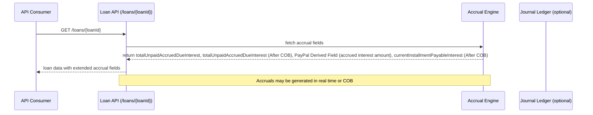
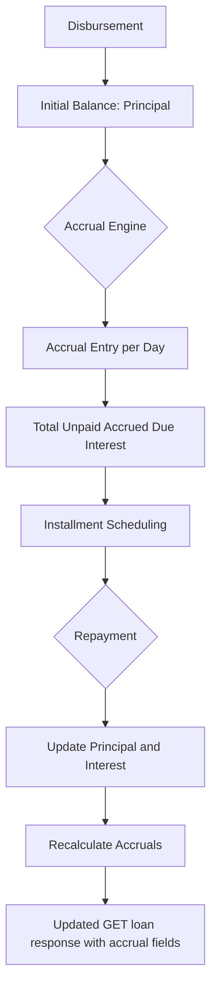

# API Change requests - Loan submission / get loan

This topic captures the confirmed enhancements described for the Pepper-Soup loan APIs in the Origination and API domain. The primary objective is to extend visibility into accrual and payable-interest information exposed by loan-related endpoints, and to outline the high-level impact on loan creation flows as reflected in the reference material. The changes are documented here as verified behavior and observable outputs, without speculating beyond what the source data confirms.

### Scope of the change

- GET Loan by ID or External ID: Extend the loan retrieval surface to include additional fields related to accruals and payable interest. The reference material explicitly demonstrates new fields appearing in the loan response, enabling clients to observe accrued amounts and near-term payable interest alongside existing loan schedule data.
- POST Create Loan: The reference indicates an enhancement to the loan creation API to support additional fields. The exact parameters and field set are not spelled out in the provided material, but the intent is to broaden the payload and/or response to accommodate accrual-related data during loan creation workflows.

> Important: The exact field names and payload shapes for the POST changes are not fully enumerated in the reference data. This page records what is evidenced (the GET-field extensions) and notes the intention around the POST enhancement where the source is truncated.

### What the GET /loans/{loanId} surface adds (verified fields)

The reference material provides concrete examples of fields added to the loan retrieval output to expose accrual-related data. In the shown Field changes, the following fields are present in the GET loan response when accrual information is applicable:

- totalUnpaidAccruedDueInterest: The total amount of accrued interest that remains unpaid as of the current state.
- totalUnpaidAccruedDueInterest (After COB): The same total, recalculated or adjusted up to the close of business today, reflecting COB processing for the accruals.
- PayPal Derived Field (accrued interest amount): A derived figure representing accrued interest captured from a PayPal-related calculation or external reference point, surfaced in the loan response.
- currentInstallmentPayableInterest (After COB): The portion of the current installment's interest that is payable after COB processing.

These fields are demonstrated in the reference calculation sheets under the “GET API Field changes Examples” and related accrual scenario diagrams. They accompany existing loan schedule data such as balance, principal due, and interest per period to give a fuller picture of the loan’s accrual state.

### Example references to accrual calculations and field semantics

The reference data includes several calculation references that illustrate how accruals and payable interest are produced and reconciled over time. The key concepts evidenced are:

- Progressive loan accrual: Two versions (v2 and v3) demonstrate accrual and accrual-activity reporting, including per-period interest, outstanding balance, principal due, and journal-aware events.
- Accrual and accrual-activity entries: The sheets show rows labeled Accrual and Accrual Activity, with accompanying fields such as Balance Of Loan, Principal Due, Interest, Due, Paid, and Outstanding. These entries imply that the system tracks daily or period-based accruals and their translation into payment obligations.
- Recalculation on payments: The examples include repayments on a date (for example, 01-Feb-2024) that alter the outstanding balance and accruals, reflecting updated payable interest and remaining principal.
- Fully prepay scenarios: The references include notes such as “FULLY PREPAY ON DISBURSEMENT DATE” or “FULLY PREPAY ON 2 DAYS AFTER DISBURSEMENT,” indicating that early or full prepayments affect whether interest accrues in later periods and how accrual records are generated in real time or COB jobs.

These references ground the expected behavior of the accrual engine and its integration with the loan retrieval response, particularly the newly surfaced fields that communicate the unpaid accruals and near-term payable interest.

### How accruals are calculated in the reference material

The reference includes dedicated calculation sheets that describe the mechanics of payable interest and accrual activity for progressive loans. In summary:

- Payable interest is calculated on an ongoing basis with a per-day approach and a daily rate derived from the loan’s accrual configuration. The sheets illustrate an example where the daily rate is rounded and used to accumulate payable interest over days in a period.
- The payable interest calculation produces a running total of accruals, and the interaction between accruals and repayments is reflected in updated balances and interest components in the per-period data.
- Rounding conventions are part of the calculation context (the reference notes permissible rounding methods such as HALF_UP or HALF_EVEN for intermediate values).
- The examples show both prepayment scenarios and scheduled accruals, highlighting how the payable interest and total unpaid accrued interest may increase, decrease, or be reset based on disbursement timing, repayments, and accrual jobs.

The exact formulas, inputs, and intermediate arithmetic steps used to derive the accumulated payable interest are captured in the referenced calculation sheets. The high-level takeaway for API consumers is that the loan retrieval now reveals accrual health through the new fields, while the underlying calculations continue to drive the per-period schedule and the overall interest payable narrative.

### Illustrative references: progressive loan accrual sheets (verbatim concepts)

- Progressive loan v2 and v3 sheets demonstrate the interaction between the loan balance, principal due, interest, and accrual entries across multiple periods, including the initial disbursement, a series of periods with interest and principal flows, and end-of-period summaries. The sheets capture dates, day counts, and the sequence of accrual events that feed into the “total cost of loan” and the “installment totals.”
- The Sheets include narrative notes about current COB processing, real-time accrual creation, and COB job effects that adjust the accrual and journal-entry landscape.

These references establish the expected linkage between the per-period accounting data and the enriched loan retrieval payload that surfaces accrual information.

### Special cases and integrity considerations

- In situations where the loan has no outstanding accrued interest (for example, immediate or fully prepaid disbursements), the accrual fields would reflect zero values, consistent with the documented scenarios in the reference sheets.
- Integrity constraints emphasize that during payment allocations, the opening balance of a period must equal the prior period’s closing balance, and that payments, accruals, and journal entries reconcile when data is available.
- Journal entries, when present, must balance (debit equals credit) given the actual ledger data that accompanies accrual and repayment events.
- Rounding behavior in accrual calculations must adhere to a documented convention (examples reference HALF_UP or HALF_EVEN style rounding) to verify consistency across period totals.

### Architecture and processing implications (high level)

- API surface: GET /fineract-provider/api/v1/loans/{loanId} returns enhanced loan details with accrued-related fields, enabling clients to observe the loan’s current accrual position without reconstructing it from per-period data alone.
- Loan creation: The POST create loan flow is indicated to be extended to support additional fields, potentially affecting input validation, persistence, and post-creation accrual setup. The exact field set is not specified in the reference, so client integrations should anticipate possible schema extensions and adjust payloads when guidance is provided.
- Calculations and scheduling: The accrual engine (as evidenced by the progressive loan references) processes daily accruals and accrual activity entries, correlating with repayments and COB processing. The enriched GET response exposes these derived values to consumers without requiring them to navigate internal tables or compute the values themselves.
- Persistence and accounting: The references imply that accrual data is produced in real time or COB jobs and is bound to journal-entry events when available. The public API surface mirrors these derived quantities to support reconciliations and reporting in downstream systems.

### Practical guidance for implementation and integration

- When integrating with GET loan by ID, expect and gracefully handle the presence or absence of new fields such as totalUnpaidAccruedDueInterest, totalUnpaidAccruedDueInterest (After COB), PayPal Derived Field (accrued interest amount), and currentInstallmentPayableInterest (After COB).
- If consuming the POST create loan flow, prepare for addition of new fields in the request or response payload. Validate input against the evolving schema and monitor for any API versioning notes that accompany the change.
- verify clients understand the semantics of After COB fields: they reflect COB-processed values, which may differ from end-of-day or posted values depending on the system’s COB job timing.
- follows the integrity expectations: reconciliations between outstanding balances, paid amounts, and accrual totals must be preserved. When a repayment occurs, the system may adjust accruals and the loan balance in ways that are observable in the extended GET response.

### Diagram: loan retrieval with accrual exposure

### Diagram: accrual and repayment flow (high level)

### Summary of verified behavior

- GET loan by ID/external-id now exposes accrual-related fields in the loan payload, enabling clients to observe total unpaid accrued interest and near-term payable interest alongside the standard loan schedule.
- The reference provides concrete field names and example calculations illustrating how accrued amounts evolve with time and repayments, including COB considerations and real-time vs COB processing notes.
- The POST create loan flow is described as receiving enhancements to support additional fields, though the exact field set is not enumerated in the provided material.
- Integrity and accounting concepts in the reference emphasize balance reconciliation, timing of repayments, and the role of journal entries when available.

This page presents the verified behavior as described in the references, with an emphasis on the GET loan surface and the accrual calculation references that underlie the new fields. It avoids hypothesizing beyond what is evidenced and preserves the exact conditions and terminology used .