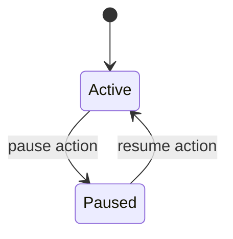

# Pause Delinquency

Pause Delinquency is a delinquency management enhancement that allows an authorized user to pause or freeze the delinquency calculation for a loan for a defined period. The feature affects both loan‑level delinquency assessment and installment‑level delinquency classification, and it is implemented as a loan‑level control that can be activated and later resumed. When paused, the system refrains from reclassifying delinquency buckets during the pause window, while payments made on delinquent amounts may still resolve the delinquent state. The pause state is represented by a loan‑level flag and an effective pause period, and changes to this flag emit domain events.

The design is scoped to loan‑level delinquency control and its impact on the installment delinquency process. It is not a product level setting and does not alter the underlying delinquency bucket definitions themselves. The pause mechanism is governed by the lifecycle of delinquency actions stored against a loan, and the system exposes an API surface to view and create these actions. The daily COB (close of business) processing will re‑evaluate delinquency buckets when pauses are not active, and it will respect the current pause state when computing delinquency for each loan.

### Key concepts and guarantees
- The pause state is represented by actions stored in a dedicated data structure (the delinquency action history) and a boolean indicator exposed through loan read endpoints. A loan is considered paused if the current business date falls inside an active pause window.
- The pause window is defined by a start date and an optional end date. A valid pause must start today or later and must last at least one day (start date strictly precedes end date).
- Resume actions restore delinquency calculation. A resume action has a start date (which is the effective date of resumption) and must not specify an end date.
- Pause and resume actions are persisted as discrete entries against the loan, and overlapping pauses are not allowed by validation rules.
- When the pause flag changes, events are emitted to reflect the new state. The system also extends collection data with a delinquency paused flag so external consumers can observe current pause status.

### Execution lifecycle and state transitions
The pause state is fundamentally a binary condition: Active (delinquency calculation enabled) and Paused (delinquency calculation disabled). The following state transitions are evidenced by the design and related implementation points:

- Active to Paused: A Pause action is created for an active loan and the pause period includes the current business date.
- Paused to Active: A Resume action is created to end the pause; delinquency calculation resumes from the start date of the resume action.
- Attempts to pause while already paused are validated as invalid at the API boundary (overlapping pauses are not permitted).

Mermaid diagram (simplified):



### Data model and persistence
A dedicated table stores delinquency actions associated with each loan. The table captures the action type, effective window, and audit information:

- Table: m_loan_delinquency_action
 - id: BIGINT, PK, not null
 - loan_id: BIGINT, index, not null
 - action: VARCHAR(128), not null (e.g., PAUSE, RESUME)
 - start_date: Date, not null
 - end_date: Date, optional
 - created_by: BIGINT, not null
 - created_on_utc: timestamp, not null
 - last_modified_by: BIGINT, not null
 - last_modified_on_utc: timestamp, not null

Algorithm to determine whether delinquency calculation is paused for a loan
- The database layer provides the following decision logic (as specified in the design):
 - If no record is found for the loan, delinquency calculation is enabled (not paused).
 - If a PAUSE entry is returned by the query, delinquency calculation is paused.
 - If a RESUME entry is returned, delinquency calculation is enabled.
 - The exact query used to determine the paused state is:
 
 <div class="calc-box">
 <div class="calc-title">Pause state query ()</div>
 <div class="calc-step"><strong>Query:</strong> <![CDATA[SELECT * 
 FROM m_loan_delinquency_action
 WHERE 
 ((action = "pause" AND end_date is not null AND :business_date >= start_date AND :business_date <= end_date) OR
 (action = "resume" AND end_date is null AND :business_date >= start_date)) AND
 loan_id = :loan_id
 ORDERY BY created_on_utc DESC 
 LIMIT 1;]]
 </div>
 </div>

Where business_date represents the current processing date used by the delinquency computation. The presence of a PAUSE entry in effect on the business date indicates that the delinquency calculation is paused; the presence of a RESUME entry indicates that the calculation is enabled again. If the query returns no rows, the delinquency calculation is considered enabled.

### API design and endpoints
The feature exposes endpoints to view and create delinquency actions for a loan. The interaction model is as follows:

1. Retrieve all delinquency actions for a loan
- HTTP method and path:
 - GET /loans/{loanid}/delinquency-actions
 - GET /loans/external-id/{loanExternalId}/delinquency-actions
- Response body (example):
<div class="param-grid"><div class="param-card"><span class="param-label">Actions</span><span class="param-value">[{"id":"123","action":"pause","startDate":"2023-10-05","endDate":"2023-10-08","created_by":"","created_on_utc":"","last_modified_by":"","last_modified_on_utc":""},...]</span></div></div>

2. Create a new delinquency action for a loan
- HTTP method and path:
 - POST /loans/{loanid}/delinquency-actions
 - POST /loans/external-id/{loanExternalId}/delinquency-actions
- Request body (example):
```json
{
 "action": "pause",
 "startDate": "2023-10-05", 
 "endDate": "2023-10-08"
}
```

Validation rules for the API surface ():
- Only Pause and Resume actions are supported at this time.
- Pause validations:
 - Pause can start today or later and must last at least one day (start date before end date).
 - Pause and resume should be applicable only for active loan accounts.
 - Overlapping Pause periods are not allowed.
- Resume validations:
 - Resume can only be used when there is an active pause.
 - Resume date is always the current business date; this shall be the start_date (no future resume is possible at the moment).
 - In case of resume, end_date must not be specified.

A separate API surface is introduced to expose the pause state on loan retrieval results (see below).

### Loan read endpoint extension for pause flag
The loan read path exposes the delinquency pause state as part of the loan view. The intended fields are:
- delinquencyCalculationPaused: boolean — indicates whether delinquency calculation is paused for the loan at the moment of the request.
- delinquencyPausePeriodStartDate: date — the start date of the current active pause period or the last active pause start if multiple pauses exist.
- delinquencyPausePeriodEndDate: date — the end date of the current active pause period (or the last end date if paused previously).

Implementation note: The updated loan read path extends the existing collection data with these fields to allow clients to observe the current pause state without requiring additional lookups.

### Events and integration points
Delinquency pause and resume changes produce domain events that external systems or COB processes can subscribe to. Notable points :
- When the flag changes, a new event is emitted describing the new pause state. This is aligned with the broader event model used for delinquency state transitions.
- Existing external event definitions such as LoanAccountDelinquencyRangeDataV1 are triggered when the set of assigned delinquency tags changes. This event is emitted by the DelinquencyWritePlatformService path that updates the loan delinquency tags during COB operations.
- The primary event stream for delinquencies ties into the loan COB step that calls setLoanDelinquencyTag() with the current date, which is the point that bucket assignments are recalculated and tags updated.
- The public CollectionDataV1 structure (an Avro schema) is extended to carry a delinquencyCalculationPaused boolean flag so external consumers can surface the pause state without schema migrations to V2.

Payload fields for the pause state event surface include:
- delinquencyCalculationPaused: boolean
- delinquencyPausePeriodStartDate: date
- delinquencyPausePeriodEndDate: date

These fields describe active, expired, or future pause information for a loan.

### Delinquency calculation and pause impact on processing
Pause affects how delinquency is computed across the lifecycle:
- When a loan is paused, the system will not recalculate or advance the delinquency bucket during the pause period. The effective pause days contribute to the calculation of the current delinquency for each unpaid installment when the pause is active.
- The computation for an installment’s delinquency considers the duration of relevant pause periods. The formula used to derive the effective delinquency days is:

<div class="calc-box">
 <div class="calc-title">Calculation</div>
 <div class="calc-step"><strong>Formula:</strong> <code>current date - unpaid installment date - sum(relevant pause days)</code></div>
 <div class="calc-step"><strong>Substitution:</strong> <code>actual values from the loan and pause records</code></div>
 <div class="calc-step calc-result"><strong>Result:</strong> <code>effective delinquency days used to assign the installment to a delinquency bucket</code></div>
</div>

The pause days are determined by the overlaps between the pause periods and the installment due dates. The reference scenarios illustrate several pause windows and how they influence the calculated delinquency days for each installment.

The daily COB job evaluates loans and assigns installments to the standard delinquency bucket when pauses are not active. If a loan enters an active pause, the previously defined delinquency buckets are preserved for the duration of the pause, and the eventual bucket reassignment occurs once the pause ends and the COB process runs again.

### Calculation references and scenarios ()
- Pause days calculation v2 provides a structured representation of how pause days influence repayment schedules and the effective delinquency period. The repayment schedule used in the scenarios follows the base repayment pattern and demonstrates how the pause windows modify the progression through delinquency buckets.
- See the Pause days calculation references for the detailed Scenario 1–4, including pause windows such as 02-01-2022 to 20-01-2022 and 15-01-2022 to 14-02-2022, and how they impact the per‑installment pause computation.

### Calculation integrity and validation
- The system maintains precise alignment between opening and closing balances across periods; the opening balance of a period equals the previous period’s closing balance.
- Payment allocations during a pause must reconcile with the transaction amounts and the paused status; the pause affects bucket reclassification rather than the raw payment posting itself.
- All relevant intermediate calculations, running balances, and rounding follow verified rules as described in the design artifacts. Where numeric exists, it is represented exactly; no synthetic numbers are introduced.

### Architecture and component responsibilities (high level)
- Delinquency pause data persists per loan in the m_loan_delinquency_action domain, capturing PAUSE and RESUME actions with start and end dates.
- The loan read path surfaces delinquencyCalculationPaused and the associated pause period window to clients.
- The COB/Delinquency components consume the pause state to decide whether to recalculate buckets and how to apply the pause to the installment delinquency evaluation.
- Domain events are published when the pause flag state changes, enabling external consumers to react to the pause/resume lifecycle.

### Edge cases and considerations
- Overlapping pauses are rejected by validation rules to prevent ambiguous pause windows.
- Resume actions must occur with an active pause; a resume without an active pause is invalid per the design rules.
- End dates for resume actions are not allowed; a resume entry marks the point at which delinquency calculation resumes from the stated start date.
- If a loan has never had a pause configured, the delinquency calculation state is not paused, and the pause fields are empty in the loan view.
- When a payment is posted that fully clears an old delinquent installment, that installment exits its delinquency bucket, but the loan remains delinquent until all installments clear the bucket.

### Implementation notes (-driven)
- Delinquency actions are accessible via API endpoints that return and create actions for a given loan. The endpoints are designed to support querying by loan id or external id and to create new pause/resume actions with proper validation.
- The pause state is consumed by a query against m_loan_delinquency_action to determine whether the delinquency calculation is paused for a given business date and loan.
- The delinquency pause surface is integrated into loan views, enabling client applications to observe the current pause status and the active or most recent pause window.

## Example scenarios and references (conceptual)
- Pause window example: Pause from 2022-02-01 to 2022-02-20. During this window, delinquency calculation for the affected installments is not advanced beyond the existing bucket state. On resume, the calculation re‑evaluates installments using the effective pause days that overlapped with each installment’s due date.
- Scenario handling includes several combinations of pause windows and installment due dates, illustrating how the effective delinquency days are calculated and how the system reclassifies buckets after the pause ends.

> Note: The design documents reference a concrete set of scenarios, formulas, and data structures. The public documentation above reflects the verified behavior and the exact conditions described in those sources without introducing new or unverified concepts.

### Summary of user-visible changes
- A new delinquency action API surface to pause or resume delinquency calculation on a loan.
- A loan read extension that exposes delinquencyCalculationPaused and related pause window fields.
- Internal COB processing respects the pause state to determine when to recalculate delinquency buckets and how effective pause days affect the delinquency depth per installment.
- Events are emitted when the pause state changes, enabling downstream systems to observe the pause lifecycle.