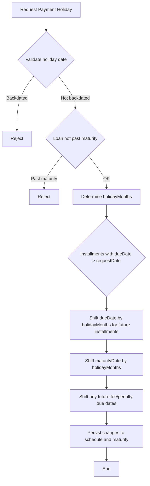

# Payment Holidays

Payment Holidays provide a controlled mechanism to pause scheduled loan repayments for specific accounts, primarily to support BNPL-style products in diverse markets. The feature operates within the loan repayment scheduling domain and is anchored to the Disbursement and Schedule lifecycle. When a payment holiday is approved for a loan, it defers future installments by the requested number of months while preserving any installments that are already due. The result is an adjusted repayment schedule and an updated loan maturity date, with subsequent autopay flows continuing according to the revised schedule. This document consolidates the evidenced behavior from the reference use cases and documents the rules, validations, and resulting schedules that a backend engineer must implement and reason about when integrating or extending this capability.

## Scope and design boundaries

- Supported holiday lengths in the reference set are one month and two months. The system applies the requested holiday to future installments, while installments that are already due at the time of approval are not extended.
- The system shifts due dates for all future installments by the number of months in the approved holiday. The loan’s maturity date is advanced by the same number of months as part of the schedule realignment.
- Any fees or penalties with due dates in the future are also moved forward to the next payment due date after the holiday is applied.
- Holidays cannot be granted if the requested date is backdated relative to the payment event point. A backdated request must be rejected with an error. Holidays are also not permitted once the loan has passed its maturity date.
- The rule that preserved in the reference is: installments already due do NOT get extended; only future installments are shifted.

## Core rules and behaviors (evidenced)

- Future installments shift by the holiday duration. For example, a one-month holiday moves each future due date forward by one month. The maturity date is moved forward by the same amount.
- Past installments remain in their original positions; they are not retroactively shifted.
- Fees and penalties with future due dates follow the same forward-shift rule for due dates, aligning with the new payment schedule.
- If a loan has any due date on or after the approval point, that due date behavior is determined by the rule that only future installments receive the extension (i.e., installments with due dates after the approval date are extended).
- No holiday is allowed if the point of holiday approval is after the loan’s maturity date; in that case, the operation is rejected.

## API interaction semantics (high level, evidenced intent)
- The system should expose an API pathway that allows a caller to update the repayment next due date, the remaining schedule payment due dates, and the maturity date. The exact endpoint path and payload shape are not specified in the reference data, but the behavior is described: apply the holiday to future installments, move the maturity, and adjust any future fee/penalty due dates .

## Validation guards and invariants
- Backdated HOLIDAY requests are rejected: if the holiday effective date has already passed, the system returns an error.
- No PH after maturity: a holiday request cannot extend beyond the loan’s maturity date.
- Installments already due are not extended: only future installments are shifted.
- Future fee/penalty due dates move forward in lockstep with the payment schedule changes.

## Recalculation algorithm (conceptual)
1. Validate the holiday request date against the current date and the loan’s maturity date. Reject if backdated or if the loan is past the maturity date.
2. Determine holidayMonths (e.g., 1 or 2 months) from the approved request.
3. For each installment in the repayment schedule, if the installment due date is after the holiday approval date, shift its due date by holidayMonths months.
4. Shift the loan’s maturity date forward by holidayMonths months.
5. For any fees/penalties with future due dates, shift those due dates forward to follows the next adjusted payment due date.
6. Persist the updated schedule, updated maturity date, and updated fee/penalty due dates.
7. Trigger any downstream scheduling (e.g., autopay recalculations) as needed by the scheduling subsystem.

> Note: The above reflects the constrained, -based behavior described in the use-case worksheets. It explicitly guards that only future installments are extended and that past-due installments remain unchanged.

## Worked reference use cases (evidenced schedules)
The reference data provides concrete, date-anchored scenarios that illustrate how schedules mutate under one- and two-month holidays, plus a past-due scenario and a case with associated fees. The following sections reproduce those patterns and show the resulting after-holiday schedules. Each example preserves the declared initial conditions and demonstrates the exact changes to due dates, maturity, and payment allocations.

### UC1-1M Pay Hol (1-month holiday, four-installment loan)
- Initial conditions (before holiday):
 - Loan amount: 1000
 - Maturity date: 1-Nov
 - Four installments of 250 each due monthly on 8/1, 9/1, 10/1, 11/1
 - Down payment completed: 750 (balance 750 remains to be amortized)
- Event: 1-month payment holiday approved on 5-Aug
- After-holiday results:
 - NEW Maturity Date: 1-Dec
 - Remaining installment due dates after holiday: Install 1 due 8/1 becomes 0 (not due in future for the holiday period), Install 2 NOW due 10/1, Install 3 NOW due 11/1, Install 4 NOW due 12/1
 - Autopay events proceed as scheduled on the shifted dates: 1-Oct autopayment of 500, 1-Nov autopayment of 250, 1-Dec autopayment of 0

 
Calculation

 
<strong>Formula:</strong> shift future due dates by 1 month; increase maturity by 1 month

 
<strong>Substitution:</strong> future installments (9/1, 10/1, 11/1) +1 month → (10/1, 11/1, 12/1); maturity 1-Nov → 1-Dec

 
<strong>Result:</strong> new schedule with Install 2 at 10/1, Install 3 at 11/1, Install 4 at 12/1; maturity 1-Dec

> Observed behavior: Installments that were due prior to the holiday (the 8/1 installment) do not reappear in the extended window; the first future installment dates are shifted from 9/1 onward.

### UC2-2M Pay Hol (2-month holiday, four-installment loan)
- Initial conditions (before holiday): same as UC1-1M
- Event: 2-month payment holiday approved on 5-Aug
- After-holiday results:
 - NEW Maturity Date: 1-Jan
 - Installment due dates after holiday: Install 1 due 8/1 (paid/handled) remains as standard; Install 2 NOW due 11/1, Install 3 NOW due 12/1, Install 4 NOW due 1/1
 - Autopay events: 1-Oct autopayment 500; 1-Nov autopayment 250; 1-Dec autopay 0; 1-Jan autopay 0

 
Calculation

 
<strong>Formula:</strong> shift future due dates by 2 months; increase maturity by 2 months

 
<strong>Substitution:</strong> future installments due on 9/1, 10/1, 11/1 → 11/1, 12/1, 1/1; maturity 1-Nov → 1-Jan

 
<strong>Result:</strong> new schedule with Install 2 at 11/1, Install 3 at 12/1, Install 4 at 1/1; maturity 1-Jan

> Observed behavior: Future installments and the maturity date extend by two months; installments already due at the approval moment are not extended.</n
### UC3- 2M Pay Hol Past Due (two-month holiday, past-due scenario)
- Initial conditions (before holiday): identical to UC1-1M baseline
- Event: 2-month payment holiday approved on 5-Aug (while some installments are already due or past due)
- After-holiday results:
 - NEW Maturity Date: 1-Jan
 - Installment schedule after holiday: Install 1 due 8/1 remains due; Install 2 NOW due 11/1, Install 3 NOW due 12/1, Install 4 NOW due 1/1
 - Note: Installments already due (e.g., 8/1) are not extended; future installments shifted by 2 months
 - Autopay events proceed after shifting

 
Calculation

 
<strong>Formula:</strong> shift future due dates by 2 months; keep already-due installments untouched

 
<strong>Substitution:</strong> 9/1, 10/1 → 11/1, 12/1

 
<strong>Result:</strong> Install 2 at 11/1, Install 3 at 12/1, Install 4 at 1/1; Install 1 remains due on 8/1

> Important: The rule explicitly states that installments already due do NOT get extended; only future installments are moved forward.

### UC4-1M Pay Hol with Fees (1-month holiday, with fees/penalties)
- Initial conditions (before holiday): four-installment loan; one fee/penalty (NSF) of 15 due 1-Sep appears during the cycle; balance progression shows the fee integration with the payment schedule
- Event: 1-month payment holiday approved on 5-Aug
- After-holiday results:
 - NEW Maturity Date: 1-Dec
 - Installment due dates after holiday: Install 1 due 8/1 becomes 0 (not due within the holiday window); Install 2 due 10/1, Install 3 due 11/1, Install 4 due 12/1
 - Fee/penalty handling: fee due date 1-Sep moves forward to follows the next payment due date after the holiday; in the example, the autopayment composition reflects the updated balance and penalty amount as the cycle progresses (e.g., 750 principal balance with 15 penalty on 3-Aug, then 750 balance with 15 penalty resolved by 3-Aug settlement)
- Additional autopay events shown: 1-Oct autopayment 500; 1-Nov autopayment 250; 1-Dec autopayment 0

 
Calculation

 
<strong>Formula:</strong> shift future due dates by 1 month; move fee/penalty due dates to the associated next due date

 
<strong>Substitution:</strong> 9/1 → 10/1; 10/1 → 11/1; 11/1 → 12/1; 1-Sep fee due date moves to 10/1 or the next due date after the holiday window

 
<strong>Result:</strong> Install 2 at 10/1, Install 3 at 11/1, Install 4 at 12/1; Maturity 1-Dec; Fee due date advanced to follows new cycle

> Observed behavior: Fees/penalties that were scheduled for the future follow the same forward-shift rule as installment due dates. Future due dates for penalties track the updated payment schedule.

## Scheduling implications and asset accounting considerations (-based)
- The observable effect of applying a payment holiday is a forward re-baselining of the repayment schedule: future installments receive a one- or two-month deferral, the maturity date extends , and future fees/penalties follows the new next-due-date for the adjusted schedule.
- Since the reference demonstrations include autopay lines on subsequent dates after the holiday, the system must re-evaluate and recalculate the autopay calendar to reflect the new due dates. This is especially relevant for BNPL products where continuous cycles are expected after the holiday window.

## Diagram: how a payment holiday propagates through a loan schedule

## Edge cases and validation summary
- No backdated holidays: the system rejects requests where the holiday effective date has already passed.
- No PH after maturity: holidays cannot extend a loan beyond its maturity date.
- Past installments remain unchanged: only future installments are shifted.
- Fees/penalties with future due dates are moved to follows the new schedule.
- If a future installment’s new due date would collide with other calendar constraints, the implementation must rely on the existing schedule reconciliation logic to avoid double-allocations or overlapping dues.

## How this relates to integration points
- Scheduling subsystem: the payment holiday operation updates the repayment schedule entries and the maturity date, and signals the updated calendar to downstream routines (such as autopay processors).
- BNPL product support: the feature is designed to accommodate market-specific deployment where pausing and resuming installments is required for consumer financing products.

## Summary of verified behavioral rules
- A payment holiday defers future installments by the approved number of months and advances the maturity date by the same amount.
- Installments already due at the time of approval are not extended.
- Fees and penalties with future due dates are moved forward in tandem with the installments.
- Holidays are rejected if backdated or if the loan has already reached or passed maturity.
- The system exposes an API pathway to update repayment next due date, remaining due dates, and maturity date; exact REST surface is not specified .

This page presents the evidenced behavior for Payment Holidays as described by the scenario worksheets and use cases. It documents the rules, the resulting schedule transformations, and the validations that backend implementations must enforce to maintain accurate, auditable loan schedules during holiday periods.