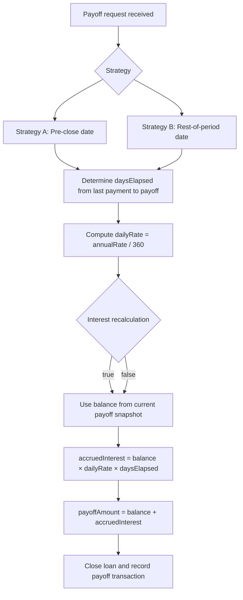

# Payoff transaction(prepay as of given date)

The payoff transaction is the mechanism that determines the amount required to close a loan as of a specific date, including any accrued interest not yet billed. It is a component of the Repayment and Allocation workflow under the Payoff topic. The calculation relies on the standard loan amortization assumptions used in the module, notably a fixed-rate instrument with day-count conventions and a monthly repayment schedule. The payoff amount is derived from the current loan state and the payoff date, with optional recalculation of accrued interest and the choice of payoff-date semantics (pre-close date versus the end of the current period).

### Scope and component role

- Purpose: expose the amount needed to close a loan on a given date, capturing any accrued interest that has not yet been invoiced at the payoff moment.
- Boundary: operates on the loan’s amortization schedule and current balance, using the defined day-count conventions to compute accrued interest up to the payoff date.
- Inputs (conceptual): the loan state (balance, interest rate, schedule), payoff date, payoff strategy (pre-close date or rest-of-period date), and a flag indicating whether interest should be recalculated for the payoff date.
- Outputs (conceptual): a payoff amount, including a breakdown of principal and interest components specific to the payoff moment, and a record of the payoff transaction that closes the loan if accepted.
- Observed conventions (from reference data): the classic configuration uses a 360-day year with 30-day months, a standard principal like 100, and an annual interest rate of 7% as a baseline for payoff computations. The schedule uses fixed-period amortization with monthly payments.

> Note: The references describe multiple payoff scenarios that exercise slight variations of timing (pre-close date versus rest-of-period date) and recalculation of interest. The core financial principle remains the same: payoff amount equals the outstanding balance as of payoff date plus accrued interest up to that date, subject to any recalculation rules.

### Payoff calculation concepts and formulas

The payoff calculation hinges on two intertwined ideas: (1) the amortization schedule defines the balance and interest components across periods, and (2) day-count conventions determine how much interest accrues between dates. The documented conventions are:
- Day-count convention: Days in year = 360, Days in month = 30
- Interest rate: annual nominal rate (e.g., 7% per year; daily rate effectively = annual rate / 360)

Key formulas used -based payoff calculations:
- Daily interest rate
 - Formula: dailyRate = annualRate / daysInYear
 - : daily accruals provided as 0.000194444 for a 7% annual rate with 360-day year, which corresponds to 0.07 / 360.
- Accrued interest (over a period of daysElapsed)
 - Formula: accruedInterest = balance × dailyRate × daysElapsed
 - : daily accrual concepts and the presence of a dedicated "Daily accrual" and "Payable interest" tracking in the payoff-related sheets.
- Payoff amount (basic encapsulation)
 - Concept: payoffAmount = (outstanding balance as of payoff date, per the schedule) + (accruedInterest up to payoff date, if recalculation is performed)
 - : the payoff workflow is described as including accruals and balance evolution up to the payoff moment, with explicit options to recalculate accruals.

The reference material distinguishes two payoff-date semantics that influence how the payoff date is chosen and how interest is reconciled:
- Strategy A: Pre-close date
 - The payoff date is the pre-close date input by the user, and interest can be recalculated for that horizon.
- Strategy B: Rest-of-period (end of rest frequency) date
 - The payoff date is the end of the current rest frequency (the remainder of the period), and interest can be recalculated for that horizon.

Both strategies share the same underlying accrual mechanism but differ in which date is treated as the closing date for the loan schedule and how much of the period remains to accrue interest.

### Calculation references and workflow (conceptual)

 
Principal100

 
Annual Interest Rate7% (0.07)

 
Days in Year360

 
Days in Month30

 
Payoff Date[user-supplied]

 
StrategyPRE_CLOSE_DATE or REST_OF_PERIOD

 
Recalculate Interesttrue/false

 
Calculation

 
<strong>Formula:</strong> <code>dailyRate = annualRate / daysInYear</code>

 
<strong>Formula:</strong> <code>accruedInterest = balance × dailyRate × daysElapsed</code>

 
<strong>Formula:</strong> <code>payoffAmount = balance (as of payoff) + accruedInterest (if recalculated)</code>

 
<strong>Notes:</strong> The balance portion uses the amortization schedule up to the payoff date; accrued interest may be recalculated if the flag is enabled. The payoff date is determined by the selected strategy (pre-close or rest-of-period).
 

### Payoff flow (textual workflow)

1) A payoff request arrives with a loan identifier, a payoff date, a chosen payoff strategy, and a recalculation flag.
2) The system selects the payoff horizon based on the strategy: either the pre-close date or the end of the current rest period.
3) The daysElapsed between the last billing date (or last accrual date) and the payoff date is determined according to the 360/30 convention.
4) The daily rate is computed as annualRate / 360, and accruedInterest is calculated as balance × dailyRate × daysElapsed.
5) If recalculation is enabled, the system replays the amortization state up to the payoff date to derive the balance that would exist on that date; otherwise, the payoff balance is taken from the existing schedule snapshot at payoff.
6) The payoff amount is the sum of the balance (as of payoff) and the accrued interest ().
7) The loan state is updated to reflect closure, and a payoff transaction is recorded for settlement.

A simplified schematic of the payoff decision and calculation is shown here:

### Inputs, outputs, and integration touchpoints

- Inputs (operational):
 - Loan state (balance, schedule, interest rate, amortization cadence)
 - Payoff date (as provided by the caller)
 - Payoff strategy (PRE_CLOSE_DATE or REST_OF_PERIOD)
 - Recalculate interest flag (true/false)
- Outputs (operational):
 - Payoff amount (principal to close plus any accrued interest)
 - Optional breakdown of principal and interest components for the payoff moment
 - A payoff transaction that represents the closure of the loan as of the payoff date
- Interactions: the payoff calculation relies on the ongoing amortization engine to provide the current balance and schedule state up to the payoff moment. The payoff result is recorded as the closure event, updating the loan’s state .

### Edge cases and scenarios described in the reference material

- On overdue loans with late prepayment (S2), the same accrual conventions apply, but the payoff may reflect the overdue balance and the accruals associated with the overdue period. The reference material demonstrates a late prepayment scenario under the same rate and day-count assumptions.
- Early payoff adjustments labeled under different strategies (S3/S4) illustrate payoff calculations where the payoff date is aligned with a specific early-pay event (for example, 15th January or 20th January) and where adjustments are made to next installments or last installment contexts, depending on whether the payoff is performed before the next cycle or at the end of the current cycle.
- In all cases, the payoff amount must reconcile with the resulting closing balance and the accrued interest up to the payoff moment, with any recalculation performed according to the selected strategy.

### Example inputs and expected outputs (guidance only)

The following is a concise reference for the key parameter values, drawn from the documented setup used in the payoff calculations:
- Principal: 100
- Annual Interest Rate: 7% (0.07)
- Days In Year: 360
- Days In Month: 30
- Payoff Strategy: PRE_CLOSE_DATE or REST_OF_PERIOD
- Recalculate Interest: true or false

If a payoff is executed with recalculation enabled and the payoff date aligned with a pre-close date (Strategy A), the system replays the amortization up to that date and computes accrued interest with dailyRate = 0.07 / 360, daysElapsed based on the period cadence, and balance derived from the schedule up to the payoff moment. The payoffAmount is the sum of the resulting balance and accrued interest.

If the payoff uses the rest-of-period date (Strategy B), the payoff is calculated using the end of the current period as the closing horizon, with the same accrual approach but the balance and daysElapsed reflecting the rest-of-period alignment.

### Architecture and implementation notes (summary)

- Calculation core: the payoff computation is anchored in the module’s amortization framework, reusing the same balance evolution logic used for regular repayments. It applies a daily accrual step using a 360-day year and 30-day months as the calendar basis.
- Scheduling and replay: when recalculation is requested, the system replays the amortization state up to the payoff moment to derive the effective balance that would be outstanding on that date, prior to emitting the payoff transaction.
- Output contract: the payoff result includes a monetary amount representing the closing liability as of the payoff date, including accrued interest if recalculation is performed. The loan is then closed and the payoff event is recorded in the loan’s lifecycle.

### Glossary of terms

- Payoff amount: the total sum required to close the loan on the specified date, including any accrued interest up to that date.
- Pre-close date: the payoff date chosen explicitly for closing the loan, with interest recalculation potentially applied up to that date.
- Rest-of-period date: the payoff date defined as the end of the current schedule period, with interest recalculation potentially applied up to that date.
- Accrued interest: interest that has accumulated between the last interest accrual date and the payoff date, calculated using the daily rate derived from the annual rate and the days-in-year convention.
- Recalculate interest: a flag that determines whether the payoff calculation recomputes accrued interest based on a day-count between dates rather than using only the last known interest component.

This page describes the verified payoff calculation behavior and its interaction with the loan’s amortization state. It documents the rules and formulas that govern how the payoff amount is determined as of a given date, including how the payoff date is chosen under different strategies and how interest accrual is handled when recalculation is requested.