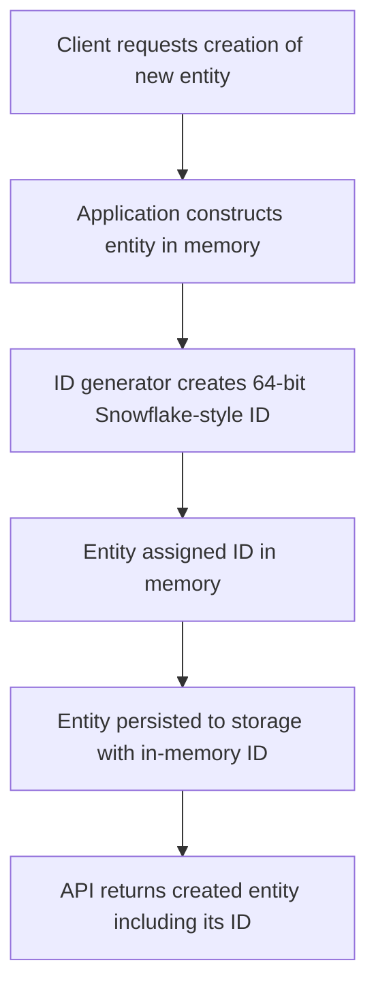

# Moving away from DB-enforced auto-increment primary keys

The Pepper-Soup initiative to move away from database-enforced auto-increment primary keys shifts identity generation from the persistence layer to the application layer. The motivation is to address long-standing issues with relying on DB-generated IDs that only become known after a transaction flush or commit. This approach follows the recommendation to adopt Snowflake-style 64-bit IDs, produced in memory at entity creation time, and used throughout the system for persistence and external interfaces.

### Motivation and scope

Auto-increment primary keys generated by the database require a flush/commit in order to obtain the identifier. This behavior complicates several common development patterns, including batching, caching, and testing. It also introduces additional persistence round-trips to obtain IDs and can expose predictable, sequential values via APIs, which may raise security and privacy concerns. The proposed direction replaces DB-generated IDs with application-generated identifiers to provide immediate availability of IDs, improve testability, and reduce reliance on transaction boundaries for identity assignment.

The reference specifies removal of auto-increment keys as part of the design. It also notes the architectural implication that IDs become available in memory without waiting for persistence, enabling more flexible batching, caching strategies, and test scenarios. A migration path is described as not required for the identity itself, given the IDs are generated by the application rather than by the database. However, implementing this approach requires an ID generator and safeguards around clock synchronization to maintain correctness across distributed instances.

> Specification Notes: Auto-increment key removal; 1 child

### Technical approach: Snowflake-style 64-bit IDs

The recommended model uses application-generated 64-bit identifiers composed of three conceptual parts: a timestamp, a machine/instance identifier, and a per-instance sequence value. The resulting IDs are globally unique across instances and are available immediately in memory when a new entity is created, without waiting for a database flush. The IDs are roughly time-ordered, which aids debugging and querying, and they mitigate the privacy and security concerns associated with exposing monotonically increasing, human-friendly integers.

Key characteristics include:
- Availability: IDs are produced at the moment of entity creation, prior to persistence.
- Global uniqueness: IDs remain unique across all instances of the application.
- Ordering: IDs are roughly ordered by time, supporting efficient sorting and querying.
- Human factors: IDs are compact 64-bit values but are not designed to be human-friendly like sequential integers.
- Migration: No database migration is required for the identity scheme, as IDs are generated by the application.

Pros:
- Immediate availability of IDs in memory without a flush.
- Global uniqueness across instances.
- Roughly time-ordered IDs aid debugging and querying.
- Reduced exposure of predictable, sequential IDs via APIs.
- No migration required for identity values.

Cons:
- Requires a generator implementation within the application and clock synchronization safeguards to verify correctness across distributed nodes.
- IDs are less human-friendly than plain sequential integers.

### Impacted areas and considerations

Because the change alters the origin of primary keys, several architectural and operational considerations arise:
- Persistence layer: The identity assignment mechanism moves from DB-generated keys to an application-based generator. This affects how entities are instantiated and how IDs are associated with persisted data.
- APIs and integrations: Identifiers become available during entity construction, which influences request handling, response payloads, and integration contracts that surface identifiers to clients or downstream systems.
- Testing and tooling: Tests can rely on in-memory IDs without requiring a commit or flush, simplifying unit tests and certain integration tests.
- Clock synchronization safeguards: To prevent ID collisions and verify monotonicity, the system must implement safeguards related to clock drift and, , clock reset handling across distributed instances.
- Migration considerations: The approach envisions no database schema migration for the identity mechanism itself, but teams should evaluate any downstream impacts on data access patterns, auditing, and external contracts.

### Architectural flow: how IDs are generated and used

This flow demonstrates the shift from a post-persist ID assignment to an in-memory, pre-persistence ID assignment. The ID is attached to the entity at creation time and carried through the persistence operation to the final stored state, verifying consistency between in-memory representation and stored data.

### Implementation considerations and guidance

- Generator implementation: The system must provide a reliable generator capable of producing 64-bit IDs with the required properties (global uniqueness, rough time ordering, immediate availability). The generator should be designed to operate correctly in multi-instance deployments.
- Clock safeguards: Implement safeguards to handle clock drift and verify that IDs remain unique and monotonic across instances. This typically involves combining a time component with a stable machine/instance identifier and a sequence counter.
- API exposure: verify that APIs and clients can rely on IDs being present at the time of entity creation and that ID values are consistently surfaced across all interactions with the system.
- Testing strategy: With IDs available immediately, testing scenarios that relied on post-persist ID retrieval can be simplified. Validate that IDs remain unique across created entities and that ordering properties hold under typical load.
- Migration plan: Although the reference notes that no migration is required for identities, coordinate with dependent services and integrations to verify that external contracts and data access patterns remain correct when IDs are generated in the application layer.

### Specification notes and verifications

- Auto-increment key removal is the primary change in this direction.
- The approach relies on a Snowflake-style 64-bit ID scheme consisting of a timestamp, a machine/instance identifier, and a per-instance sequence to guarantee global uniqueness.
- IDs are available immediately in memory, which reduces the need for flushes and related persistence round-trips.
- The IDs are roughly time-ordered, aiding debugging and queryability.
- Clock synchronization safeguards are required to verify correctness across distributed environments.
- There is no mandated database migration for the identity values themselves; migration concerns focus on downstream effects on APIs, services, and data access patterns.

### Summary for architects and engineers

This enhancement eliminates DB-enforced auto-increment primary keys in favor of application-generated Snowflake-style IDs. The primary benefits are immediate ID availability, global uniqueness across instances, and improved testability and operational flexibility. The main trade-offs involve implementing a reliable ID generator and clock synchronization safeguards, as well as managing the less human-friendly nature of 64-bit identifiers. The design remains migration-friendly, with no schema changes required solely for the ID mechanism.