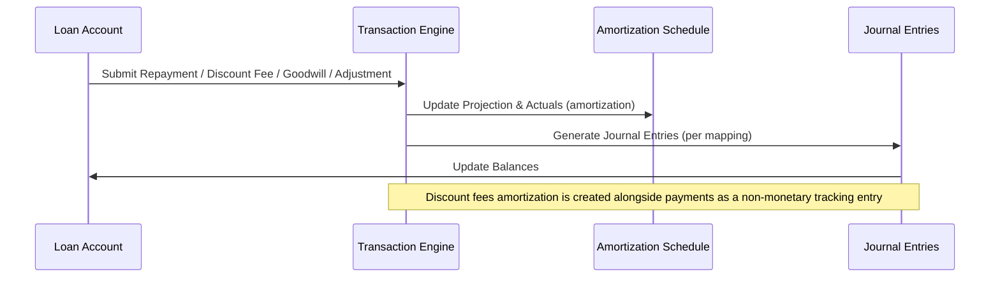

# EIR Calculation Phase 2 - Batch Job Foundation

This page documents the EIR-based calculation foundation introduced for of the Working Capital (WC) program. The Batch Job Foundation encapsulates the end-to-end lifecycle for amortization scheduling, income recognition, and dynamic recalculation driven by real cash flows. It operates within the new Working Capital loan product framework and interacts with the loan product configuration, loan account lifecycle, and transaction processing. The design emphasizes accurate EIR-based amortization, traceable accounting impact, and replayable backdated processing, while supporting two configuration strategies for loan payable economics.

### Component role and boundaries

The WC Batch Job Foundation is responsible for computing and maintaining the projected amortization profile for Working Capital loans. It integrates with the new WC loan product module, which allows configuration of WC loan products distinct from traditional term loans. When a WC loan account is created, the system derives and stores key amortization inputs at the loan account level, including period payment amount, total days, daily EIR, and annual EIR under the Revenue-based strategy. For fixed-payment or fixed-EIR strategies, the system persists the necessary inputs and recalculates outputs . The Foundation's guarantees include:

- Decoupled product module: WC loan products exist in a dedicated configuration space to avoid impacting existing term loan products.
- Loan account inheritance: Upon account creation, fields such as currency, settings, and term are inherited from the selected WC loan product.
- Schedule-driven accounting: Amortization-related activity is driven by the amortization schedule, which is updated as repayments and other events occur.
- Traceable events: The system emits and records events related to amortization, discount fees, and related transactions, enabling auditability and reporting.

### Amortization models and their inputs

The system supports two amortization calculation approaches for Working Capital loans:

- Flat Amortization (Low Priority)
 - Income is amortised in a straight-line manner over the loan tenure.
 - Fixed amortization per period; independent of actual repayments; minimal recalculation unless tenure changes.
 - This method is considered low priority and may have limited initial support.

- Declining Amortization (EIR-Based)
 - Income is amortised using the Effective Interest Rate (EIR) methodology, tying income recognition to time value of money and actual cash flows.
 - Amortization varies over time, aligned with repayments and payment timing.
 - This is the primary and preferred approach for implementation.
 - Amortization inputs and outputs are recalculated based on repayments, timing, and changes in outstanding balance, allowing dynamic adjustments to the projected schedule.

> Note: The system also documents a distinction between two LP configuration strategies that influence what values are stored at the loan account level, see the next subsection.

### LP configuration strategies (two approaches)

The WC product supports two primary configurations that determine how amortization inputs are stored and used:

1) Revenue-based configuration
 - The loan account stores: Period Payment Amount, Total Days, Daily EIR, Calc. Annual EIR.
 - The schedule reflects revenue-based recognition aligned with observed repayments and deferrals.

2) Fix payment amount configuration
 - The loan account stores: Period Payment Amount (provided), Total Days (calculated), Daily EIR (calculated), Calc. Annual EIR (calculated).
 - The system uses a fixed payment amount as input while computing timing and rate-derived values.

3) Fix EIR configuration
 - The loan account stores: Period Payment Amount (provided), Total Days (calculated), Daily EIR (calculated), Calc. Annual EIR (provided).
 - The period payment is set, while the system computes remaining inputs to reflect the fixed EIR at the loan level.

These strategies shape how the system pre-loads and updates amortization inputs, and they influence future recalculations as repayments occur.

### Projected Amortization Schedule: structure and fields

The system maintains a continuously updated projected amortization schedule for each WC loan. Each record captures the evolution of the loan's income recognition and cash flow matching over time. A representative structure includes the following fields:

 
Amortization Installment NumberN

 
Amortization Installment DateYYYY-MM-DD

 
Expected Payment AmountAmount

 
Discount FactorFactor

 
NPV ValueValue

 
BalanceBalance

 
Net Amortization AmountAmount

 
Actual Payment AmountAmount

 
Actual Amortization AmountAmount

 
Income ModificationValue

 
Deferred BalanceBalance

The above fields are designed to reflect a real-time view of projected cash flows and income recognition, rather than a fixed, static schedule. A calculation reference excerpt below illustrates how amortization interacts with a repayment event.

 
Calculation

 
<strong>Formula:</strong> Not disclosed directly in the specification; amortization follows the EIR-based approach and is updated on repayment events. The example below shows a concrete amortization amount observed in reference data when a payment occurs.

 
<strong>Substitution:</strong> On repayment of 50 currency units, the Discount Fee Amortization amount recorded is 9.61 (example from the calculation reference). This amount is reflected in the amortization-related accounting flow as described in the accounting entries section.

 
<strong>Result:</strong> 9.61 (Discount fee amortization amount for the example repayment).

### Transaction handling and accounting traces

The WC batch job foundation coordinates recalculation and posting through a set of interrelated transaction types. Key patterns drawn from the reference data include:

- Repayment transaction: A monetary transaction that reduces the outstanding balance and updates the amortization schedule. It triggers posting of associated accounting entries and, , a Discount Fees Amortization transaction (non-monetary) to reflect income recognition linked to the repayment.
- Discount fees amortization: A non-monetary system-generated transaction created alongside a payment when there is deferred income to amortize. It records the amortized portion of deferred income and links to the parent payment transaction. It has no direct impact on loan balances or GL accounts; it is primarily for tracking and reporting purposes and for coherence with the EIR-based schedule.
- Discount fee adjustment: When allowed, creates a linked adjustment transaction that reduces the loan's discount and recalculates the amortization schedule from the adjustment point forward, replaying recorded repayments as necessary. The adjustment triggers a business event for downstream processes and posts new accounting entries for the adjustment flow.
- Credit Balance Refund (CBR): Refund of excess funds when overpayments occur. It reduces the credit balance and may trigger journal entries consistent with the accounting rules for refunds.
- Goodwill Credit: A monetary adjustment to the loan balance similar in effect to a repayment, but used to address goodwill adjustments. It follows the same amortization and accounting patterns as repayments, including potential overpayments and subsequent CBR handling.
- Payout Refund: A specialized transaction type for recovering disbursed funds on WC loans, applicable to active loans, with backdating and reversal support, and COB amortization posting .

The batch job foundation verifies that all of these events interact coherently, maintaining integrity of the amortization schedule, the outstanding balance, and the deferred income balance. The process includes backdated processing and reprocessing semantics: backdated transactions trigger schedule replays, recalculation of amortization (including the EIR-based projection), and replay of subsequent transactions and their accounting entries to preserve consistency.

### Backdated processing, replays, and integrity guarantees

Backdated processing is supported for most transaction types, with the system reprocessing the loan balances and charge components as needed. When a backdated event occurs, the batch job foundation replays all subsequent transactions and their accounting entries to verify consistency with the revised cash-flow history. The integrity requirements emphasize:
- Each period’s opening balance must equal the previous period’s closing balance after re-calculation.
- Payment allocations must reconcile with the transaction amount and reflect the configured allocation priority.
- Remaining cash and outstanding dues must reconcile with updated amortization and schedule values.
- Journal entries must balance when debit and credit data are available in the accounting entries for each transaction type.
- Rounding and precision follows the documented conventions; the system uses measured values that reflect actual business rules and currency precision.

### Validation rules and constraints (highlights)

Across WC loan transactions, the batch job foundation adheres to these guards (as evidenced by the transaction guidance):
- Date validations enforce that transaction dates do not precede the loan disbursement date and respect backdating rules.
- Amount validations require monetary transactions to have positive amounts.
- Loan status constraints determine whether a transaction is permissible (e.g., Active, Charged-Off, Closed, depending on the transaction type).
- Specific constraints apply to discount fee adjustments (see Discount Fee Adjustment rules) and to CBR (credit balance refunds).
- The system verifies that any adjustments to amortization or deferrals preserve historical amortization entries while reprojecting future values.

### Journal entries and GL mappings (illustrative)

The WC accounting entries are described in the reference accounting mapping, showing how the WC transaction types map to GL accounts and how debits/credits are arranged. Representative mappings (illustrative) include:
- Discount fees (Dr) Loans Receivable Principal; (Cr) Deferred Interest / Deferred Income
- Disbursement (Dr) Loans Receivable Principal; (Cr) Suspense/clearing account
- Repayment (Dr) Suspense/clearing account; (Cr) Loans Receivable Principal; (Cr) related liability or receivable accounts for fees/penalties 
- Discount Fees Amortization (Dr) Deferred Interest; (Cr) Interest income
- Goodwill Credit and other adjustments follow similar patterns with standard allocations and future amortization recalculations

Note: The precise GL codes and the associated mapping parameters are defined at the WC loan product level and are exercised during journal entry generation during each transaction processing pass.

### Interaction with transactions: flow overview

A simplified sequence illustrating core interactions is shown below:

Backdated events follow a similar pattern but trigger a re-computation and replay of subsequent transactions and their accounting entries to restore consistency with the revised cash-flow history.

### Edge cases and invariants

Key invariants and edge-case handling described in the reference data include:
- The amortization schedule is continuously recalculated in response to repayments and other inflows; historical amortization entries remain intact while future portions are recomputed.
- Discount fee amortization is system-generated and non-monetary; it cannot be created or modified independently, and it is replayed in concert with payment processing and backdated recalculations.
- In scenarios involving overpayments, the system may trigger a Credit Balance Refund (CBR) transaction to adjust the credit balance, potentially changing loan status to OVERPAID and later to CLOSED_OBLIGATIONS_MET after refunds settle remaining obligations.
- Prepayment transactions fully payoff the loan on a specified date and reuse standard repayment accounting rules, with payoff amount calculated by the system and the loan closed .
- Reversals create linked reversal transactions and invalidate the associated financial impact and accounting entries; the system replays the amortization schedule as needed.

### Summary of benefits and why this matters

The EIR Calculation Batch Job Foundation provides a reliable, auditable, and flexible foundation for WC loans with EIR-based income recognition. By separating the WC product into its own module and enabling two LP configuration strategies, the system can accommodate different business models while preserving accuracy in amortization, deferral accounting, and reporting. The batch job foundation coordinates proactive schedule generation, dynamic recalculation, and backdated reprocessing to verify the loan’s projected income, deferred balances, and outstanding obligations stay aligned with actual cash flows. The integration with transaction processing and accounting verifies a traceable path from payment events to GL postings, including the amortization of discount fees and any adjustments or refunds that affect the loan’s balance and income recognition.

- Amortization models: Flat vs Declining (EIR-based), with Declining as the primary approach.
- Projected Amortization Schedule fields: Amortization Installment Number, Date, Expected Payment Amount, Discount Factor, NPV Value, Balance, Net Amortization Amount, Actual Payment Amount, Actual Amortization Amount, Income Modification, Deferred Balance.
- LP configuration strategies and their stored inputs at loan account level under Revenue-based, Fix payment amount, and Fix EIR configurations.
- Core transaction types and interactions: Repayment, Discount Fees Amortization, Discount Fee Adjustment, Credit Balance Refund (CBR), Goodwill Credit, Payout Refund, and Charge Adjustment.
- Backdated processing and reprocessing behavior: schedule recalculation and replay of subsequent transactions and accounting entries to preserve consistency.
- Accounting mappings and entries for WC loans, including Debit/Credit flows for Discount Fees, Disbursement, Payment, and Amortization-related adjustments.

If you need deeper, section-by-section cross-references to the exact data fields and tables (for example, exact GL codes for each WC transaction type), we can provide a targeted extraction aligned to the WC loan product configuration you are deploying.