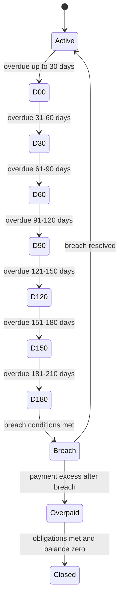

# EIR Calculation Phase 2 - Breach Management

of the EIR-based Working Capital (WC) calculation focuses on managing breach and delinquency events within the WC loan lifecycle and on recalculating the projected amortization schedule as actual cash flows occur. The Breach Management component sits at the intersection of the WC loan product configuration, the dynamic amortization engine (declining amortization via EIR), and the transaction processing framework. It guarantees that income recognition, deferred balance movement, and outstanding balances remain consistent with observed repayments, delays, and adjustments, while preserving strict accounting discipline and auditable traceability.

Key boundaries and responsibilities
- Module boundaries: the Breach Management features operate within the WC loan product scope and interact with the standard term-loan-like transaction processing, amortization scheduling, and GL accounting pathways. The design treats WC loans as a distinct product family with an EIR-based amortization model and a dedicated projected amortization schedule that can be recalculated as events unfold.
- Primary guarantees include: (1) daily accrual and amortization are anchored to an EIR-based methodology for the declining amortization path, (2) the projected amortization schedule remains consistent with the underlying cash flows, and (3) backdated events trigger schedule replays and reprocessing of dependent calculations and entries while preserving historical records.

This page documents verified behavior, invariants, and workflows observed for Breach Management within EIR Phase

2. Where the design references future or optional capabilities, those items are described as part of the verified behavior and known interaction points only when evidenced .

---

## Core concepts and Verifications

### Amortization model and day-count conventions
- Declining Amortization (EIR-Based) is the primary amortization approach for Working Capital loans. It distributes income recognition over time in a manner aligned with the time value of money, recalculating as repayments occur. A Flat Amortization option exists as a lower-priority alternative that straight-lines income across the loan tenure, but it is not the default in .
- Day-count conventions:
 - Net Present Value (NPV) calculations use a 360-day year as the standard day count.
 - Amortization schedules are generated and evaluated with a daily payment cadence in the current configuration (payment period = daily). The configuration also exposes a “Nth daily / weekly / monthly” choice for the overall payment cadence.
- The projected amortization schedule is the authoritative, dynamic representation of income recognition and deferred balance movement across the loan lifecycle. Each row records an installment number, a scheduled date, the expected payment, the discount factor, the NPV value, the opening balance, the net amortization amount, the actual payment, the actual amortization, income modifications, and the deferred balance.

Example structure (field names and purposes):

 
Amortization InstallmentNumber

 
Amortization DateDate

 
Expected Payment AmountAmount

 
Discount FactorFactor

 
NPV ValueValue

 
BalanceBalance

 
Net AmortizationAmount

 
Actual PaymentAmount

 
Actual AmortizationAmount

 
Income ModificationAmount

 
Deferred BalanceAmount

For reference, the 360-day NPV convention and daily EIR framing are consistently applied to the amortization calculations and the NPV value column in the projected schedule.

---

## Breach and delinquency management

Breach Management governs how delinquency progresses through defined buckets and how breach-related calculations affect amortization and income recognition.

- Delinquency buckets (example progression):
 - D00: 0–30 days past due
 - D30: 31–60 days past due
 - D60: 61–90 days past due
 - D90: 91–120 days past due
 - D120: 121–150 days past due
 - D150: 151–180 days past due
 - D180: 181–210 days past due
 The range and transition semantics are evidenced in the Delinquency examples, where a bucket history tracks the bucket assignments over time and the delinquency amount per bucket.
- Near Breach evaluation: a configurable near-breach period evaluation guides how soon a loan enters breach consideration. In the reference material, a near breach period evaluation is parameterized (including a near breach percentage such as 33.33%). The near breach logic informs when the formula-driven breach calculations should begin affecting the projected amortization and income movement.
- Breach periods and ranges: breach configuration includes a Breach Period Frequency and a Breach Period Frequency Term, which drive when breach calculations are evaluated and how the breach window is segmented. The breach range concept is demonstrated with ranges such as 90-day blocks spanning multiple start/end dates, to determine when breach-triggered actions should occur.

These rules interact with the projected amortization schedule so that future amortization and income recognition reflect the current delinquency and breach posture, while historical amortization remains unchanged.

---

## Calculation references and stored values

The WC calculation model stores core values at the loan account level to support breach management and amortization recalculation:
- Period Payment Amount: the per-period payment benchmark used in projections
- Total Days: the total duration defined for the loan’s amortization horizon
- Daily EIR: the daily effective interest rate used to accumulate income under the EIR-based method
- Calc Annual EIR: the annualized EIR derived from the daily rate and day-count conventions

During repayment events, the following values are updated and tracked per period:
- Payment amount (actual received)
- Actual Amortization (Income) based on the updated schedule
- Income Modification reflecting changes to deferred income and amortization as a result of repayments

The reconciled values form the backbone of the financial reporting and GL postings for breach-related adjustments.

---

## Transactions and processing model

The WC Breach Management framework relies on the same transaction model and processing lifecycle used for term loans, with some WC-specific extensions. Transactions are categorized into monetary and non-monetary types, with the following notable WC-focused items:
- Monetary transactions include: Disbursement, Repayment, Discount Fees, Credit Balance Refund (CBR), Goodwill Credit, Payout Refund, Charge, Charge Adjustment, and related WC-specific adjustments.
- Non-monetary transactions include: charge applications, charge waivers, and various reclassifications/reversals when applicable.

Each monetary transaction triggers journal entries (JEs) according to GL mappings defined at the loan product level. The following high-level rules are evidenced:
- Disbursement and Repayment transactions trigger standard accounting entries in the accounting section.
- Discount Fees are amortized over the loan tenure via EIR-based mechanics and do not generate standalone accounting entries on each amortization event; instead, amortization is a tracking mechanism for deferred income.
- Discount Fees Adjustments create a linked adjustment transaction, update the loan’s discount balance, regenerate the amortization schedule, replay historical repayments, and post associated accounting entries for the adjustment.
- Payout Refund is a WC-specific transaction type that reduces principal and related balances, posts the amortization at COB, and can result in overpayment if the refund exceeds the outstanding balance.
- Credit Balance Refund (CBR) refunds excess payments by reducing the credit balance on the loan; CBR also triggers journal entries and backdated reprocessing as needed.

Backdating and reprocessing behavior is a core guarantee: when a backdated monetary transaction is processed, the system replays subsequent transactions and recalculates amortization and balances to preserve integrity of historical data and to maintain consistency with the updated cash flows.

Reversals are supported for monetary transactions. A reversal creates a linked reversal transaction that reverses the financial impact and the associated accounting entries, and may trigger a reprocessing of the amortization schedule.

---

## Pivotal accounting and COB behavior

- Journal entries are generated for monetary transactions according to configured GL mappings at the WC loan product level. The WC amortization tracker itself does not generate direct accounting entries; instead, the accounting impact is realized through payments, adjustments, and other transactional events.
- Discount fee amortization is a system-generated, non-monetary, tracking-only transaction. It records the progressive recognition of deferred income without affecting the loan balance or GL accounts directly. It is created automatically as part of payment processing flows (or in conjunction with certain WC adjustments) and is reprocessed on backdated payments.
- Discount Fee Adjustment triggers a complete re-valuation and restatement of the amortization plan, including re-application of all historical repayments and recalculation of EIR-driven projected payments, NPVs, and the deferred balance. It also raises a dedicated business event for the adjustment.
- The Payout Refund transaction requires recalculation and posting of the amortization at COB, and it permits overpayments if the refund exceeds the outstanding principal balance, changing the loan’s status to Overpaid as needed.
- The system supports backdated processing for key WC transactions, including reimbursement-related events (CBR, refunds) and recurring amortization adjustments. Reprocessing verifies the internal ledger (GL) reflects the corrected balances and income recognition histories.

---

## Data model and lifecycle integration

### Loan Product and account-level configuration
- WC loan products are configured in a dedicated module, with a separate product configuration that allows creation via UI and API. Key fields include currency, amortization type (EIR or Flat), NPV day count, and payment allocation strategy (fees, penalties, principal). When WC loans are created, the fields required include currency and amortization settings, with the ability to specify the period payment rate and related factors.
- The lifecycle for WC loans mirrors the term loan lifecycle in terms of disbursement, approval, and disbursement steps, but with WC-specific constraints and configurations. After a loan is created, the system copies relevant values (currency, settings, term) from the product into the loan account and then proceeds through standard lifecycle stages: submission, approval, disbursement, and ongoing repayment processing.

### Transaction model and GL integration
- All WC transactions comply with the same general transaction framework used for term loans, including validation rules, backdating support, and journal-entry generation. The WC-specific set includes: Disbursement, Repayment (and its variants), Discount Fees, Discount Fee Adjustments, CBR, Payout Refund, Goodwill Credit, Charge and Charge Adjustments, and associated amortization events.
- The allocation logic for repayments is a priority-based waterfall: penalties, fees, then principal, with the priority and allocation controlled at the transaction level and, where supported, at the loan product level.

---

## Validation rules and invariants

Validated inputs and invariants reflect in the breach management and WC transaction design:
- Transaction date validations verify that monetary transactions cannot precede the loan disbursement date and must comply with backdating rules. Non-monetary adjustments follow analogous constraints.
- Amount validations require monetary transaction amounts to be greater than zero.
- Loan status validations determine whether a given transaction is permissible, with states including Active, Charged-Off, Closed, and Overpaid across WC scenarios.
- Backdated transactions trigger reprocessing of the amortization schedule and the entire sequence of subsequent transactions, with all dependent accounting entries replayed .
- Reversals are allowed for monetary transactions, provided there are no dependency conflicts and the loan is in a valid state. A reversal creates a linked reversal transaction and reverses the financial impact and accounting entries.

- For the WC-specific breach workflow, breach calculations are driven by the breach period frequency and the near-breach threshold configuration. The near-breach percentage observed in examples is 33.33%, illustrating how the near-breach guard might be configured in practice.

---

## Versioned workflows and example flows (high-level)

1) Loan creation and setup
- Create a WC loan product with EIR-based amortization and NPV day count 360.
- Create a WC loan account using the product, copying currency, terms, and settings.
- Approve and disburse the loan, applying any disbursement charges and discount fees as configured.
- Generate the initial projected amortization schedule based on the configured terms and the initial cash flows.

2) Repayment and breach handling
- A repayment transaction is submitted and allocated to penalties/fees/principal according to the configured allocation policy.
- The system recalculates the amortization for future periods using the updated cash flow profile and re-estimates the EIR-driven schedule.
- The Discount Fees Amortization tracking transaction is generated in conjunction with the repayment to reflect the portion of deferred income recognized on the payment date, with no direct impact on the loan balance.
- If a breach is detected (per near-breach and breach thresholds), breach-related calculations update the projected amortization and income recognition , while preserving historical amortization data.

3) Backdating and reversals
- Backdated repayments or adjustments trigger reprocessing from the affected date, replaying subsequent transactions and recalculating amortization, deferred balances, and NPVs.
- Reversals create a linked reversal transaction and cause recomputation of dependent balances and amortization, potentially triggering additional reprocessing.

4) Special WC flows
- Discount Fee Adjustments create a linked adjustment mechanism that reduces the discount balance and restates the amortization plan, including restoring of historical repayments and recalculating future amortization. It raises a business event for the adjustment and posts new accounting entries for the adjustment.
- Credit Balance Refunds (CBR) reduce the loan’s credit balance or refund excess cash to the customer, with backdated processing supported as needed and the loan balance updated to reflect the refund.
- Payout Refund addresses fraud-related refunds by recovering disbursed funds and adjusting the principal, with COB posting for the amortization and potential overpayments if the refund exceeds outstanding balance.

---

## APIs, integration points, and observable behaviors

- WC loan products expose configuration via UI and API pathways, paralleling the term loan product configuration in essence but decoupled to support WC-specific semantics (EIR-based amortization and breach management).
- Transaction APIs generally mirror term loan equivalents, with additional WC-specific transaction types and allocation rules. The lifecycle events (disbursement, repayment, adjustments, and refunds) drive the projected amortization schedule and the associated accounting entries.
- The system maintains a strict, auditable linkage between events and their effects on balances, amortization, deferred income, and NPVs, including the ability to replay events and reprocess schedules when backdated transactions occur.

---

## Visual overview: Breach progression (Mermaid)

The diagram illustrates the typical progression through delinquency buckets, with a breach condition potentially triggering breach-specific treatment and subsequent closing or reversion paths. It also shows how an overpayment can alter the state trajectory, including possibilities that lead to an Overpaid or Closed state depending on subsequent repayments and refunds.

---

## Reference calculations and schedules (conceptual)

The reference calculations demonstrate how the WC approach derives values used for breach management and amortization—particularly the interaction between period definitions, NPVs, and the projected amortization schedule. The calculations are anchored by these concepts:
- Period definitions and time horizons drive the number of amortization installments and the calculation of NPV values.
- The Net Present Value at each installment is computed using the 360-day year convention and the daily EIR; the NPV values roll into the overall balance and deferred income statements.
- The per-period expected payment and the actual payment (when provided) feed into the recalculation of the amortization and income modification fields, updating the projected schedule in real time as cash flows occur.

The projected amortization schedule records the following columns per installment: Amortization Installment Number, Amortization Installment Date, Expected Payment Amount, Discount Factor, NPV Value, Balance, Net Amortization Amount, Actual Payment Amount, Actual Amortization Amount, Income Modification, Deferred Balance. This structure supports continuous recalculation in response to repayments, delays, and adjustments, so that income recognition remains aligned with cash flows under the EIR methodology.

---

## Important notes for implementers

- The Breach Management workflow integrates with the WC transaction framework and the projection/recalculation engine. Any future enhancements that introduce new WC-specific transaction types or alternative allocation strategies should preserve the existing accounting and reprocessing guarantees.
- When backdating is involved, all subsequent transactions must be replayed, and the amortization schedule must reflect both the historical and updated future paths. Historical amortization remains immutable to preserve traceability.
- Overpayments can occur through repayments or refunds; the system must end up in an Overpaid state when the outstanding balance is fully or partially satisfied with excess funds, and a CBR may be used to settle the excess funds.
- The Near Breach threshold and breach period configurations are configurable per loan product and affect when breach computations are applied to adjust projected amortization and income recognition.
- All monetary transactions should trigger journal entries in accordance with the GL mappings defined for the WC loan product. Discount fee amortization is a non-monetary tracking construct and does not itself generate accounting entries; a separate Discount Fee Adjustment or repayment event may generate the associated accounting impact.

---

If you need deeper walkthroughs of specific flows (for example, a step-by-step path for a backdated repayment or the exact sequence of events when a Discount Fee Adjustment is posted), we can provide a focused scenario narrative aligned to verified behavior and supported by the project’s transaction and amortization rules. The material above reflects the verified operational model for EIR Calculation – Breach Management and its integration with the broader Working Capital product behavior.