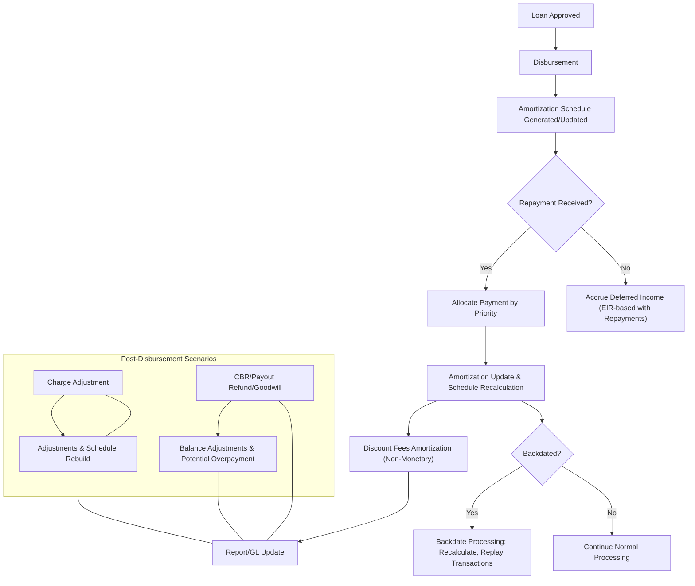

# EIR Calculation Phase 2 - Transaction Types

This page documents the transaction type landscape for of the EIR (Effective Interest Rate) calculation in Pepper-Soup’s Working Capital loan product. The Working Capital product is designed as a separate module that introduces EIR-based income recognition, accounting mappings, and a flexible transaction model aligned with PayPal’s Working Capital financing concepts. The implementation guarantees referenced here reflect verified behavior: the product operates as a zero-interest facility with a single disbursement, no accrual-type transactions, and a lifecycle that supports repayments, reversals, and a range of charge-related activities while verifying accurate amortization and reporting through the EIR methodology.

### Component role and boundaries

- The Working Capital product is implemented as a dedicated module that can be configured and operated independently of traditional term loan products. It inherits core loan lifecycle concepts but applies EIR-based amortization and special handling for charges, fees, and overpayments.
- Amortization, income recognition, and deferral movements are driven by repayments and related adjustments, with the primary accounting implications described at a high level and mapped to the loan product’s configuration. The feature emphasizes accurate recognition of income over the loan tenure, dynamic recomputation of amortization schedules on cash flows, and reprocessing when backdated actions occur.

### Execution lifecycle and state considerations

Transactions operate within a loan lifecycle that includes creation, approval, disbursement, and post-disbursement activity. The model supports delinquency handling, charge-offs, and potential recovery activities, with transitions governed by verified rules:

- Disbursement activates the loan and () generates or updates the amortization schedule and the projected income recognition plan.
- The system supports backdated processing for many transaction types, triggering schedule reprocessing and recalculation of amortization and related deferred balances.
- Special states observed in the reference scenarios include Active, Active Delinquent, Charged-Off, OVERPAID, and adjustments that can move a loan into a write-off-recovery lifecycle. Reversal transactions create linked counterparts that revert both the monetary impact and the associated accounting entries, and reprocessing replays subsequent transactions as needed.

A high-level flow of typical activity is as follows: creation/approval sets up the loan product fields and period structure; disbursement releases funds and initializes the amortization plan; repayments (and other monetary actions) update the outstanding balance and amortization; non-monetary adjustments (charges, waivers) alter the allocation and the deferred income position; backdated events trigger schedule replays; and reversals restore previous states when permitted by the loan status.

> Note: Detailed state names and triggers are defined in the verified reference material for the Working Capital product; this page presents them in a consolidated, publication-ready form without exposing private references.

### Amortization calculation approaches

The Working Capital design supports two amortization calculation types, with distinct characteristics:

- Declining Amortization (EIR-Based): This is the primary and preferred method. Income recognition follows an Effective Interest Rate approach, with amortization amounts varying over time in accordance with the cash flows and the evolving outstanding balance. The approach ties amortization to repayments and timing, providing alignment between income recognition and actual cash flows.
- Flat Amortization (Straight-Line): A secondary approach, categorized as low-priority in the reference material. Income is amortized in equal installments over the loan tenure, independent of actual repayment patterns. This method yields a fixed amortization amount per period and requires less recalculation.

Two configurations are described for how values are stored and computed at the loan account level, depending on the chosen LP configuration strategy (Revenue-based, Fixed payment amount, or fixed EIR settings). In all cases, the system maintains core outcome concepts such as Period Payment Amount, Total Days, Daily EIR, and Calc. Annual EIR, and ties these values to the amortization and income recognition process.

### Transaction types (monetary and non-monetary)

The reference data distinguishes two broad classes of transaction types for Working Capital contracts: monetary transactions that alter balances and accounting, and non-monetary transactions that capture the application and adjustments of charges and other controls. The following lists summarize -based set of transaction types observed in .

- Monetary Transactions
 - Disbursement: Single disbursement on an approved loan account. Disbursement activates the loan, creates/updates the amortization schedule, books principal outstanding, applies any disbursement-time charges, and triggers standard accounting entries. Reversal is supported via a linked reversal that undoes the monetary impact, principal outstanding, and associated accounting entries, and reverts the loan to the approved state.
 - Repayment: A payment received on an active loan account. Repayment reduces the outstanding balance, updates the amortization schedule, and triggers an amortization (discount) entry that recognizes the portion of deferred income related to the repayment. Repayments may be regular, partial, or excess (overpayments). Backdated repayments cause schedule reprocessing and replay of subsequent transactions and accounting entries. Reversals create a linked reversal transaction that reverses allocations and the accounting impact, followed by schedule reprocessing.
 - Discount Fees: An upfront fee that creates deferred income and affects the EIR. It is a monetary transaction active at disbursement or after, but with an effective date tied to the disbursement. On repayment, the amortization of the deferred income is recognized via the amortization schedule. Accounting entries are created when the discount fee is applied and again during amortization triggered by repayments.
 - Discount Fees Amortization: A system-generated, non-monetary transaction. It is created in tandem with payment processing to reflect the amortization of deferred income. It does not alter loan balances or GL accounts directly; it provides a traceable amortization record for reporting and audit purposes. Backdated payments trigger recalculation and re-creation of amortization entries and reconciliation with the schedule.
 - Goodwill Credit: A monetary adjustment applied to the borrower, treated similarly to a repayment for the purpose of outstanding balance reduction and amortization schedule adjustment. It supports the same allocations and accounting behavior as a repayment, including backdated processing and reversal pathways.
 - Payout Refund: A specialized monetary transaction for Working Capital loans used to recover disbursed funds (e.g., in fraud scenarios). It reduces the outstanding principal and related balances in accordance with a configurable allocation rule, triggers a COB amortization entry for the discount fee, and may result in overpayment if the refund exceeds the outstanding obligation. The loan may move to an OVERPAID state when applicable. Backdating and reversal are supported.
 - Credit Balance Refund (CBR): A monetary transaction that refunds excess funds when a loan account is overpaid. It reduces the credit balance and updates loan balances . CBR supports backdating and reversal via a linked reversal transaction. If a repayment creates an overpayment, the status may move to OVERPAID, and after a CBR that clears the overpayment, the loan can transition toward CLOSED_OBLIGATIONS_MET if all obligations are met.
 - Recovery Payment: A monetary transaction associated with post write-off activity. Where relevant, repayments after a write-off are treated as recovery income and follow applicable write-off or recovery accounting rules.
 - Charge Adjustment: A monetary transaction used to adjust charges that have previously been paid. It can target penalties, fees, or principal portions depending on the configured allocation priority. It reopens the amortization plan, replays all repayments, and triggers associated accounting entries. A linked adjustment transaction is created, and a business event may be emitted.
 - Prepayment: A payoff-type transaction that fully settles an active loan on a specified payoff date. The system computes the payoff amount automatically and disallows user-entered allocations or adjustments. Prepayment processing reduces outstanding balances and follows the standard repayment accounting rules, with backdated processing allowed.

- Non-Monetary Transactions
 - Charge Application: System-generated record representing the application of a charge to the loan account. It increases charge receivable and charge income accounts according to configuration, and the charge is allocated according to the selected allocation priority.
 - Charge Waiver: Non-monetary record indicating a waiver of a previously charged amount, typically handling adjustments in the charge accounting flow.
 - Write-Off / Charge-Off: Non-monetary controls used in conjunction with the write-off process when a loan is deemed uncollectible. The reference details describe the associated accounting and post-write-off dynamics.
 - Adjustments / Reversals: Non-monetary adjustments that accompany reversals and other corrective actions in the loan lifecycle.

> The above list reflects the transaction types evidenced in reference materials. Each monetary type carries explicit validation rules and processing behavior, and each non-monetary type captures a control or state transition relevant to the lifecycle.

### Transaction attributes (typical fields)

Each transaction in the Working Capital workflow carries a consistent set of attributes, aligned with the term-loan style transaction model and extended for WC specifics. The validated references describe the following common attributes:

- Transaction ID (system-generated) and External ID (integration-friendly identifier)
- Transaction Type and Transaction Date (business date)
- Created Date / System Date
- Amount and Currency
- Principal Component, Fee Component, Penalty Component
- Outstanding Balance (post-transaction)
- Payment Reference / Mode
- Reversal Flag and Linked Transaction ID (for reversals)
- Notes / Remarks

These attributes allows unified reporting, auditing, and cross-transaction reconciliation while supporting backdating, reprocessing, and linked reversals.

### Processing rules, validations, and backdating

Processing of WC transactions adheres to strictly evidenced guards and behaviors:

- Date validations: a transaction date must respect business date rules and cannot precede the loan disbursement date. Backdating is allowed for many transaction types where the product policy permits.
- Amount validations: monetary transactions require an amount greater than zero.
- Status validations: transactions are allowed only when the loan is in valid states such as Active, Charged-Off (with restrictions), or specific recovery scenarios for write-offs.
- Allocation priority: repayment allocations follow a configurable priority; defaults exist and may be defined per loan product.
- Backdated processing: when supported, backdated actions trigger loan schedule reprocessing and recalculation of amortization (including discount amortization) and balances, with replay of subsequent transactions and their accounting entries.
- Reversals: monetary transactions support reversals via a linked reversal transaction, reversing the financial impact and associated accounting entries, subject to status and dependency constraints.
- Accounting integration: each transaction type maps to journal entries per loan product configuration. Transactions trigger the generation of journal entries as specified by the product’s accounting mappings.

### Projected Amortization Schedule (WC loans)

A core objective of is to automatically generate and maintain a projected amortization schedule for Working Capital loans across the full lifecycle. The schedule records per-period values that inform income recognition and deferred balance movements. Each record in the projected amortization schedule includes the following fields:

1. Amortization Installment Number
2. Amortization Installment Date
3. Expected Payment Amount
4. Discount Factor
5. Net Present Value (NPV) Value
6. Balance
7. Net Amortization Amount
8. Actual Payment Amount
9. Actual Amortization Amount
10. Income Modification
11. Deferred Balance

The schedule is generated automatically at loan creation, updated at approval and disbursement, and continuously recalculated in response to repayments and other relevant transactions. Backdated actions trigger reprocessing of the schedule to verify consistency with the historical cash flow history.

### Calculation principles and precision

The EIR-based approach ties income recognition to actual cash flows, with amortization driven by repayments and changes in the outstanding balance. When a repayment occurs, the system determines the amortized portion of income to recognize and updates both the schedule and deferred income balance. The amortization calculation relies on the chosen amortization type (EIR-based for declining amortization or flat-line as a secondary approach) and uses the loan’s remaining balance, deferred income, and repayment projections as inputs. In all cases, the system verifies that the opening balance of each period equals the prior period’s closing balance and that all allocations reconcile with the underlying transaction amounts.

### Accounting implications and GL stewardship

- The Product configuration defines how journal entries are created for each transaction type. Journal entries balance when accounting data is available, and allocations for principal, fees, and penalties are tracked according to the configured rules.
- Discount fees amortization does not alter the loan balance directly; instead, it provides a tracing mechanism for income recognition tied to repayments. When a repayment occurs, the amortization portion of the deferred income is recognized as income in the payer’s books, and a separate amortization record is created for reporting purposes.
- Payout refunds, CBRs, charge adjustments, and goodwill adjustments all surface through journal entries in accordance with the loan product’s accounting mappings; the transactions themselves drive changes to principal and related balances and trigger amortization recalculations where standard.

### Special scenarios and edge cases

- Overpayments and CBR: If a repayment results in an overpayment, the system may create a credit balance on the loan and record a Credit Balance Refund (CBR) transaction to refund the excess. The loan status may transition to OVERPAID, and subsequent CBR processing can return the loan toward a closed obligation state when the overpayment is cleared.
- Charge-offs and recoveries: A write-off can be followed by recovery payments, which are treated according to charge-off and recovery accounting rules, with amortization and schedule recalculation .
- Backdated actions: The system supports backdated processing for many transaction types, with schedule reprocessing and a replay of subsequent transactions and accounting entries to preserve consistency with the historical cash flows.
- Reversals: Reversal processing creates a linked reversal transaction and replays the affected accounting entries and amortization effects, preserving auditability.

### Mermaid diagram: high-level transaction lifecycle

Mermaid (flowchart) illustrating a simplified WC EIR transaction lifecycle. This diagram shows the core sequence from disbursement through repayment, with possible backdating and reversal paths. It is intentionally high level to avoid internal identifiers while clearly showing the flow and decision points.

This diagram encapsulates the verified flow: after disbursement, amortization scheduling reacts to repayments; backdated events trigger reprocessing; adjustments and refunds affect balances and future amortization. It serves as a conceptual guide for integration and testing without exposing internal system paths.

### Summary of verified behaviors

- The Working Capital product operates as a separate configuration module for WC loans, enabling EIR-based income recognition and flexible charge handling within .
- The facility is zero-interest and uses a single disbursement model with no accrual-type transactions required.
- Amortization is primarily EIR-based (declining) but a flat amortization option exists as a lower-priority alternative.
- A broad set of monetary and non-monetary transaction types is supported to model disbursement, repayment, charges, adjustments, and refunds, with explicit backdating, reversal, and scheduling behaviors.
- The projected amortization schedule is central to reporting and reconciliation, containing fields that track expected and actual payments, discount factors, NPVs, and deferred balances.
- Journal entries are generated per transaction type per loan product accounting mappings, with discount amortization treated as an informational (non-balancing) mechanism in some contexts.
- Reprocessing, backdating, and reversal flows are designed to preserve consistency with historical cash flows and auditability.

If you need deeper drill-downs into a specific transaction type, its validation rules, or its exact accounting mappings, refer to the corroborated references that describe the per-transaction behavior and the product’s accounting configuration at the loan product level.