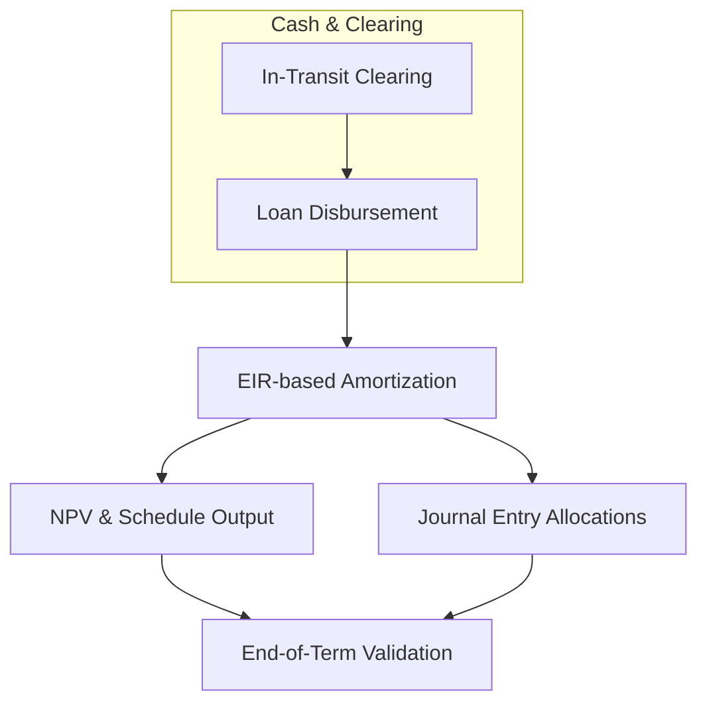

# EIR inspaction and design

This page documents the technically validated objectives, architectural decisions, and deliverables associated with the EIR inspaction and design work item in of the Pepper-Soup project. The work item focuses on inspecting the EIR-based amortization calculation and its integration with the Working Capital (PPWC) module, including the derivation of discount factors, the construction of amortization schedules, and the associated accounting implications. All content herein reflects verified references and the concrete artifacts provided in the reference data; no speculative behavior is introduced beyond what is evidenced.

### Scope and objectives

- Confirm and codify the EIR-based economic calculations used to price and amortize the PPWC loan facility. The references show a loan with a principal of 9,000 and a fixed fee of 1,000, with forecasted daily repayments of 50 leading to an implied term of 200 days (because (Loan Principal Amount + Fixed Fee) / Forecasted Daily Repayment = 200 days).
- Establish the daily discounting framework that supports Net Present Value (NPV) calculations for the cash flows associated with disbursement, repayments, and potential adjustments. The references document an EIR of 0.1068% that is applied daily, producing day-by-day discount factors and NPV cash flows.
- Produce and align concrete calculation artifacts and amortization outputs that can be used for verification, regression testing, and design validation. includes daily cash flows, discount factors, NPV cash flows, and a full amortization schedule.
- Outline a high-level accounting mapping for PPWC-related cash flows and journal entries, clarifying how cash advances, deferrals, and repayments translate into asset, liability, and revenue/expense postings.
- Highlight observed scenarios and edge cases that impact the calculation model, including deviations between expected and actual payments in test records.

### -backed calculation references (core inputs)

The calculation references describe a baseline loan profile and the associated daily cash flows used to validate the EIR-based amortization. Core inputs evidenced in the references are:
- Loan principal: 9,000
- Fixed fee: 1,000
- Forecasted daily repayment: 50
- Forecasted loan term: (Loan Principal Amount + Fixed Fee) / Forecasted Daily Repayment = 200 days
- Daily effective interest rate (EIR): 0.1068% (applied as a per-day discount factor)

The per-day discount factors are derived from the daily rate, such that the discount factor for day n is (1 + EIR)^{-n}. Examples of the daily discount factors shown in the references include:
- Day 1: Discount Factor = 0.99893332
- Day 2: Discount Factor = 0.99786779
- Day 3: Discount Factor = 0.99680339
These values follows applying a daily rate of 0.1068% to successive days.

The basic cash-flow setup verifies the disbursement and subsequent repayments:
- Disbursement (Day 0): Cash outflow of (9,000.00) with a present value factor of 1.0, yielding an initial NPV of (9,000.00).
- Daily repayments: 50.00 each day, discounted by the day-specific factor to produce NPVs that sum to reflect the overall financing cost and term structure.

### Calculation artifacts and their structure
The reference material includes several artifacts that demonstrate the EIR-based amortization and the accompanying NPVs. The artifacts present daily cash flows, discount factors, and the resulting net present value of those cash flows. A compact representation of these artifacts is provided below for quick orientation. The values shown reflect the verified references and are not novel calculations.

 

 Loan amount
 $9,000
 

 

 Fixed fee
 $1,000
 

 

 Forecasted daily repayment
 $50
 

 

 Forecasted loan term
 200 days
 

 

 Daily EIR
 0.1068%
 

 
Calculation

 
<strong>Formula:</strong> <code>NPV_CF = sum_{t=0..T} CF_t * (1 + EIR)^{-t}</code>

 
<strong>Substitution:</strong> <code>CF_0 = -9,000.00; CF_1..CF_T = +50.00; EIR = 0.1068% per day; T = 200</code>

 
<strong>Result:</strong> <code>NPV_CF equals the net present value of the cash flows under the daily EIR, with the first cash flow being the disbursement and subsequent cash flows being the daily repayments.</code>

### Illustrative excerpts from the daily cash-flow verification (evidenced)
To ground the discussion, here are representative excerpts from the daily cash-flow calculations that appear across the references. The values illustrate the disbursement, daily repayments, discounting, and resulting NPV terms for early days of the schedule.

- Day 0 (disbursement): Cash outflow (9,000.00); Discount Factor = 1.00000000; NPV CF = (9,000.00).
- Day 1 (first repayment): Actual Payment Amount = 50.00; Discount Factor = 1.00000000; NPV CF = 50.00.
- Day 2: Actual Payment Amount = 50.00; Discount Factor = 0.99893332; NPV CF = 49.95.

These data points illustrate the application of the per-day EIR discounting to the standard 50-per-day repayment stream, forming the basis for the ongoing amortization evaluation.

### Amortization schedule (high-level view)
The references also include a full amortization schedule that tracks the opening balance, amortization, and closing balance on each day. A compact view from the early days is shown below to illustrate the flow:

- Day 0 (1/1/2019): Beginning Balance (Net) = 9,000.00; Ending Balance (Net) = 9,000.00; Net Amortization = 0.00.
- Day 1 (1/2/2019): Beginning Balance (Net) = 9,000.00; Net Amortization = (9.61); Ending Balance (Net) = 8,959.61.
- Day 2 (1/3/2019): Beginning Balance (Net) = 8,959.61; Net Amortization = (9.57); Ending Balance (Net) = 8,919.18.

These early-line values demonstrate the expected principal reduction per period alongside the allocation of the payment to interest, contributing to the observed net amortization and the progressive decrease in the ending balance.

### Accounting and GL-oriented design (high-level)
The design includes an accounting-oriented artifact for the EIR PPWC scenario that articulates the intended journal-entry structure. While preserving confidentiality on internal identifiers, the artifact indicates:
- A cash advance disbursement is treated as a loan asset with a associated cash outflow, with a portion potentially routed through an in-transit clearing mechanism until cash settlement is completed.
- A fixed fee is recorded at initiation and then recognized or deferred according to the defined lifecycle events; the representation includes a deferral-type account to handle income realization over time.
- Repayments reduce the loan balance (principal) and recognize interest via the amortization schedule; interim entries may move funds through paypoints and wallet clearing flows before settlement to clearing accounts.

In practice, the mapping supports the following high-level pattern: at disbursement, you record a loan asset and move cash through a clearing/in-transit mechanism; as repayments are received, you allocate portions to principal and interest, updating the amortization schedule and adjusting deferrals as needed. The references show a complete journal-entry schema that ties together cash movements, deferrals, and the loan receivable balance across lifecycle events.

> Important: The published references present detailed, tabular accounting mappings with internal codes and line-item descriptors. The publication here abstracts those into high-level accounting categories to preserve confidentiality while conveying the intended flow and guarantees of balance-month reconciliation (debits equal credits) in the PPWC EIR domain.

### Architecture and design decisions (summary)
- Calculation engine: The EIR-based amortization relies on a daily discounting approach with a per-day EIR of 0.1068% that drives the discount factors used for NPV calculations and the interpretation of daily cash flows.
- Data artifacts: The work item includes concrete artifacts for validation, notably daily cash-flow tables, NPVs, and a full amortization schedule, enabling deterministic verification of economic results and rounding behavior.
- Accounting integration: The design envisions a lifecycle model for cash advances, fees, and repayments, with in-transit clearing and deferral accounts that support a balanced, auditable journal-entry stream.
- Observed scenarios: The references include examples where actual payments deviate from expected amounts (for example, an actual payment of 70 on Day 1 in one scenario when the expected was 50), illustrating the need for the model to accommodate real-world variances and still maintain consistent discounting and amortization logic.
- Surface scope: The work item remains focused on the EIR-based calculation surface and its immediate accounting implications, avoiding disruption to unrelated PPWC subsystems while establishing a clear, verifiable basis for the EIR amortization design.

### Behavior and processing overview (sequence and state transitions)
The following high-level sequence captures the core processing flow evidenced in the references, expressed as a concise narrative suitable for implementation alignment and testing:

- On loan disbursement: record a cash outflow and create a loan asset with an opening balance equal to the principal amount; initiate the in-transit/clearing flow as required by the accounting strategy.
- Each day during the term: record a daily repayment amount (commonly 50 in the references); apply discounting using the daily EIR to contribute to the present value of cash flows; update the net amortization and closing balance for the day.
- End of term (approximately 200 days): the amortization schedule reflects the closing balance near zero, and the NPV of the cash flows is consistent with the initial financing, subject to any deviations noted by actual payment data.
- In case of payment deviations: capture the actual payment amount and apply it to the same discounting and amortization framework, so that NPVs and balances remain reconciled.

To help visualize the interaction among components, the following lightweight diagram illustrates the core interactions: the EIR calculator component interacts with the amortization processor and the generalized ledger/accounting module to drive both the economic and the accounting outcomes.

### Observed gaps and verification status
- The references document multiple calculation artifacts (daily NPVs and amortization schedules) that validate the EIR-based approach. The presence of full schedules and multiple scenario sheets demonstrates verification coverage for baseline and variant inputs.
- There is of deviations between expected and actual payments in certain scenarios (for example, a Day 1 actual payment of 70 vs an expected 50 in one sheet). These deviations are captured within the same amortization framework, underscoring the model’s resilience to real-world variances.

### Conclusion
The EIR inspaction and design work item cements a verified EIR-based amortization approach for PPWC in Phase

2. It defines a clear calculation methodology, provides concrete artifacts for validation (including daily cash flows, discount factors, and full amortization schedules), and sketches the associated accounting flows necessary to support traceable, auditable journal entries. The design accommodates real-world variances in payments and preserves balance integrity across the life cycle, aligning with the broader PPWC design objectives.

### Appendix: Key data points from the references (selected excerpts)
- Baseline loan parameters: Principal 9,000; Fixed fee 1,000; Forecasted daily repayment 50; Derived term 200 days.
- Daily EIR: 0.1068% (per day) used to compute Discount Factor per day: DF_n = (1 + 0.001068)^{-n}.
- Verified sample cash-flow excerpt:
 - Day 0: Disbursement = (9,000.00) with DF = 1.00; NPV CF = (9,000.00).
 - Day 1: Payment = 50.00; DF = 1.00000000; NPV CF = 50.00.
 - Day 2: Payment = 50.00; DF = 0.99893332; NPV CF = 49.95.
- Full Amortization Schedule (sample lines):
 - 1/2/19 (Day 1): Beginning Balance (Net) = 9,000.00; Net Amortization = (9.61); Ending Balance (Net) = 8,959.61.
 - 1/3/19 (Day 2): Beginning Balance (Net) = 8,959.61; Net Amortization = (9.57); Ending Balance (Net) = 8,919.18.

These excerpts reflect the verified structure and outcomes of the EIR-based amortization design as captured by the reference calculations and the full amortization schedule artifacts.