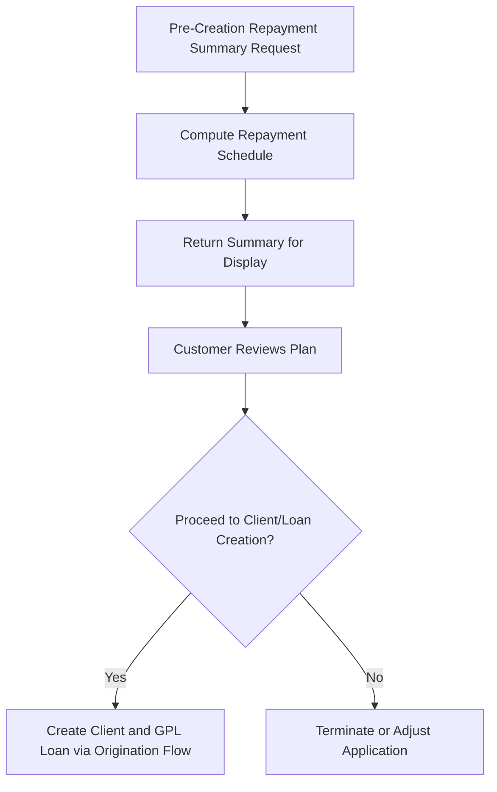

# Repayment Summary before loan creation

The Repayment Summary before loan creation feature provides a pre-creation API call that generates a repayment plan prior to the existence of a client or a loan. It is positioned in Origination and API under the pre-creation path: Origination and API > Pre-creation > Repayment Summary before loan creation. The primary purpose is to present a repayment plan to GPL loan applicants before they elect to apply for a loan, enabling informed decisions early in the origination process.

Overview and scope

- Purpose: Generate a repayment plan for display to the customer before any client or GPL loan is created. This allows applicants to review expected payments prior to initiating the application process.
- Preconditions: The call operates without requiring the existence of a client or loan. It is intended to be invoked in the pre-creation phase of origination.
- Output intent: The repayment summary is suitable for display to the customer, with the GPL context expecting monthly payments as part of the plan.
- Relationship to existing behavior: There is an existing capability in Fineract to submit a request for a repayment schedule without creating a loan or client. The new pre-creation pathway extends this capability to the explicit pre-creation flow used for GPL loan presentations.

Conceptual behavior and flow

- When invoked, the system computes a repayment schedule based on the provided context, returning a summary that can be shown to the applicant. The calculation results are intended to be consumer-facing, focusing on understandability and the monthly payment profile.
- The feature is designed to be independent of subsequent creation steps. A customer may review the repayment plan and then either proceed with client and loan creation through the standard origination flows or discontinue.

What the repayment summary contains (-based expectations)

- The feature is intended to present a repayment plan with monthly payments in the GPL context, enabling the applicant to gauge affordability before applying.
- The exact payload structure, field names, and data types are not specified in the available reference material. The emphasis is on producing a display-ready repayment plan suitable for presentation to the customer.

Lifecycle and interactions (high level)

The repayment summary request operates as a standalone pre-creation step within the origination workflow. It does not create a client or a loan by itself. Once the summary is presented, the applicant may proceed through the standard channels to create the client and GPL loan if they choose to continue.

Procedural usage (high level)

1. Initiate a pre-creation repayment summary request. The request is performed in the pre-creation phase, prior to any client or loan creation.
2. The system computes the repayment schedule and returns a summary suitable for display. The result emphasizes monthly payment visibility in GPL scenarios.
3. Present the repayment plan to the applicant for review and decision-making.
4. If the applicant chooses to continue, proceed through the regular client and GPL loan creation flow; if not, terminate or adjust the application as per the standard origination process.

Notes on data and calculations

- The exact data structure and fields of the repayment summary payload are not specified in the reference material. The essential characteristic is that the response conveys a repayment plan suitable for display, with a focus on monthly payments for GPL use cases.
- The feature follows the existing behavior in Fineract that supports generating a repayment schedule without creating a loan or client, and it formalizes that capability into the pre-creation experience.

Diagram: pre-creation repayment summary lifecycle

