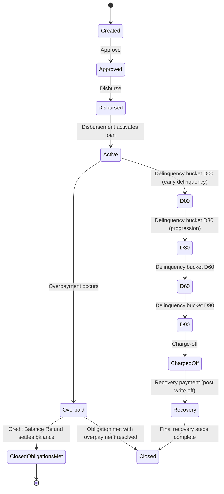

# Loan product support for Effective interest rate (PPWC)

This document describes the loan product concept and implementation details for a Working Capital loan product that uses an Effective Interest Rate (EIR) based calculation. The Working Capital product is designed to follows PayPal’s Working Capital financing offerings, delivering an EIR-based cost of credit, support for discount/fee structures, and flexible repayment semantics. The design is implemented as a separate product module with dedicated configuration and lifecycle, accessible through both UI and API, and integrated with the system’s accounting and reporting capabilities.

The material below captures verified behavior and the rules that govern the Working Capital loan product, its amortization model, transaction surface, and associated processing semantics. Wherever a capability is described, it reflects what is evidenced in the product requirements and reference material. Where discusses design intent or items under review, the text remains precise about current status and expected behavior without inventing contracts, endpoints, or internal identifiers.

### Component role and module boundaries

- The Working Capital loan product is implemented as a separate product module with its own configuration surface. This module provides dedicated product configuration for Working Capital loans and is intended to operate independently from traditional term loan configurations, allowing focus on EIR-based amortization and related accounting.
- The product supports creation of loan products via UI and API, with fields inherited or overridden at the loan account level. Core fields include currency, amortization method, and NPV/day-count configuration, among others. The design separates this surface from existing term loan configurations to minimize impact on existing loan products.

### Execution lifecycle and state transitions (evidenced behavior)

The Working Capital product follows a lifecycle that includes loan creation, approval, disbursement, activation, repayments, and potential post-disbursement events such as delinquency handling, charge-offs, and write-offs. The source material references the following lifecycle moments as part of standard operation:
- Create Loan Account: Copy currency, settings, and term from the loan product into a new loan account. Loans can be created via UI or API.
- Approve Loan Account: A created loan can be approved via UI or API.
- Disburse Loan Account: An approved loan is disbursed, activating the loan and triggering amortization scheduling and accounting entries.
- Ongoing loan state: The loan can be in an Active state and subsequently experience delinquency buckets, charge-offs, and related recoveries as governed by the product rules.
- Post-disbursement events: Reversals, overpayments, credit balance refunds, discount adjustments, and amortization recalculations can occur as part of ongoing servicing.

Note: The material references explicit state names in contexts such as Active, Charged-Off, and Overpaid, and describes moves between these states in response to events (repayments, overpayments, refunds, etc.). When implementing, maintain the observed invariant that a period’s opening balance equals the previous period’s closing balance, and that transactions reconcile with the ledger and amortization model.

### State machine (conceptual diagram)

Below is a compact, evidenced-state diagram representing the high-level lifecycle transitions described in the reference material. It captures the principal states and triggers without inventing states beyond what is evidenced.

This diagram reflects the essential flow described in the reference: approvals and disbursements activate the loan; delinquency buckets emerge as repayments lag; charge-off and possible recoveries are supported; overpayments can lead to an overpaid status that may be settled by refunds; and final state transitions close the loan once obligations are settled. Backdating and reversal flows exist within each state and are addressed in the associated sections.

### Amortization modeling: two approaches and the primary method

A central design decision for the Working Capital product is how income recognition is scheduled over the life of the loan. The reference describes two amortization methodologies:

- Flat Amortization (described as low priority): Income is amortized in a straight-line fashion over the loan tenure. The fixed amortization amount per period is independent of actual cash flows, and recalculation is minimal unless the tenure changes. This approach is noted as low priority and not the default for the Working Capital implementation.
- Declining Amortization (EIR-Based): This is the primary and preferred approach for implementation. Amortization uses an Effective Interest Rate (EIR) methodology, aligning income recognition with time value of money and with actual cash flows. The amount recognized in each period can vary over time and depends on repayments, timing, outstanding balance, and the EIR schedule. The schedule is recalculated as repayments occur and as the outstanding balance evolves, so that income recognition tracks real cash flows for reporting and compliance.

- Amortization schedule structure (projected): Each record in the projected amortization schedule contains the following fields:
 - Amortization Installment Number
 - Amortization Installment Date
 - Expected Payment Amount
 - Discount Factor
 - NPV Value
 - Balance
 - Net Amortization Amount
 - Actual Payment Amount
 - Actual Amortization Amount
 - Income Modification
 - Deferred Balance

- Schedule dynamics: The system generates an initial projected amortization schedule at loan creation, recalculates at approval and disbursement, and continuously updates based on actual repayments. Recalculations occur in response to adjustments, repayments, or other events that affect cash flows and balances. For backdated transactions, the amortization is replayed and recalculated to reflect the historical cash-flow history.

- Interaction with transactions: On each payment, the system computes the amortized portion of the payment under the EIR-based schedule, updates the amortization schedule, and creates a associated Discount Fees Amortization transaction (non-monetary, informational). The amortization itself does not directly create accounting entries; accounting is driven by the repayment and related transactions.

- Backdated and reprocessing behavior: When backdated repayments or adjustments occur, the system reprocesses the amortization schedule, recomputes EIR-based projections, and replays subsequent transactions and accounting entries to maintain consistency with the historical cash-flow history.

- Notes on precision and rounding: The system follows standard EIR-based timing with daily EIR calculations and 360-day year conventions for NPV calculations by default. Rounding and precision rules are applied in a manner consistent with EIR-based accounting, and the intermediate values (NPV, discount factors, and balances) must reconcile across the schedule and ledger.

### LP configuration strategies and the values stored per loan account

The Working Capital product supports two principal configuration strategies that influence how the system stores control values on each loan account:

- Revenue-based configuration
 - Stored values on the loan account include:
 - Period Payment Amount
 - Total Days
 - Daily EIR
 - Calc. Annual EIR
 - These values are derived through the configured revenue-based approach and support dynamic recalculation as required by actual cash flows.

- Fix payment amount configuration
 - The following values are stored on the loan account:
 - Period Payment Amount (provided by configuration or user input)
 - Total Days (calculated)
 - Daily EIR (calculated)
 - Annual EIR (calculated)
 - This mode fixes the payment amount while allowing calculated total days and EIR values to adjust as necessary with lifecycle events.

- Fix EIR configuration
 - The following values are stored and managed as part of the loan account:
 - Period Payment Amount (provided)
 - Total Days (calculated)
 - Daily EIR (calculated)
 - Calc Annual EIR (provided)
 - This mode fixes the EIR and allows the payment amount and term to be derived .

The design enumerates these options to accommodate the varied business needs of Working Capital financing, verifying the system can reflect revenue-based income recognition, fixed payments, or fixed EIR inputs according to the configured strategy.

### Key validations and guards across the transaction surface

The Working Capital product exposes a set of validations and invariants to verify data integrity and regulatory compliance. The following rules are evidenced in the reference material:

- Disbursement validations
 - Disbursement date must not precede the loan approval date and must comply with backdating rules.
 - Disbursement amount must be greater than zero and must not exceed the approved loan amount for a single disbursement.
 - Disbursement is a monetary transaction that triggers activation, schedule updates, principal outstanding, and accounting entries.

- Repayment validations
 - Repayment date must not precede the loan disbursement date and must comply with backdating rules.
 - Repayment amount must be greater than zero.
 - Repayments are allowed when the loan is Active, Closed, or Charged-Off.
 - Repayment recalculates outstanding balances, updates the amortization schedule, and triggers a Discount Fees Amortization transaction (informational) and related accounting entries.
 - Backdated repayments trigger schedule reprocessing and replay of subsequent transactions and accounting entries.

- Prepayment validations
 - Prepayment is a payoff transaction that uses system-calculated payoff amounts on a specified date and must not allow users to modify allocations or the payoff amount.
 - Payoff computation is constrained by payoffs up to the current business date and not beyond recent transactions. Backdated prepayments are supported with standard validations and reprocessing when dates change.

- Discount Fees Amortization validations
 - This is system-generated and cannot be manually created, edited, or deleted independently.
 - Triggered by valid payment transactions with remaining deferred income greater than zero.
 - Amortization is purely informational (no ledger impact) and is replayed during backdated processing.

- Discount Fee Adjustment validations
 - Adjustment is allowed only for Working Capital loan types with an Active loan, and only if a non-reversed Discount Fee transaction exists with remaining adjustable discount.
 - Adjustment amount must be greater than zero and not exceed the remaining adjustable discount.
 - The adjustment creates a linked adjustment transaction, stores an allocation row, updates the loan discount and balances, regenerates the projected amortization, replays prior repayments, raises a business event, and posts accounting entries.
 - Backdated adjustments trigger full reprocessing of amortization and related balances.

- Overpayments and Credit Balance Refunds (CBR)
 - If a repayment creates overpayment, the loan transitions to OVERPAID status.
 - CBR can reduce the credit balance and optionally refund the excess to the customer; if an overpayment remains after refunds, status remains OVERPAID, otherwise it can move toward ClosedObligationsMet when obligations are fully met.

- Payout Refund (WCP-specific)
 - A dedicated refund flow for recovering disbursed funds on fraudulent loans. It behaves like a repayment for the purpose of reducing principal and related charges, and it may post an amortization transaction at COB. Overfunding can drive an overpaid state.

- Delinquency handling
 - Delinquency buckets (e.g., D00, D30, D60, D90, D120, D150, D180) are used to classify delinquent periods and drive related business rules such as breach management, payment holidays, and near-breach evaluations, as described in the reference. The exact bucket transitions are governed by the delinquency framework described in the reference.

- Charge handling and adjustments
 - Charges can be applied at disbursement or on scheduled due dates; a Charge transaction increases receivables (charges) and income (fees/penalties) according to allocation rules. A Charge Adjustment transaction offsets charges that have already been paid and adjusts the balance according to the allocation priorities. Both transactions have associated accounting implications and backdating/reprocessing support.

### Transaction surface: types and general behavior (evidenced)

The transaction model for Working Capital covers both monetary and non-monetary transactions, with a strong emphasis on alignment between cash flows, amortization, and accounting entries. The following categories are evidenced in the reference material:

- Monetary transactions (examples):
 - Disbursement
 - Repayment
 - Discount Fees Amortization (system-generated, non-monetary in the sense of accounting impact)
 - Prepayment
 - Charge Adjustment
 - Discount Fees (upfront discount at creation or post-disbursement date)
 - Credit Balance Refund (CBR)
 - Goodwill Credit
 - Recovery Payment (post write-off)
 - Payout Refund (WCP-specific refund to recover funds)
- Non-monetary transactions (examples):
 - Charge Application
 - Charge Waiver
 - Write-Off / Charge-Off
 - Adjustments / Reversals

- Allocation and processing rules:
 - Allocation priority and flow are configurable at the loan product level and/or per transaction type, with a typical emphasis on charging components (penalties/fees) before principal in the reconciliation of payments.
 - Backdated processing is supported for most transaction types, triggering amortization replays and balance recalculations.
 - Journal entries are generated for monetary transactions, with GL mappings defined at the loan product level. The Discount Fees Amortization and related adjustments have special handling to verify correct income recognition and balance evolution.

- Reporting and traceability:
 - Each transaction carries fields such as Transaction ID, External ID, Date, Amount, Principal/Fees/Penalty components, Outstanding Balance after the transaction, and references to linked transactions (for reversals or adjustments).
 - Discount Fees Amortization is a system-generated, non-monetary trace that links to the associated payment events to provide audit visibility without altering the loan’s balance or cash flows.

### Disbursement semantics and validation (evidenced)

Disbursement is supported as a single disbursement per loan account and is the trigger for loan activation, amortization schedule generation, and accounting postings. Disbursement charges (if configured) are applied at disbursement time. Validation verifies the date does not precede the approval date and complies with backdating rules. The disbursement amount must be > 0 and cannot exceed the approved amount for single-disbursement arrangements. Reversals are supported and create a linked reversal transaction that reverses the financial impact and reverts loan status .

### Repayment semantics and validation (evidenced)

Repayment is a monetary transaction impacting an Active loan and can represent regular, partial, or excess payments. The repayment flow:
- Reduces the loan’s outstanding balance and updates the amortization schedule.
- Triggers the creation of a Discount Fees Amortization transaction (informational) and related accounting entries.
- Supports backdated repayments, which reprocess the schedule and replay subsequent transactions and accounting entries.

Validation rules for repayments include a non-negative date (not before disbursement date), amount > 0, and applicability to valid states (Active, Closed, Charged-Off).

### Special scenarios worth noting (evidenced)

- Overpayments: When repayments exceed the total payable amount, an overpayment scenario arises, and the system uses Credit Balance Refund (CBR) to settle excess funds. The loan’s status can move to OVERPAID, and a CBR can subsequently settle the overpayment, potentially moving the loan to CLOSED_OBLIGATIONS_MET when fully resolved.
- Prepayment: A payoff transaction that closes the loan on a specified date, with the system calculating payoff amounts and enforcing that users cannot alter the payoff figures. Backdated prepayments are supported with standard recalculations and reprocessing.
- Goodwill credits: Treated as a monetary adjustment similar to a repayment, reducing outstanding balance and triggering amortization and accounting entries.
- Payout refunds: A dedicated, WCP-specific mechanism to recover funds from fraudulent loans, reducing principal and related fees in line with the allocation rules, with potential overpayment outcomes.

### Projected Amortization Schedule: structure and purpose

The system maintains a Projected Amortization Schedule to model the loan’s income recognition plan over its lifecycle. The schedule captures:
- Amortization Installment Number
- Amortization Installment Date
- Expected Payment Amount
- Discount Factor
- NPV Value
- Balance
- Net Amortization Amount
- Actual Payment Amount
- Actual Amortization Amount
- Income Modification
- Deferred Balance

This structure supports dynamic recalculation in response to approvals, disbursements, repayments, and adjustments, allowing the system to project and align income recognition with cash flows while maintaining a consistent linkage to the underlying journal entries when applicable.

### Calculations, accuracy, and reporting requirements

The design follows EIR-based methodologies to allocate income recognition and project cash flows. The daily EIR and annual EIR are computed per the configuration, and the NPV calculation uses a 360-day day count convention by default. While exact numerical substitutions depend on loan-specific inputs, the system must verify:
- Consistency between opening and closing balances for each period, per period accounting and amortization steps.
- Reconciliation of intermediate calculations, running balances, and period totals to the integrity of the amortization model.
- HALF_UP or HALF_EVEN rounding conventions where rounding is required, per the system’s standard financial rounding policy.

Accounting impact is driven by monetary transactions (disbursements, repayments, discounts, and charge adjustments), with Discount Fees Amortization serving as an informational tracking construct rather than a ledger entry. When applicable, journal entries balance, and GL mappings are defined per the loan product.

### Domain events and integration points (evidenced)

Certain business events are described as part of the Working Capital feature set, including events that fire on specific adjustments to discount fees or amortization-related changes. Example names and triggers in the reference include events such as:
- WorkingCapitalLoanDiscountFeeAdjustmentTransactionBusinessEvent

These events are emitted to support downstream processes and integrations with accounting and portfolio monitoring.

### API contracts, integration points, and endpoints

No REST endpoint contracts are invented in this publication. The Working Capital product is designed to be accessible via both the UI and API, consistent with other loan products. The exact paths, request and response payload shapes, and HTTP status handling are not enumerated here, as the reference data does not provide explicit endpoint signatures. Implementers should follow the established patterns used by existing loan products for API surface design and validation surfaces, and apply the same coding, security, and validation practices.

### Persistence and data model considerations (high level)

- Loan products: Dedicated configuration for Working Capital loans, including options for the LP configuration strategies and amortization mode.
- Loan accounts: Persist the currency, term, and LP configuration settings, and maintain the amortization-related fields (Period Payment Amount, Total Days, Daily EIR, Calc Annual EIR) as part of the loan account’s state.
- Transactions: Store monetary and non-monetary transactions with fields such as date, amount, components (principal, fees, penalties), the outstanding balance after the transaction, and references to related transactions for reversals or adjustments.
- Amortization: Maintain a projected amortization schedule and link actual repayments to amortization entries. Reprocessing events must recompute and replay the necessary components without violating historical data integrity.

### Practical guidance for engineers integrating PPWC EIR-based lending

- Treat the Working Capital product as a distinct product line with its own configuration surface and lifecycle handling, separate from traditional term loans.
- Implement the Declining Amortization (EIR-Based) path as the default and primary approach, with the Flat Amortization path available as a lower-priority alternative if required by business needs.
- verify that every monetary transaction triggers the standard accounting postings and that the GL mapping is respected at the loan product level.
- Implement backdating support carefully: backdated events must trigger schedule reprocessing, amortization recalculation, and replay of subsequent transactions and their accounting entries.
- Honor the validation rules for disbursement, repayment, prepayment, discount adjustments, and CBR, and verify that the system enforces invariants such as balance consistency across periods.
- Provide clear visibility for users and integrators into the projected amortization schedule, including fields such as Expected Payment Amount, Discount Factor, NPV Value, Balance, and Deferred Balance, and verify this schedule stays in sync with actual cash flows.
- When exposing events to downstream systems, publish the documented business events to allows proper accounting and reporting workflows.

### Example representations (illustrative, not prescriptive)

- Parameter cards (example):
 

 
Period Payment Amount[Configured or calculated value]

 
Total Days[Calculated value]

 
Daily EIR[Calculated value]

 
Calc Annual EIR[Calculated value]

 

- Calculation workflow (high level):
 - Inputs: disbursement amount, period, currency, and LP configuration strategy
 - Compute daily EIR and annualized EIR
 - Build initial projected amortization schedule
 - On each payment: reallocate the payment to principal/fees/penalties according to allocation rules, update outstanding balance, and record amortization impact
 - Emit Discount Fees Amortization entry (informational) and adjust deferred income as needed

### Summary of verified behavior and guarantees

- The Working Capital PPWC feature is implemented as a separate product module, with UI/API access for product configuration and loan account lifecycle management.
- The loan account supports a single disbursement, not a traditional full-tenure EMI schedule, and uses an EIR-based amortization model as the primary method for income recognition.
- The system maintains a projected amortization schedule that dynamically updates with approvals, disbursements, repayments, and adjustments, and can replay backdated events to maintain consistency with actual cash flows.
- Transactions include Disbursement, Repayment, Discount Fees, Discount Fees Amortization, Prepayment, Charge Adjustment, CBR, Goodwill Credit, Recovery, Payout Refund, and related non-monetary actions, with detailed validation and reconciliation behavior.
- Accounting is driven by monetary transactions and GL mappings configured at the loan product level; Discount Fees Amortization remains a tracking construct that does not affect the loan balance or accounting entries directly, except where triggered by relevant events.
- Domain events are present to surface significant adjustments (e.g., discount fee adjustments) to downstream processes.

This publication remains faithful to the evidenced design and avoids extrapolations beyond what is documented in the reference material. It presents the Working Capital EIR-based loan product with its lifecycle, amortization model, and transaction surface in a way suitable for backend Java engineers, system integrators, and open-source contributors contributing to the Fineract-based implementation.