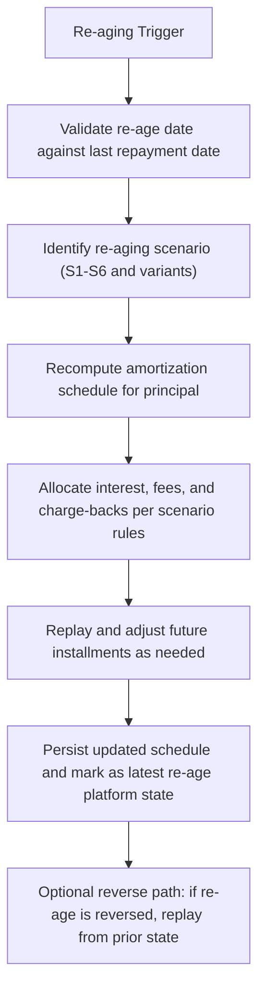

# Re-aging for Interest bearing products

Re-aging is a controlled reallocation of a loan’s repayment schedule that allows adjusting the timing and composition of future installments after an original disbursement. For Pepper-Soup, Re-aging for interest-bearing products allows updating the remaining principal schedule while accounting for interest, fees, and any chargebacks in a forward- or backward-looking manner, subject to the verified rules described below. The feature is characterized by its allowance to re-age from any date in the loan cycle, with the re-age date allowed to be before the last repayment date under certain scenarios, and by a set of deterministic rules that govern how interest, principal, fees, and chargebacks are reallocated, reversed, or replayed. The rules are captured across several scenario categories (S1–S6) and their variants, each illustrating a distinct treatment when re-aging is performed.

### Conceptual boundaries and design guarantees

- The re-aging operation focuses on adjusting the amortization schedule after a re-age date, revisiting the remaining installments, and reassigning principal across new installments while applying day-count conventions that are used throughout the product. The baseline assumptions are a 360-day year and 30-day months, with a 7% annual interest rate (0.000194444 per day) for these demonstrations.
- The re-age date must respect the primary constraint: it should not be before the last repayment date, so that the re-aging operation acknowledges concluded periods before applying the new schedule.
- Re-aging can be reversed, but only up to the point where the re-age operation is not the latest transaction on the loan. In other words, the reversal is allowed while there exists a more recent transaction than the targeted re-age event.
- When re-aging occurs, charges/fees with due dates after the re-age date are waived, while charges/fees with due dates before the re-age date are split uniformly across the new installments. This allocation rule is part of the consolidated treatment described and is applied consistently across affected schedules.
- Charge-backs and related adjustments are addressed with explicit guidance: the interest and principal amounts affected by a charge-back may be split and allocated according to the re-aged schedule, with various scenarios showing different treatment for the reversed or continued balances. Where a charge-back event occurs before or after re-aging, the resulting adjustments are reflected in the new amortization trajectory.
- Backdated repayments or reversals are allowed, and re-aging operations trigger a replay of the schedule so that the new installments are aligned with the updated balance and the revised interest accrual.
- The system supports multiple re-aging scenarios (S1–S6) and their variants (e.g., S1.1, S2.1, S3.1) to illustrate common business patterns such as interest-only reversals, fees handling, N+1 installments, partial payments, and post-re aging charge-backs. These scenarios are used to guide the replay and reallocation logic.

### Core day-count and calculation model

Re-aging calculations rely on a standardized daily rate derived from the product’s interest terms. The evidenced model uses:
- Interest rate (annual): 7% (0.07)
- Days in year: 360
- Days in month: 30
- Daily rate: 0.07 / 360 = 0.000194444...
- Principal used for calculations: as observed in the schedules (e.g., 100 in the examples)
- The fundamental accrual formula per period follows the day-count convention: 
 Interest for a period = OpeningBalance × (AnnualRate / DaysInYear) × DaysInPeriod.
 This follows the 30-day period calculations shown in the reference examples (e.g., Approximately 0.58 of interest on a 100 base for a 30-day window).

An illustrative calculation snippet is provided below to aid implementation and code reviews:

 
Calculation

 
<strong>Formula:</strong> <code>Interest = OpeningBalance × (AnnualRate / DaysInYear) × DaysInPeriod</code>

 
<strong>Substitution:</strong> <code>OpeningBalance=100, AnnualRate=0.07, DaysInPeriod=30, DaysInYear=360</code>

 
<strong>Result:</strong> <code>Interest ≈ 100 × (0.07 / 360) × 30 = 0.5833</code>

This calculation framework underpins the re-amortization and replay logic across all re-aging scenarios. It is used to derive the periodic interest portion in each updated installment, subject to the adjustments described in each scenario (S1–S6) and their variants.

### Scenario-based treatments (S1–S6)

The reference data defines several discrete scenarios describing how re-aging affects the amortization and allocations of principal, interest, fees, and charge-backs. Each scenario demonstrates a different treatment strategy when the re-age date is applied.

- S1 – Interest Split: Re-amortization is applied with principal reallocation and an explicit distribution of interest across the revised installments. The illustrative schedule shows a principal-driven repayment trajectory with a consistent EMI amount around 17.01 and a decreasing interest component as the balance declines.
- S2 – Fees and Interest Split (before re-aging): This scenario documents the handling of both interest and fees split across the new schedule, illustrating how fees due dates before re-aging are distributed into future installments.
- S3 – Charge-back before: This scenario models a charge-back occurring before re-aging, detailing how the charge-back interacts with the updated amortization and the display of a revised balance in the pre-reage context.
- S4 – N+1 Scenario: The re-aging process can accommodate an N+1 adjustment, where the N+1st installment is recalibrated as part of the replay. The illustrative schedule reflects a transfer of amounts that reshapes the later installments.
- S5 – Partially Paid Installment: When an installment is only partially paid, re-aging adjusts the balance and allocations to reflect the remaining unpaid portion, continuing with the revised amortization pattern.
- S6 – Charge-back after re-aging: A post-re-aging charge-back interaction is modeled, showing how subsequent-dated charge-backs are integrated into the updated schedule.

Each scenario leads to a revised repayment schedule and new balance path, reflecting how the re-age date reshapes the future cash flows. The data provide representative numbers for each scenario (e.g., initial balance of 100, monthly repayments around 17, and a final zero balance by the end of the term) to illustrate the mechanics. Exact figures in production will depend on the loan’s actual balance, due dates, and any concurrent fees or charge-backs.

In addition to the primary S1–S6 flows, there are variant sheets (S1.1, S2.1, S3.1, etc.) that model supplementary cases such as merchant refunds, partial refunds, and fee adjustments performed in the context of re-aging.

### Re-aging constraints, reversals, and replay behavior

- Re-aging can be reversed: The operation may be reversed until it is the latest transaction on the loan. This provides a reversible control point for correcting misconfigurations or updating business decisions without permanently locking the loan into a single trajectory.
- Backdated repayments and reversals are allowed: Re-aging will be reversed and replayed , so the updated schedule reflects the corrected payment history.
- Backdated or post-dated charges/fees are treated according to the due-date relation to the re-age date: charges/fees with due dates after the re-age date are waived, while those with due dates before the re-age date are allocated across new installments. This verifies consistent alignment with the revised schedule.
- Charge-backs interact with the re-aged schedule via explicit allocation rules: the associated interest and principal affected by charge-backs are redistributed according to the updated amortization path.

### Data persistence and traceability

Re-aging operations update the loan’s repayment schedule to reflect the new set of installments, balances, and due dates. The operation is designed to be reversible, preserving the ability to roll back to the pre-re-age state if the re-age transaction is not the latest action on the loan. When a re-age occurs, the system records the resulting schedule and any related allocations so that the updated path is auditable and traceable.

### Validation guards and invariants (implemented behavior)

- Re-aging date must not be before the last repayment date (except as captured in the S3/S4/S5 contexts where scenarios illustrate alternate behavior).
- Principal re-amortization changes only the outstanding principal; unpaid interest may be treated according to the scenario (e.g., split, waived, or replayed) as observed in the scenario definitions.
- Charges/fees with due dates after the re-age date are waived; charges/fees with due dates before the re-age date are split across new installments.
- Re-aging can be reversed until it is the latest transaction on the loan; subsequent re-aging events will replay the schedule anew.

If additional guards or invariants are required by business policy, they should be aligned with the scenario definitions above and implemented in the same replay engine used for S1–S6. The rules are designed to preserve the integrity of the repayment path and to maintain consistency between the original and re-aged schedules.

### Flow: how re-aging is executed (high level)

A compact view of the execution flow is shown in the diagram below. It captures the core steps from trigger to persistence and replay:

The replay path verifies that each re-age yields a deterministic, auditable, and reversible path forward, with all affected balances and installment allocations reconciled against the updated schedule.

### Relationships to financing operations and scheduling

- The re-aging process interacts with the standard amortization that governs daily accruals and scheduled repayments. It modifies only future installments while anchored to the existing balance history up to the re-age date.
- The day-count conventions (360-day year, 30-day months) and the daily rate interpretation underpin all recalculations. All intermediate balances, interest accruals, and principal allocations are recomputed according to those conventions for the new schedule.
- The re-aged schedule may contain N+1 adjustments and reverse replay behavior, verifying the ability to align the loan’s trajectory with revised business decisions without compromising accounting integrity or data consistency.

### Example illustrations (conceptual references)

The reference data includes several illustrative schedules that demonstrate how the re-aging logic plays out across S1–S6 and their variants. In summary:
- A principal re-amortization is paired with an adjusted interest component across new installments, leading to a near-linear decline in the balance over the re-aged horizon.
- Fees attributable to periods before the re-age date are redistributed across the new installments, while those after the re-age date are waived.
- Charge-backs create adjustments to the balance and the installments that appear in the re-aged schedule, sometimes requiring an N+1 installment and occasional partial repayments to be carried into the revised timeline.

These patterns are illustrated in the scenario schedules, which reflect consistent application of the underlying formulas and logic described above.

### Important notes for implementers

- Do not assume fixed endpoints or fixed EMI values across all loans. EMI values in the reference scenarios are illustrative; production values depend on the loan's actual balance, dates, and the precise re-aging scenario selected.
- The re-aging operation should be treated as a first-class re-calculation that can be safely reversed. verify the system preserves historical state up to the re-age and supports replay semantics when a reversal or a new re-age occurs.
- verify that any accounting events (debits/credits) associated with re-aging are aligned with the ledger policies in use for the platform. Where journal entries are provided, document the debit/credit flows per transaction event; where not, defer to the standard accounting rules for loan adjustments and charge-backs.

This publication presents the verified operational semantics for Re-aging on interest-bearing loans, grounded in the demonstrated scenarios, the day-count framework, and the rules surrounding reversals, replay, and charge-backs. It is intended to guide backend engineers implementing or integrating re-aging features in Pepper-Soup and to assist contributors in understanding the expected behaviors across the supported scenarios.