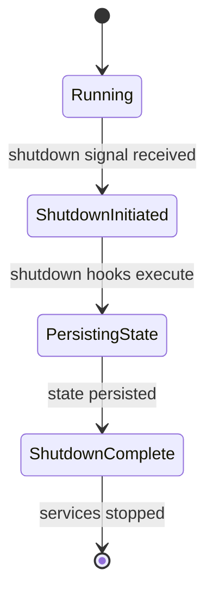
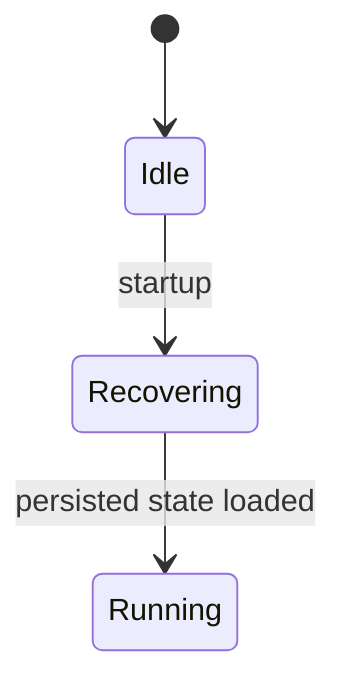

# Graceful shutdown and recovery

This page documents the Pepper-Soup enhancement for graceful shutdown and recovery, focusing on technical handling via shutdown hooks, writing the current state to durable storage, accurate API responses during recovery, and the correct handling of Batch Job management. The aim is to minimize data loss during termination and to restore operational state promptly on restart, with batch jobs able to resume from their last known state.

### Conceptual scope
The enhancement covers two tightly related concerns: (1) how the runtime responds to shutdown in a controlled, predictable manner, and (2) how current state, including batch job progress, is written to durable storage so that recovery can proceed without ambiguity. A key design goal is that, after a restart, the system can recover the previously active state and batch job executions from the persisted data, and API responses reflect the recovered state once the system is running again.

### What changed (verified scope)
- Shutdown hooks are introduced as a mechanism for performing finalization tasks when the process receives a termination signal. These hooks run in the shutdown sequence to perform necessary state finalization.
- The system persists current in-memory state at shutdown, along with batch job metadata and progress, to durable storage to support recovery.
- On startup, the system reads the persisted state and batch job data to reconstruct the in-flight work and to align API responses with the recovered state.
- Batch Job management data now lives in a durable representation that supports resumption after termination, so that batch processing can continue from the last persisted point.

### Affected architectural responsibilities
- Runtime lifecycle and shutdown hooks: The runtime now coordinates a graceful shutdown sequence using registered hooks to perform cleanup and persistence tasks before termination.
- Persistence layer: A durable store is used to record the current in-memory state and batch job metadata at shutdown, so recovery has a single source of truth.
- Batch Job management component: Batch job progress and metadata are included in the persisted state to allows resumption after restart.
- API layer and responses: API responses are derived from the recovered state upon startup, so that clients observe the stable state after recovery.

### Behavioral overview
1) Normal operation: The system maintains active state and batch job progress in memory during runtime. API responses reflect the current in-memory representation while the system is healthy.
2) Shutdown signal received: The runtime begins a graceful shutdown sequence. Registered shutdown hooks are invoked to perform finalization tasks.
3) Persistence during shutdown: The shutdown hooks persist the current in-memory state and batch job data to durable storage. This step establishes the point from which recovery will proceed.
4) Termination: After successful persistence, services are stopped in a controlled order, and resources are released.
5) Startup and recovery: On subsequent startup, the system loads the persisted state to reconstruct in-flight work and batch job progress, making the API surface reflect the recovered state once the system is operational again.

### Data and API integrity considerations
- The persisted state serves as the authoritative source for recovery, guiding the reconstruction of in-flight work and batch job progress after restart.
- API responses after recovery reflect the recovered state, aligning external visibility with the durable data. During shutdown, in-flight activity may be transiently represented by in-memory state until persistence completes.

### Lifecycle diagrams
##### Graceful shutdown lifecycle

##### Recovery on startup lifecycle

### Procedural guidance for operators and maintainers
1. Initiate a graceful shutdown via the orchestrator or process signal to begin the shutdown sequence.
2. Allow shutdown hooks to execute, letting the system flush in-memory state and batch job progress to durable storage.
3. Confirm that persistence completed before the process terminates otherwise you may observe incomplete recovery data on next startup.
4. On restart, verify that in-flight work is reconstructed from the persisted state and that batch jobs resume from the last known progress point.

### Validation and testing guidance
- Verify that a termination signal triggers the shutdown hook sequence and that the persisted state matches the in-memory representation at the moment of completion.
- Validate that, after a restart, in-flight batch jobs resume from the last persisted progress and API responses reflect the recovered state.
- Test concurrent shutdown signals and verify only a single shutdown sequence completes, without partial persistence artifacts.

### Notes
This page documents an enhancement focused on runtime lifecycle management, state persistence at shutdown, and batch job recovery. No changes described here alter business logic or calculation semantics; the changes are architectural and procedural, aimed at reliability and recoverability in failure scenarios.