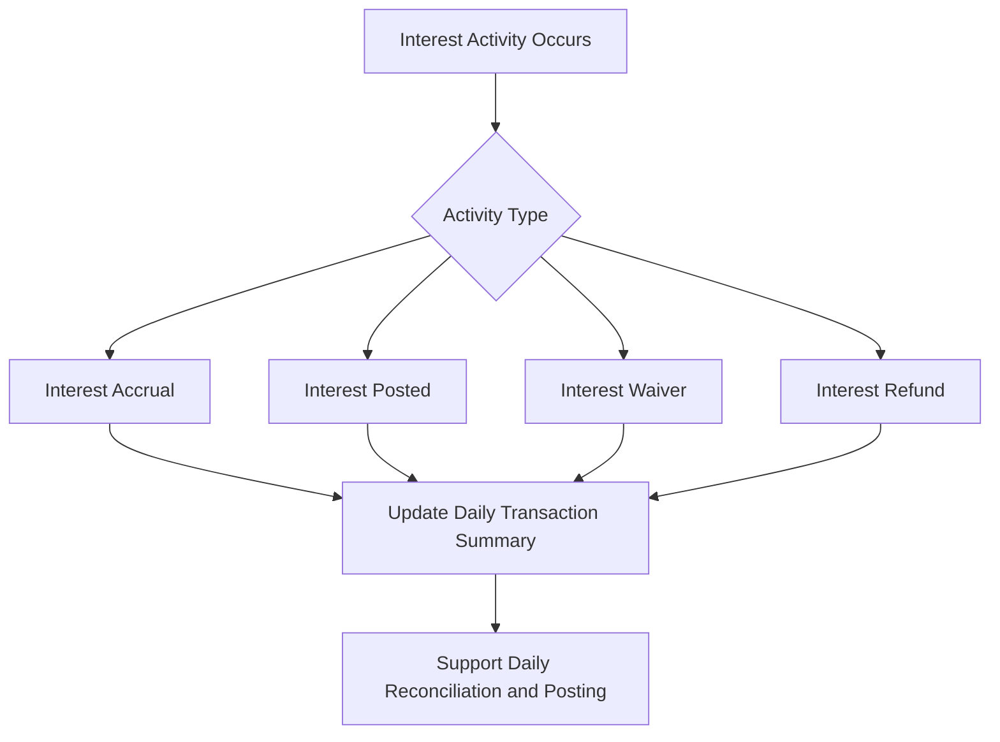

# Transaction summary report changes

### Overview
The objective of this update is to extend the transaction summary report to reflect interest-related activity. Specifically, the daily transaction summary will include interest events in four categories: interest accrual, interest posted, interest waiver, and interest refund. This enhancement supports reconciliation and daily posting by verifying the report surfaces all relevant interest activity alongside existing transactions.

### Scope and confirmed behavior
The documented changes focus on including interest activity in the daily transaction summary report. The four categorized interest events are:
- Interest accrual
- Interest posted
- Interest waiver
- Interest refund

These categories are explicitly listed in the referenced notes as part of the updated reporting expectations. The change is described from a reporting perspective, with the stated goal of improving visibility for daily reconciliation and posting.

Note: The reference material does not specify changes to internal components, APIs, or database schemas. Details about exact module names, service interfaces, or data models affected by the change are not provided in the current release notes.

### Interest activity coverage and interpretation
- Interest accrual represents the formal recording of interest as it accrues over the relevant period.
- Interest posted denotes the moment interest is applied to the customer’s account as a posting action.
- Interest waiver reflects cases where interest charges are waived and no obligation remains.
- Interest refund corresponds to situations where previously charged interest is returned to the customer.

The inclusion of these events in the daily report verifies that all interest-related movements are visible for daily reconciliation and posting processes.

### Processing and data integrity considerations
The enhancement integrates interest activity into the daily reporting flow, making all interest-related events part of the transaction summary output for the day. While the notes describe the desired outcome, they do not provide new calculation rules, balances, or day-count conventions beyond acknowledging the interest-related categories. Therefore, calculated balances, running totals, and reconciliation logic must remain consistent with existing processing rules, with the addition that interest-related events are now surfaced in the daily report.

In line with reporting integrity, each period’s reported data should reflect a coherent sequence where opening balances follows the previous period’s closing balances, and the reported interest amounts reconcile with associated postings, accruals, waivers, or refunds. The exact reconciliation rules, formatting, and data fields are not specified in the provided material.

### Impacted surfaces and delivery surfaces
The current reference does not publish details about specific components, services, or API surfaces modified as part of this change. Consequently, there is no published schema change, API parameter addition or removal, or persistence-layer modification within this document. The scope is described at the reporting visibility level: the daily transaction summary now includes interest activity.

### Acceptance criteria and next steps
The reference notes indicate that acceptance criteria require further discussion with the product owner and the team’s use-case development. The final criteria will define exact use cases, validation scenarios, and any additional report formatting or localization considerations needed to support daily reconciliation and posting workflows.

### Diagram: interest activity flow (Mermaid)

### Visual reference: interest activity coverage

 
Interest Activity Coverage

 <ul style="margin:0 0 0 1.2em;line-height:1.5;">
 <li>Interest accrual</li>
 <li>Interest posted</li>
 <li>Interest waiver</li>
 <li>Interest refund</li>
 </ul>

### Notes for implementers
- This document reflects the verified scope as described in the reference data available for this enhancement. It does not disclose internal implementation details, such as specific class names, service boundaries, API contracts, or database migrations, since those details are not part of the publicly stated specifications.
- If further technical specifications are provided (e.g., new fields in the report, formatting rules, or exact data types), they should be documented in a subsequent technical update to preserve accuracy and traceability.

### Summary
The transaction summary report now surfaces interest-related activity on a daily basis, including accruals, postings, waivers, and refunds. This change is intended to improve reconciliation accuracy and daily posting efficiency by providing complete visibility into interest movements within the reporting data.