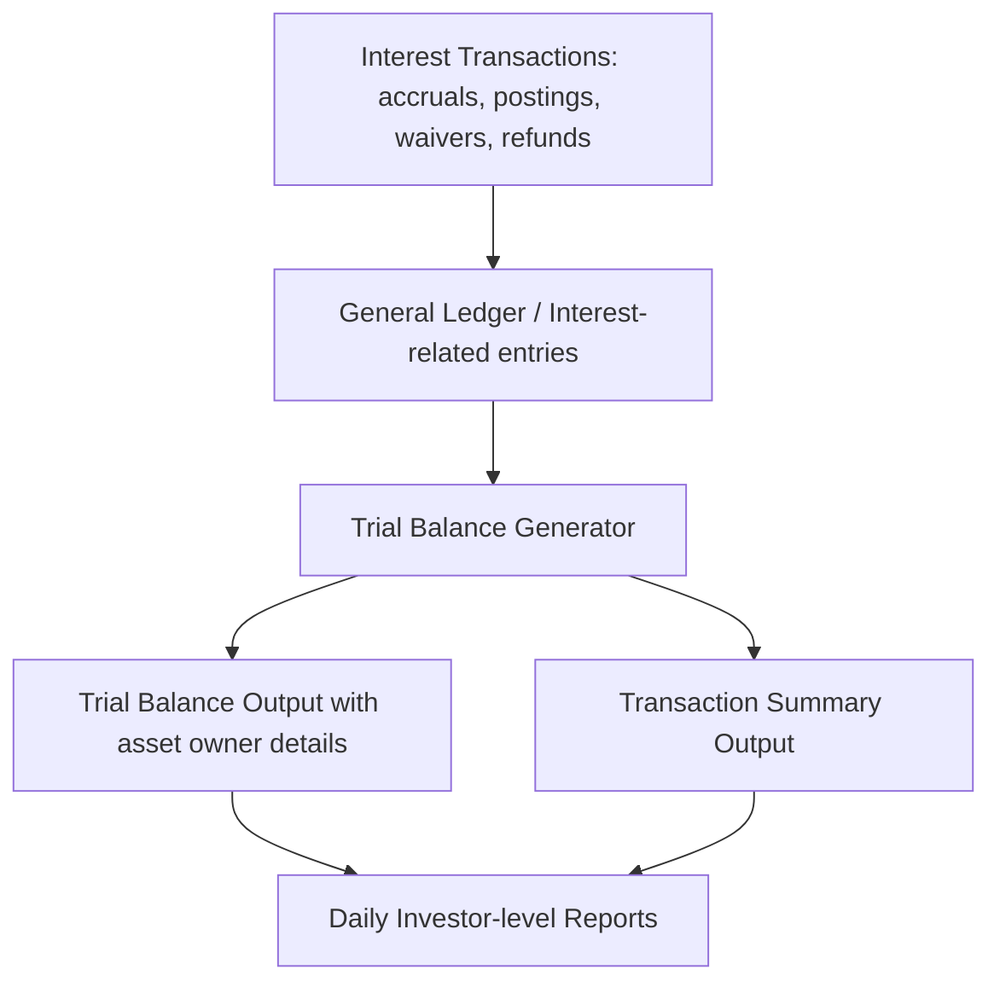

# Trial Balance report changes

This document describes the verified behavioral changes to the Trial Balance reporting surface in support of reflecting interest-related activity. The enhancement focuses on incorporating interest accruals, interest postings, waivers, and refunds into the daily trial balance and associated reports. It also addresses asset ownership visibility for interest activity and adds detail lines for interest installment products to reflect the correct asset owner details. The aim is to improve reconciliation and daily posting capabilities for Credit Accounting Managers and investors.

### Scope of change

The reference material specifies high-level reporting outcomes without enumerating concrete code artifacts, API surfaces, database schemas, or service interfaces. , this document describes verified product behavior at a functional level, and notes where implementation details are not provided .

- Primary focus: include interest activity in the Trial Balance and related daily accounting reports.
- Reports affected: daily Trial Balance and the Transaction Summary reports, with asset owner separation for interest activity and balances.
- Data detail: new detail lines for interest installment products carry the correct asset owner details.
- Investor-centric view: daily accounting reports reflect interest activity by investor to support reconciliation and posting workflows.
- API, schema, and internal component changes: not specified in the reference material. No concrete changes to API contracts, database schemas, or specific class names are described here.

### Verified behavioral changes

The reference describes the following behavioral changes as part of the enhancement:

- Interest activity is included in the trial balance calculations. This encompasses interest accruals as they occur within the reporting horizon, and interest postings as entries are settled in the ledger.
- Interest waivers and interest refunds are reflected in the trial balance, so that the daily DR/CR activity accounts for reductions or restorations of previously recognized interest amounts.
- Daily reports contain all interest-related activity, enabling reconciliation and daily posting workflows. The reports aggregate both balances and daily DR/CR lines to include interest accruals, postings, waivers, and refunds.
- Asset ownership visibility is improved for interest-related activity. New detail lines are created for interest installment products to reflect the asset owner details accurately.
- Reporting surfaces (trial balance and transaction summaries) exhibit asset owner separation for interest-related activity and balances. This separation verifies that interest-related movements can be traced to the standard asset owner.

### Conceptual data flow and processing

The following flow describes how interest activity surfaces in the Trial Balance reporting, from capture to output, without asserting internal component names or implementation specifics:

- Interest-related transactions are generated and recorded in the general ledger as accruals, postings, waivers, and refunds.
- The Trial Balance generation process ingests these interest-related entries alongside existing principal and other ledger activity for the period.
- Calculations aggregate daily DR/CR activity, incorporating interest accruals and postings, and adjust for waivers and refunds .
- Output reports (Trial Balance and Transaction Summary) present balances and activity, with explicit asset owner details where relevant, and with dedicated lines for interest installment products.
- Investor-focused views in the daily accounting reports aggregate interest activity by investor, enabling reconciliations and postings at the investor level.

### Data integrity and calculations: expectations without concrete numerics

There are no numeric examples in the reference material. However, the described behavior implies that:

- Opening and closing balances in each period should reflect all interest-related activity processed during that period, including accruals and postings, with waivers and refunds adjusting the DR/CR totals .
- The daily DR/CR activity totals for interest must reconcile with posted interest amounts and any adjustments due to waivers or refunds.
- Asset owner details must be accurate for all interest-related entries, and the separation by asset owner must be preserved in both the Trial Balance and the Transaction Summary reports.

### Implementation notes and constraints

Because the reference does not specify concrete implementation artifacts, this document does not enumerate component names, service interfaces, or database schema changes. The following points reflect what is known and what remains unspecified:

- No API surface changes are described in the reference. If APIs exist for retrieving Trial Balance data or related reports, their current use for interest-related transactions is described at a functional level, not via contract-level changes.
- No DDL or database migration details are provided. Therefore, no schema changes are documented here.
- No specific class, package, or module modifications are listed. supports a reporting-visible change, not a disclosed code-level refactor.

### Acceptance criteria and next steps

The reference notes that acceptance criteria require further discussion with product stakeholders to delineate use cases. Practically, validation should cover:

- Correct inclusion of interest accruals, postings, waivers, and refunds in daily Trial Balance and Transaction Summary outputs.
- Asset owner separation on all interest-related activity in trial balance and transaction summaries.
- New detail lines for interest installment products reflect the correct asset owner details.
- Investor-level reporting of interest activity follows reconciliation and posting processes.

Since the reference does not provide concrete acceptance tests, these items should be refined with stakeholders and translated into verifiable test cases in the project’s quality regime.

### Summary of impact

This enhancement broadens the Trial Balance reporting surface to incorporate complete interest-related activity, improves asset-owner traceability for interest movements, and supports investor-focused reconciliation workflows. The changes described here are anchored in the verified behavioral expectations from the reference material, with implementation specifics and data-model changes left to follow-up discussions and detailed design work with product and engineering.