# Same day CBR/Disbursement Scenarios

This page documents the behavior of on-day Credit Balance Refund (CBR), Chargeback, and Disbursement on overpaid loans as implemented for Pepper-Soup. It formalizes how the system handles loans that are ACTIVE, OVERPAID, or CLOSED (OBLIGATIONS MET) when same-day disbursement, refunds, and adjustments occur. The material below mirrors the evidenced rules and example scenarios described in the reference material and describes how the operations affect loan balances, overpayments, repayment schedules, and related general ledger (GL) movements.

## Conceptual scope and component role

The same-day CBR/Disbursement Scenarios feature concerns the lifecycle where disbursement actions, refunds, and corrective transactions (CBR and Chargeback) interact with a loan that has an overpayment. The core concepts are:

- Loan statuses and their meaning: ACTIVE indicates a normal performing loan with outstanding balance; OVERPAID indicates the loan balance has been overpaid (outstanding balance is zero and an overpaid amount exists); CLOSED (OBLIGATIONS MET) indicates the loan is fully settled.
- Transaction types relevant to the scenarios: Repayment (payments against principal), CBR (Credit Balance Refund, a refund to a customer for overpayment), Chargeback (reversal of a previous repayment or refund), and Disbursement (additional funds disbursed on the loan).
- On-day behavior: On the same business date, a loan can experience a sequence of events where repayment creates an overpayment, CBR reduces or replenishes the overpayment, and a disbursement on an overpaid loan reallocates funds between the existing overpayment and the installment schedule, potentially changing the loan’s status and the repayment schedule.

The material is organized around verified use cases and their effects on balance, status, and accounting, with explicit examples illustrating each outcome.

## Verified state transitions and lifecycle considerations

 describes the following core transitions and rules:

- A repayment that exceeds the outstanding balance moves an ACTIVE loan into OVERPAID, with the outstanding amount reduced to zero and the overpaid amount representing the excess funds.
- A CBR (Credit Balance Refund) transaction is only allowed on loans in OVERPAID status. A CBR increases or decreases the net overpayment depending on its amount relative to the current overpaid balance, and may backdate under certain conditions.
- A Chargeback transaction is permitted on overpaid loans and interacts with the overpaid amount in analogous ways to CBR, with specific rules depending on whether it occurs before or after maturity, and depending on the relationship between the chargeback amount and the current overpayment.
- A on-day Disbursement on an overpaid loan increases the actual installment principal by the full disbursement amount and allocates any remaining amount to the overpayment as repayment, potentially transitioning the loan between OVERPAID and ACTIVE or to CLOSED if fully settled.

The references provide concrete scenario-driven descriptions of these transitions, including when moves to CLOSED occur and how partial vs full adjustments affect the repayment schedule.

## On-day CBR on overpaid loans

Credit Balance Refund (CBR) is used to refund an overpaid amount to a customer. The key constraints and behaviors evidenced are:

- CBR amount must not exceed the current overpaid amount on the loan.
- The CBR transaction can be backdated after its creation.
- If a backdated CBR amount is higher than the overpayment after reprocessing, the outstanding principal of the actual installment can be increased by the full CBR amount and the overpayment amount is allocated as repayment (for principal). On the repayment schedule, the full CBR appears as a creditable principal amount.
- CBR transactions are only permitted when the loan status is OVERPAID.

### Situation #1: Partial CBR applied on an overpaid loan
- Given: Loan is ACTIVE with an outstanding balance of 50.
- When: A repayment occurs for 100.
- Then: The loan moves from ACTIVE to OVERPAID; outstanding becomes 0; overpaid amount becomes

50. The Overpayment GL account is credited by 50.
- When a CBR of 25 happens:
 - The loan remains in OVERPAID, outstanding is 0, overpaid becomes 25.
 - The Overpayment GL account is debited by 25.

### Situation #2: Full CBR applied on an overpaid loan
- Given: Loan is ACTIVE with an outstanding balance of 50.
- When: A repayment occurs for 100.
- Then: The loan goes to OVERPAID with outstanding 0 and overpaid 50; Overpayment GL is credited by 50.
- When a CBR of 50 happens:
 - The loan transitions from OVERPAID to CLOSED (OBLIGATIONS MET); outstanding is 0; overpaid is 0, and there is no change to the repayment schedule.
 - The Overpayment GL account is debited by 50.

### Situation #3: Full CBR applied on an overpaid loan after backdated activity
- Given: Loan is ACTIVE with outstanding balance 50.
- When: A repayment occurs for 25, then another repayment for 75 (total 100) occurs, producing an overpaid balance of 50.
- Then: A CBR of 50 happens, moving the loan from OVERPAID to CLOSED, outstanding 0, overpaid 0.
- The Overpayment GL account is debited by 50, and the repayment schedule takes into account the full CBR allocation on the repayment timeline.

## On-day Chargeback on overpaid loans

Chargeback acts as a reversal or reallocation instrument on a previous repayment or refund. The tested rules show:

- A Chargeback amount must not exceed the target (the transaction being charged back) in aggregate for that target; multiple Chargebacks can accumulate on the same target, but the sum cannot exceed the target.
- Transaction date cannot be defined for a Chargeback (it uses the actual business date).
- Backdated Chargebacks are allowed after the initial chargeback.
- Chargeback is allowed on overpaid loans.
- Chargeback can be used to reduce the overpayment, and in certain situations increases the outstanding principal (in particular backdated scenarios and certain timing interactions).
- Before maturity, a Chargeback increases the actual installment by the full amount and delinquency calculation is triggered immediately; after maturity, Chargeback creates a new installment (N+1) with the full amount of the Chargeback when there was no existing installment for that date.

### Situation #1: Partial Chargeback applied on an overpaid loan
- Given: The loan is ACTIVE with outstanding balance 50.
- When: A repayment occurs for 100, producing an overpayment of 50.
- Then: The loan remains ACTIVE to OVERPAID; outstanding 0; overpaid 50; Overpayment GL is credited by 50.
- When a Chargeback of 25 happens for the first repayment:
 - The loan remains OVERPAID; outstanding 0; overpaid becomes 25; the Overpayment GL is debited by 25.

### Situation #2: Full Chargeback applied on an overpaid loan
- Given: The loan is ACTIVE with outstanding balance 50 and repayment created an overpaid amount of 50.
- When: A Chargeback of 50 happens on the first repayment:
 - The loan moves from OVERPAID to CLOSED (OBLIGATIONS MET); outstanding 0; overpaid 0; the Overpayment GL is debited by 50.
 - The effect on the repayment schedule is that the overpayment is neutralized and the loan is considered settled for obligations met.

### Situation #3: Chargeback on an overpaid loan with backdated processing
- Given: The loan is ACTIVE with outstanding balance 50 and a backdated Chargeback creates a higher effective chargeback than the current overpayment due to timing.
- When: A Chargeback for 2nd repayment occurs with amount 50.
 - The loan moves from OVERPAID to CLOSED; overpaid becomes 0; the Overpayment GL is debited by 50; and the actual repayment recognized on the schedule can reflect reconciliation actions (the exact accounting propagation depends on the reprocessing rules).
- If the 1st repayment was reverted, a reprocessing of the 2nd repayment can occur, potentially reestablishing OVERPAID status and triggering a new Chargeback processing cycle with associated GL impacts.

### New, enhanced Chargeback handling (release 1.10)

A new enhancement to Chargeback handling augments how chargebacks interact with principal, fees, and penalties, and how allocation is performed when the repayment strategy uses advanced allocation logic. Key features include:

- Chargeback transactions can be allocated to not only principal but also to fees or penalties, based on the target transaction that was charged back.
- If the repayment strategy is set to Advanced payment allocation, Chargeback amounts can be allocated according to a configurable allocation order (e.g., priority among principal, fee, and penalty). This is meaningful primarily for partial Chargebacks.
- When the target transaction involved repayment of fees or penalties alongside principal, the same types of fee and/or penalty can be created during the Chargeback to reflect the mirrored allocation.

### Situation #4: Enhanced allocation on a partial Chargeback (example)
- Given: A loan is ACTIVE with overpayment balance; the Chargeback credit allocation order is FEE, PENALTY, PRINCIPAL.
- When: A repayment occurs for 25 (to outstanding 25).
- Then: The loan remains ACTIVE with 25 outstanding.
- When: A repayment occurs for 75 (pays 65 principal and 10 fee).
- Then: The loan moves to OVERPAID with outstanding 0 and overpaid 50.
- When a Chargeback of 50 occurs on the 2nd repayment:
 - The loan moves to CLOSED (OBLIGATIONS MET); overpayment becomes 0; the Overpayment GL is debited by 50.
- In the enhanced path, if no fee existed or the allocation results in a higher chargeback equal to or greater than the overpayment, then no extra fee is created and the overpayment funds fully satisfy the chargeback amount.
- If a 1st Repayment is reverted, a reprocessing event may occur for the 2nd repayment, potentially restoring OVERPAID and triggering a re-recognition of the Chargeback on the repayment schedule.
- The enhanced path also demonstrates how the repayment recognized on the schedule includes the full Chargeback amount as part of the repayment recognition, and how earlier GL entries may be reversed to reflect updated balances.

## On-day Disbursement on an overpaid loan

Disbursement on an overpaid loan is supported and can be performed on ACTIVE, CLOSED (OBLIGATIONS MET), or OVERPAID loans. The effect of a disbursement is to increase the actual installment principal by the full disbursement amount and allocate the remainder to the overpayment as repayment toward the principal portion. This can move the loan between OVERPAID and ACTIVE, or create a new balance leading toward settlement.

### Situation #1: Disbursement amount is lower than the overpayment amount
- Given: The loan is ACTIVE with an outstanding balance of 50.
- When: A repayment occurs for 100 (resulting in an overpaid amount of 50).
- Then: A disbursement of 25 is applied. The loan remains OVERPAID; the outstanding balance remains 0; overpaid is reduced to 25 (the disbursement amount is split between the installments and the overpayment amount is allocated as repayment).
- The Overpayment GL account is debited by 25.

### Situation #2: Disbursement amount equals the overpayment amount
- Given: The loan is ACTIVE with an overpaid amount of 50 and outstanding balance 50 after repayment.
- When: A disbursement of 50 occurs.
- Then: The loan moves from OVERPAID to CLOSED (OBLIGATIONS MET); outstanding 0; overpaid 0; the full disbursement amount is allocated between the installments, and the overpayment amount is allocated as repayment.
- The Overpayment GL account is debited by 50.

### Situation #3: Disbursement amount is higher than the overpayment amount
- Given: The loan is ACTIVE with an overpaid amount of 50.
- When: A repayment occurs for 25 (subsequently the loan balance is still ACTIVE with 25 outstanding).
- When: A repayment occurs for 75 (total 100), the loan goes from ACTIVE to OVERPAID with an overpaid amount of 50.
- When: A disbursement of 75 occurs on the overpaid loan,
 - The loan moves from OVERPAID to ACTIVE with an outstanding balance of 25 and overpayment amount becomes 0 (the full disbursement is split between the installments and the overpayment amount is allocated as repayment).
 - The Overpayment GL account is debited by 25.

## Calculation references and illustrative calculations

The following sections summarize the verified calculation patterns that accompany the above scenarios. They describe how starting positions, inputs, and allocation rules translate into final balances and GL movements. Figures below reflect in the reference material and illustrate the method and results without introducing new figures not present in the reference data.

### Calculation reference: CBR on overpaid loans (summary of core rules)

- Starting position: Loan is OVERPAID with an overpaid amount O and outstanding balance 0.
- Action: A Repayment occurs; the overpaid amount updates to O' (depending on the principal and schedule changes).
- Action: A CBR of amount C is processed with the constraint C <= O'. If C < O', then the loan remains OVERPAID with new overpaid O' - C; if C = O', the loan becomes CLOSED (OBLIGATIONS MET).
- Accounting effect (illustrative rules ):
 - A partial CBR (C < O') credits the Overpayment GL by the amount of the overpayment being refunded and debits the customer-facing liability; the overall effect increases or reclassifies the balance components while maintaining the loan in OVERPAID until fully settled.
 - A full CBR (C = O') debits the Overpayment GL by the full amount and moves the loan to CLOSED (OBLIGATIONS MET).
- Special case (backdated CBR): If the CBR amount is higher than the overpayment amount after reprocessing, the outstanding principal of the actual installment can be increased by the full CBR amount, and the overpayment amount is allocated as repayment (for principal). The repayment schedule then shows the full CBR as Credit Principal.

 
Calculation

 
<strong>Formula:</strong> New overpaid amount = max(0, previous overpaid - CBR_amount); status transitions depend on resulting overpaid and outstanding balances.

 
<strong>Substitution:</strong> Example: previous overpaid O = 50, CBR_amount C = 25 → new overpaid = 25; status remains OVERPAID.

 
<strong>Result:</strong> Overpaid reduces to 25; status stays OVERPAID; GL entry reflects a debit to the CBR and a associated credit movement against the Overpayment liability, rules.

### Calculation reference: Chargeback on overpaid loans (summary)

- Starting position: Loan is OVERPAID with overpaid amount O.
- Action: A Chargeback amount B is processed. The allowed total across chargebacks on the same target cannot exceed the target transaction amount.
- Outcome options:
 - Partial Chargeback (B < O): The loan remains OVERPAID; overpaid reduces to O - B; Overpayment GL is debited by B.
 - Full Chargeback (B = O): The loan moves to CLOSED (OBLIGATIONS MET); overpaid becomes 0; Overpayment GL debited by B.
 - Backdated interactions may reprocess repayments and Chargebacks, potentially re-establishing OVERPAID or ACTIVE states depending on the timing and allocation.
- Enhanced handling (release 1.10) allows allocation of Chargeback amounts to principal, fees, and penalties according to configured rules; when applicable, the same chargeback-derived amounts are created for fees and penalties as part of the accounting and schedule updates.

 
Calculation

 
<strong>Formula:</strong> New overpaid amount after Chargeback = max(0, O - Chargeback_amount) for the OVERPAID path; if Chargeback_amount equals O, status moves to CLOSED.

 
<strong>Substitution:</strong> Example: O = 50, Chargeback_amount B = 25 → new overpaid = 25; status remains OVERPAID.

 
<strong>Result:</strong> Partial Chargeback reduces overpayment to 25; full Chargeback would settle to 0 and close the loan if B = O.

### Calculation reference: Disbursement on overpaid loans (summary)

- Starting position: Loan is OVERPAID with overpaid amount O and possibly outstanding balance greater than 0 after a prior repayment.
- Action: A Disbursement amount D is applied while the loan is OVERPAID. The full disbursement is split between installments and the overpayment amount is allocated as repayment against principal.
- Outcome options:
 - D < O: After disbursement, the loan can remain OVERPAID with new overpayment O' = O - D; the outstanding balance increases for the portion allocated to the installment; Overpayment GL is debited by D.
 - D = O: The loan can move to CLOSED (OBLIGATIONS MET) with no remaining overpayment; the full disbursement is allocated toward the installment and overpayment is settled.
 - D > O: The overpayment is fully absorbed, and the remaining amount increases the outstanding balance (moving to ACTIVE) with new outstanding equal to D - O; Overpayment GL is debited by the portion used to repay the existing overpayment (D - O is allocated to the installment). The status becomes ACTIVE with 0 overpayment and an installment balance.

 
Calculation

 
<strong>Formula:</strong> New outstanding after Disbursement on OVERPAID = max(0, previous_outstanding - (D - min(O, D))) and new overpaid = max(0, O - D).
 

 
<strong>Substitution:</strong> Example: O = 50, outstanding before = 0, D = 75 → overpaid becomes 0; remaining 25 allocated to installment; new outstanding = 25; status becomes ACTIVE.

 
<strong>Result:</strong> Overpayment cleared; if D > O, loan moves to ACTIVE with an outstanding balance equal to D - O; otherwise, if D = O, loan closes; if D < O, loan remains OVERPAID with new overpaid O - D.

## State diagram (verified transitions)

Mermaid diagrams provide a compact view of the verified state transitions among ACTIVE, OVERPAID, and CLOSED. The diagram focuses on the observed transitions described in the reference data and avoids speculative states.

```mermaid
stateDiagram-v2
 [ACTIVE] --> OVERPAID : Repayment > outstanding
 OVERPAID --> OVERPAID : CBR < overpaid
 OVERPAID --> CLOSED : CBR = overpaid
 OVERPAID --> CLOSED : Chargeback = overpaid
 OVERPAID --> ACTIVE : Disbursement > 0 and overpaid > 0
 CLOSED --> ACTIVE : (not observable in core flows; remains terminal until reactivation by business rules)
```

## Practical implications for persistence and accounting

The described scenarios imply a set of observable effects that must be preserved by the implementation:

- Balances must be reconciled period-by-period: opening balance of a period must equal the previous period’s closing balance, and transactions must close with consistent balances per the rules above.
- Payment allocations must reconcile: the allocation of amounts to principal, interest, fees, penalties, and overpayment must follows the described behavior for CBR, Chargeback, and Disbursement in each scenario, including any backdated processing and reprocessing flows.
- GL accounting movements must be consistent: the references describe specific directions for the Overpayment GL (credit or debit) depending on the operation. Disbursement and repayments contribute to the principal and the overpayment accounts, while CBR and Chargeback adjust the Overpayment GL .
- Edge cases around backdating and reprocessing are supported by the model: backdated CBR and chargebacks may reallocate balances and require reprocessing of repayment schedules and GL entries. When this occurs, the repayment schedule can show full CBR or chargeback amounts as part of the recognised repayment entries.

## Summary of the verified behavior you can rely on
- A repayment that exceeds the outstanding balance places the loan into OVERPAID with an overpayment amount equal to the excess. The Overpayment GL is credited by the amount of the overpayment.
- A CBR on an OVERPAID loan reduces the overpayment; partial CBR reduces the overpaid amount and debits the Overpayment GL by the CBR amount; full CBR reduces overpayment to zero and moves the loan to CLOSED. Backdated CBR can raise or reallocate principal depending on reprocessing.
- A Chargeback on an OVERPAID loan reduces the overpayment similarly to CBR, with partial vs full outcomes mirroring the CBR logic; prior repayments can be reprocessed to reflect updated balances. Enhanced handling (release 1.10) allows allocation of chargebacks to principal, fees, and penalties according to configuration.
- A Disbursement on an OVERPAID loan splits the disbursement between reducing the overpayment (as repayment) and funding the installment. If the disbursement is less than the overpayment, the loan remains OVERPAID with a reduced overpayment; if equal, the loan can close; if greater, the loan can move to ACTIVE with a new outstanding balance equal to the excess amount of the disbursement.

> Note: All figures in the examples above are drawn from the verified scenario descriptions in the reference material and are used solely to illustrate the exact behaviors that the system implements. No new figures are introduced.