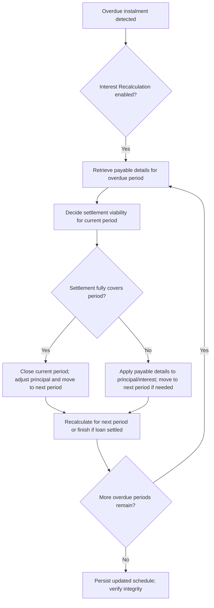

# Schedule recalculation for overdue loan accounts

This document describes how Pepper-Soup handles schedule recalculation for loan accounts when Interest Recalculation is enabled and an Instalment remains unpaid past its due date. The goal is to verify the repayment schedule remains consistent with the actual payment behavior, accruing interest over the correct periods, and regenerating principal repayment schedules as required. The material here reflects the verified calculation patterns and workflow behavior demonstrated in the reference data, including how payable details are determined, how balances and interest are adjusted, and how allocations are reconciled across overdue installments.

### Key concepts and terminology

- Interest Recalculation: A configuration that triggers recalculation of the repayment schedule when an instalment is not paid on the instalment date. When enabled, the system regenerates overdue portions of the schedule, recalculates interest for affected periods, and advances the remaining balance according to current balances and new interest accruals.
- Payable details: The amount of interest and principal that would be due for a given period given the current balance, the transaction date, and the applicable rate. The system obtains payable details via the EMI calculation component, which differentiates between current, past-due, and future periods.
- Rate factor: A multiplicative factor used in the reference calculations to project how much interest accrues over a period based on the rate and the period length. Numerous reference sheets show rate factor values driving the recalculation, including strategies that adjust EMI and interest across altered periods.
- EMI (Equated Monthly Installment): The fixed installment amount configured for the loan, used to amortize the loan over its term. In the reference data, EMI values are shown alongside principal and interest components for each period.
- Balance progression: A recurring integrity rule states that each period’s opening balance must equal the previous period’s closing balance. The recalculation logic must preserve this invariant while adjusting for payments, accrued interest, and any reallocation that occurs during the overdue processing.
- Payment allocation: When a payment is processed, the system determines an allocation order for the components of the instalment (commonly Interest first, then Principal) and updates the associated fields . The reference material emphasizes that payments are allocated with interest first in several scenarios.

### High-level workflow and decision points

1) Detect overdue instalments
- The process begins when an instalment is not paid on its due date and the account is configured with Interest Recalculation enabled. This triggers the Schedule Recalculation flow for overdue loan accounts.

2) Retrieve payable details for the overdue period
- The system consults the EMI calculator (Payable Details) to determine the amount of interest and principal that should be recognized for the current overdue period, given the current balance and the transaction date relative to the period's schedule.
- The payable details vary by scenario: for current vs. overdue periods and for immediate vs. rest-of-period calculations (see Strategy definitions in the reference). The retrieved payable details influence how much of the period is considered due and how the remaining balance will be recalculated.

3) Decide how much of the period is being settled and adjust the period if needed
- If the repayment amount available is enough to fully settle the period (i.e., EMI minus payable interest and any projected interest for the remainder of the period), the system changes the principal due for that period and marks it as settled. The period is closed, and the next period’s interest calculation starts from the current date + 1 day.
- If so much principal is paid that the remaining interest becomes unrealizable within the period, the system moves the remaining interest to the next period and recalculates from the newer outstanding balance. The “from date” for interest calculation shifts to the current date + 1 day and is treated as part of the next period.
- If the customer pays so far in advance that one or more periods are effectively closed, the system handles the resulting adjustments in balance and interest , potentially leading to zero payable interest for the remaining periods.

4) Recalculate and reallocate: balance, interest, and EMI for affected periods
- Using the current balance and updated period information, the calculator recomputes the interest for the affected days and adjusts the balance . If there is any remaining amount from the instalment after satisfying the current period’s payable components, the recalculation proceeds to the next overdue period, repeating steps 2–4 until the payment is fully allocated or the loan is settled.
- The reference data shows multiple variants (S1, S2, S3, S4) that demonstrate different rest-frequency and pre-closure behaviors. These variants illustrate how the system behaves under various early repayment and rest-of-period conditions.

5) Persist and verify integrity
- The resulting schedule must maintain the invariant that each period’s opening balance equals the previous period’s closing balance, and that payment allocations reconcile with the transaction amount. If actual accounting entries are produced, they must balance (debits equal credits) once the available data is applied. The process also verifies that any remaining cash or outstanding dues reconcile with the updated schedule.

### APIs and components involved (behavioral view)
- EMI calculator (Payable Details): Provides payable interest and payable principal details for the current overdue period, depending on the transaction date and period status. The behavior varies by whether the transaction date is before, on, or after the due date and whether the period is current, past-due, or rest-frequency-adjusted.
- Schedule recalculation engine: Orchestrates the loop across overdue periods, applying payable details, reallocating payments, and updating the repayment schedule . It handles both single-period adjustments and multi-period cascading adjustments until all overdue amounts are resolved.
- Payment allocator: Applies the available payment amount to the identified period(s) in the required order (commonly prioritizing Interest first, then Principal). It reports back the amounts allocated to each component and the remaining balance and outstanding due.
- Persistence layer: verifies that the updated schedule, balances, and status flags survive across processing cycles and COB jobs, preserving consistency with the described invariants.
- GL/accounting hooks (when available): If journal entries are produced for the recalculation events, the events balance with debits and credits and reflect the recalculated interest and principal movements.

Note: The material here reflects verified patterns and decisions demonstrated in the reference data, including how payable details are obtained, how rate factors are used to project accrual, and how the system rebalances the schedule when overdue payments are processed.

### Calculation framework: core formulas and conventions
- Installment Interest for a period: Installment Interest = Balance × (Interest Rate per Year) × (Days in period / Days in year)
 - The reference data uses Days In year = 360 and Days in period associated to the actual days between period boundaries (e.g., 30 or 31 days). The example patterns show how this formula yields small interest amounts that, when rounded, contribute to the period’s interest figure.
 - Rounding: Intermediates are rounded to two decimal places, consistent with the examples in the reference data (HALF_UP rounding is the implied convention in the published numbers).
- Rate factor concept (as depicted in the reference sheets): Rate factor is used to scale calculations across non-standard rest periods and is derived from the interest rate and the length of the period. The details vary by scenario but the factor is applied to project interest and EMI in recalculated schedules.
- Principal and balance progression: For a usual one-period payment, Principal Paid = EMI − Interest, and Balance after payment = Balance before payment − Principal Paid. The reference data shows this progression explicitly in the simple, on-time payment example (Balance 100 → 83.57 after paying 16.43 principal, with 0.58 interest).

Example anchor from the reference data (on-time payment baseline):
- Starting balance: 100
- EMI: 17.01
- Interest for the period (with 31 days, 7% annual, 360-day year): approximately 0.58
- Principal paid: EMI − Interest ≈ 17.01 − 0.58 = 16.43
- Balance after payment: 100 − 16.43 = 83.57
- This sequence is visible in the sample row for 2/1/24 in the reference data, illustrating the baseline cash-flow progression prior to any overdue recalculation.

### How the calculation flows link to the reference patterns
- S1 Installment overdue scenario demonstrates a straightforward overdue flow where a payment is processed while some principal and interest are recognized and the schedule can be recalculated for the next period as needed.
- S2 and S3 variants show adjustments when overdue repayments interact with prepayments, early adjustments, or changes to the rest frequency. These patterns illustrate the cascading recalculation logic that can advance through multiple periods and shift the from-date for interest calculations.
- S4 and related sheets illustrate late repayment adjustments where the balance may be rapidly reduced via a sequence of partial payments, with the system propagating recalculated interest to the next period until the loan is settled or the remaining due is zero.

These patterns collectively validate the architectural approach: detect overdue, obtain payable details, adjust periods as needed, reallocate payments, loop until settled, and persist results with integrity guarantees.

### Important edge cases and invariants
- Multiple overdue installments: The engine supports cascading recalculation across several overdue periods, recalculating interest on the updated balances after each adjustment.
- Early repayment adjustments: When a customer pays early or pays more than the current period’s due, the system may close one or more periods and recompute interest for future periods based on the new balance.
- Last installment and maturity: If a period is fully paid earlier than the scheduled maturity, the system can finish the amortization; no payable interest remains after maturity.
- Integrity constraints: Opening balances must equal the prior period’s closing balances; allocations must reconcile to the actual payment amount; remaining cash and outstanding dues must reconcile; journal entries (if produced) must balance.

### Diagram: overview of the overdue schedule recalculation flow

### Implementation guidance for contributors
- Behavior is driven by the need to maintain a coherent, recalculated repayment schedule when installments become overdue under Interest Recalculation. The core calculation foundation rests on the standard interest accrual formula used in the reference: Installment Interest = Balance × (Interest Rate per Year) × (Days in period / Days in year).
- The system uses payable details to determine how much of an instalment’s EMI is attributed to interest and principal for the overdue date. If the repayment amount is sufficient to settle the period, the principal portion is adjusted and the period is closed. If the payment does not fully cover the period’s payable, the system carries forward the remainder to the next period and recomputes from the updated balance.
- The payment allocator follows a priority pattern (typically allocating to Interest first) per the reference notes, with subsequent principal allocation as available funds permit.
- The architecture supports several scenario-driven strategies (e.g., rest-frequency adjustments or daily- vs monthly-based accruals). Implementations should respect the rate factor logic and verify that calculated balances and interest follows the referenced patterns.
- Tests should verify the invariants: (a) opening balance of each period equals the previous period’s closing balance; (b) total payments allocated equal the transaction amount; (c) remaining cash and outstanding balances reconcile after each recalculation; (d) journal entries (if produced) balance.

### Summary of risk considerations
- Precision and rounding: The system relies on two-decimal rounding in the reference scenarios (HALF_UP convention implied). verify consistent rounding across all intermediate steps and final totals.
- Edge-case handling: Overdue cascading adjustments may push interest into subsequent periods. The implementation should robustly handle multiple iterations, possibly across several periods, until the loan is settled or no further adjustments are required.
- Data consistency: After each recalculation cycle, the schedule should preserve the invariant that the opening balance equals the prior closing balance. Reconciliation checks should be part of the finalization step.

This publication captures the verified behavioral model, calculation framework, and decision flow for the Schedule recalculation feature for overdue loan accounts with Interest Recalculation enabled. For contributors, the material provides a coherent reference to the core formulas, the pivotal payable-details concept, and the end-to-end recalculation workflow validated by the reference data.