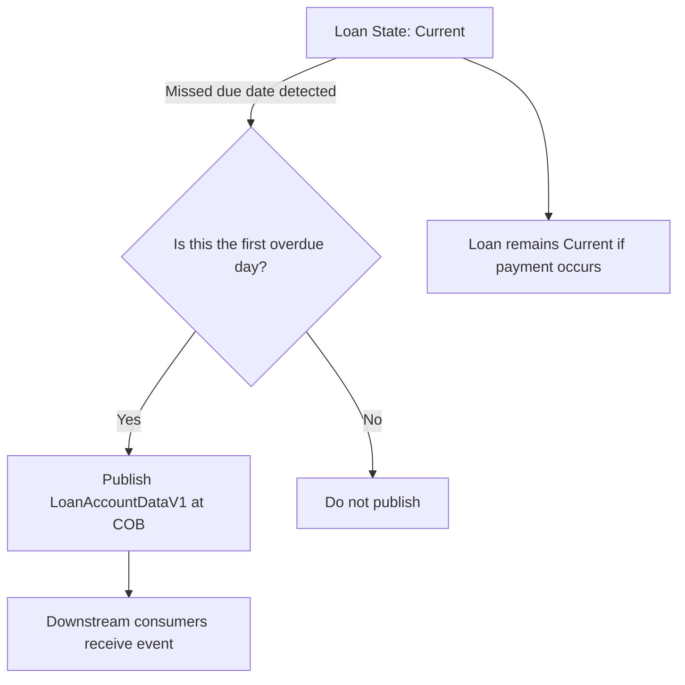

# Dev - Pi 30 - Post-Production Stability

The Custom triggered snapshot events feature for Pi 30 provides a per-loan, near-real-time view of loan account state when a loan becomes overdue. For Pi 30, which is a single-installment product with mandatory recurring payments, most loans clear on the installment due date. When an installment remains unpaid, the loan transitions to a past-due state at the end of the day. This capability publishes a snapshot of the loan account data to downstream consumers, making the latest past-due information available for client systems and integrations that rely on loan accounting data.

### Scope and data contract

The event publishes a complete account snapshot using the LoanAccountDataV1 schema. The data payload includes fields that convey the loan status, current balance, the repayment schedule, and collection-related data. The intent is to provide a complete view of the loan at the moment it becomes past due, so client systems can reflect the latest information back to borrowers and stakeholders.

This event is emitted only when the installment is not paid or when there is any overdue amount. It is not emitted for periods where the loan remains up-to-date or when no overdue amount exists.

The publication semantics are designed to minimize noise: the event is produced specifically on the first day the loan becomes overdue, and not on subsequent overdue days. If the loan subsequently remains overdue for additional days, no additional events are emitted for those later days unless a new triggering condition is met.

### Trigger rules and COB behavior

- Trigger condition: the loan becomes overdue due to a missed installment. The event should be emitted only on the first overdue day. 
- Timing: the snapshot event is published at COB (close of business) processing. This follows the decision to emit the event on COB rather than throughout the business day.
- Suppression rules: if a chargeback transaction is triggered for the overdue installment, the snapshot event must not be emitted. This suppression applies to the COB-based emission window.

These rules are captured to provide consistent, predictable behavior across PB (point of sale) integrations and back-office reconciliations, while avoiding duplication of notifications across overlapping events.

### Execution context and architectural responsibilities

The feature relies on a COB-time processing component that reads the current loan state and overdue indicators from the persistent data store and publishes the LoanAccountDataV1 snapshot when the trigger conditions are satisfied. The data published conforms to the LoanAccountDataV1 schema and includes loan status, balance, repayment schedule, and collection data.

Key responsibilities include:

- Determining the first overdue day: detect when a missed due date marks the loan as overdue for the first time.
- Condition verification: verify that the installment is not paid and that no chargeback has occurred for the involved installment prior to emission.
- COB emission: publish the snapshot at the close of business to downstream consumers that rely on the latest past-due information.
- Data integrity: verify the event payload follows the LoanAccountDataV1 schema and represents the current state of the loan at emission time.

The implementation encapsulates these duties in the COB processing path, which reads loan state and overdue indicators and interacts with the event delivery mechanism to disseminate LoanAccountDataV1 payloads to registered consumers.

### Data model and event content

- LoanAccountDataV1: A schema that carries a consolidated view of a loan account. The event payload includes at least the following aspects:
 - loan status (e.g., current, past_due)
 - current loan balance
 - repayment schedule (structure/dates and amounts)
 - collection data (relevant to delinquency handling and collection steps)

The exact field set is defined by LoanAccountDataV1, and the event carries the complete representation of these fields at the moment of emission.

### Operational flow (high-level)

This diagram illustrates the core trigger: only on the transition to the first overdue day does the system publish the snapshot at COB. If the loan becomes overdue again after the first day, no additional event is emitted for those subsequent overdue days.

### Edge cases and considerations

- Chargebacks: A chargeback transaction triggered for the overdue installment suppresses the event emission. The system must evaluate chargeback presence before emitting at COB.
- COB timing: Emission occurs as part of COB processing to align reconciliations and downstream processing windows.
- Data completeness: Since the event includes LoanAccountDataV1, downstream systems should be prepared to receive a complete account snapshot and reconcile it with their own ledgers and state.
- Idempotency and duplicates: The design emphasizes a single emission on the first overdue day for a given loan installment. Downstream consumers should assume at-most-once delivery for the first overdue event per installment occurrence, subject to their delivery semantics.

### Public interface and integration considerations

The published event exposes the LoanAccountDataV1 payload to registered consumers. There is no presented REST contract or public API signature in the reference data. The behavior is defined by the event emission rules and the LoanAccountDataV1 schema; consuming systems should rely on the schema and the timing semantics described here.

### Audit and observability notes

- The event emission is driven by COB processing and contingent on the first overdue day, non-payment, and absence of a chargeback.
- Downstream consumers should correlate the LoanAccountDataV1 payload with their own records to reflect the latest delinquency snapshot for the affected loan.

### Summary of verified behavior

- A snapshot event is published only when an installment is not paid or when there is an overdue amount.
- The event is emitted on the first day the loan becomes overdue, and not on subsequent overdue days.
- Emission occurs at COB processing, and the event is suppressed if a chargeback transaction is triggered for the installment.
- The event payload uses the LoanAccountDataV1 schema, containing loan status, balance, repayment schedule, and collection data.

If you require a more detailed mapping of LoanAccountDataV1 fields or a concrete integration example, please provide the approved field definitions for LoanAccountDataV1 or the consumer contract, and we can align the documentation while remaining faithful to the verified behavior described above.