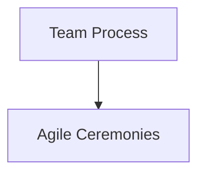

# Agile Ceremonies

In Pepper-Soup, Agile Ceremonies is represented as a process-level construct within the Team Process. It governs the rituals teams perform within an iteration and is accessible through the established governance navigation path. The published reference identifies Agile Ceremonies as a process with a clearly defined place in the Team Process hierarchy, but it does not publish implementation-level services, interfaces, or data models for this construct.

### Overview

The Agile Ceremonies page designates it as a process, intended for governance of the team rituals that occur during an iteration. The available public material provides only the high-level placement and purpose of this construct within the Team Process, without detailing technical execution, service boundaries, or integration points.

### Verified metadata (from the reference material)

- Classification: process
- Navigation path: Process and Team > Team process > Agile Ceremonies
- Audience: contributor | backend Java engineers, system integrators, and Fineract contributors
- Content scope: The reference describes Agile Ceremonies at a process level with an Overview entry but does not publish implementation-specific details such as service contracts, REST interfaces, data models, or persistence schemas.

### Technical execution pipeline (status)

There are no verified descriptions of a technical execution pipeline for Agile Ceremonies in the current reference. Consequently, no service triggers, processing sequences, transaction boundaries, idempotency guarantees, or database state mutations are published for this construct. Likewise, there is no documented treatment of batch jobs or COB tasks, scheduling expressions, failure handling, event sequencing, retry logic, or at-least-once delivery related to Agile Ceremonies.

### External interactions and ledger considerations

The reference data does not publish any interaction contracts with external systems or ledger postings specific to Agile Ceremonies. No external system interfaces, messaging contracts, or accounting postings are described for this process in the available material.

### Conceptual relationship diagram

### Notes on scope and future work

The current public materials establish Agile Ceremonies as a process within Team Process but do not disclose the operational, transactional, or integration aspects that would typically accompany a fully realized execution workflow. Any future publication that adds technical execution details should cover:

- Service triggers and processing sequence within the Agile Ceremonies lifecycle
- Transaction boundaries and persistence mutations associated with ceremony events
- Idempotency guarantees and handling of repeatable actions
- Scheduling and execution semantics for batch or COB tasks (if applicable)
- Event sequencing, retry policies, and at-least-once delivery guarantees (with edge-case handling)
- Interaction contracts with external systems or ledger postings, including data formats and acknowledgment semantics

This page reflects the current, verified publication status: Agile Ceremonies is defined as a process in the Team Process with a stated navigation path and audience, but implementation-level details are not published in the reference data.