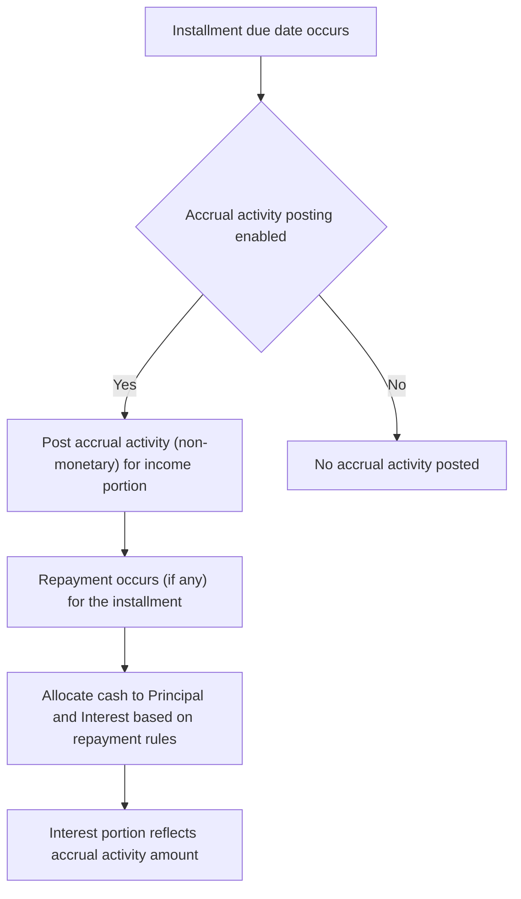

# Accrual Activity Posting on Installment date

This page documents the enhancement that introduces a new non-monetary transaction type called accrual activity. The accrual activity is posted on the Installment due_date for the installment’s income portion. The feature provides visibility into accrued income associated with each installment, independent of cash movements, and integrates with subsequent repayment processing to reflect the income recognition on the installment date.

Why this matters to day-to-day operations
- It records accrued income tied to installments on the exact due date, without moving cash. This supports revenue recognition alignment with the installment schedule.
- It affects how repayment breakdowns are interpreted, by associating part of the income recognition with the repayment’s interest portion when a payment occurs on or after the due date.
- It handles adjustments such as early payments and reversals by applying or replaying accrual activity against the installment’s repayment, as described in the scenarios that follow.

What changes in the system
- A new non-monetary transaction type named accrual activity is available under the accruals workflow. The posting occurs on the installment due_date for the income portion of the installment.
- The accrual activity transaction has the following characteristics: Transaction Type = accrual activity, Transaction date = the installment due_date, amount = accrual amount, Principal = 0, Interest = accrual amount. The accrual activity does not generate a cash movement (no debit or credit to cash accounts).
- When a repayment is posted for the installment, the repayment breakdown includes the accrual amount in the Interest portion, reflecting the recognition of the accrued income on the same installment date (as shown in the reference scenarios).
- The feature supports adjustments like early payments and reversals. In scenarios involving reversal, accrual activity may be reversed and replayed to reflect the corrected accrual in the repayment schedule.

How accrual activity interacts with repayments (conceptual)
- On the installment due date, the system creates a non-monetary accrual activity entry representing the income portion’s accrual for that installment.
- When the borrower makes a repayment for that installment, the standard repayment processing occurs. The interest portion of that repayment corresponds to the accrual activity amount posted on the due date in the observed scenarios.
- The principal portion of the repayment reduces the outstanding loan balance as usual; the accrual activity does not itself move cash but aligns the timing of income recognition with the installment schedule.

Workflow for posting accrual activity on the Installment due date
1) On the installment due date, the system posts an accrual activity transaction for the loan and installment that is due. The posting is non-monetary and records the accrual amount against the income portion.
2) The accrual activity row is created with:
 - Transaction Type: accrual activity
 - Transaction date: the Installment due_date
 - Amount: accrual amount
 - Principal: 0
 - Interest: accrual amount
 - Installment Date: the installment’s due date
3) The posting does not move cash and does not alter the principal balance at the time of posting; it only affects the income recognition for that installment.
4) When the borrower makes a repayment for that installment, the system processes the payment using the standard repayment logic. The Interest portion of the repayment reflects the accrual activity amount on the due date (as shown in Scenario 1 and Scenario 2).
5) If an early payment occurs, the accrual activity for the paid installment remains in the record, and the repayment reflects the associated principal and interest allocations (Scenario 2 demonstrates this alignment).
6) If a reversal of an accrual or a daily accrual is performed, the system can reverse and replay accrual activity to follows the corrected accrual in the repayment schedule (Scenario 3 demonstrates the reversal and replay flow).

 from reference scenarios
- Scenario 1 (on-time payment, accrual activity posting on the due date) shows an accrual activity of 20 posted on 2/1/22, followed by a repayment on 2/1/22 of 220 with principal 200 and interest

20. The accrual activity amount matches the interest portion of the repayment.
- Scenario 2 (early payment) shows an accrual activity of 10 posted on 2/1/22, followed by a repayment on 2/1/22 of 220 with principal 210 and interest

10. Again, the accrual amount follows the interest portion of the repayment.
- Scenario 3 (early part payment reversal) illustrates how accrual activity can be reversed and replayed to reflect corrected accrual, impacting the repayment breakdown for the installment (the reference data demonstrates the reversal and replay sequence and its effect on the repayment view).

Scenarios at a glance (compact view)
Scenario 1: On-time payment
| Event | Date | Amount | Principal | Interest | Installment Date | Notes |
|---|---|---|---|---|---|---|
| Disbursement | 1/1/22 | 1200 | | | 1/1/22 | Initial loan disbursement |
| Accrual activity | 2/1/22 | 20 | 0 | 20 | 2/1/22 | Accrual activity posted on due date; income portion accrues |
| Repayment | 2/1/22 | 220 | 200 | 20 | 2/1/22 | Repayment includes principal and interest; interest matches accrual amount |

Scenario 2: Early payment
| Event | Date | Amount | Principal | Interest | Installment Date | Notes |
|---|---|---|---|---|---|---|
| Disbursement | 1/1/22 | 1200 | | | 1/1/22 | Initial loan disbursement |
| Accrual activity | 2/1/22 | 10 | 0 | 10 | 2/1/22 | Accrual activity posted on due date; income portion accrues |
| Repayment | 2/1/22 | 220 | 210 | 10 | 2/1/22 | Repayment includes principal and interest; interest equals accrual amount |

Notes:
- The accrual activity transaction is a non-monetary posting that records the accrual amount against the income portion of the installment. It does not move cash at posting time. When a repayment occurs, the interest portion of the repayment can reflect the accrual amount.
- The scenarios illustrate the linkage between accrual activity amounts and the interest portion of associated repayments.

Reference calculations and notation
The following excerpt from the reference calculations shows the observed alignment between accrual activity amounts and the interest portion of repayments on the due date:

Accrual activity (Scenario 1)Amount 20; Principal 0; Interest 20; Installment Date 2/1/22

Repayment (Scenario 1)Amount 220; Principal 200; Interest 20; Installment Date 2/1/22

Accrual activity (Scenario 2)Amount 10; Principal 0; Interest 10; Installment Date 2/1/22

Repayment (Scenario 2)Amount 220; Principal 210; Interest 10; Installment Date 2/1/22

Mermaid diagram: accrual activity posting workflow

Integrity and operational notes
- Each period’s opening balance must equal the previous period’s closing balance.
- Payment allocations must reconcile with the transaction amount on the repayment; the principal and interest components must sum to the repayment amount.
- The remaining cash and outstanding dues must reconcile after each transaction posting and repayment.
- Where actual journal entries are available, they should balance (debits equal credits). Since accrual activity is a non-monetary posting, no cash journal movement is generated at posting time; the journals would reflect standard repayments and any other monetary movements.
- Rounding and precision follow the system’s established conventions; use the documented rounding method (HALF_UP or HALF_EVEN) to the monetary portions in repayments, while accrual activity itself is non-monetary and does not involve cash rounding.

Publication notes
- This page describes verified product behavior and presents it in a way that supports day-to-day operations, loan approvals, and branch-level administration. It uses the navigation path provided for context: Interest and Accrual > Accruals > Accrual Activity Posting on Installment date.
- No internal development artifacts, source identifiers, or confidential references are included here. All behavior described follows the observed reference data for accrual activity posting on installment due dates.

Diagram legend
- The diagram illustrates the lifecycle: on the installment due date, accrual activity is posted as a non-monetary entry for the income portion; when a repayment occurs, the repayment’s interest portion follows the accrual amount; principal is applied to reduce the loan balance as usual; in cases of reversal, accrual activity can be reversed and replayed to reflect the corrected accrual in the repayment.