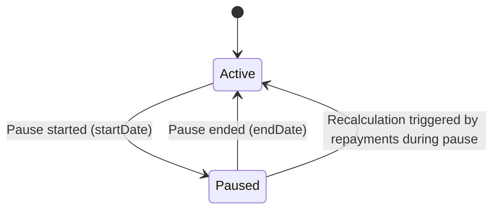

# Pause/resume interest accruals on a loan

The pause/resume interest accrual feature allows servicing staff to suspend interest accrual for a defined interval on a progressive loan and to resume accrual when the pause ends. The business aim is to align interest recognition with a customer’s payment hardship, so that interest does not accrue across paid holidays and does not unduly burden the customer while a payment holiday is in effect. This feature benefits loan officers, operations staff, branch managers, and credit agents by providing controlled, auditable handling of interest during specified windows while preserving the integrity of the amortization schedule and related calculations.

### Scope and eligibility

- The feature is supported for progressive loans with the recalculation flag set to true (recalculate interest). If either condition is not met, the pause function is not available.
- A pause can be created for any loan life-cycle window by specifying a start date and an end date. The start date can be any date (but cannot be on or after the loan maturity date). The end date cannot extend beyond the loan maturity date.
- Interest will not accrue for the days covered by the pause window. That means no daily interest is recognized on those days.
- Multiple pauses can be configured for a single loan during its life cycle, but pauses must not overlap with one another.
- The pause process does not require a resume action; the loan automatically returns to accrual after the end date of the pause.
- If a backdated start date is used and repayments occur between the start date and the date of reconciliation, the system triggers recalculation. Accrual adjustments are applied to reflect any difference in interest recognition caused by the backdated pause.
- If penalties or charges are added based on a percentage of interest, those charges will be reversed and replayed in accordance with the revised interest calculation. Charges created on other bases are not affected by the pause.
- No accrual journal entries are posted for the days encompassed by the pause period.
- The pause calculation remains consistent for payoff, charge-off, and reschedule calculations.
- The “Pause start date” and “Pause end date” are inclusive for interest pause calculation.

### How the system models pause calculations (conceptual view)

During an active pause window, the system suppresses daily interest accrual for each day within the window. When the pause ends, the system resumes accrual based on the then-current balance and the continuing schedule. If, in the period between the pause start and end dates, repayments occur, the system may reverse and replay those repayments as part of recalculating interest for the affected cycle. Any resulting accrual differences are reconciled through an accrual adjustment.

To help visualize when an accrual is active and when it is not, consider the following simplified lifecycle: the loan is in an Active accrual state, then transitions to Paused for the duration of the pause window, and returns to Active when the end date is reached. If backdated pauses occur and repayments happen within the paused interval, the system may transition through a recalculation state, after which accrual resumes.

### Operational workflow (UI navigation and steps)

The pause feature is accessible under the loan’s Interest and Accrual area. Follow these steps to pause interest accrual for a loan:

1. Open the loan record and navigate to the path labeled **Interest and Accrual > Accruals > Pause/resume interest accruals on a loan**.
 - System outcome: The loan’s accrual control panel is displayed with pause-related inputs.
2. Click **New Pause** (or the equivalent action in your UI) to begin a pause entry.
 - System outcome: The pause entry form appears with fields for pause start and pause end dates.
3. Enter the pause window:
 - **Pause start date**: select the desired start date.
 - **Pause end date**: select the desired end date.
 - If the start date is in the past relative to today, backdating is allowed per policy and will trigger recalculation if repayments occurred during the paused interval.
 - System outcome: The system validates the window against eligibility rules (non-overlapping with existing pauses, start before maturity, end no later than maturity).
4. Save the pause window.
 - System outcome: The loan’s accruals are re-evaluated for the pause interval. No accruals are recorded for the days within the pause. If the pause is backdated and repayments occurred during the paused interval, the system schedules an accrual adjustment and, if needed, replays those repayments in the correct order.
5. Review the updated accrual schedule and pause summary:
 - The UI displays the pause window, total pause days, and the updated balance/interest trajectory after applying the pause.
 - If multiple pauses exist, the system verifies non-overlapping windows are maintained and shows a consolidated view of all pauses.
 - System outcome: The loan record reflects that interest accrual is paused for the specified days, and the subsequent accrual continues from the end of the pause window using the recalculated balance.

Note: The feature does not require a separate “Resume” action. A pause ends automatically at its end date, and accrual resumes thereafter. If a backdated start date is used, any necessary recalculation is triggered to align the interest recognition with repayments and the revised pause window.

### Calculation model and worked references

Financial calculations underpin the behavior described above. The model uses the following baseline inputs, which are evidenced in the reference data for a representative loan:

- Principal: 100
- Interest rate: 7% annually
- Days in year: 360
- Days in month: 30
- Repaid every: 1 month
- Early monthly installment (EMI): 17.01

From these inputs, the per-day interest rate used in calculations is derived as r = 0.07 / 360 ≈ 0.000194444 per day. In the period outside a pause, daily interest accrues on the outstanding balance using this rate. During the defined pause window, daily interest accrual is suppressed, resulting in zero accrual for each day within the pause, and the outstanding balance at the end of the pause window is carried forward to resume accrual with the next scheduled payment.

The reference data demonstrates two representative pause scenarios:

- S1: Pause calculation within the same period, with a pause window defined and the balance carried forward into the subsequent accrual cycle. In the example, the pause window is defined as a finite set of days within a single period, and the calculation shows how the balance evolves before and after the pause while the EMI remains the same when resuming. The calculation context notes that the total pause days equals the defined window length, and the period continues from the point where accrual resumes.
- S2: Pause calculation between two periods, illustrating how the system handles pauses that span multiple scheduled accrual events and how the balance and interest components are adjusted when pausing occurs across period boundaries. The reference shows the capacity to pause across dates that bisect payment timing and to re-align the balance and interest components after the pause ends.

Important note about the calculation workflow:
- The pause window is inclusive of the start and end dates for interest pause calculation.
- If repayments occur within the pause window, the system reverses and replays the affected repayments as part of recalculation, and an accrual adjustment may be generated to reflect any difference in interest recognition.
- Accrual-related penalties or charges that are created based on percentage-interest rules will be reversed/replayed in alignment with the revised interest calculation; other penalties unaffected by interest pause remain unchanged.
- No accrual entries are posted for days within the pause window.

### Worked example inputs (representative values)

Parameter grid (representative values drawn from the reference data):

 
Principal100

 
Interest rate7% (0.000194444 per day)

 
Days in year360

 
Days in month30

 
EMI17.01

In a sample where a pause window is placed within the same period (S1), the system recognizes the pause window and reduces the interest accrued for the pause days to zero. The period resumes with the subsequent EMI, using the recalculated balance. In a sample where the pause spans two periods (S2), the balance and interest allocations are recalibrated at the pause boundary, and any repayments during the pause trigger recalculation with associated adjustments.

### Post-pause outcomes and reconciliation

- After the pause ends, accrual resumes on the outstanding balance using the standard daily rate, and the next EMI continues per the loan’s amortization schedule.
- The total interest recognized for the cycle is reduced by the amount of interest that would have accrued during the pause window (subject to any backdated adjustments and repayments that were reversed/replayed during recalculation).
- All subsequent schedules reflect the updated balance, interest, and principal allocations, and the system shows a consolidated view of all pauses and their effects on the current balance and future payments.

### Edge cases and exceptions (evidenced behavior)

- Pause windows cannot overlap; attempts to create an overlapping window should be rejected with a clear validation message.
- Pause windows must be fully contained within the loan’s life, with start before maturity and end no later than maturity.
- A pause can be backdated; when repayments occur between the pause start and the reconciliation date, the system recalculates the affected period and applies an accrual adjustment as needed.
- Pause does not affect penalties that are not based on interest rate or do not rely on interest accrual timing; penalties based on percent-of-interest may be reversed and replayed in line with revised calculations.
- If the loan reaches payoff or is charged-off or rescheduled, the pause calculation logic remains consistent with the described rules for maintaining correct interest recognition.

### Summary for operators

- The Pause/Resume Interest Accruals feature suspends interest accrual for a defined window on progressive loans with recalculation enabled.
- It supports multiple non-overlapping pause windows and backdated pauses that trigger recalculation when repayments occur within the paused interval.
- The feature does not require a dedicated resume control; accrual resumes automatically at the end of the pause window.
- All system behavior is visible in the loan’s accrual schedule and pause summaries, and adjustments are applied where needed to maintain financial integrity.

If you need to apply multiple pauses across a loan’s life, plan the windows to avoid overlap and validate that each end date remains before maturity. After each pause, review the accrual schedule to confirm that no interest was charged for paused days and that recalculations follows repayments and the updated balance.