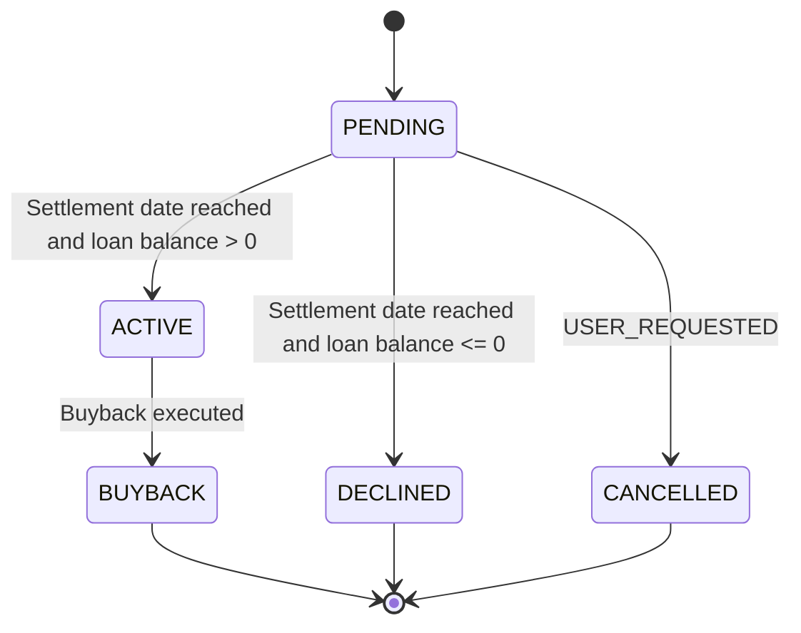

# Asset Externalization in Fineract

Asset externalization is a modular capability that allows the transfer of loan ownership from an internal portfolio to an external investor (the asset owner). The feature records and enforces the lifecycle of ownership transfers, from initiation through settlement, including sale and buyback scenarios, and tracks the resulting accounting and reporting implications. It provides visibility to operations staff, loan officers, branch managers, and credit agents about who owns a given asset, under what conditions, and when changes take effect on the customer’s loan. The function is designed to support reporting and analytics for downstream systems by exposing a transfer record with an external owner and related identifiers, while preserving a clear audit trail of status changes and dates. 

Roles that benefit include:
- Investors (external asset owners) who gain visibility into loan ownership and related events.
- Business Managers who manage investor relationships, decide on asset sales or buybacks, and oversee related journal activity and reporting.
- Operations staff and loan officers who execute and monitor asset transfers, validate eligibility, and verify COB handling rules are applied consistently.

> Note: This page describes verified product behavior, its business purpose, and how users observe results in day-to-day operations. It does not document internal design decisions or development history.

---

## Key concepts

- Asset Owner (external): The external party identified by a unique external identifier who owns a given loan after a transfer.
- Settlement Date: The date at which ownership becomes effective (the end of day that closes the transfer). For buyback and sale, the settlement date is treated as the date on which the transfer outcome is finalized in COB processing.
- Effective Date Range: The active period during which the transfer is considered valid for ownership; from a start date to an end date, inclusively.
- Purchase Price Ratio: The percentage of ownership acquired by the external owner, expressed as a number between 0 and 100 (for example, 100% implies full ownership transfer).
- Transfer Status: The current state of an asset transfer. Implemented statuses include PENDING, ACTIVE, BUYBACK, DECLINED, and CANCELLED.
- Transfer Type: SALE (asset sale to an external owner) or BUYBACK (asset repurchased by the original owner or related party).
- External identifiers: External transfer IDs and related sales transaction identifiers used to correlate records in downstream systems.
- Journal entry relationship: An accounting linkage exists between asset ownership transfers and journal entries to support auditing and reporting for external ownership. The precise mapping and journal definitions are subject to implementation decisions and are described at a high level in public design materials, with actual entries Defined in product configuration .

These concepts are used consistently across all workflows described in the Use Cases and Rules sections.

---

## How asset externalization works (Lifecycle overview)

The lifecycle consists of initiation, COB processing, and potential follow-on events such as buyback or cancellation. The system enforces business rules to verify only eligible loans can be transferred and that settlement timing follows COB processing. A transfer progresses through a small set of discrete statuses, and each transition is observable via events that propagate to downstream systems.

- Initiation (SALE or BUYBACK): A transfer request is created for a loan currently in an eligible state (typically ACTIVE). The transfer request includes the asset owner (external), an optional sales transaction identifier, the purchase price ratio, and the settlement date. The transfer begins in a PENDING state.
- COB Processing: At COB (end of business day), the system evaluates the transfer against business rules (for example, balance conditions). If the loan balance is greater than zero, the transfer becomes ACTIVE. If the balance is zero or negative, the transfer is DECLINED. A user can cancel a PENDING transfer before COB, in which case the transfer becomes CANCELLED.
- Buyback and further actions: If a transfer is BUYBACK, the same COB timing rules apply, and the transfer can transition through ACTIVE to BUYBACK depending on the balance and timing. Transfers cannot be initiated when a previous transfer is still in PENDING without COB resolution; the system enforces rules analogous to those governing monetary activities.
- Freedom of cancellation: A transfer that is in PENDING may be cancelled by the user prior to COB. Cancels do not alter completed COB outcomes and do not apply to transfers that have progressed to ACTIVE or BUYBACK.
- Observability: Events are emitted to inform downstream systems about ownership changes. The design includes events that carry asset owner information and transfer context, enabling reporting and analytics in downstream systems.

The following diagram summarizes the asset ownership status flow and the key transitions.

---

## Functional lifecycle: Use cases and rules

### UC1: Initiate asset transfer
1. A user (with standard permissions) initiates an asset transfer for a loan. The request must specify the external asset owner, a purchase price ratio, and a settlement date. The system requires the following validations: the Asset Owner Identifier must be provided and limited to 100 characters; the Settlement Date cannot be in the past; the Purchase Price Ratio must be provided and valid as a numeric value. The transaction is created in a PENDING state and is associated with the loan. If a transfer for the same loan is already in a PENDING state, the new request is rejected.
2. If the loan is eligible (for sale) and the request passes validations, the system returns a transfer record with a new internal transfer id and an externally visible transfer id if provided. The initial status shown to users is PENDING or a associated pending indication.
3. If the loan balance or other eligibility conditions would prevent transfer at initiation, the system reports the NOK condition with an explanatory reason.

### UC1.1 OK and UC1.2 NOK (initiation scenarios)
- OK: Initiation proceeds for eligible loans and available asset owners with required information supplied.
- NOK - pending conflict: If there is already a pending transfer for the same loan, initiation is rejected with a conflict condition.

### UC1.3 NOK - loan balance conditions
- If the loan balance is closed or overpaid, initiation is rejected because there is no balance to transfer to an external owner.

### UC2: Execute asset transfer
#### UC2.1: OK - Sale
- If the transfer is initiated as a SALE and the COB window and balance conditions are satisfied, the transfer can be finalized as ACTIVE at COB, making the asset ownership change effective for the asset owner and enabling downstream reporting.
#### UC2.2: OK - Buyback
- If the transfer is initiated as a BUYBACK, the system follows the same COB timing, and the transfer can become ACTIVE or proceed to BUYBACK according to the balance and COB rules.
#### UC2.3: OK - Pending → Buyback on the same day
- The design supports a scenario where a transfer remains PENDING and then transitions to BUYBACK within the same business day if conditions allow.
#### UC2.4 DEPRECATED: NOK - Declined sale due to already closed loan
- Previously documented behavior that a sale could be declined if the loan balance had already been fully settled is deprecated as a supported pathway in favor of current COB-based rules, which evaluate balance at settlement.

### UC3: Loan got closed
#### UC3.1 OK - Buyback executed when the loan got closed
- If a loan closes while a BUYBACK transfer is pending, the system may complete the buyback according to the COB process and close the transfer , per policy.
#### UC3.2 NOK - Sale declined when the loan got closed
- If a sale attempt would result in no balance because the loan is closed, the transfer is declined.
#### UC3.3 NOK - Buyback and sale cancelled when the loan got closed
- If there is a conflicting state at close, the system may cancel pending actions in alignment with the COB and policy rules.

These use cases describe verified behavioral pathways for initiating and executing asset transfers, handling buybacks, and addressing loan closure scenarios. They are designed to verify that asset ownership transitions are traceable, auditable, and compliant with settlement timing.

---

## Rules, constraints, and edge cases

- Initiation is captured by API interactions; the actual transfer completion occurs at COB. This separation verifies that the COB process correctly finalizes ownership changes and related accounting implications.
- Settlement date is mandatory for buyback requests and for many sale requests. Transfers include a settlement date and owner information; some fields may be optional in certain contexts, but settlement timing governs state transitions.
- Asset Owner Identifier is required for SALE operations and has a maximum length (up to 100 characters) to maintain data integrity and uniqueness guarantees for external ownership records. The Sales Transaction ID is optional but, if provided, must be a string with a practical length limit.
- Transfer state transitions are governed by COB processing: PENDING advances to ACTIVE when settlement conditions are met and the loan balance is greater than zero; if the balance is zero or negative, the transfer is DECLINED. Cancellations are permitted only while a transfer remains in PENDING.
- Only transfers in TRANSFER_IN_PROGRESS or TRANSFER_ON_HOLD loan statuses are eligible for ownership movement through the API; transfers are restricted by the same policy constraints as monetary activities for timing and risk management.
- The system supports assets with pending ownership transfers being cancelled. If a cancellation occurs, the transfer status becomes CANCELLED and no journal entries are created for that transfer.
- Journal entry behavior and mapping to external investors are described at a high level. Specific journal entry definitions and mappings to external owners are Defined in product configuration in the current design, with the intent to allows auditing and reporting of investor-related entries.
- An external event stream is extended to include asset owner information, allowing downstream systems to respond to ownership changes with richer context. A new event, Loan Ownership Transfer, carries key fields describing the transfer and the asset ownership context so that third-party systems can react .

---

## Events and observability

New and extended events are designed to inform external systems about asset ownership changes. The events carry data about the transfer type (SALE or BUYBACK), the external transfer identifiers, the involved loan, the asset owner, and the balance context at the time of the transfer. In addition to asset ownership context, the design supports an AccountChangedEvent and a loan snapshot to supports reconciliation and reporting at the time of ownership transitions. The precise event schema is aligned with the asset externalization design and is intended to support downstream analytics and auditing requirements.

Key externally observable pieces include:
- Transfer identifiers (internal and external)
- The asset owner’s external identifier
- The loan’s external identifier and balance context at the time of transfer
- The date of the transfer and the settlement date
- The transfer status and sub-status ()

The goal of these events is to provide visibility into ownership movements and to support reporting and analytics in downstream systems while preserving data integrity and an auditable trail.

---

## Data persistence and mapping (high level)

At a high level, the system maintains:
- A record of asset ownership transfers, including the loan, external owner, purchase price ratio, settlement date, and effective date range. The record tracks current status (PENDING, ACTIVE, BUYBACK, DECLINED, CANCELLED) and historical transitions.
- History of externalization requests and outcomes to support auditing and reconciliation.
- A linkage between journal entries and external investors to support investor-related reporting, with the understanding that precise journal-entry-to-transfer mappings may be refined as the design matures.
- A mapping between journal entries and the external asset transfer context to supports post-transaction reporting and traceability.

The data model is designed to allows auditing of ownership transfers and easy retrieval of ownership state and related financial context for a given loan and asset owner. The COB processing boundary governs the actual completion of ownership changes and the associated accounting implications.

---

## Glossary (selected terms)
- Asset Owner ID: An external identifier identifying the asset owner (investor) for a loan.
- Sales Transaction ID: An external identifier for the sale transaction (optional).
- Purchase Price Ratio: The percentage of ownership represented by the external owner in the loan, expressed as a value between 0 and 100.
- Settlement Date: The date on which ownership transfer is settled; the switch to Active typically occurs at COB on this date.
- Effective Date From / To: The date range during which the ownership transfer is considered valid and in effect.
- Transfer Status: Current lifecycle stage of the transfer (PENDING, ACTIVE, BUYBACK, DECLINED, CANCELLED).
- Transfer Type: SALE or BUYBACK; represents the direction of the ownership movement.
- External Transfer ID: The external identifier for the transfer used by external systems.
- Asset Externalization Events: Observability points that inform downstream systems about ownership changes and related context.

---

## Use cases in practice
The asset externalization feature is designed to support a disciplined, auditable flow for moving loan ownership to external investors, while maintaining strict COB-based settlement rules, clear state transitions, and reliable observability through events. The lifecycle supports sale and buyback scenarios, with standard handling for loan closure events and cancellation of pending transfers. Operations staff, loan officers, branch managers, and credit agents should use these rules as the basis for validating transfer requests, monitoring COB outcomes, and reconciling balances and ownership in customer accounts.

---

## Test and validation guidance (summary)
- Validate initiation rules: required fields, length constraints, and eligibility checks for SALE vs BUYBACK. verify a pending transfer is not created if there is an existing pending transfer for the same loan.
- Validate COB processing: balance-based evaluation at COB to determine ACTIVE vs DECLINED statuses; verify cancellation paths are allowed only for PENDING transfers.
- Validate buyback handling: same-day COB semantics for sale and buyback, with proper status transitions and any applicable cancellation rules.
- Validate loan-closed scenarios: verify that buyback execution is possible when the loan closes and that sale is declined in such a case.
- Validate event emission: confirm that asset ownership changes emit the new ownership-aware events and that downstream consumers can correlate transfers to loans and external owners.
- Validate observability: confirm that the system exposes transfer records with status, effective range, and external identifiers to allows reporting and auditing.

---

## Related considerations and policy notes
- Access control: A new permission is required for external investor module actions; only users with that permission and super user status should perform these actions.
- Data quality: Asset Owner IDs must be provided for SALE actions; the length and uniqueness constraints help verify reliable externalization references and reporting.
- Compliance with COB timing: The system applies COB-based processing rules to verify ownership changes follows daily settlement, preserving consistency with related monetary activities and reporting.

---

If you need to reference this page in training or procedures, use the concept phrases introduced here (Asset Owner, Settlement Date, Purchase Price Ratio, Effective Date Range, Transfer Status, Sale, Buyback) and align your operational steps with the lifecycle and rules described above.