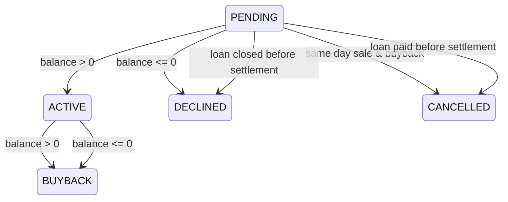
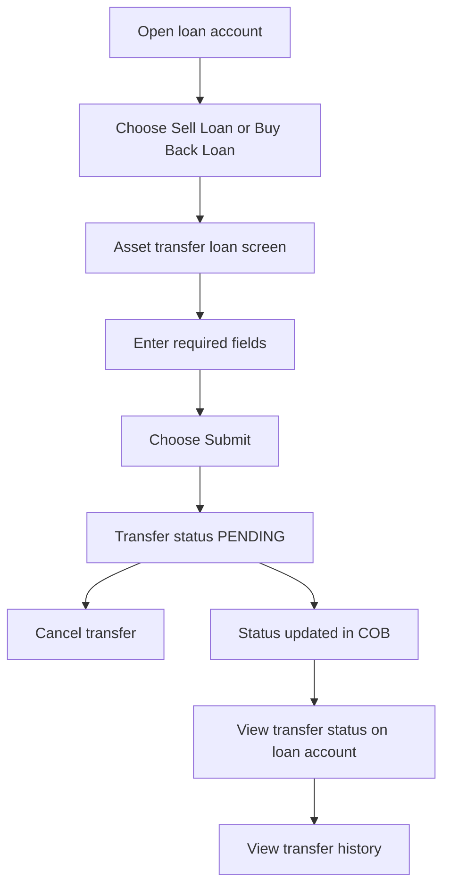

# Asset Externalization

## Asset Externalization

### Scope and configuration

Asset externalization covers loans only. The investor module for savings accounts, fixed deposits, recurring deposits and shares accounts is not included, and customisable asset owner data fields are not captured. A global configuration enables or disables the investor module, and automatic owner creation is enabled by default.

### Asset owner data and statuses

Asset owner data records who owns an externalised loan and tracks the transfer status through its lifecycle.

The system stores the following ownership data:

- Asset Owner (text field, user entered)
- Transfer ID (text field, user entered, optional, generated if not provided)
- Settlement date (date field, user entered)
- Purchase price ratio (percentage field, user entered)
- Status (system updated field)
- Created time stamp (system updated field)

When a request arrives with an unrecognised owner external id, the system creates an entry in the owner table automatically.

- Stored ownership data cannot be updated.

| Status | Meaning |
| --- | --- |
| Active | Loan is sold to investor with settlement date same or later than current date |
| Pending | Loan is selected to transfer with settlement date greater or same as current date |
| Buyback | Buyback is initiated and ownership reverts |
| Declined | Validations failed due to balance |
| Cancelled | Asset ownership request was made but cancelled before execution |

| Status | Meaning |
| --- | --- |
| Pending | Asset ownership transfer request has been made but not yet made active by COB end of day |
| Active | Asset ownership transfer is active and all journal entries are made against the investor |
| Buyback | Loan's ownership got bought back |
| Declined | Asset ownership request has been made but it is still not end of day and the loan was paid back or overpaid so there is nothing the investor could buy |

### Transfer initiation rules

You can initiate an asset transfer as either a sale or a buyback only when the loan balance is positive, no transfer is already pending or active, and the settlement date is not earlier than the business date. The system rejects transfers for loans in any status other than ACTIVE, and declines sales on closed, overpaid, submitted, or approved loan account stages.

A sales or buyback event requires the following parameters:

- From Owner identifies the current owner of the loan.
- To Owner identifies the party receiving the transfer.
- Asset Owner ID is an externally provided string identifying the owner of a particular loan and is required for a sale.
- Sales Transaction ID is an external transaction ID; the system generates it when you do not provide one.
- Purchase Price Ratio is a percentage from 0% to 100% representing the investor ownership fraction.
- Settlement Date is the last date the previous owner holds the asset; new ownership starts the next day and the date cannot be in the past.

A successful transfer returns the following information:

- resource id
- owner id
- status PENDING
- sales transaction id

Technical information associated with a transfer includes:

- transfer timestamp
- effective date range from the submitted on date to 9999-12-31
- transfer status with the value PENDING

Buyback transfers use a transfer ID different from the sale transfer ID.

> **Note:** Transfer API calls are restricted until COB has run up to the settlement date, under the same restrictions as monetary activities.

### Transfer lifecycle and COB processing

Close of Business (COB) processing settles asset ownership transfers whose settlement date equals the business date and whose valid_to remains 9999.12.31. The CoB step completes the actual transfer. Buyback is accepted when the loan has ACTIVE transfer status or when the loan has PENDING transfer status with the same effective date. Account ownership transfer can only happen after (or at the end of) Close of Business.

COB applies the following outcomes to pending transfers:

- A pending sale becomes ACTIVE when the account balance is greater than 0.
- A pending sale becomes DECLINED when the account balance is less than or equal to 0.
- A pending buyback becomes BUYBACK when the account balance is greater than 0.
- A pending buyback becomes [none] when the account balance is less than or equal to 0.
- Pending transfers become ACTIVE transfers only if balance is greater than or equal to 0.

Other COB behaviour includes:

- A pending sale is declined if the loan is closed before the settlement date.
- A pending buyback is cancelled with a new substatus when the loan is closed before the settlement date.
- When a pending sale and pending buyback exist and the loan is paid fully before the settlement date with different settlement dates, the pending sale is declined and the buyback is cancelled.
- When asset externalisation is pending and the loan gets paid, COB does nothing because COB does not catch up closed loans.
- A closed loan can be selected for sale or buyback even though COB will not catch them up.
- A sales request can be made for a loan that is not approved or disbursed, but if the settlement date was before approval or disbursement, COB will not pick up the loan and the sale will not become ACTIVE.

Cancellation rules are:

- A cancel action exists for a pending sale or an incomplete buyback, applicable only before those transfers are settled.
- At cancellation, the valid_to of the cancelled record is set to NOW.
- Sale transactions can be followed by buyback; in that case both get CANCELLED.
- Sale and buyback on the same settlement date result in no owner transfer and no journal entries, with both pending sale and buyback cancelled.

Listener behaviour on loan closure or overpayment is:

- When a sales transaction is pending and the loan gets closed or overpaid, the system declines those pending sales transactions through business listeners.
- When a buyback transaction is pending and the loan gets closed or overpaid, the system accepts those pending buyback transactions through business listeners.

> **Note:** An internal server error occurs from Inline COB when asset externalisation sales and buyback settlement dates are the same.

### Same-day sale and buyback

When a sale and its buyback settle on the same day, the system creates GL entries for both transfers, with the sale entry first and the buyback entry last. The investor does not change the GL entries; it appears only as a comment or tag, while the same entries are used.

### Buyback specifics

A business manager can buy back loans with active ownership transfer from investors when the loan account becomes fraud or for any other reason. The buyback is another activity with an external Buyback Transfer ID.

The buyback API request requires the following fields:

- Settlement date is mandatory.
- Transfer ID must be present.
- Owner ID can be null.

Cancelling a buyback works as follows:

- Cancel does not require a settlement date on the API request.
- Cancel always refers to the current PENDING transfer.
- Cancelling buyback is not supported at the moment.

### Journal entries and GL mapping

The system posts journal entries for asset owner changes and buybacks as part of the COB jobstep on the settlement date. If the loan account balance is zero or negative before COB on that date, the asset transaction is declined and no journal entries post.

Monetary transactions include an asset owner column that identifies the investor linked to the loan account.

- The column stores the current asset owner ID of the loan account.
- Transactions with a business date on or before the settlement date carry the old investor; transactions after the settlement date carry the new investor.
- The column is null when no active investor exists for the loan account.
- The column is always null for loan products where the investor module is disabled.
- The value is derived from the active asset owner as of the business date, regardless of transaction type, backdated transactions, reversals, charge additions, or accruals.

GL mapping for asset transfer is available when the investor module is enabled.

- You can map a new GL account for asset transfer in the loan product.
- You can also use the asset transfer option from the financial activity mappings section.

The default GL account used for asset transfer is defined as follows.

| GL code | GL name | Type |
| --- | --- | --- |
| 146000 | receivable /clearing account | Asset Account |

### Reporting

Create a new report named Transaction summary with investor. The transaction summary report includes asset owner detail, asset transfer transactions, and asset buyback transactions, and it groups and totals sums based on those transactions.

Only the investor side of a transaction is posted, so there is no Asset Transfer or Asset Buyback summary line when Asset Owner ID is null (PayPal). Balances reported equal the journal entry created where principal is the investor side of the 112601 entry and fees are the investor side of the 112603 entry.

The Trial Balance report includes asset owner detail in transaction summary reports and groups and totals sums based on the transaction summary report.

### Ownership impact and business rules

Changing the asset owner of a loan account does not affect loan account portfolio behaviour, accounting, or actual ownership; actual ownership changes at close of business. An asset transfer request on a closed or overpaid loan is unsuccessful and returns a proper error message instead of an internal server error.

Date handling rules for sales requests:

- Date handling logic is unified, and buyback and pending are similar statuses.
- Effective from and settlement date have the same meaning for buyback and pending.
- For a buyback transaction, the effective date equals the settlement date.
- When a non-existent date is provided in a sales request, no error message is provided and the system chooses the nearest valid date.

### Personas and permissions

Asset externalization involves three personas: the investor, who is a legal entity referred to as the external owner; the business manager, who is an employee of the organisation offering the loan to its customer and either decides on an asset sale or uses data related to it; and the auditor, who can see the history of a loan's ownership changes. The asset externalization goal is described on Asset Externalization requirements.

Permissions and API capture work as follows:

- Only users with the external investor module permission and super users can perform actions in that module.
- Only transfer initiation is captured by API.
- Initiation followed by buyback followed by initiation followed by buyback in the same day prior to COB is not allowed; a pending request can be followed by buyback but a second pending request will fail on the API.

### User interface and workflow

Asset externalization moves a loan portfolio from one owner to another. You can view asset owner details at the loan account level when the investor module is enabled in the environment configuration file, and the UI highlights the current owner of the loan account.

Transfers are available only on active, closed and overpaid loan accounts.

- Sale and buyback on active loans are available for the whole lifecycle of the loan.

1. Open the loan account and choose "Sell Loan" or "Buy Back Loan" from the actions to open the asset transfer loan screen.
2. Enter Settlement Date, Purchase Price Ratio and Owner External Id, optionally enter Transfer External Id, then choose Submit.
3. Open the loan account and choose "External Asset Owner" from the tab to open the external asset owner tab screen.
4. On the external asset owner tab screen, choose Sell Loan, Cancel Sell Loan, Buy Back Loan or View Journal Entries.

The asset transfer loan screen requires Settlement Date, Purchase Price Ratio and Owner External Id.

- The asset transfer loan screen offers Cancel and Submit buttons.

You can cancel an asset transfer when its status is PENDING.

- You can view the status of each transfer on the loan account view screen once updated in the COB.
- You can view the history of all previous transfer requests and their status.

No changes are made on accounting screens.

- Accounting entries are handled on reporting.

| Screen | Fields |
| --- | --- |
| External asset owner tab | Active Asset Transfer, Status, Owner External Id, Settlement Date, Effective Date, Details, Principal Outstanding, Interest Outstanding, Fees Outstanding, Penalties Outstanding, Outstanding, Overpaid, External Asset Owner, Effective From, Transfer External Id, Purchase Price Ratio, Actions |
| External asset transfer section | Status, Owner External Id, Settlement Date, Effective Date, Details, Principal Outstanding, Interest Outstanding, Fees Outstanding, Penalties Outstanding, Outstanding, Overpaid |

### Worked examples

A loan officer submits a request to sell a loan asset to an external investor. The figures in this example are illustrative. The loan has an outstanding balance of 1,000.00. The officer enters the asset owner as Investor A, sets the purchase price ratio to 100 percent, and chooses a settlement date ten days ahead. No sales transaction ID is entered, so the system generates one. The request is accepted because the loan is active and the settlement date is not in the past. The system stores the request with status PENDING and assigns a transfer ID. This example shows that a sale request is stored as PENDING with a generated transfer ID when none is supplied.

| Step | Field or check | Value entered or result | Status after step |
| --- | --- | --- | --- |
| 1 | Asset owner | Investor A | Request received |
| 2 | Purchase price ratio | 100 percent | Request received |
| 3 | Settlement date | Ten days from today | Request received |
| 4 | Sales transaction ID | Not entered; system generates one | Request received |
| 5 | Validation | Loan active, balance above zero | PENDING |
| 6 | Stored record | Transfer ID, owner, dates | Saved |

A pending sale reaches its settlement date at the close of business. The loan balance is 1,000.00, which is greater than zero, so the ownership transfers to the investor. The system posts journal entries using the closing balance. The receivable clearing account is cleared for the old owner and the loan receivable and interest fee receivable accounts are updated for the investor. If the balance were zero or negative, the status would become DECLINED instead of ACTIVE. This example shows that a pending sale becomes ACTIVE at close of business only when the balance is above zero.

| Step | Account | Asset owner tag | Debit | Credit | Effect |
| --- | --- | --- | --- | --- | --- |
| 1 | Receivable clearing account | null | 1,000.00 | - | Old owner exposure removed |
| 2 | Loan receivables | null | - | 1,000.00 | Old owner balance cleared |
| 3 | Receivable clearing account | Investor A | - | 1,000.00 | Investor exposure recorded |
| 4 | Loan receivables | Investor A | 1,000.00 | - | Investor balance recorded |
| 5 | Transfer status | PENDING to ACTIVE | - | - | Ownership active from next day |

A business manager buys back a loan that is actively owned by an investor. The loan balance is 1,000.00. The manager enters a buyback transfer ID, for example BB-100, and sets the settlement date to today. The owner field can be left blank because the ownership reverts to the organization. Since the balance is above zero, the status changes from ACTIVE to BUYBACK. The system posts buyback journal entries that reverse the investor exposure. If the balance were zero or negative, the buyback would not be accepted. This example shows that a buyback reverses active ownership and posts reversing journal entries.

| Step | Field or check | Value | Result |
| --- | --- | --- | --- |
| 1 | Transfer type | Buyback | Request accepted |
| 2 | Buyback transfer ID | BB-100 | Stored as external reference |
| 3 | Settlement date | Today | Ownership reverts tomorrow |
| 4 | Owner ID | Left blank | Reverts to organization |
| 5 | Balance check | 1,000.00 greater than zero | Status changes to BUYBACK |
| 6 | Journal entries | Posted on settlement date | Investor exposure reversed |

Reports now show the asset owner for each transaction. An asset transfer of 1,000.00 principal and 10.00 fees is made to Investor A, identified by owner ID 123456789. The transaction summary lists principal and fees separately under the investor ID. The trial balance shows the loan receivable and interest fee receivable balances split between no owner and the investor. This example shows that reports split balances by asset owner ID so each investor position is visible.

| Report | Account or allocation | Asset owner ID | Debit movement | Credit movement | Ending balance |
| --- | --- | --- | --- | --- | --- |
| Transaction summary | Principal | 123456789 | 1,000.00 | - | - |
| Transaction summary | Fees | 123456789 | 10.00 | - | - |
| Trial balance | Loan receivables | blank | - | 1,000.00 | -1,000.00 |
| Trial balance | Loan receivables | 123456789 | 1,000.00 | - | 1,000.00 |
| Trial balance | Interest fee receivable | blank | - | 10.00 | -10.00 |
| Trial balance | Interest fee receivable | 123456789 | 10.00 | - | 10.00 |

See also: [BNPL Products: Pay in 3 and Pay in 4](../loan-products/bnpl.md#pay-in-3-and-pay-in-4).
