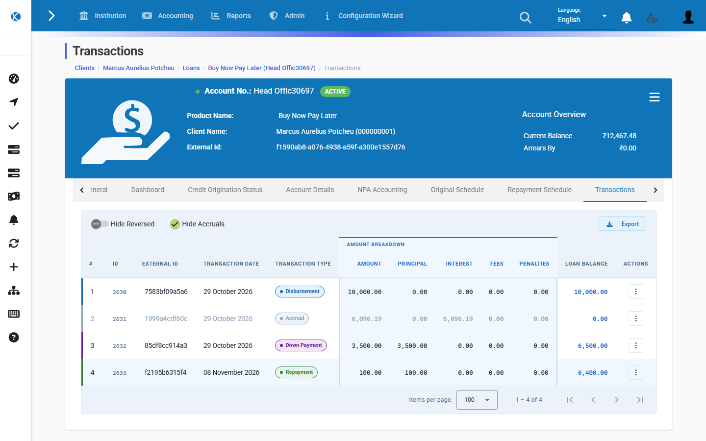

# Chargeback Distribution

## Chargeback overview

A Chargeback transaction initiates a chargeback on a previous repayment or refund. It effectively undoes the repayment without reverting it. Chargeback creates a credit amount for a previous repayment and adds it to the current installment without touching previous repayments or accounting, so the missed payment is collected as of the current date. To perform a chargeback, select the repayment to reverse and click chargeback on that repayment.

## Charge back a transaction

Use this screen to initiate a chargeback on a previous repayment or refund, which creates a credit amount for that transaction and adds it to the current installment without touching previous repayments or accounting.

1. Select **Institution** > **Clients** and open the client.
2. Under **Loan Accounts**, select the loan account.
3. Open the **View Transaction** screen.

The chargeback amount is added to the next installment in the repayment schedule, and the loan balances and repayment schedule are updated accordingly.

## Supported transaction types

You can create a chargeback for goodwill credit, payout refund, merchant refund, and down-payment transactions using the UI.

Chargeback is available for these transaction types:

- Goodwill credit
- Payout refund
- Merchant refund
- Down-payment

## Eligibility and restrictions

You can charge back a repayment transaction or a payment transaction only if the transaction has not been reversed. The charged back amount cannot exceed the amount of the related transaction.

## Amount limits and multiple chargebacks

It can be lower, so you can create multiple chargeback transactions for the same target transaction. The cumulative amount of all chargeback transactions for one target transaction cannot exceed the target transaction amount.

You can view the transaction relation to a chargeback transaction in transaction details.

- A user can view the transaction relation to a chargeback transaction in transaction details.

## Chargeback date and backdating

The Chargeback transaction date is always the actual business date; you cannot set it to another date. Backdated transactions are allowed after a Chargeback.

## Amount allocation

A chargeback amount is allocated between principal, fee, and penalty buckets based on the transaction allocation from which the chargeback is raised. Chargeback supports all amount allocations: Charge, Interest, Penalty, and Principal.

Allocation rules apply as follows:

- The priority order for allocating the chargeback amount between principal, fee, and penalty matters only when the chargeback is partial.
- When the target transaction repaid fee and/or penalty alongside principal, the same type of fee and/or penalty is created during chargeback.
- Chargeback includes the interest portion if the payment being charged back has any interest.

## Allocation priority configuration

You can configure the order in which chargeback amounts are allocated to penalties, fees, interest and principal at the loan product level. This configuration applies when the repayment strategy is Advanced payment allocation.

| Priority | Allocation target |
| --- | --- |
| 1 | Fees |
| 2 | Penalty |
| 3 | Interest |
| 4 | Principal |

## Payment allocation order

The system portions the chargeback amount from the repayment being chargebacked. Payment allocation follows the priority set at the Advance payment allocation strategy, and the latest payment takes priority under the same amount portion. If two fees exist for the repayment and a partial payment comes in, the system allocates the latest fees first and then the oldest.

## Fees and penalties on chargeback

When you allocate a fee or penalty amount during a chargeback, the system creates a new fee or penalty on the chargeback date for that amount. If the chargeback creates a new charge, its due date and delinquency evaluation period begin on the chargeback date. The same fee or penalty is added back on the chargeback submitted date for the repayment that the chargeback came from.

## Schedule and interest impact

A chargeback adds the charged-back principal to the repayment schedule. Interest is recalculated only when the chargeback happens before the maturity date; on or after the maturity date, no interest recalculation occurs.

The chargeback affects the schedule as follows:

- Before maturity, the actual installment increases by the full chargeback amount and delinquency calculation starts immediately from that date until the amount is fully paid.
- After maturity, a new installment is created if it did not already exist, with the full chargeback amount.

Interest treatment depends on timing relative to the maturity date.

| Timing | Interest effect |
| --- | --- |
| Before maturity date | Interest is calculated on the increased outstanding principal (original outstanding principal plus credited back principal). |
| On or after maturity date | No interest is recalculated. |

## Worked examples

A customer repays two installments on a 1,000 loan. A loan officer then initiates a full chargeback of those repayments for 500. The figures in this example are illustrative.

| Date | Event | Principal balance | Due 1/1 | Due 1/16 | Due 1/31 | Due 2/15 |
| --- | --- | --- | --- | --- | --- | --- |
| 1-Jan | Loan disbursed | 1,000.00 | 250.00 | 250.00 | 250.00 | 250.00 |
| 4-Jan | Payment 250 | 750.00 | 0.00 | 250.00 | 250.00 | 250.00 |
| 16-Jan | Payment 250 | 500.00 | 0.00 | 0.00 | 250.00 | 250.00 |
| 20-Jan | Chargeback 500 | 1,000.00 | 0.00 | 0.00 | 750.00 | 250.00 |
| 31-Jan | Payment 750 | 250.00 | 0.00 | 0.00 | 0.00 | 250.00 |
| 15-Feb | Payment 250 | 0.00 | 0.00 | 0.00 | 0.00 | 0.00 |

The chargeback restores the principal balance and adds the credited amount to the next installment.

A customer repays one installment of 250 on a 1,000 loan. A loan officer initiates two partial chargebacks on the same repayment, first for 100 and then for 150. The cumulative chargeback cannot exceed the original repayment amount.

| Date | Event | Principal balance | Due 1/1 | Due 1/16 | Due 1/31 | Due 2/15 |
| --- | --- | --- | --- | --- | --- | --- |
| 1-Jan | Loan disbursed | 1,000.00 | 250.00 | 250.00 | 250.00 | 250.00 |
| 4-Jan | Payment 250 | 750.00 | 0.00 | 250.00 | 250.00 | 250.00 |
| 20-Jan | Chargeback 100 | 850.00 | 0.00 | 0.00 | 350.00 | 250.00 |
| 25-Jan | Chargeback 150 | 1,000.00 | 0.00 | 0.00 | 500.00 | 250.00 |
| 31-Jan | Payment 500 | 500.00 | 0.00 | 0.00 | 0.00 | 250.00 |
| 15-Feb | Payment 250 | 0.00 | 0.00 | 0.00 | 0.00 | 0.00 |

A third chargeback on the same repayment would be rejected because the cumulative 500 already equals the original repayment.

A loan of 750 carries a 20 fee and a 10 penalty. The customer pays 280, clearing the fee and penalty and paying 250 toward principal. A loan officer chargebacks the full 280. The fee and penalty are restored as due, and the principal portion is added to the next installment.

| Date | Event | Principal balance | Due fee | Due penalty | Due 1/1 | Due 1/16 | Due 1/31 |
| --- | --- | --- | --- | --- | --- | --- | --- |
| 1-Jan | Fee assessed | 750.00 | 20.00 | 0.00 | 250.00 | 250.00 | 250.00 |
| 1-Jan | Loan disbursed | 750.00 | 20.00 | 0.00 | 250.00 | 250.00 | 250.00 |
| 2-Jan | Penalty assessed | 750.00 | 20.00 | 10.00 | 250.00 | 250.00 | 250.00 |
| 4-Jan | Payment 280 | 470.00 | 0.00 | 0.00 | 0.00 | 250.00 | 250.00 |
| 20-Jan | Chargeback 280 | 750.00 | 20.00 | 10.00 | 0.00 | 500.00 | 250.00 |
| 31-Jan | Payment 500 | 250.00 | 0.00 | 0.00 | 0.00 | 0.00 | 250.00 |
| 15-Feb | Payment 250 | 0.00 | 0.00 | 0.00 | 0.00 | 0.00 | 0.00 |

New fee and penalty records are created with the chargeback date, matching the types that were originally paid.

A repayment of 100 includes 10 fee and 90 principal. The product administrator sets the chargeback allocation priority to Principal first, then Fee. A loan officer chargebacks 95. The system allocates 90 to principal and 5 to fee, and creates a new fee of 5 as of the chargeback date. If the priority were Fee first, the same 95 would allocate 10 to fee and 85 to principal.

| Allocation priority | Chargeback amount | Principal | Fee | New fee date |
| --- | --- | --- | --- | --- |
| Principal first | 95.00 | 90.00 | 5.00 | Chargeback date |
| Fee first | 95.00 | 85.00 | 10.00 | Chargeback date |

The configured priority only matters when the chargeback is partial; a full chargeback restores every portion of the original repayment.

A customer repays the final installment of 125 on 15-Feb, bringing the balance to zero. On 20-Feb, after the last due date, a loan officer chargebacks that repayment for 125. Because no future installment exists, the system creates a new installment due on the chargeback date.

| Date | Event | Principal balance | Next installment due |
| --- | --- | --- | --- |
| 1-Jan | Loan disbursed | 500.00 | 125.00 due 1/1, 1/16, 1/31, 2/15 |
| 15-Feb | Final payment 125 | 0.00 | None |
| 20-Feb | Chargeback 125 | 125.00 | 125.00 due 2/20 |
| 28-Feb | Payment 125 | 0.00 | None |

If the chargeback had occurred before the last due date, the amount would have been added to that upcoming installment instead of creating a new one.
