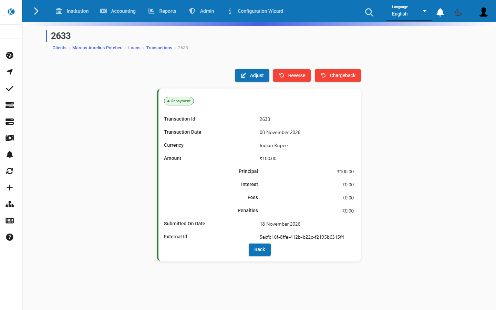

# Interest on Chargebacks

## Feature scope and availability

Interest on chargeback applies only to progressive loan types.

Chargeback is allowed for progressive, interest-bearing loans when:

- Interest recalculation is enabled.
- Interest recalculation is not enabled and no chargeback transaction allocation rule is set.

## Charge back a transaction

Use the View Transaction screen to reverse a linked transaction by creating a chargeback transaction dated the current date.

1. Select **Institution** > **Clients** and open the client.
2. Under **Loan Accounts**, select the loan account.
3. Open the **View Transaction** screen.

The system creates a chargeback transaction for the selected linked transaction, crediting back the paid balances according to the chargeback allocation rule or increasing due principal only when no rule applies.

## Chargeback amount and target transaction

A chargeback transaction is dated the current date. Its amount can be equal to or lower than the target transaction, but cannot exceed the amount of the related payment transaction.

## Allocation rules and options

For non-progressive loans, a chargeback increases the due principal only. For interest-bearing loans with a custom chargeback allocation rule, the chargeback amount is credited back to principal, interest, fee and penalty balances in the order of the allocation rule, and only for each balance as it was paid on the target transactions. Chargeback includes the interest portion if the payment being charged back has any interest. Chargeback amount allocation priority is configurable, and the chargeback transaction allocation follows the defined allocation rules.

Four allocation options are available:

- PRINCIPAL
- INTEREST
- FEE
- PENALTY

| Condition | Effect of allocation rule order |
| --- | --- |
| Chargeback is a partial amount of the target transaction | The order defines how the chargeback amount is credited back to each balance |
| Chargeback equals the full target transaction amount | The same amounts are credited back to the same balances regardless of order |

You can configure the chargeback transaction allocation rule on the loan product for progressive loans.

## Interest handling and recalculation

Charged back interest is paid as a fixed amount as part of the period it belongs to. The interest portion from the target transaction is credited back as principal as part of the chargeback transaction. Credited interest on a period increases the EMI of that period.

Interest recalculation depends on when the chargeback happens:

- If chargeback happens before maturity date, it increases the outstanding principal and interest is calculated on the increased amount.
- If chargeback happens on maturity date or after, no interest is calculated and no interest recalculation is needed.

Chargeback interest does not:

- Go through interest recalculation again.
- Have new accrual transactions or income recognition.
- Have extra interest calculated after maturity date.

## Repayment schedule and EMI

The chargeback amount is added to the next unpaid installment in the repayment schedule. Credited principal on a period increases the EMI of that period.

The next installment depends on the current date:

- If the current date is before the current installment due date, the next installment is the current installment.
- If the current date is on the current period due date, the next installment is the period just after the current period.

## Processing and reprocessing

For non-interest bearing loans, or loans where interest recalculation is not enabled, the system applies the chargeback without reprocessing every transaction. For progressive loans where interest recalculation is enabled, the system reprocesses all transactions including the chargeback to recalculate interest when the principal due amount changed. Reprocessing is still needed even when the chargeback amount cannot be changed and all of it was already allocated to principal, and the repayment schedule might change.

## Eligibility and restrictions

Chargeback behaviour depends on whether the loan is progressive, whether interest recalculation is enabled, and whether a chargeback allocation rule is configured.

| Loan type | Interest recalculation | Chargeback allocation rule | Chargeback behaviour |
| --- | --- | --- | --- |
| Non-progressive | Any | Any | Full chargeback behaviour applies. |
| Progressive | Any | Not configured | Full chargeback behaviour applies. |
| Progressive | Enabled | Not configured | Chargeback is allowed. |
| Progressive | Enabled | Configured | Behaviour #2 applies. |
| Progressive | Not enabled | Not configured | Behaviour #1 applies. |
| Progressive | Not enabled | Configured | Behaviour #2 applies. |

## Accrual and income recognition

The system does not create accrual transactions for charged back amounts, including charged back penalty, fee, and interest. Principal is not income, so it never gets an accrual.

## Model and implementation options

Two model options control how credited amounts affect interest. One applies credited principal as a static, additional value alongside calculated due principal, and both amounts are used to calculate due interest for the period. The other applies credited interest as a static, additional value alongside calculated due interest where applicable. For progressive, interest bearing loans with interest recalculation enabled and no chargeback allocation set, the system handles chargebacks through the advanced payment schedule transaction processor.

## Worked examples

A full chargeback before maturity with no chargeback allocation rule and interest recalculation disabled. The figures are illustrative. A loan of principal 1,000 charges 12% a year (1% a month) and is repaid in 3 monthly installments over 30-day months. Two installments have been paid. On the next due date the officer charges back the most recent repayment in full. Because no allocation rule is configured, the whole chargeback amount is credited back to due principal, including the interest portion returned as principal. The outstanding principal rises and the remaining installment is recalculated on the higher balance. It shows that a full chargeback before maturity reinstates principal and that interest on the remaining period is calculated on the increased balance.

| Stage | Date | Balance before | Interest | Principal | Payment | Balance after |
| --- | --- | --- | --- | --- | --- | --- |
| Before | 2/1 | 1000.00 | 10.00 | 330.02 | 340.02 | 669.98 |
| Before | 3/1 | 669.98 | 6.70 | 333.32 | 340.02 | 336.66 |
| Chargeback | 3/1 | 336.66 | 0.00 | 340.02 | 340.02 | 676.68 |
| After | 4/1 | 676.68 | 6.77 | 676.68 | 683.45 | 0.00 |

A partial chargeback before maturity with a chargeback allocation rule and interest recalculation disabled. Same loan: principal 1,000, 12% a year (1% a month), 3 monthly installments, 30-day months. Two installments have been paid, leaving 336.66. The repayment due on 3/1 consists of principal 333.32 and interest 6.70. The officer charges back 100.00 of that repayment with the allocation rule Interest, then Principal. Because the chargeback is partial, the allocation order matters: the first 6.70 goes to interest and the remaining 93.30 goes to principal. The outstanding principal rises by 93.30 and the final installment is recalculated on the higher balance. If the rule were Principal first, the full 100.00 would go to principal and the balance after would be 436.66 instead. It shows that with a partial chargeback the allocation rule splits the amount across balances, while a full chargeback credits the same balances whatever the order.

| Stage | Date | Balance before | Interest | Principal | Payment | Balance after |
| --- | --- | --- | --- | --- | --- | --- |
| Before | 2/1 | 1000.00 | 10.00 | 330.02 | 340.02 | 669.98 |
| Before | 3/1 | 669.98 | 6.70 | 333.32 | 340.02 | 336.66 |
| Chargeback | 3/1 | 336.66 | 6.70 | 93.30 | 100.00 | 429.96 |
| After | 4/1 | 429.96 | 4.30 | 429.96 | 434.26 | 0.00 |

A chargeback on or after the maturity date. Same loan: principal 1,000, 12% a year (1% a month), 3 monthly installments, 30-day months, maturing on 4/1. After the first two installments the outstanding principal is 336.66. On the maturity date the officer charges back the 3/1 repayment of 340.02. Because the chargeback falls on or after maturity, no interest is calculated on the credited principal and no extra interest arises; the amount is due as principal only. It shows that on or after maturity no interest is calculated on the charged-back principal.

| Stage | Date | Balance before | Interest | Principal credited | Payment | Balance after |
| --- | --- | --- | --- | --- | --- | --- |
| Chargeback | 4/1 | 336.66 | 0.00 | 340.02 | 340.02 | 676.68 |
