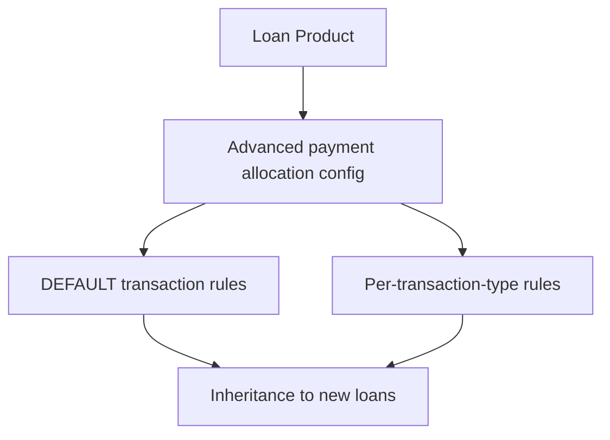

# Configurable payment allocations for transactions

Configurable payment allocations for transactions provide a structured mechanism to route customer payments by transaction type and across future installments. The feature is implemented at the loan product level and is inherited by new loans when the Advanced payment allocation option is enabled on the product. Existing loans retain the rules that were in place at the time they were created. A fallback configuration exists via a DEFAULT transaction type when no specific configuration is defined for a given transaction type.

Who benefits
- Operations staff and credit agents manage the configuration and observe its effects on repayment behavior.
- Loan officers and branch managers see how payments are allocated to installments and balance components (principal, interest, penalties, fees) in real time or through reports.
- Customers receive payments allocated according to the configured rules, delivering expected behavior for repayments, refunds, goodwill adjustments, and downpayments.

Concepts and rules
- Main allocation rule (installment level)
 - Past Due Installment: Allocation always starts from the oldest unpaid installment. If a past due installment is not fully paid, allocations apply to that installment first, according to the defined sub-rules.
 - Due Installment: Allocation applies to the current due installment when the transaction date matches the due date.
 - Future Installments: Allocation can apply to future installments using one of three sub modes:
 - Next Installment: Allocation goes to the next installment based on due date.
 - Last Installment: Allocation goes to the last installment based on due date.
 - Reamortization: In advance allocations are divided evenly across all future installments.
- Secondary allocation rule
 - When applying the main rules, remaining balance components may be allocated according to one of these secondary options: Penalties, Fees, Principal, or Interest.
- Future installment allocation rule
 - Future installments can be targeted using NEXT_INSTALLMENT, LAST_INSTALLMENT, or REAMORTIZATION. The chosen option governs how portions of an advance payment are distributed across future installments.

Configuration scope and inheritance
- Transaction types: Allocation rules can be configured per transaction type. The documented transaction types include Repayment, Goodwill credit, payout refund, Merchant refund, Charge Adjustments, and Downpayment.
- DEFAULT configuration: If a specific transaction type has no rule configured, the DEFAULT transaction type configuration acts as the fallback for that loan.
- Loan product scope: The allocation configuration is defined on the loan product screen. When a loan is created with Advanced payment allocation enabled, the allocation rules are inherited by the loan. Changes to the loan product configuration affect only new loans created after the change; existing loans continue using the rules in effect at their creation.
- Re-amortization and future allocations: Re-amortization and other future-installment allocations are applied with the aim of rebalancing the schedule while honoring the specified allocation rules. If re-amortization would over-allocate to principal, the secondary allocation rules determine how any remaining amount is distributed (e.g., penalties or fees, if unpaid).

UI navigation and data entry (operational steps)
1) Open the loan product screen for the product you want to configure. The feature is exposed on the loan product level as Advanced payment allocation.
2) allows Advanced payment allocation for the loan product. This allows per-transaction-type configuration and inheritance behavior for new loans.
3) For the DEFAULT transaction type configuration, set future_installment_allocation_rule to one of NEXT_INSTALLMENT, LAST_INSTALLMENT, or REAMORTIZATION.
4) For each relevant transaction type (for example, Repayment, Goodwill credit, payout refund, Merchant refund, Charge Adjustments, Downpayment):
- In the transaction type, provide a payment_allocation_order list where each item includes:
 - payment_allocation_rule: one of the codes for the main allocation (for example, PAST_DUE_PENALTY, PAST_DUE_FEE, PAST_DUE_PRINCIPAL, PAST_DUE_INTEREST, DUE_PENALTY, DUE_FEE, DUE_PRINCIPAL, DUE_INTEREST, IN_ADVANCE_PENALTY, IN_ADVANCE_FEE, IN_ADVANCE_PRINCIPAL, IN_ADVANCE_INTEREST).
 - order: the sequence position (1, 2, 3, ...).
- Save the configuration.
5) Understand inheritance: saved rules apply to new loans created after the change; existing loans keep their original configuration. Changes to the loan product do not retroactively alter already-created loans.
6) If re-amortization is configured and an N+1 installment exists, include N+1 in the re-amortization calculation .
7) When re-amortization spreads a payment across installments, if a principal portion is fully allocated, any remaining balance may be allocated to the secondary components in accordance with the configured secondary allocation rules.

Implementation notes (key behaviors)
- If an installment carries a charge or penalty, re-amortization applies to the principal balance; other balance types are not automatically re-amortized unless the allocation rules specify otherwise.
- The system processes transaction reprocessing in chronological order to rebuild the repayment schedule when needed, reducing revert-replay events.
- For refunds and merchant adjustments, allocations can be directed to past due installments first, then to future installments, depending on the configured future_installment_allocation_rule and the selected primary/secondary allocations.
- The allocation rules are documented and illustrated in the Reference Calculations and Schedules for various use cases (UC01 through UC25) to demonstrate how the system behaves under simple payments, overpayments, refunds, and reversals.

Calculation references and representative scenarios
This section presents representative calculations drawn from the reference scenarios to illustrate how the configurable allocations affect balances and repayments. The source uses a consistent base loan with defined installments and dates.

UC01 – Simple Payments (illustrative parameter set)
- Parameters
 - Principal: $500.00
 - Installments: 4
 - Installment amount: $125.00
 - Down payment: $125.00
- Calculation narrative
 - Starting balance after full disbursement: $500.00
 - After Down Payment: $375.00
 - After 16-Jan Payment: $250.00
 - After 31-Jan Payment: $125.00
 - After 15-Feb Payment: $0.00
- Calculation steps
 - Balance_t = Balance_{t-1} - PaymentAmount_t
 - Balance_0 (post-disbursement) = 500.00
 - Balance_1 (post-down payment) = 500.00 - 125.00 = 375.00
 - Balance_2 (post-16-Jan payment) = 375.00 - 125.00 = 250.00
 - Balance_3 (post-31-Jan payment) = 250.00 - 125.00 = 125.00
 - Balance_4 (post-15-Feb payment) = 125.00 - 125.00 = 0.00
- Result: 0.00 at the end of the sequence, with each installment paid according to the payment schedule.

 
Principal$500.00

 
Installments4

 
Installment amount$125.00

 
Down payment$125.00

 
Calculation

 
<strong>Formula:</strong> Balance_t = Balance_{t-1} - PaymentAmount_t

 
<strong>Substitution:</strong> Balance_0 = 500.00; Down payment 125.00; 16-Jan payment 125.00; 31-Jan payment 125.00; 15-Feb payment 125.00

 
<strong>Result:</strong> 0.00

For each use case, the reference provides extended scenarios such as overpayments (UC02, UC03), refunds (UC05, UC08, UC11, UC12, UC14, UC17–UC25), and special conditions (goodwill credits, partial refunds, auto-repayments, and reversals). The same principles apply: the configured allocation rules determine the sequence and components to which every payment is applied, and re-amortization can restructure future installments according to the future_installment_allocation_rule. When you need to interpret a specific use case in detail, consult the associated reference sheet (UC01 through UC25) and its calculation sections.

Edge cases and operational notes
- Future allocations and re-amortization: If a re-amortization event occurs, the system may reallocate across remaining installments to follows the chosen future_installment_allocation_rule. If the re-amortization amount exceeds the principal portion across installments, the remainder is allocated to the next components as defined by the secondary allocation rules.
- N+1 installments: When there is an N+1 installment, the re-amortization logic includes the N+1 installment in the reallocation calculation.
- Inheritance and retroactivity: Changes to loan product configuration affect only new loans created after the change; existing loans retain their historical configuration and any previously performed allocations.
- Default behavior: If a transaction type has no dedicated configuration, the DEFAULT transaction type configuration provides the fallback rules.

Glossary (allocation rule codes)
- Main allocation (installment-level):
 - PAST_DUE_PENALTY, PAST_DUE_FEE, PAST_DUE_INTEREST, PAST_DUE_PRINCIPAL
 - DUE_PENALTY, DUE_FEE, DUE_INTEREST, DUE_PRINCIPAL
 - IN_ADVANCE_PENALTY, IN_ADVANCE_FEE, IN_ADVANCE_PRINCIPAL, IN_ADVANCE_INTEREST
- Future installment allocation rules: NEXT_INSTALLMENT, LAST_INSTALLMENT, REAMORTIZATION

< Mermaid diagram>

</Mermaid>

This page describes the implemented behavior of Configurable payment allocations for transactions and how to operate, configure, and observe its effects on customer accounts. All figures and examples reflect verified behavior from the reference material and illustrate how allocations flow from configuration to customer balance outcomes.