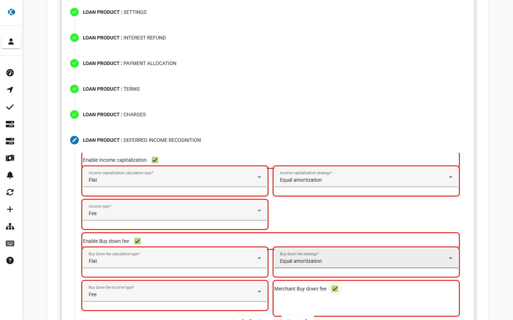
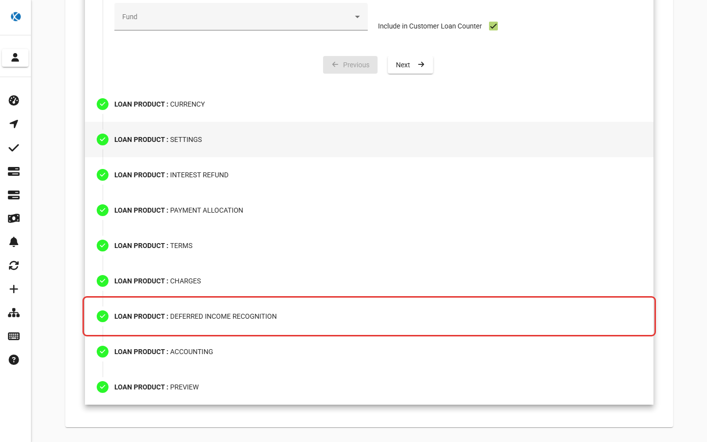
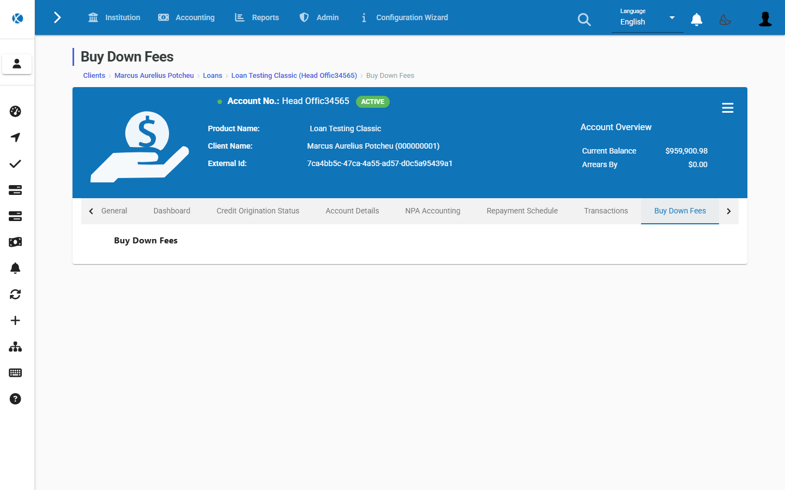
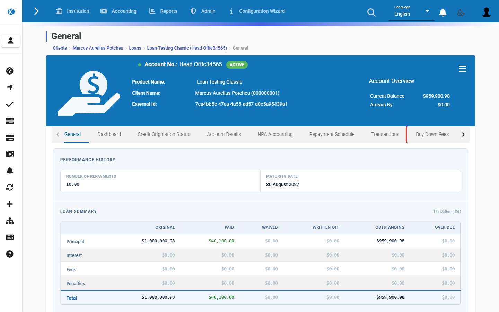

# Buy-Down Fees

## About Buy-Down Fees

Buy-down fees are a unique transaction type used to post the buy-down fee to the loan account. They allow merchant fees to be collected at disbursement and amortized into interest income over the loan lifecycle. You can add buy-down fees at disbursement through the API or from the UI. Buy-down fees do not appear in customer-facing schedules or statements.

## Configure capitalized income on a loan product

Use this screen to set up income capitalization and buy-down fees for a loan product so merchant fees can be collected at disbursement and amortized into interest income over the loan lifecycle.

1. Select **Admin** > **Products** > **Loan Products**.
2. Select **Create** > **Create Loan Product (Classic)**, or open an existing product and select **Edit**.
3. Select **DEFERRED INCOME RECOGNITION**.

   

| Field | Required | Description |
| --- | --- | --- |
| Enable income capitalization | No | Turn on income capitalization for the loan product. |
| Income capitalization calculation type | Yes | Choose how income capitalization is calculated. |
| Income capitalization strategy | Yes | Choose the income capitalization strategy. |
| Income type | Yes | Select the income type for capitalized income. |
| Enable Buy down fee | No | Turn on buy-down fees for the loan product. |
| Buy down fee calculation type | Yes | Choose how the buy-down fee is calculated. |
| Buy down fee strategy | Yes | Choose the buy-down fee strategy. |
| Buy down fee income type | Yes | Select the income type for the buy-down fee. |
| Merchant Buy down fee | No | Enter the merchant buy-down fee. |

The loan product is configured with income capitalization and buy-down fee settings.

## Add a buy-down fee to a loan

Use this screen to add a buy-down fee to an active progressive loan after disbursement so merchant fees can be collected at disbursement and amortized into interest income over the loan lifecycle.

1. Select **Institution** > **Clients** and open the client.
2. Under **Loan Accounts**, select the loan account.
3. Open the **Buy Down Fees** tab.

   

The system creates a new buy-down fees transaction with the amount you entered, and the fee is amortized daily into interest income over the loan lifecycle without affecting the loan schedule or interest calculation.

## Eligibility and Timing

Buy-Down fees apply only to progressive loans. You can add them once the loan is active, using any transaction date on or after the first disbursement date.

## Adding Buy-Down Fees

The amount you enter becomes the transaction amount, and the system creates a new Buy-Down fees transaction for that amount. Buy-Down fees are treated as an income portion (interest or fees) and do not affect schedule calculation, recalculation, or interest calculation.

Supported fields:

- Amount.
- Transaction date (on or after the first disbursement date).
- Payment type.
- Note.
- External id.

## Amortization and Income Recognition

Buy-down fees can be recognized as either interest income or fees income. The system amortizes the deferred fee balance daily over the period from the buy-down fee date to the loan maturity date, and recognizes income each day through daily amortization. Daily recognition uses equal portions based on the number of days between the buy-down fee date and the loan maturity date. The amortization follows the configured amortization strategy, either equal amortization or formula-based amortization. Equal amortization divides the fee by the number of days (`fee / days`). The system maintains a current deferred fee balance at the loan level and tracks amortized and not yet recognized amounts by updating the buy-down fee balance. Daily calculations match expected formulas for amortization accuracy, and the deferred balance tracks correctly through the loan lifecycle for balance integrity. Daily recognition creates a loan transaction of type Buy Down fee Amortization and triggers a new business event. The configuration determines whether income is treated as fee or interest income and which GL mapping applies.

Early payoff and charge-off:

- If the loan is preclosed on the same day, final amortization recognizes the remaining not yet recognized amount as income in one shot.
- If a loan balance is charged off, any balance in deferred income is charged off.
- Once a loan is paid off, realized income is not reversed or undone.

Adjustments and tracking:

- If more deferred income is recognized at end of day, a Buy Down fee amortization Adjustment transaction can correct the amount.
- Buy-down fee balances are tracked on a loan and on a buy-down fee transaction basis.
- Database tracking stores the link to the loan, link to the buy-down fee transaction, buy-down fee amount, date of buy-down fee, not yet recognized income, charged-off buy-down fee amount, and adjustment buy-down fee amount.

| Amortization method | Calculation |
| --- | --- |
| Equal amortization | `fee / days` |
| Formula-based amortization | Applies if configured |

## Buy-Down Fee Adjustments

A Buy Down fees Adjustment is a credit transaction that reduces the Buy Down fees balance from amortization. It adjusts or credits deferred income and has no impact on the loan balance.

Rules for creating an adjustment:

- You can add a Buy Down fees Adjustment transaction to the loan account through API or UI.
- An adjustment can be invoked on an existing Buy Down fees transaction only, with relation type ADJUSTMENT from the adjustment to the original transaction.
- Multiple adjustments are allowed on the same original Buy Down fees transaction.
- The created adjustment transaction lists relations with relation type ADJUSTMENT between the original Buy Down fees transaction and the Buy Down fees Adjustment transaction.
- The total adjustment amount cannot exceed the original transaction amount.
- The adjustment transaction date cannot be earlier than the original transaction date.
- An adjustment can be backdated.
- Creating an adjustment updates the related Buy Down Fee Balance by adding the amount to the adjustment amount.
- A not yet reversed Buy Down fees transaction is allowed to be reversed if there is no not yet reversed Buy Down fees Adjustment that belongs to this transaction.

Rules for reversing an adjustment:

- A not yet reversed Buy Down fees Adjustment transaction is allowed to be reversed.
- Mirror JE entries are passed for the reversal entry of a reversed Buy Down fees Adjustment transaction.
- Reversing an adjustment updates the related buy down fee balance by subtracting the amount from the adjustment amount.

| Behaviour | Effect |
| --- | --- |
| Buy Down fees Adjustment accounting entries | Work like a mirror of Buy Down fees entries. |
| Reversing a Buy Down fees transaction | Corrects already amortized amounts in a Buy Down fees amortization adjustment transaction using mirror JE entries of Buy Down fees amortization, and deletes the related buy down fee balance. |

## Charge-Off and Payoff

When you charge off a loan, the system also charges off any Buy Down fees and stops daily amortization after the charge-off date. It calculates the amount that should already have been amortized and corrects any differences with normal amortization journal entries. It moves any not yet recognized balance to Charge-off and creates a final amortization with journal entries, linking that final amortization transaction to the charge-off transaction as related. Undoing a charge-off undoes the final amortization transaction and adjusts accounting entries, but does not undo the amortization transaction because it is a catch-up.

## Accounting Entries

Buy-Down fee accounting uses journal entries that post to the Deferred Income liability account and to expense or income accounts depending on the transaction. For non-merchant lending, the system uses the Fund Source parameter mapped GL for cash at hand instead of the EXPENSE parameter, which is hidden. For merchant lending, accounting posts to either the EXPENSE account or the ASSET account as configured at global level.

Each accounting entry uses these debit and credit mappings.

| Transaction | Debit | Credit |
| --- | --- | --- |
| Initial fee posting | Expense | Deferred Income (Liability) – Deferred Income |
| Daily amortization | Deferred Income (Liability) – Deferred Income | Buy Down fees Amortization (Income) – Interest/fees Income |
| Buy-Down fee adjustment | Deferred Income (Liability) – Deferred Income | Fund Source (ASSET) – cash at hand |
| Charge-off | Deferred Income (Liability) – Deferred Income | charge-off expense / charge-off expense-bad dept / credit loss-bad dept / credit loss-bad dept-fraud |
| Preclose pay-off | Deferred Income (Liability) – Deferred Income | Buy Down fees Amortization (Income) – Interest/fees Income |
| Preclose write-off | Deferred Income (Liability) – Deferred Income | Losses written off (Expense) – Written off |

## Loan Product Configuration

Buy-down fees on a loan inherit from the loan product and require buy-down fees to be enabled on that product. When enabled, the system adds GL account mappings for the loan product, including Buy Down Expense and Buy Down fees Amortization accounts for periodical accounting. These mappings appear in loan product details and can be updated during a loan product update.

Buy-down fees configuration at the loan product level includes the following settings:

| Setting | Value |
| --- | --- |
| Status | Enable |
| Calculation mode | FLAT |
| Strategy | EQUAL_AMORTIZATION (default) |
| Income type | FEE (default) or INTEREST |

## User Interface

Buy-down fee configuration can appear on the same tab as Capitalized Income configuration, renamed to ‘Deferred Income Recognition’. If buy-down fee capabilities are allowed on the loan, a new tab on the loan details view shows buy-down fee details. Each row on that tab represents one buy-down fee entry. For merchant type, the UI shows the EXPENSE parameter for mapping.

## API and Business Events

The API supports Buy-Down Fees through commands, transaction events, fetch and template calls.

API commands and events:

- The command to add Buy-Down Fees to a loan is buy down fee.
- Adding Buy-Down Fees triggers a new Buy-Down Fees transaction event.
- Adjusting existing Buy-Down Fees triggers a new Buy-Down Fees Adjustment transaction event.
- Buy-Down Fees amortization triggers a new Buy-Down Fees Amortization transaction event.
- Reversing a Buy-Down Fees or adjustment transaction triggers the existing LoanTransactionAdjustment event.
- End-of-day Buy-Down Fees amortization adjustment triggers a new transaction event.

Fetch and template APIs:

- An API fetches Buy-Down Fees information: Buy-Down Fee amount, Transaction, Amortized amount, Not yet amortized amount, Adjusted amount.
- The template API for Buy-Down Fee transactions retrieves the maximum amount allowed.

## Limits and Calculations

The system calculates Buy-Down fees using flat calculation mode and equal amount amortization. It rounds each calculated amount according to the rounding mode configuration.

The maximum allowed amount depends on the transaction type:

- Buy-Down Fee transaction: approved loan amount minus total disbursed amount minus total Buy-Down fees minus total capitalized income.
- Buy-Down Fee Adjustment: Buy-Down Fee transaction amount minus total Buy-Down Fee adjustments for the original transaction.

## Related Features

Buy-down fees are capitalized but excluded from the principal base used for interest calculation.

## Worked examples

A customer takes a 900.00 loan at 12% annual interest, repaid in three monthly installments over 30-day months. A loan officer adds a buy-down fee of 90.00 at disbursement on January 1 through the UI or API. The fee is deferred and recognized daily in equal portions over the 90 days to maturity, so 1.00 per day; it does not change the repayment schedule. Figures are illustrative. Posting the fee on a later date leaves the schedule unchanged; only the amortization start date moves. The repayment schedule is identical to a loan with no buy-down fee; only the deferred fee balance is amortized to income daily.

| Date | Payment | Principal | Interest | Balance | Days | Fee recognized | Deferred balance |
| --- | --- | --- | --- | --- | --- | --- | --- |
| Jan 1 | — | — | — | 900.00 | — | — | 90.00 |
| Feb 1 | 309.00 | 300.00 | 9.00 | 600.00 | 30 | 30.00 | 60.00 |
| Mar 1 | 306.00 | 300.00 | 6.00 | 300.00 | 30 | 30.00 | 30.00 |
| Apr 1 | 303.00 | 300.00 | 3.00 | 0.00 | 30 | 30.00 | 0.00 |
| Total | 918.00 | 900.00 | 18.00 |  | 90 | 90.00 |  |

The same 900.00 loan with a 90.00 buy-down fee is repaid for two months and then paid off early on March 1. By that date 60.00 of the fee has been recognized and 30.00 remains deferred; the remaining 30.00 is recognized immediately on payoff. On early payoff, the remaining deferred fee is recognized immediately instead of being spread over the rest of the term.

| Date | Payment | Principal | Interest | Balance | Days | Fee recognized | Deferred balance |
| --- | --- | --- | --- | --- | --- | --- | --- |
| Jan 1 | — | — | — | 900.00 | — | — | 90.00 |
| Feb 1 | 309.00 | 300.00 | 9.00 | 600.00 | 30 | 30.00 | 60.00 |
| Mar 1 | 600.00 | 600.00 | 0.00 | 0.00 | 30 | 60.00 | 0.00 |
| Total | 909.00 | 900.00 | 9.00 |  | 60 | 90.00 |  |

The same 900.00 loan with a 90.00 buy-down fee is charged off on March 1 after two monthly payments. Daily amortization stops at charge-off, and the 30.00 still deferred is charged off rather than recognized as income. When a loan is charged off, daily amortization stops and any remaining deferred fee balance is charged off.

| Date | Payment | Principal | Interest | Balance | Days | Fee recognized | Charged off | Deferred balance |
| --- | --- | --- | --- | --- | --- | --- | --- | --- |
| Jan 1 | — | — | — | 900.00 | — | — | — | 90.00 |
| Feb 1 | 309.00 | 300.00 | 9.00 | 600.00 | 30 | 30.00 | — | 60.00 |
| Mar 1 | 600.00 | 600.00 | 0.00 | 0.00 | 30 | 30.00 | 30.00 | 0.00 |
| Total | 909.00 | 900.00 | 9.00 |  | 60 | 60.00 | 30.00 |  |

The same 900.00 loan with a 90.00 buy-down fee runs for two months. On March 1 a buy-down fee adjustment of 30.00 is posted to reduce the deferred income; the adjustment does not change the loan balance, which stays at 600.00. The adjustment reduces the deferred fee to zero while the amount the customer owes is untouched.

| Date | Payment | Principal | Interest | Balance | Days | Fee recognized | Adjustment | Deferred balance |
| --- | --- | --- | --- | --- | --- | --- | --- | --- |
| Jan 1 | — | — | — | 900.00 | — | — | — | 90.00 |
| Feb 1 | 309.00 | 300.00 | 9.00 | 600.00 | 30 | 30.00 | — | 60.00 |
| Mar 1 | — | — | — | 600.00 | 30 | 30.00 | 30.00 | 0.00 |
| Total | 309.00 | 300.00 | 9.00 |  | 60 | 60.00 | 30.00 |  |
