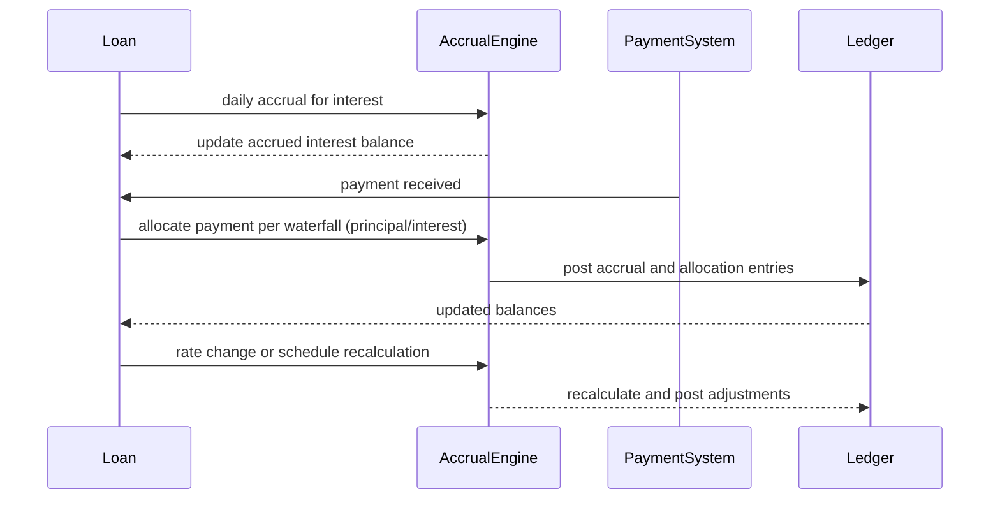

# Interest-bearing loan products on Fineract

This page documents the behavior, configuration, and operational implications of the Interest-bearing loan products feature as implemented in Fineract. The feature allows long-term installment lending with explicit daily accrual and progressive interest mechanics, supporting regulatory-compliant calculation conventions, flexible rate tiering, and automated accounting. It is designed to benefit a broad audience of frontline and supervisory users, including operations staff, loan officers, branch managers, and credit agents. 

## What the feature does and why it matters

Interest-bearing loan products on Fineract implement a complete set of capabilities that govern how interest accrues, how repayments are allocated, and how related fees and charges are handled throughout the loan life cycle. The design emphasizes accurate daily accruals, transparent amortization schedules, and reliable accounting integration. By supporting daily interest accrual, rate tiering by balance status, and automated journal entries, the system follows standard banking practice for longer-term installment lending while preserving full auditability and historical traceability. 

Key users observe and influence the product through configuring loan products, initiating payoffs, recording payments and waivers, and monitoring daily accrual results and related balances. The following sections describe verified behavior, rules, and observable outcomes that operations staff and loan officers should expect to see in day-to-day use.

## Core capabilities and behavior
The implementation details described here come from the verified specifications for Delivery of Interest-bearing products. Each item documents a distinct capability and the observable effect on customer accounts, loan schedules, and general ledger postings.

1) 366-Day and Leap Year Interest Calculation
- The system fully supports both standard 365-day and actual 366-day (leap year) day-count conventions for regulatory compliance across target regions. Calculations that depend on day-count conventions reflect the chosen rule for a given loan product and calculation date.

2) Progressive Loan EMI Calculation
- The schedule generator uses progressive amortization formulas. This aligns daily compounding and simple interest accruals with core Fineract standards, producing an amortization schedule that evolves as days accumulate and as repayments are made.

3) Full Payoff Calculation with Accrued Interest
- When a payoff is initiated, the system computes outstanding principal plus accrued interest up to the settlement date, producing a settlement amount that settles both principal and accrued interest.

4) Interest Rate Tiering by Balance Status
- Interest rates can be configured dynamically by installment and balance status (Current, Past Due, and Future). Rates applied at each installment can reflect the balance and status of the loan, enabling policy-driven tiering.

5) Downpayment Allocation on Long-Term Loans
- Downpayments at loan origination allocate strictly against disbursed principal. The allocation reduces the funded principal balance that is disbursed to the borrower.

6) Charge-off Non-Accrual Enforcement
- Interest accrual automatically stops on loans that have been charged off or tagged with specified non-accrual flags. No further daily accruals occur until policy-defined conditions resume accrual.

7) Fixed-Fee Installment Accrual
- Fixed fees are divided evenly across scheduled installments and accrue on a daily basis. Fee accruals are counted toward the daily interest-related balance while remaining distinct from the principal balance.

8) Advance Payment Allocation
- Advance repayments allocate across accrued interest and principal according to progressive waterfall rules. This verifies that early payments reduce the portions of the balance that have accumulated interest first.

9) Dedicated Interest Waiver Transaction
- A dedicated interest waiver transaction type exists to waive accrued interest without altering principal balances. This preserves the principal outstanding while removing the associated interest accrual from income.

10) Secondary Interest Refund Transaction
- A dedicated secondary interest refund transaction type handles interest adjustments arising from merchant refunds. This mechanism adjusts interest-related balances in a controlled, auditable manner.

11) Posted Interest Transaction Accounting
- Dedicated posted-interest accrual events update the loan sub-ledger and General Ledger. These postings reflect the accruals as journaled entries, making interest income and interest receivable balances visible in the accounting records.

12) Pause and Resume Interest Accrual
- Operational controls allow pausing daily interest accruals and resuming them in accordance with business policy. When paused, daily accruals do not advance until resumed.

13) Chargeback Handling on Interest Components
- Chargeback transactions properly adjust both interest and principal allocations during reversal-replay cycles, preserving correct allocations and balances.

14) Chronological Reverse-Replay Engine
- Backdated transactions trigger automatic chronological reprocessing of interest accruals and balances to maintain consistency with prior activity and policy changes.

15) Renewal and Top-up Loan Linkage
- Renewal and top-up loans are linked to original loan accounts to preserve the full accounting history and allows traceability across related borrowing events.

16) Accelerated Charge-off Balance Due
- Charge-off enhancements accelerate all outstanding balances to become due immediately, reflecting the finalization of the charge-off status in the customer’s account.

17) Automated Due-Date Fees and Penalties
- On-due-date processing automatically evaluates and applies scheduled fees and penalties per the loan product configuration.

18) Backdated Interest Rate Modifications
- Interest rate modifications can apply retroactively, with automated schedule recalculation to reflect the revised rate across affected periods.

19) Extended API Surface
- Loan product and transaction endpoints include parameters that support progressive interest-bearing loans, enabling integration with external systems and custom workflows.

20) Domain Event Publishing
- Domain events are published for accrual events, payments, waivers, and schedule recalculations, enabling downstream consumers to react to changes in loan state.

21) Automated Journal Entries
- Double-entry accounting entries post automatically for interest accruals (Debit Interest Receivable, Credit Interest Income) and for payment allocations, verifying timely and auditable financial records.

## Rate and calculation context
To support regulatory-compliant and auditable interest-bearing products, the reference calculations describe cap scenarios and nominal-rate mappings used in testing and validation.

- Calculation framework note: The reference data identifies an Effective Rate Limit of 0.09995 (9.995%) in the 9.995% limit scenario and a similar limit of 0.09995 (9.995%) in the 9.99% limit scenario. These values establish the upper bound for the effective rate in the scenarios documented there.
- Representative nominal rates observed in the reference data (shown as decimal values that translate to percentages) include values such as 0.094772, 0.094820, 0.094833, 0.094866, 0.094995, 0.095052, and 0.095220. In percent terms, these correspond to approximately 9.4772% to 9.5220% for the tested configurations. The samples are provided to illustrate nominal-rate behavior within the tested limits and are not guarantees for all configurations.

These data points illustrate how nominal rates relate to the cap scenarios used for validation, and they confirm that nominal rates tested in the reference data stay below the stated effective-rate cap. The calculations in the reference are part of validation artifacts and demonstrate that the product reliably enforces the cap while allowing nominal-rate variations within the tested range.

## Observed data behaviors and observable outcomes

- Calculation conventions: The system supports both 365-day and 366-day day-count conventions, and it applies the chosen convention consistently for daily accrual calculations and for payoff determinations.
- Schedule and balance integrity: Each period’s opening balance equals the previous period’s closing balance, verifying continuity in the amortization schedule and in the sub-ledger.
- Allocation reconciliation: Payment allocations follow the progressive waterfall rule and must reconcile with the transaction amount; remaining due and remaining cash must be consistent with the observed allocations.
- Accounting integrity: When journal entries (debits and credits) are posted, they balance, with allocations to Interest Receivable and Interest Income tracked alongside principal events. Where data exists for ledger postings, these postings balance in aggregate.
- Observability: Users can observe accrued interest daily, the evolving principal balance, and the updated schedule after repayments, waivers, or rate changes. The system publishes domain events for accrual encounters, payments, waivers, and recalculations to support downstream processes.

## Example views and outputs (conceptual)
A loan file configured as an interest-bearing product would typically expose the following observable artifacts to users:
- A daily accrual balance showing the current accrued interest, the outstanding principal, and the net carrying amount.
- An amortization schedule reflecting progressive payments, with daily accruals and the impact of each payment on principal and interest components.
- A ledger view showing postings to Interest Receivable and Interest Income, tied to the relevant accrual and payment events.
- A payoff quote that includes outstanding principal plus accrued interest up to the settlement date, consistent with the actual settlement date chosen by the user.

## Diagram: domain interactions (high-level overview)
Below is a compact, verified sequence that illustrates the interaction between components during normal operation for an interest-bearing loan product. It shows how accrual, payments, and postings relate to each other and how recalculations propagate through the system.

## Operational notes and edge cases
- If a loan is in charged-off status or marked with a non-accrual flag, accrual of interest halts automatically until policy-driven resumption.
- Downpayments reduce disbursed principal at origination and do not increase interest accruals directly; they affect the base to which future interest is applied.
- When an advance payment is received ahead of schedule, the system allocates the payment according to the progressive waterfall rules, reducing interest first and then principal according to policy.
- Rate modifications may be backdated with automatic schedule recalculation so that the correct accruals and balances are maintained for all periods affected by the change.
- Journal entries post automatically to reflect accruals and repayments, supporting a double-entry view of the loan and its related income and receivable accounts. Where data is available, these entries balance across the debit and credit sides.

## Glossary of key terms (quick reference)
- Daily accrual: The process of accruing interest on a daily basis based on the current outstanding balance and applicable rate.
- Progressive amortization: An amortization approach where principal and interest allocations evolve over time according to a defined waterfall and the remaining balance.
- Tiering by balance status: Rates that vary by whether the loan installment is Current, Past Due, or Future.
- Non-accrual: A status in which interest accrual is suspended due to specific policy rules, typically when a loan is charged off or flagged for non-accrual.
- Waterfall allocation: The order in which payments are applied to interest, fees, and principal, following a defined priority sequence.
- Domain events: System-wide notifications published when accruals, payments, waivers, or recalculations occur, enabling external systems to react.

This page presents a compiled view of the verified behaviors and financial effects of the Interest-bearing loan products feature as implemented. It is written to assist operations staff, loan officers, branch managers, and credit agents in understanding how these products work, how to interpret the resulting schedules and postings, and how to manage the lifecycle of interest-bearing loans within Fineract.