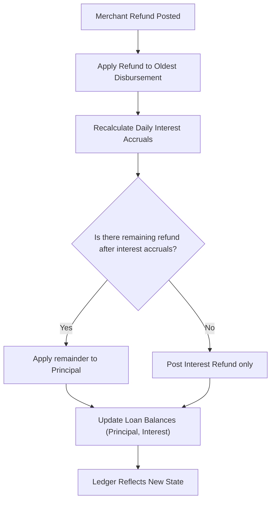

# Transaction type - Interest refund

This feature handles the calculation and posting of interest refunds whenever a merchant refund posts against a loan. When a merchant refund is posted, the system computes the associated interest refund, allocates it to the interest accrual first, and, if any refund remains after reducing interest, applies the remainder to principal. The behavior is defined to maintain a consistent and auditable progression of a loan’s balance and accrued interest. The feature supports a variety of real-world refund patterns, including refunds on single disbursements, multiple disbursements on the same or different days, and partial refunds across different points in the repayment schedule. It is visible to operations staff, loan officers, branch managers, and credit agents through the loan servicing workflow and the interest transaction results on the loan’s ledger.

### Core concepts and business purpose

- Interest refunds are triggered by merchant refunds and are calculated to restore the loan’s accrued interest to a correct state after the refund is posted. The calculation follows a day-by-day exam of the loan's disbursements and the refund application.
- The default allocation order is intimate with the loan’s disbursement history: refunds are applied to the oldest disbursement first, then proceeding forward in time as needed.
- After determining the amount of interest to refund, the system applies the refund to interest accrual first. If there is any over-refund relative to accrued interest, the surplus is applied to principal.
- The rules are demonstrated across a set of reference scenarios (UC01 through UC18), which illustrate single and multi-disbursement cases, same-day and different-day refunds, full refunds at various points in the schedule, and partial refunds within and after installment periods.

### How the system determines the interest refund (high level)

- Identify the merchant refund amount that must be refunded to the loan.
- Apply the refund to the OLDEST disbursement, working forward in time, as needed, until the refund is exhausted.
- Recalculate the total interest to date for the loan by re-simulating daily accruals with the updated principal on each day.
- For each day, compute: 
 - NewPrincipal_d = Disbursements up to day d minus RefundAppliedToDisbursements up to day d
 - NewInterestAccrual_d = NewPrincipal_d × DailyPeriodicRate
- Determine the total original interest accrual (before the refund) and the total new interest accrual (after applying the refund). The difference is the InterestRefund amount.
- Apply the InterestRefund to interest accrual first. Any remainder from the refund, after reducing interest, is applied to principal.

> Note: In some scenarios, the guidance in the reference materials explicitly states when an InterestRefund is applied to interest accrual (for example, the line “INTEREST REFUND IS APPLIED TO INTEREST ACCRUED” appears in several examples). Where this applies, the allocation proceeds as described above.

### Calculation reference and representation
The following representation mirrors the approach used in the reference calculations. It shows the method and a concrete numeric example to illustrate the data-driven rules. The calculations use the daily periodic rate and the disbursement history to derive new principal balances and new interest accruals day by day, then determine the interest refund as the difference between the original and new accruals.

 
Calculation

 
<strong>Formula:</strong> <code>InterestRefund = OriginalInterestAccrual - NewInterestAccrual</code>

 
<strong>Per-day substitutions:</strong> <code>NewPrincipal_d = Sum(Disbursements up to day d) - Sum(Refunds applied to disbursements up to day d)</code>

 
<strong>Per-day accrual:</strong> <code>NewInterestAccrual_d = NewPrincipal_d × DailyPeriodicRate</code>

 
<strong>Rounding/precision:</strong> <code>HALF_UP</code> daily calculations, , with running totals maintained to the same precision as the system uses for interest accruals.
 

 
<strong>Result (example).</strong> See UC01 below for a concrete instantiation: OriginalInterestAccrual (to 21-Jan) = 5.75; NewPrincipal after refund = 0.00; NewInterestAccrual = 0.00; InterestRefund = 5.75; After posting, InterestRefund is applied to interest accrual, leaving principal and interest accrual at 0.00.

### Example: UC01 — Single disbursement, full refund within the first installment period

Reference data for UC01 uses a 12-month installment loan with daily period rate 0.0002736986 and monthly payments of 91.67. In this scenario, a single disbursement of 1,000.00 is posted on 1-Jan, and a full refund of 1,000.00 is posted on 22-Jan (within the first installment period).

- Daily periodic rate: 0.0002736986
- Disbursement: 1,000.00 on 1-Jan
- Interest accrued to 21-Jan: 5.75
- Refund posted: 22-Jan, amount: 1,000.00
- Interest refund: 5.75 (closing the accrual for the refund period)
- Resulting balances after processing:
 - Principal Balance: 0.00
 - Interest accrued PTD: 0.00
 - Interest refund posting: -5.75

Illustrative data excerpts from the reference flow (simplified):
- 1-Jan: Disbursement 1,000.00; Interest accrued PTD progresses through 0.27, 0.55, ..., 5.75 by 21-Jan.
- 22-Jan: Refund -1,000.00; Interest refund -5.75; Principal balance 0.00; Interest accrual 0.00.

This UC01 sequence demonstrates the core behavior: the refund is applied to the oldest disbursement first, the interest accrual is recalculated, and the net effect is a refund of the accrued interest plus a return of principal in the same operation when the refund equals the disbursed amount.

### Related scenarios and behaviors (high level)

The reference data documents many combinations of disbursement timing and refund patterns. In short:
- UC02 demonstrates a single disbursement refund after the first installment period, resulting in a different alignment of interest refunds and subsequent repayments.
- UC03 shows a single disbursement refund after all installments are paid, with commodity adjustments to the remaining accruals.
- UC04 through UC07 cover multi-disbursement cases with varying day patterns and timing of refunds, illustrating how the system re-applies refunds to the oldest balances and recalculates accruals across subsequent days.
- UC08 through UC16 illustrate partial refunds within or after installment periods, including partial refunds across multiple disbursements and the associated allocation between interest accrual and principal.
- UC11, UC12, UC13, UC14, UC15, UC16, UC17, and UC18 introduce explicit notes such as “INTEREST REFUND IS APPLIED TO INTEREST ACCRUED” and show the effect of partial refunds on both interest and principal balances.

These examples collectively define the implemented behavior for the interest refund transaction type and its interaction with daily accruals, refund allocations, and resulting balances.

### Operational procedures (UI navigation and data entry)
The following steps describe how an operations user would interact with the system to post a merchant refund and observe the resulting interest refund calculations. Boldface items indicate visible UI controls or data fields; outcomes describe what the system displays after each step.

1. Access the loan account where the merchant refund is being posted.
 - Action: open the loan and navigate to the transaction entry area titled **Merchant Refund**.
 - Expected system outcome: the system accepts the refund amount and records it against the loan’s disbursement history.
2. Post the merchant refund: enter the refund amount as the merchant refund value.
 - Action: input the refund amount in the **Refund Amount** field and confirm with **Post Refund**.
 - Expected system outcome: the system logs the refund against the loan and triggers the interest refund calculation.
3. View the computed interest refund and updated balances.
 - Action: open the loan’s **Interest Transactions** view and locate the newly created **Interest refund** entry.
 - Expected system outcome: the ledger shows the calculated InterestRefund amount (negative in the interest category) and the updated balances for principal and interest accrual.
 - Example outcome (UC01): Interest refund shows -5.75; Principal Balance shows 0.00; Interest accrued PTD shows 0.00.
4. Validate the overall reconciliation of the transaction.
 - Action: confirm that the sum of the refund and the interest refund equals the original refund amount, and that the resulting opening and closing balances reconcile.
 - Expected system outcome: Opening balance of the period equals the prior closing balance; the period’s closing balances reflect the post-refund state.
5. Optionally review the detailed calculation path.
 - Action: inspect the calculation trace (per-day reconstructions) used to determine the NewPrincipal_d and NewInterestAccrual_d values, and compare the OriginalInterestAccrual with NewInterestAccrual to verify the computed InterestRefund.
 - Expected system outcome: a calculational trace demonstrates how the refund applied to the oldest disbursement propagates through the daily accruals to arrive at the final InterestRefund value.

> Observed outcomes may vary by scenario. Use the standard UC scenario as a reference when validating a given merchant refund and its impact on interest and principal balances.

### Visual workflow (high level)

### Integrity and validation rules

- Each period's opening balance must equal the previous period's closing balance after the interest refund posting.
- Payment allocations must reconcile with the transaction amount, verifying the refund and any subsequent allocations follows the original refund value.
- Remaining cash and outstanding dues must reconcile after applying the interest refund and any principal adjustment.
- When actual journal entries are available, they must balance (debits equal credits) and reflect the event, accounts, and amounts; where such entries are shown in the reference data, align the public documentation with those conventions.
- Rounding and precision follow the reference expectations for financial calculations (HALF_UP or HALF_EVEN as evidenced by the reference data). When intermediate steps show rounding, document the method used and the resulting values.
- Where the reference shows explicit statements (for example, “INTEREST REFUND IS APPLIED TO INTEREST ACCRUED”), reproduce those behavior notes to guide expectations in similar scenarios.
- Do not introduce values or scenarios that are not supported by the reference data.

### Key takeaways

- Interest refunds are calculated automatically when a merchant refund posts and are applied first to interest accrual, then to principal if there is any remainder.
- The allocation order starts with the oldest disbursement and proceeds forward in time, recalculating daily accruals to determine the final interest refund amount.
- The behavior is demonstrated across multiple UC scenarios to cover common real-world refund patterns encountered in loan servicing.