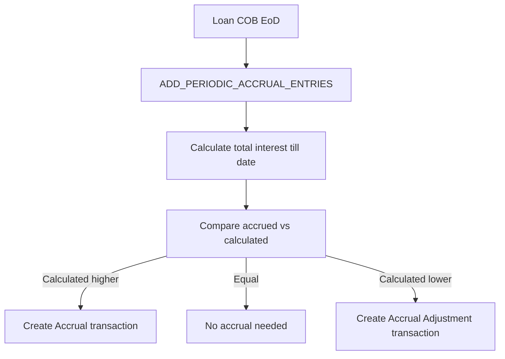

# Interest Timing

## First-Day Interest

### Day 0 interest behaviour

The disbursement date is Day 0 for interest purposes, and interest is calculated and accrued for that day at end of day based on the actual total outstanding principal at end of day. Intra-day actions such as repayment affect the daily interest amount, and payable interest stays in sync with the daily periodic accrual calculation.

The following rules apply to Day 0 interest behaviour:

- A customer who fully repays on the disbursement date can do so without paying any interest before end of day.
- The obligation to pay interest starts on the day after disbursement.
- The 0th day of a repayment period is not excluded from interest calculations.
- The disbursement date is Day 0 from an interest perspective and Day 1 of the repayment period.

### Repayment period date boundaries

Interest for a repayment period runs from the period from date through the day before the due date. The from date is inclusive for interest, while the due date is excluded from interest even though actions on that date belong to the period it falls on.

Date boundaries for repayment periods:

- The from date is exclusive for most actions except Day 0.
- The due date is inclusive for most actions but not for interest.
- The due date of one period and the from date of the next period are the same date with no gap.
- Actions on the due date belong to the period that due date falls on, except interest.

### Interest charged from date configuration

The interest charged from date controls when interest starts accruing on a loan. It depends on two product-level settings: interest charged from disbursement date and interest charged from date same as disbursal date.

| Interest charged from disbursement date | Interest charged from date same as disbursal date | Interest charged from date |
| --- | --- | --- |
| FALSE | FALSE | Disbursement date + 1 day |
| TRUE | FALSE | Disbursement date |
| FALSE | TRUE | Disbursement date |
| TRUE | TRUE | Disbursement date |

### Progressive loan accrual allocation

For progressive loans, the system allocates the interest amount of each accrual transaction across repayment periods in order of instalment number, from oldest to newest, up to the charged interest amount for each period. Relationships between accrual transactions and repayment schedule instalments might be removed for a progressive schedule. The combined total of positive accrual transaction balances and negative accrual adjustments cannot exceed the charged interest on the repayment schedule.

### Day 0 versus Day 1 interest logic

Interest can be charged starting from Day 0 or Day 1. Day 0 is excluded and Day 1 is the first day interest is charged, with the maturity date as the last day. Under the alternative logic, Day 0 is included and interest runs through the day before the maturity date.

Either logic produces exactly the same amount of payable interest until the maturity date is excluded from interest calculation.

### Interest recognition timing and accrual

Interest recognition timing decides when interest is accrued and when it becomes payable. Interest is recognised as part of end of day Day X and becomes payable as start of day Day X+1, which expedites accrual. Interest recognition on the disbursement date is supported only for progressive loan schedule type. You can update the setting if the loan was created but not yet approved or disbursed.

The interest recognition on disbursement date field controls when interest recognition starts:

- If TRUE, interest recognition happens on Day 0 (disbursement date) end of day and interest charging starts from Day 0 end of day, calculating interest based on current date + 1.
- If not provided or FALSE, interest recognition happens on Day 1 (disbursement date+1) end of day as legacy default behaviour and interest charging starts from Day 1 end of day, calculating interest based on current date.

### Partial period rate factor

The partial period rate factor determines how interest accrues for a partial period when interest recognition starts on the disbursement date.

The logic applies as follows:

- When interest recognition from disbursement date is true, the partial period rate factor includes the very first day and excludes the due date.
- When interest recognition from disbursement date is not true, no amendments are made to the partial period rate factor logic.

Interest calculation from Day 0 (the disbursement date) is supported based on configuration, and the number of days in month and year is considered according to the configuration.

The legacy interest recognition starting date is controlled by interest charged from date if provided during loan creation, secondly by the interest-charged-from-date-same-as-disbursal-date global configuration parameter, otherwise it starts with the disbursement date plus one day. The field is stored at loan product level and can be overridden when the loan is created.

> **Note:** Additional scenarios can be created where the disbursement date is not 1 January and may include backdated or reversed transactions.

### Daily accrual calculation and transactions

Each day at end of day, the system calculates the total interest that should be accrued through the day being closed as part of the ADD_PERIODIC_ACCRUAL_ENTRIES business step of Loan COB. It uses an up to date ProgressiveLoanInterestScheduleModel and ProgressiveEmiCalculator for this calculation.

The system then compares the calculated total interest with the interest already accrued:

- If the calculated amount is higher, it creates an Accrual transaction for the difference and allocates the accrued amount on repayment instalments from oldest to newest.
- If the calculated amount is equal, it accrues no interest.
- If the calculated amount is lower, it creates an Accrual Adjustment transaction for the difference and lifts the accrued amount from instalments from newest to oldest.

If interest recognition on disbursement date is enabled, COB creates an accrual transaction with daily interest on the disbursement date at end of day, and the calculated daily interest is based on the current date plus one day using the EMICalculator.

Total interest till date is also calculated using an up to date ProgressiveLoanInterestScheduleModel and ProgressiveEmiCalculator.

> **Note:** An alternative calculation uses actual total outstanding principal multiplied by the interest rate for one day based on the days in year configuration, but the model and EMICalculator are the safest course.

### Worked examples

Figures in this example are illustrative. A loan of 3,600 is disbursed on 1 January at an annual interest rate of 12 percent, using a 360-day year and 30-day months. The product is configured to charge interest from the disbursement date, so the disbursement date is Day 0. Interest accrues at the end of each day and becomes payable at the start of the next day.

| Day | Date | Interest accrued today | Cumulative accrued | Interest payable |
| --- | --- | --- | --- | --- |
| Day 0 | 1 Jan | 1.20 | 1.20 | 0.00 |
| Day 1 | 2 Jan | 1.20 | 2.40 | 1.20 |
| Day 2 | 3 Jan | 1.20 | 3.60 | 2.40 |

This shows that under the new behaviour the first day of disbursement already produces an accrual, while the matching amount only becomes payable on the following day.

A customer takes a loan of 1,000 on 1 January at an annual interest rate of 12 percent and repays the full amount later that same day before the end of day. Because repayment happens on Day 0, no interest obligation arises.

| Step | Amount | Balance after step | Interest due |
| --- | --- | --- | --- |
| Disbursement | 1,000.00 | 1,000.00 | 0.00 |
| Full repayment on Day 0 | 1,000.00 | 0.00 | 0.00 |

The loan closes with zero interest because the full repayment precedes the end-of-day accrual on the disbursement date.

A loan of 3,600 is disbursed on 1 January at an annual interest rate of 7 percent on a 360-day year, giving a daily interest of 0.70. The product flag that controls whether interest starts on the disbursement date is switched on, so Day 0 is the first interest day.

| Day | Date | Accrual at end of day | Payable at start of day |
| --- | --- | --- | --- |
| Day 0 | 1 Jan | 0.70 | 0.00 |
| Day 1 | 2 Jan | 0.70 | 0.70 |
| Day 2 | 3 Jan | 0.70 | 1.40 |

If the flag is switched off, the first accrual of 0.70 is created on 2 January instead of 1 January, and every payable date shifts one day later.

A loan of 3,600 at an annual interest rate of 12 percent runs from 13 December to 13 January using a 360-day year, so the daily interest is 1.20. When interest recognition starts on the disbursement date, the period includes the from date and excludes the due date.

| Setting | Days in December | Days in January | Total days | Interest for period |
| --- | --- | --- | --- | --- |
| New logic | 19 | 12 | 31 | 37.20 |
| Legacy logic | 18 | 13 | 31 | 37.20 |

Both settings yield the same total interest because the period length is unchanged; only the split across the year boundary moves.

## Early and Late Repayment Interest

### Early and late repayment interest effects

Early repayment lowers the principal balance, so less interest accrues over the remaining life of the loan and the final installment is relatively lower than the other installments. Late payments add interest on the higher balance, so the final installment is relatively higher than the other installments. These adjustments affect the final payment on the plan.

### Early repayment interest recalculation

Interest accrues daily based on principal balance. When you make an early repayment, interest is recalculated and collected as of the transaction date for that installment period, and remaining installments are recalculated based on the new outstanding principal balance with interest amounts adjusted accordingly.

Early repayment interest is handled as follows:

- Early partial payments collect the recalculated interest of that installment period as of the payment date, and the collected interest becomes the interest portion of that installment period.
- Early payment of an EMI or greater amount closes the installment period with interest recalculated.
- If the only unpaid installment is the current installment, the payable interest is calculated and must be paid.
- If the installment is a future installment but not the current one, there is no payable interest because there were no past days.
- Any advance amounts out of early repayments are allocated to the next installment or last installment based on the configuration set.
- Calculated interest is collected only for early payments with adjust to next installment configurations.
- No interest is collected when the early payment happens with adjust to last installment configuration; only principal is collected.
- Calculated interest is collected only for early payments of the current installment.

### Late repayment interest handling

Late repayment interest is calculated and collected only until the installment date, and payable interest for the late period matches the repayment schedule interest due balance. No installment is created for late repayments.

Late repayments are handled as follows:

- Any advance amounts from late repayments are adjusted to the next installment, the last installment, or first to the next installment with the remainder to the last installment.
- The repayment schedule remaining installments are recalculated based on the new principal balance and interest is adjusted accordingly.
- A repayment can be late for some periods and pay some periods in advance.
- Late repayments made after the maturity date collect the installment interest they are fulfilling.

### Advance payment adjustment strategies

An advance payment can adjust the last unpaid period by amending that period’s EMI. The change takes effect only at the end of the loan term, while the EMIs for all other periods stay the same. If the last installment was already fully paid, the system amends the last but one period instead.

Advance payment adjustment for progressive interest bearing loan products works as follows:

- When Recalculate interest is enabled, the Advance payments adjustment type includes the option Adjust last, unpaid period.
- Adjust last, unpaid period is the only supported adjustment rule for progressive loans.
- Recalculation considers the reverse replay of all transaction types, including accruals.

### Product configuration requirements

Early and late repayment interest applies to progressive interest bearing loan products when interest recalculation is enabled. Recalculation runs only until the maturity date and never after it.

Configure the product with these settings:

- Set Interest calculation Period to Daily.
- Set Recalculate Interest to Enabled.
- Set Frequency Interval for Recalculation to 1.
- Set Frequency for recalculate outstanding principal to Daily.
- Set the repayment transaction future installment allocation rule to Last installment.

The product configuration shows these values:

- Interest calculation Period is Daily.
- Recalculate Interest is Enabled.
- Frequency Interval for Recalculation is 1.
- Frequency for recalculate outstanding principal is Daily.
- Future installment allocation rule is Next installment.

> **Note:** The configured future installment allocation rule is Next installment, but early and late payment calculations require Last installment.

If there is an N+1 installment, it is open whether recalculation still calculates till the actual maturity date.

When the rest frequency type is daily and the pre-close interest calculation strategy is till rest frequency date, or the rest frequency type is same as repayment period and the pre-close interest calculation strategy is till pre-closure date, interest is calculated at the end of the actual period anyway.

Overdue interest is collected first and then principal.

### Schedule recalculation and interest collection rules

When a repayment changes the outstanding balance, the system recalculates the remaining installments based on that balance and adjusts interest accordingly.

Interest for an installment is calculated as follows:

- Payable interest for the current installment equals the total interest for the past days of that installment plus the daily interest for the current date.

### Worked examples

Early partial repayment with the advance applied to the next installment (figures are illustrative). A customer takes a 1,000.00 loan at 12% a year, with 30-day months and three monthly installments. The first installment is paid on time. Halfway through the second month the customer pays the next installment early, and the advance payments adjustment type is set to apply the advance to the next installment. Interest is recalculated as of the payment date on the balance then outstanding; that interest becomes the interest part of the installment, the principal part reduces the balance, and the remaining installment is recalculated on the new balance. The schedule is not re-amortized, so only the final installment changes and it comes out lower than the earlier installments. If the adjustment type is instead set to apply the advance to the last installment, the early payment collects principal only, no interest is taken at that time, and the advance reduces the final installment.

| Date | Event | Opening balance | Interest | Principal | Total paid | Closing balance |
| --- | --- | --- | --- | --- | --- | --- |
| 2/1 | Installment 1 due | 1,000.00 | 10.00 | 333.33 | 343.33 | 666.67 |
| 2/15 | Early payment toward installment 2 | 666.67 | 3.33 | 333.33 | 336.66 | 333.34 |
| 3/1 | Final installment recalculated | 333.34 | 1.67 | 333.34 | 335.01 | 0.00 |
| Totals |  |  | 15.00 | 1,000.00 | 1,015.00 |  |

Early payoff of the final installment before it is due (figures are illustrative). The same 1,000.00 loan at 12% a year with 30-day months reaches the point where only the last installment is unpaid: principal 333.34 with scheduled interest 3.33, due on 4/1. The customer pays it early on 3/15. Because this is the only installment left, payable interest is calculated as of the payment date for the days that have passed in the installment period and must be paid together with the principal. The loan then closes, so no further interest accrues. The final payment is lower than the scheduled installment, and the total interest for the loan is lower than in the original schedule.

| Date | Event | Opening balance | Interest | Principal | Total paid | Closing balance |
| --- | --- | --- | --- | --- | --- | --- |
| 2/1 | Installment 1 due | 1,000.00 | 10.00 | 333.33 | 343.33 | 666.67 |
| 3/1 | Installment 2 due | 666.67 | 6.67 | 333.33 | 340.00 | 333.34 |
| 3/15 | Early payoff of final installment | 333.34 | 1.56 | 333.34 | 334.90 | 0.00 |
| Totals |  |  | 18.23 | 1,000.00 | 1,018.23 |  |

Late repayment before maturity (figures are illustrative). The same 1,000.00 loan at 12% a year with 30-day months and three monthly installments. The first installment is paid on time. The second installment, due on 3/1, is paid ten days late on 3/11. The scheduled interest and principal for that installment are still paid, but additional interest is charged on the higher balance for the overdue days. That extra interest is not spread into the earlier installments; it is added to the final installment, so the final installment is higher than the others and the total cost of the loan rises.

| Date | Event | Opening balance | Interest | Principal | Total paid | Closing balance |
| --- | --- | --- | --- | --- | --- | --- |
| 2/1 | Installment 1 due | 1,000.00 | 10.00 | 333.33 | 343.33 | 666.67 |
| 3/11 | Installment 2 paid late | 666.67 | 6.67 | 333.33 | 340.00 | 333.34 |
| 4/1 | Final installment with late interest | 333.34 | 5.55 | 333.34 | 338.89 | 0.00 |
| Totals |  |  | 22.22 | 1,000.00 | 1,022.22 |  |

See also: [Backdated Loans: Backdated Loans](../loan-origination/backdated-loans.md#backdated-loans), [Interest Calculation: EMI Calculation](../loan-products/interest-calculation.md#emi-calculation).
