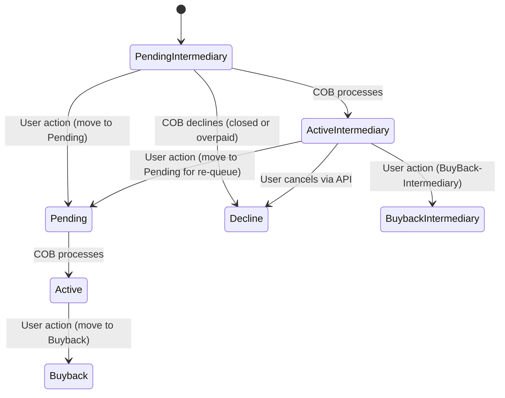

# Investor Module Enhancement

Pepper-Soup, theInvestor Module Enhancement, introduces an intermediate step in the asset externalization workflow. The change expands the previous flow which moved directly from Pending to Active after initiation. With Pepper-Soup, staff can place loan accounts into an intermediary sale state (Pending-Intermediary and Active-Intermediary) before the final sale completes. This change matters for day-to-day operations because it provides a staged, auditable pathway for asset externalization, supports ownership handoffs during the transfer process, and defines explicit COB-driven transitions and validations that affect accounting treatment and asset ownership.

Lead with what changed and why it matters
- What changed: A new intermediary sale workflow has been added. Loan accounts can enter Pending-Intermediary and Active-Intermediary states before completing the sale. The existing Pending and Active states remain, but the intermediary states allow externalization to proceed in stages.
- Why it matters: The staged flow allows asset externalization to progress even when the sale is not yet fully complete, supports explicit ownership handoffs, and defines rules for when COB (credit operations broker) processes should apply accounting entries. This affects day-to-day operations by creating new statuses to monitor, new API-based actions, and a clearer model for buybacks and declinations.

Concepts and scope
- Baseline behavior (prior to Pepper-Soup): The sale of a loan account moved from PENDING directly to ACTIVE, with accounting entries generated per COB processing rules.
- Enhancement goal: Allow an intermediate sale path, so a loan account can be in Pending-Intermediary and Active-Intermediary states prior to finalization. The documented flow is:
 - Pending-Intermediary → Active-Intermediary (COB processes)
 - Active-Intermediary → Pending (user-initiated re-queue to intermediary sale)
 - Pending (and Pending-Intermediary) → Active (COB processes)
 - Active-Intermediary → Buyback-Intermediary (user-initiated)
 - Active-Intermediary → Decline (via API cancellation)
 - Active → Buyback (via API, for loans in Active state)
- Statuses used in the enhanced flow:
 - PendingIntermediary
 - ActiveIntermediary
 - Pending
 - Active
 - Decline
 - BuybackIntermediary
 - Buyback
- Key rule: Only loans in the Active state can be moved to Buyback, while loans in ActiveIntermediary can be moved to BuybackIntermediary.

Required workflows for day-to-day operations
Initiating an intermediary sale (Active loan accounts)
1) Open the loan account involved in the asset externalization process.
2) Initiate Intermediary Sale, which places the loan account in the Pending-Intermediary state. Staff must provide the intermediary owner identifier during this action.
3) The COB process will pick up the Pending-Intermediary sale and advance it to Active-Intermediary.
4) If the loan account balance is zero, the status transition to Active-Intermediary still occurs, but no accounting entries are passed for zero amount. The asset ownership transfers to the new asset owner, and any new monetary transaction will be tagged to that owner.
5) Staff may use the API to cancel a Pending-Intermediary sale (Decline) if the loan account is closed or overpaid; COB will perform the standard state transition to Decline.

Advancing an intermediary sale to the next stage
6) An Intermediary sale in Active-Intermediary can be advanced to BuybackIntermediary via an API action (BuyBack-Intermediary).
7) Staff may initiate a sale on an Active-Intermediary loan account, moving it to Pending (to re-enter the intermediary cycle) or to other approved transitions as defined in policy.
8) The COB process will move Pending to Active (finalizing the intermediary sale step) as part of the ongoing asset externalization workflow.

Direct sale progressions and overrides
- From Pending-Intermediary, decline is possible if the loan is closed or overpaid; the loan will transition to Decline.
- From Active-Intermediary, the user may cancel via API to move to Decline, or initiate buyback flows via BuybackIntermediary; from there, subsequent steps will follow the applicable governance for Buyback paths.
- From Active, the loan can be moved to Buyback via API; Buyback concludes the sale sequence for loans in the Active state.

Validation rules and behavior by status
- Pending-Intermediary
 - The COB process will convert Pending-Intermediary loans to Active-Intermediary.
 - If the loan account is closed or overpaid, COB should move the loan from Pending-Intermediary to Decline.
 - The owner ID for the Intermediary transfer is supplied by the user during initiation.
 - Accounting entries for Pending-Intermediary are not generated for the actual sale events.
- Active-Intermediary
 - The loan remains in Active-Intermediary until an intervening action (buyback, re-queue to Pending, or decline) is taken.
 - The user may buy back the intermediary, moving to BuybackIntermediary, or move to Pending to re-activate intermediary steps.
 - Only loans in Active-Intermediary may be moved to BuybackIntermediary via API; cancellation to Decline is possible via API.
 - If the loan balance becomes zero while in Pending-to-Active flow through the intermediary, no accounting entries are recorded for that zero amount; ownership handoff is effected to the new asset owner, and subsequent monetary activity is attributed to that owner.
- Pending
 - Pending is entered via API for intermediary scenarios and will be moved to Active via COB processing.
 - The COB process will not decline a Pending loan based solely on a closed or overpaid status; such loans remain subject to the transition rules described.
- Active
 - Active loans can be moved to Buyback via API; accounting entries are governed by the standard COB processes associated with the Buyback flow.
- Decline
 - Decline results from cancellation actions (by COB for certain intermediary states or via API) and does not generate accounting entries in the documented flow.
- Buyback and BuybackIntermediary
 - Buyback is initiated via API from Active state, BuybackIntermediary from ActiveIntermediary state; these paths finalize the externalization or transfer of ownership per policy.

Accounting implications and references to entries
- The reference specifies that Pending-Intermediary state incurs no accounting entries at initiation. When the status is moved to Active-Intermediary, processing occurs via COB; the documentation does not enumerate the exact accounting entries for Active-Intermediary or subsequent Active, Buyback, or BuybackIntermediary steps in a generic table, but these steps are described as COB-processed or API-initiated in the respective states.
- When a status change from Pending to Active occurs with zero balance, no accounting entries are passed for that zero amount, and ownership transfers to the new asset owner. Any subsequent monetary transaction will be attributed to that new owner.
- In the intermediary flow, Decline does not generate accounting entries, while other transitions are governed by COB processing and API actions as described above.

What changes for operations teams and branch staff
- Visibility of new states: PendingIntermediary and ActiveIntermediary provide a staged view of loans under externalization, including timing and ownership handoffs.
- Actions available to staff: Initiate Intermediary Sale (with owner ID), BuyBack (for Active or ActiveIntermediary states), and transitions via API to Pending, Decline, or Buyback states as allowed by policy.
- COB-driven transitions: The automated COB processing handles transitions between intermediary states and regular Pending/Active cycles, with specific handling for zero-balance scenarios as described.
- Compatibility and migration notes: The reference describes the new intermediary flow and its rules but does not specify automatic migration steps for existing loans or retroactive state mappings. Adoption requires aligning user workflows with the new intermediary states and verifying owner IDs are supplied where required.

Reference diagram (state transitions)
A diagram helps visualize the verified flow and transitions among the intermediary and standard states. The diagram below captures the allowed transitions and typical sequencing as described in the reference specifications.

Reference specifications: terminology and definitions
- Statuses used in the enhanced flow:
 - PendingIntermediary: Intermediary sale initiated for an active loan account.
 - ActiveIntermediary: Intermediary sale actively processing under COB.
 - Pending: Interim state reached via API for intermediary flow; awaiting COB processing to become Active.
 - Active: Standard active state in the intermediary flow; COB processing manages the finalization.
 - Decline: State indicating the intermediary sale is canceled or declined by API or COB rules.
 - BuybackIntermediary: Intermediary buyback state initiated via API from ActiveIntermediary.
 - Buyback: Buyback state initiated via API from Active.
- Workflows follows the Investor Module 2.0 goals to allows staged asset externalization while preserving clear ownership and accounting behavior where described.

Open questions and notes for future discussion
- The reference describes transitions and actions but does not provide exhaustive enumerations of every permitted path with explicit UI labels or field-level validations for each screen. Operational guidance should map the described states to the actual product UI in use, verifying staff provide the required intermediary owner IDs when initiating intermediary actions.
- Any automated migration steps for existing portfolios are not specified in the reference. Plan onboarding communications and training to reflect the new intermediary flow and its impact on daily reconciliations.

Glossary of new terms
- PendingIntermediary: Intermediary sale has been initiated for an active loan but has not yet advanced to the intermediary active stage.
- ActiveIntermediary: The intermediary sale is actively being processed by COB.
- Pending: The intermediary sale has progressed to a pending state, awaiting the next COB step or user action.
- Active: The intermediary sale has progressed to an active state in the sequence.
- Decline: The intermediary sale has been canceled or rejected.
- BuybackIntermediary: The intermediary buyback action has been initiated for a loan in ActiveIntermediary.
- Buyback: The buyback action has been initiated for a loan in Active.

Compatibility and migration considerations for Operations Staff
- Adoption of Investor Module 2.0 introduces explicit intermediary flow states and associated COB-driven processing. The reference does not specify automatic retrofitting or migration steps for existing loans. Operations staff should plan to follows the new intermediary states and verify standard owner IDs are supplied for intermediary transfers.
- Training should cover the new states, API-based actions (for moving between states or initiating buys back), and the rule set for automated declines when loans are closed or overpaid during intermediary stages.

This page documents verified behavior and the rules for Investor Module Enhancement (Pepper-Soup) as described in the reference data. It presents the flow, state transitions, validations, and operational impacts without extrapolating beyond the documented capabilities and constraints.