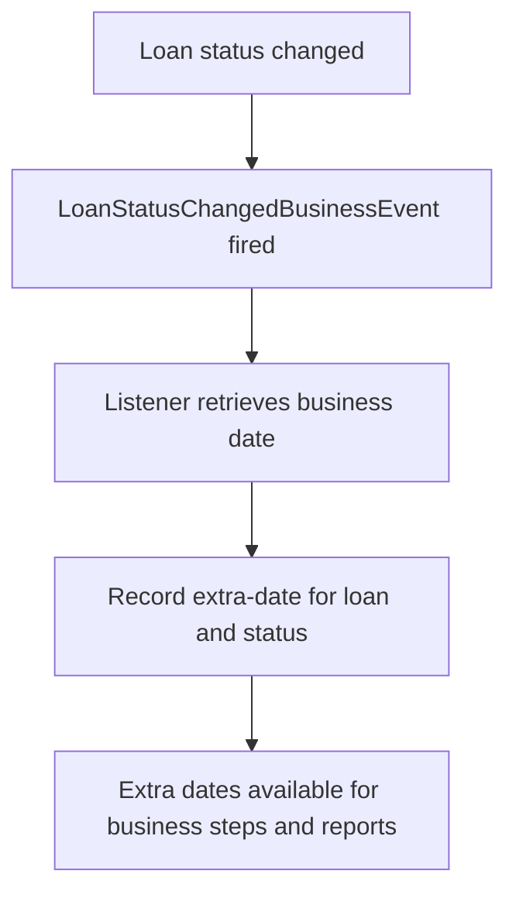

# Loan lifecycle changes with extra dates

This feature introduces a custom module that records additional, business-relevant dates whenever a loan's lifecycle changes. The primary purpose is to allows richer business analysis and reporting by preserving the exact business date on which a status transition occurred. Operations staff, loan officers, branch managers, and credit agents benefit from improved visibility into when key lifecycle events happened, which supports more accurate decision-making, reconciliation, and reporting.

### What the feature does and why it matters

When a loan's lifecycle changes (for example, when a loan becomes overpaid or reaches maturity), the system captures the actual business date of that change and stores it as an extra data point associated with the loan and the new status. This allows downstream reporting and business-step workflows that rely on precise dating of lifecycle events, independent of the general accounting or CoB (close of business) processing.

The module is designed to be configurable so that organizations can decide which status changes they want to track. By default, the configuration option tracks every status change, but it can be limited to a subset of statuses to focus on events that matter most to a given operation.

A central use case for this capability is handling backdated events. For example, when an overpayment arrives with a backdated effective date, the extra-dates mechanism provides a record of that event’s business date for reporting and internal steps. It is noted that backdated events are not distributed to other systems by CoB, which highlights the importance of this internal tracking for reconciliation and reporting purposes.

### How it works at a high level

- The system listens for loan lifecycle changes through a dedicated listener.
- When a status change occurs, the listener retrieves the actual business date of the change.
- The system stores an extra-date record linked to the loan and the new status, including who triggered the change and the timestamps of the action.
- The stored extra dates can be used to drive business steps, reports, and any processes that rely on the precise dating of lifecycle transitions.

The following diagram illustrates the flow of the event and data capture:

### Configuring which changes to track

Configuration is controlled via a single key:
- **custom.module.loan.lifecycle.allowed.status.codes**

This key defines the list of status codes for which the system should capture extra dates. The value can be:
- ALL — Track every status change (default option)
- A comma-separated list of statuses, e.g. OVERPAID, CLOSED_OBLIGATIONS_MET — Track only when the loan is overpaid or when the loan is fully paid and closed in the indicated states.

Examples:
- Value = ALL → Track every status change
- Value = OVERPAID, CLOSED_OBLIGATIONS_MET → Track only specific transitions of interest

The configuration allows organizations to tailor the feature to their governance, reporting requirements, and operational workflows.

### Data visible to users and operational impact

The extra dates are stored as part of a historical record associated with each loan and the associated status. Each record reflects:
- The loan reference
- The new status code
- The business date when that status change occurred
- The user who triggered the action
- Timestamps for when the change occurred (created and updated times)

This data is intended to support business steps and reports that require precise dating of lifecycle events. It provides you with a verifiable timeline of when changes happened, independently from settlement or accounting timestamps.

### Scenarios and behavior

- Default tracking (ALL): The system records an extra date for every status transition that occurs on a loan. This maximizes visibility into the full lifecycle timeline.
- Targeted tracking (specific statuses): The system records extra dates only for the statuses listed in the configuration. This reduces data volume and focuses reporting on events deemed critical by the organization.
- Backdated events: When an overpayment arrives with a backdated business date, the extra-date mechanism captures that date for historical accuracy. CoB does not distribute backdated events to other systems, reinforcing the need for internal tracking to reflect true business timing.

### Operational considerations

- The feature is implemented as a background capability that relies on a listener reacting to loan status change events. It does not require changes to user-initiated workflows beyond the initial configuration step and does not introduce new UI navigation paths for data entry.
- Reports and business steps that reference lifecycle dates can incorporate the extra dates to provide a more precise chronology of events.
- The extra-date records are intended to be strictly informational for the purposes of business analysis and reconciliation; they support internal controls and visibility around lifecycle timing.

### What you should verify during adoption

- Confirm the configuration for custom.module.loan.lifecycle.allowed.status.codes reflects the desired tracking scope (ALL or a subset of statuses).
- Validate that, upon a loan status change, an extra-date record is created and associated with the correct loan and status.
- verify that the recorded business date corresponds to the actual business date of the status change and that created_by and timestamps reflect the triggering user and action time.
- If backdated events are relevant to your reporting, verify that the extra dates follows your internal reconciliation needs and that no external CoB distribution affects these records.

### Summary of benefits

- Improved traceability of lifecycle events through precise business-dated records.
- Flexible configuration to follows governance, risk, and reporting requirements.
- Enhanced ability to generate business-step reports and analyses that rely on accurate event dating.
- Clear handling of backdated events with internal provenance suitable for reconciliation.