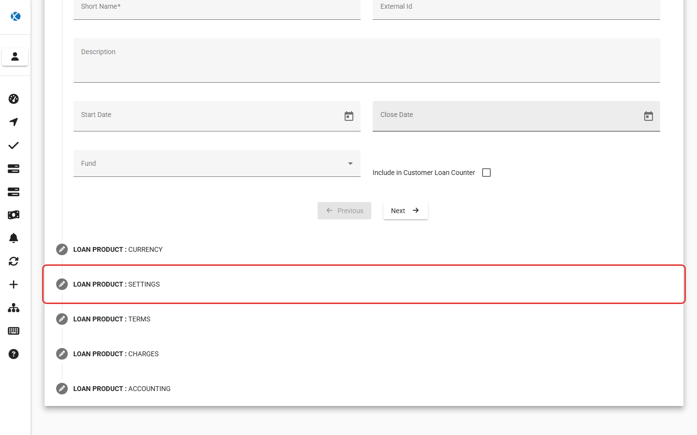
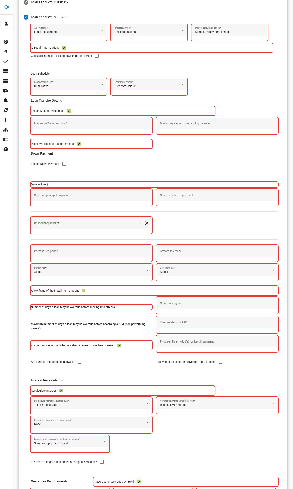

# Interest-Bearing Loans

Interest-bearing loans accrue interest daily until the maturity date is reached. Interest pause is not allowed on a progressive loan that has interest recalculation enabled and a zero interest rate. The effective rate limit is 0.09995 and can change.

## Set up loan product settings

1. Select **Admin** > **Products** > **Loan Products**.
2. Select **Create** > **Create Loan Product (Classic)**.
3. Select **SETTINGS**.

   

4. Set the fields described below, then select **Next** to continue through the form and save it at the end.

| Field | Required |
| --- | --- |
| Amortization | Yes |
| Net Present Value Day Count | Yes |
| Delinquency Bucket | No |
| Delinquency Grace Days | No |
| Delinquency Start Type | No |
| Breach | No |
| Near Breach | No |
| Breach Grace Days | No |
| Breach Start Type | No |
| Near Breach Threshold | Yes |
| Near Breach Evaluation Frequency | Yes |
| Near Breach Evaluation Frequency Type | Yes |
| Interest Method | Yes |
| Interest calculation period | Yes |
| Is Equal Amortization? | No |
| To be used with SAME AS REPAYMENT PERIOD- for  calculating exact interest with partial period  ex: Interest charged from is 5th of April , Principal is 10000 and interest is 1% per month then the interest will be (10000 * 1%)* (25/30) , it calculates for the month first then calculates exact periods between start date and end date(can be a decimal) | No |
| Loan Schedule Type | Yes |
| Repayment strategy | Yes |
| Loan Schedule Processing Type | Yes |
| Enable Multiple Disbursals | No |
| Maximum Tranche count | Yes |
| Maximum allowed outstanding balance | No |
| Disallow Expected Disbursements | No |
| Allow full term for each tranche | No |
| Disbursed Amount Percentage Down Payment (%) | Yes |
| Enable Auto Repayment for Down Payment | No |
| Loan Charge-off behaviour | Yes |
| Grace on principal payment | No |
| Grace on interest payment | No |
| Enable installment level Delinquency | No |
| Interest free period | No |
| Arrears tolerance | No |
| Days in year | Yes |
| Days in year custom strategy | No |
| Days in month | Yes |
| Allow fixing of the installment amount | No |
| On arrears ageing | No |
| Overdue days for NPA | No |
| Account moves out of NPA only after all arrears have been cleared | No |
| Principal Threshold (%) for Last Instalment | No |
| These fields are used to define the minimum, maximum gap that should be present between the installments for the loan product | No |
| Minimum gap between Installments | Yes |
| Maximum gap between Installments | Yes |
| If selected, the Loan Product can be used to apply for Top Up Loans. | No |
| Recalculate Interest | No |
| Pre-closure interest calculation rule | Yes |
| Advance payments adjustment type | Yes |
| Interest recalculation compounding on | Yes |
| Frequency Interval for compounding | Yes |
| Frequency Interval for recalculation | Yes |
| Frequency for compounding | Yes |
| Frequency for recalculate Outstanding Principal | Yes |
| Is Arrears recognization based on original schedule | No |
| Do not calculate interest on past due principal balances | No |
| Place Guarantee Funds On-Hold | No |
| Mandatory Guarantee(%) | Yes |
| Minimum Guarantee from Own Funds(%) | No |
| Minimum Guarantee from Guarantor Funds(%) | No |
| Use or not the Global Configurations values to the Repayment Event (notifications) | No |
| Due days for repayment event | No |
| OverDue days for repayment event | No |
| Allow overriding select terms and settings in loan accounts | No |
| Interest method | No |
| Repaid every | No |
| Moratorium | No |
| Number of days a loan may be overdue before moving into arrears | No |
| Also allows overriding the near breach, breach grace days and breach start type on the loan account. | No |
| Also allows overriding the delinquency grace days and delinquency start type on the loan account. | No |
| Discount Default | No |
| Period Payment Frequency | No |
| Period Payment Frequency Type | No |

## Worked examples

Figures in this example are illustrative. A loan officer disburses a loan of $1,000.00. After the charge-off date has passed, a repayment of $100.00 is posted, which blocks a new charge-off because it is a non-reversed transaction after the charge-off date. Later the same day, a Merchant Issued Refund of $900.00 repays the remaining balance in full. Because the amount balance becomes zero, the charge-off transaction is reversed; the refund itself is treated as a reversed transaction and does not count toward the block check.

| Step | Event | Amount | Balance | Charge-off result |
| --- | --- | --- | --- | --- |
| 1 | Disbursement | +$1,000.00 | $1,000.00 | Loan opened |
| 2 | Repayment | -$100.00 | $900.00 | Blocked: non-reversed transaction after charge-off date |
| 3 | Merchant Issued Refund | -$900.00 | $0.00 | Ignored for block check (reversed transaction) |
| 4 | Charge-off transaction | reversed | $0.00 | Reversed: amount balance is zero |

A refund that clears the balance forces reversal of the charge-off, while an earlier non-reversed repayment still stops a new charge-off.

An administrator opens a progressive loan of $900.00 with interest recalculation enabled and an annual interest rate of 0.00%, then attempts to add an interest pause. The application forbids the pause for this combination, so the repayment schedule is not broken and installments continue to post as scheduled.

| Step | Setting | Value | Result |
| --- | --- | --- | --- |
| 1 | Loan type | Progressive | — |
| 2 | Interest recalculation | Enabled | — |
| 3 | Annual interest rate | 0.00% | — |
| 4 | Interest pause | Add pause | Forbidden |
| 5 | Installment 1 | $300.00 | Posted on schedule |
| 6 | Balance after installment 1 | $600.00 | Schedule intact |

With a zero rate and interest recalculation on, the system blocks an interest pause so the repayment schedule stays correct.
