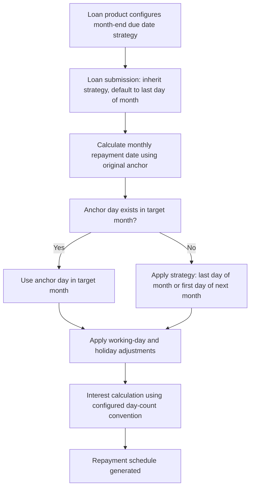
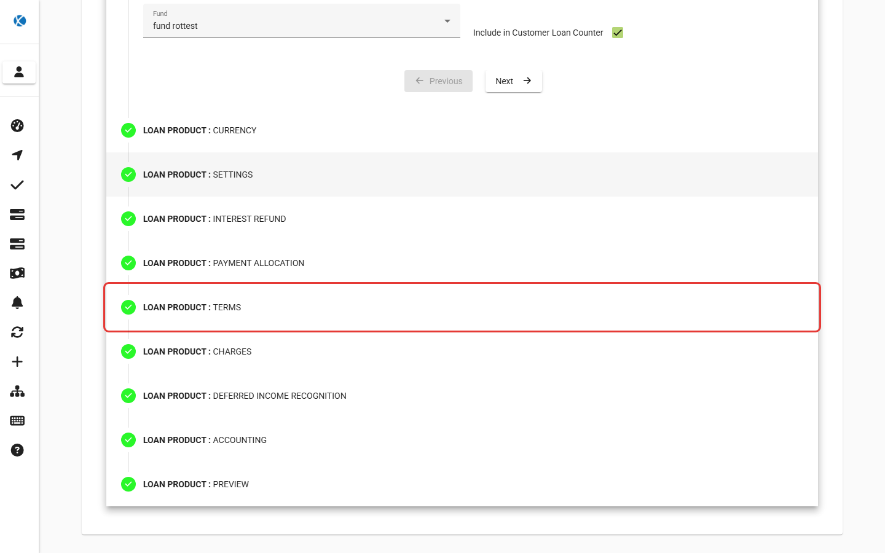
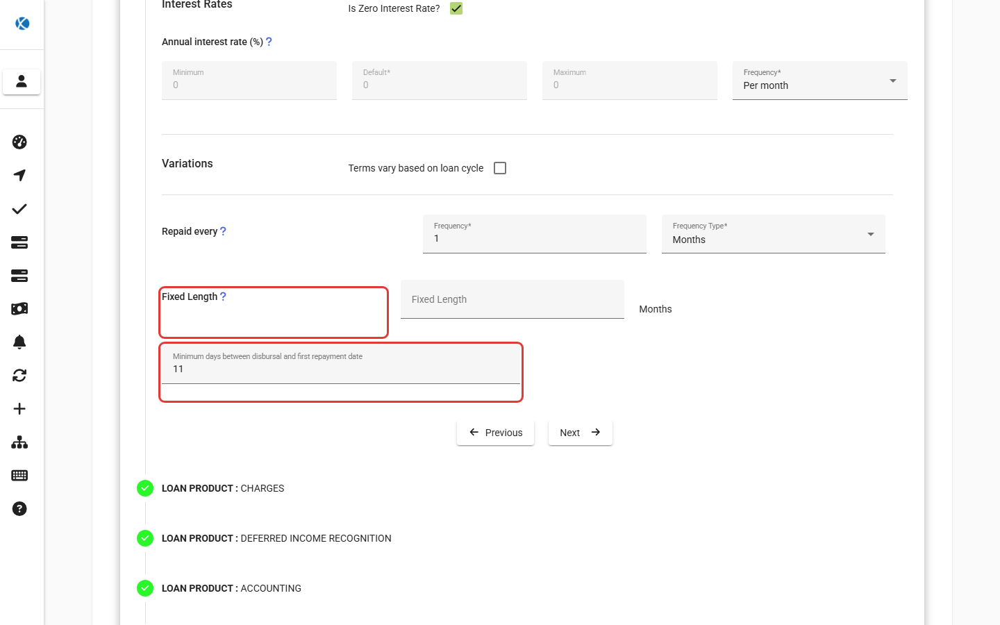

# Repayment Schedule

## Repayment due date strategy

The monthly repayment due date strategy decides what happens when a loan's repayment anchor day does not exist in a target month, such as the 31st in February. It applies only to monthly repayment frequencies; daily, weekly, and yearly frequencies keep their existing behavior.

Two strategies are available:

- LAST_DAY_OF_MONTH moves the due date to the last day of the target month.
- FIRST_DAY_OF_NEXT_MONTH moves the due date to the first day of the month after the target month.

The strategy applies when:

- Repayment frequency is monthly.
- The original repayment anchor is the 29th, 30th, or 31st.
- The target month does not contain the original anchor day.

Processing order:

- Calculate the monthly repayment date using the original anchor.
- Apply the month-end due date strategy.
- Apply the existing working-day and holiday adjustment rules.

Rules that apply to both strategies:

- The original repayment anchor day is preserved for subsequent installments.
- Subsequent repayment dates are always calculated using the original anchor, not the previously adjusted due date.
- The strategy applies to every repayment due date, including the final installment.

When the anchor day exceeds the number of days in the target month:

| Strategy | Adjusted due date |
| --- | --- |
| FIRST_DAY_OF_NEXT_MONTH | First day of the month following the target month |
| LAST_DAY_OF_MONTH | Last day of the target month |

When the anchor day is less than or equal to the number of days in the target month:

| Condition | Adjusted due date |
| --- | --- |
| Anchor day exists in the target month | Target date with its day set to the anchor day |

Financial institutions can choose how monthly repayment due dates are handled when the original repayment day does not exist. The strategy is configured at loan product level. If no value is provided, LAST_DAY_OF_MONTH is the default. A loan account inherits the configured strategy from the loan product at submission, and existing loan accounts retain the strategy captured at submission. Changes to the loan product configuration affect only newly submitted loans.

The stored strategy is reused for schedule regeneration, including rescheduling and interest recalculation, and remains available after application restart.

Interest calculation follows the loan product's configured day-count convention. Under 360/30, rolling a due date forward must not change the interest calculated for each regular monthly period. Under Actual/Actual, interest is calculated using the actual number of calendar days between repayment dates, so rolling a date forward can change the number of days in the affected periods and may change the interest charged.

> **Note:** Under Actual/Actual, total interest may change because the interest increase and decrease are calculated on different principal balances.

The strategy works for both cumulative and progressive loan schedules. Both use the same date calculation, including the fixed-length maturity-date calculation.

Under 360/30, both strategies give the same monthly interest fractions, so rolling a due date forward does not add interest. Under Actual/Actual, when a due date rolls forward, Period 1 accrues one extra day of interest on the higher outstanding balance and Period 2 accrues one fewer day on the reduced balance. For periods that cross a calendar year, the usual Actual/Actual year-length handling applies.

The strategy sets only the calendar due date. It does not change the loan product's day-count convention, the interest formula, rounding or precision, and the interest for each period still follows that period's outstanding principal.

The same strategy is applied everywhere a monthly due date is calculated: initial schedule generation, schedule regeneration, progressive EMI calculation, cumulative schedules, fixed-length maturity calculation and holiday adjustment. With fixed length configured, the maturity date matches the final due date in the schedule.

Loan products and accounts with no stored strategy use LAST_DAY_OF_MONTH, so their schedules and interest are unchanged.

## Set the monthly repayment due date strategy

Use this screen to choose how monthly repayment due dates are handled when the original repayment day does not exist in a target month, so the loan product applies a consistent month-end rule to new loans.

1. Select **Admin** > **Products** > **Loan Products**.
2. Select **Create** > **Create Loan Product (Classic)**, or open an existing product and select **Edit**.
3. Select **TERMS**.

   

4. Set the fields described below, then select **Next** to continue through the form and save it at the end.

| Field | Required | Description |
| --- | --- | --- |
| First repayment day of month | Yes | Enter the day of the month that serves as the anchor for calculating monthly repayment due dates. |
| Second repayment day of month | Yes | Enter the second repayment day of the month used when calculating the repayment schedule. |
| Fixed Length | No | Set the fixed maximum length of the loan when regulatory rules require it; the fixed length defines the length of the last installment, which may be shorter than earlier installments. |
| Minimum days between disbursal and first repayment date | No | Enter the minimum number of days between disbursal and the first repayment date. |

The chosen strategy is saved on the loan product, inherited by new loan accounts at submission, and used to calculate monthly repayment due dates before working-day and holiday adjustments are applied.

## Worked examples

A loan is disbursed on 31 January and repays in three monthly installments on the thirty-first of each month. The figures are illustrative. When February has no thirty-first, the due date moves under the chosen month-end strategy; the original anchor day of thirty-one is restored for March and tested again for April.

| Installment | Target month | Anchor day | Due date: Last day of month | Due date: First day of next month |
| --- | --- | --- | --- | --- |
| 1 | February | 31 | 28 February | 1 March |
| 2 | March | 31 | 31 March | 31 March |
| 3 | April | 31 | 30 April | 1 May |

The example shows that the rolled date becomes the last day of the target month under the last-day strategy, but the first day of the next month under the roll-forward strategy, while the anchor day stays thirty-one for every installment.

A loan has an initial principal of 1,200, an annual interest rate of 12 percent, and two monthly installments. After the first installment, 200 of principal is repaid, leaving 1,000 outstanding for the second period. The figures are illustrative. The repayment anchor is 30 January, so both strategies use a thirty-day interest fraction under the 360/30 convention.

| Period | Outstanding principal | Interest fraction | Interest: Last day of month | Interest: First day of next month |
| --- | --- | --- | --- | --- |
| 1 | 1,200.00 | 30/360 | 12.00 | 12.00 |
| 2 | 1,000.00 | 30/360 | 10.00 | 10.00 |
| Total | — | — | 22.00 | 22.00 |

The example shows that total interest is identical under both strategies because the 360/30 convention always uses thirty days per period; under Actual/Actual the same roll would change the day count and therefore the interest.

The same loan of 1,200 at 12 percent annual interest repays 200 of principal after the first period, leaving 1,000 outstanding for the second. The repayment anchor is 30 January in a non-leap year, so Actual/Actual uses the real calendar days between each pair of due dates.

| Period | Outstanding principal | Due dates | Actual days | Interest fraction | Interest: Last day of month | Interest: First day of next month |
| --- | --- | --- | --- | --- | --- | --- |
| 1 | 1,200.00 | 30 January → 28 February | 29 | 29/365 | 11.44 | — |
| 1 | 1,200.00 | 30 January → 1 March | 30 | 30/365 | — | 11.84 |
| 2 | 1,000.00 | 28 February → 30 March | 30 | 30/365 | 9.86 | — |
| 2 | 1,000.00 | 1 March → 30 March | 29 | 29/365 | — | 9.53 |
| Total | — | — | — | — | 21.30 | 21.37 |

The example shows that rolling the date forward adds one interest day to the first period on the higher balance and removes one day from the second period on the lower balance, so total interest changes slightly.
