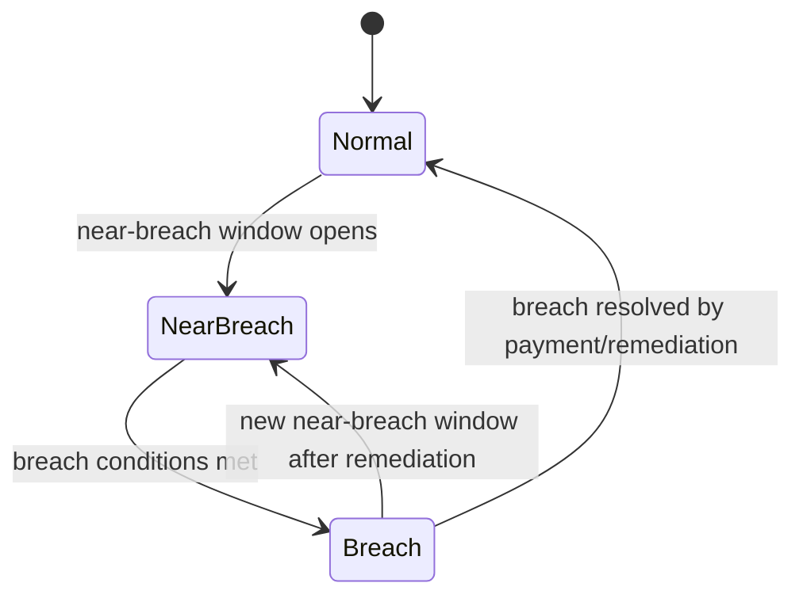

# EIR Calculation Phase 2 - Breach Management

Breaches and near-breach conditions form a critical control in the EIR-based Working Capital (WCP) product as it transitions into Phase

2. Breach Management governs how the system recognizes, flags, and responds to delinquency signals that indicate a borrower is approaching or has entered a breach of the minimum payment commitments. The feature supports Delinquency and Delinquency Pause handling, maintains a breach schedule, and interacts with the projected amortization framework to preserve accurate income recognition and balance progression. It benefits operations staff, loan officers, branch managers, and credit agents by surfacing breach status early, guiding remedial action, and verifying consistent treatment across loan accounts.

The material in this page reflects the implemented behavior and rules evidenced in the Working Capital breach-related materials. It documents what the feature does, how it behaves in loan servicing, and the observable outcomes for users. No hypothetical or internal-only behavior is described here.

### What Breach Management does and why it matters

- It defines and maintains a breach schedule for each loan, representing ranges of time during which the borrower’s payments must be reviewed for potential breach conditions. Each range specifies a period, a minimum payment expectation, and the outstanding amount that must be monitored. The schedule is used to determine when a loan enters a breach state and when it remains in near-breach territory.
- It distinguishes near-breach from breach states. Near-breach indicates a window where the borrower is close to failing to meet obligations, while breach denotes a confirmed shortfall according to the schedule's rules.
- It interacts with delinquency management, including bucket classification (for example, D00, D30, D60, etc.), to reflect changing delinquency severity and to drive standard operational responses.
- It supports updating the minimum payment requirement as conditions evolve, subject to process controls and the breach policy. This update affects how future periods are projected and how the amortization and income recognition plan adapts to new expectations.
- It provides traceability for breach decisions, including the ability to review breach ranges, associated dates, the minimum payment, the outstanding balance, and whether a given range is marked as a breach or near-breach.

### Who benefits
- Operations staff monitor breach statuses and apply policy actions.
- Loan officers and credit agents interpret breach signals to guide borrower conversations and remediation plans.
- Branch managers oversee portfolio health by reviewing breach counts and the distribution of near-breach and breach events.
- Risk and collections teams use breach data to prioritize interventions within the delinquency framework.

### Core concepts and terminology you will encounter

- Delinquency buckets: The system classifies delinquency by buckets such as D00, D30, D60, D90, D120, D150, D180, reflecting days past due and the severity of delinquency.
- Breach schedule: A sequence of date-ranged segments, each with a start date, end date, duration (in days), a defined minimum payment, and an outstanding balance. Each segment can be marked as breach or near-breach, and may include an indicator of whether it is currently in breach.
- Near breach evaluation: A monitoring window used to flag periods where the borrower is approaching a breach condition and may require action to avoid moving into a full breach.
- Minimum payment adjustments: When breach management determines a new minimum payment, the system can update the ongoing schedule so that projected payments reflect the refreshed obligation.
- Observation and outcomes: The system maintains visibility of the breach context, the outstanding balance within each breach window, and the status (breach vs near-breach) so that users can act .

### How breach information is represented in the system (illustrative data example)
The breach schedule is modeled as a sequence of ranges. The following sample rows illustrate the concept and show typical fields encountered in the breach schedule:

<table>
 <thead>
 <tr>
 <th>Breach Range</th>
 <th>Start date</th>
 <th>End date</th>
 <th>Number of days</th>
 <th>Minimum payment</th>
 <th>Outstanding</th>
 <th>Breach?</th>
 <th>Outstanding %</th>
 <th>Near Breach?</th>
 <th>Update breach amount</th>
 </tr>
 </thead>
 <tbody>
 <tr>
 <td>Range 1</td>
 <td>1/4/2019</td>
 <td>4/4/2019</td>
 <td>90</td>
 <td>900</td>
 <td>650</td>
 <td>N</td>
 <td>50.00%</td>
 <td>Y</td>
 <td> (empty)</td>
 </tr>
 <tr>
 <td>Range 2</td>
 <td>4/4/2019</td>
 <td>7/3/2019</td>
 <td>90</td>
 <td>900</td>
 <td>900</td>
 <td>N</td>
 <td>100.00%</td>
 <td>N</td>
 <td> (empty)</td>
 </tr>
 <tr>
 <td>Range 3</td>
 <td>7/3/2019</td>
 <td>10/1/2019</td>
 <td>90</td>
 <td>900</td>
 <td>900</td>
 <td>N</td>
 <td>100.00%</td>
 <td>N</td>
 <td> (empty)</td>
 </tr>
 <tr>
 <td>Range 4</td>
 <td>10/1/2019</td>
 <td>12/30/2019</td>
 <td>90</td>
 <td>900</td>
 <td>900</td>
 <td>N</td>
 <td>100.00%</td>
 <td>N</td>
 <td> (empty)</td>
 </tr>
 <tr>
 <td>Range 5</td>
 <td>12/30/2019</td>
 <td>3/29/2020</td>
 <td>90</td>
 <td>900</td>
 <td>900</td>
 <td>N</td>
 <td>100.00%</td>
 <td>N</td>
 <td> (empty)</td>
 </tr>
 <tr>
 <td>Range 6</td>
 <td>3/29/2020</td>
 <td>6/27/2020</td>
 <td>90</td>
 <td>900</td>
 <td>900</td>
 <td>N</td>
 <td>100.00%</td>
 <td>N</td>
 <td> (empty)</td>
 </tr>
 <tr>
 <td>Range 7</td>
 <td>6/27/2020</td>
 <td>9/25/2020</td>
 <td>90</td>
 <td>900</td>
 <td>900</td>
 <td>N</td>
 <td>100.00%</td>
 <td>N</td>
 <td> (empty)</td>
 </tr>
 <tr>
 <td>Range 8</td>
 <td>9/25/2020</td>
 <td>12/24/2020</td>
 <td>90</td>
 <td>900</td>
 <td>900</td>
 <td>N</td>
 <td>100.00%</td>
 <td>N</td>
 <td> (empty)</td>
 </tr>
 <tr>
 <td>Range 9</td>
 <td>12/24/2020</td>
 <td>3/24/2021</td>
 <td>90</td>
 <td>900</td>
 <td>900</td>
 <td>N</td>
 <td>100.00%</td>
 <td>N</td>
 <td> (empty)</td>
 </tr>
 <tr>
 <td>Range 10</td>
 <td>3/24/2021</td>
 <td>6/22/2021</td>
 <td>90</td>
 <td>900</td>
 <td>900</td>
 <td>N</td>
 <td>100.00%</td>
 <td>N</td>
 <td> (empty)</td>
 </tr>
 </tbody>
</table>

> Note: The breach schedule example shown above reflects a typical sequence of breach windows with associated minimum payments and outstanding balances found in breach-related modelling. It illustrates how ranges progress over time and how breach flags may be displayed.

### How the breach process affects the amortization and cash flows
The breach framework interacts with the projected amortization model by establishing the minimum payment obligations that drive future cash flows. When a loan account enters a near-breach or breach window, the minimum payment guidance and the associated outstanding balance determine how much cash is required to maintain compliance in the near term. As actual repayments occur and the schedule is updated, the projected amortization and the balance trajectory are recalculated to reflect the new reality. This alignment supports accurate income recognition under the EIR methodology and maintains consistency between observed cash flows and the associated amortization record.

### Operational steps for breach evaluation and action (step-by-step guidance)
1. Identify near-breach or breach indicators on the loan account view:
 - Review the breach schedule ranges for the account
 - Note the current date against the Start/End dates and the Minimum payment and Outstanding values in the active range
2. If the account is in near-breach (Near Breach indicated):
 - Review the Near Breach status and the current minimum payment requirement
 - If policy allows, update the minimum payment amount to reflect remediation strategy using the available action labeled **Update minimum amount**
 - After updating, observe the observable outcomes: the projected schedule recalculates future periods to incorporate the new minimum payment obligation
3. If the account is in breach (Breach indicated):
 - Confirm the breach range and its associated outstanding balance
 - Initiate breach remediation actions per the bank’s delinquency workflow, while the system continues to progress the schedule and debt aging
 - Monitor the effect on the amortization projection and the Deferred Balance movement as repayments occur
4. For any change to breach parameters, verify the consistency of outcomes:
 - Opening and closing balances for each period must reconcile with the schedule
 - The minimum payment, outstanding balance, and delinquent days follows the range progression
 - The system preserves the integrity of delinquency buckets and computes the correct projected payments going forward
5. If a loan account moves in or out of breach states due to subsequent repayments or policy adjustments, re-check the schedule and re-calculate as needed to verify the amortization remains consistent with the latest cash flows

### Validation and governance considerations
- Breach ranges are defined with explicit start and end dates and a computed number of days; each range contains the minimum payment and outstanding balance figures that are used to evaluate breach conditions.
- The breach mechanism relies on the delinquency framework, including bucket classifications, to reflect the severity and progression of delinquency.
- When a breach window changes (for example, minimum payment updates), the projected amortization is adjusted to reflect the new obligation going forward. Historical amortization values remain as recorded, while future projections are recomputed.
- The system supports updating breach parameters within policy constraints; completed updates are reflected in the ongoing schedule and in the related cash-flow projections.

### Related data model notes (conceptual, not schema details)
- Delinquency buckets and ranges underpin breach evaluation and the overall delinquency management workflow.
- The breach schedule acts in concert with the projected amortization schedule, so that income recognition and balance progression remain coherent with the borrower’s payment behavior.
- The near-breach and breach indicators provide actionable signals for servicing staff to engage with borrowers and implement remediation measures.

### Visual reference: breach lifecycle (high level)
Mermaid diagram (state machine) illustrating a simplified breach lifecycle:

### Summary of observable outcomes
- Breach Management exposes breach and near-breach statuses, and ties those statuses to the associated minimum payment guidance and outstanding balances within the breach ranges.
- It updates the projected amortization in response to changes to breach parameters, while preserving historical amortization data and maintaining a coherent balance trajectory.
- The feature integrates with delinquency management to classify the age and severity of delinquencies and to guide remedial actions.

If you need more detail on a specific breach parameter or a copy of the exact breach range table for a given loan, consult the loan's breach schedule view in the servicing console, where each range, dates, and figures are presented in the context of the current account state.